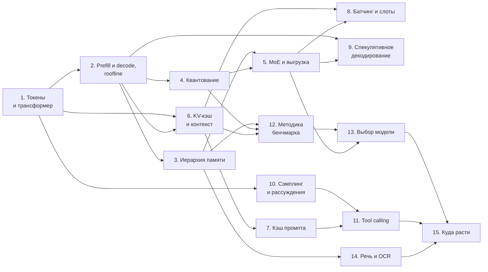

# Локальный инференс LLM: от понятий до тюнинга на своём ПК

Эта книга — самостоятельный курс о том, как большая языковая модель (LLM) работает на обычном компьютере: что происходит внутри, почему генерация упирается в память, как квантование и MoE позволяют запустить 30–70-миллиардную модель на потребительской видеокарте и как всё это измерить, чтобы не обмануть себя.

Она не привязана к конкретному проекту, фреймворку или модели. Примеры — учебные: «карта на 16 ГБ», «модель на 35 млрд параметров», «Mac с объединённой памятью». Числа в расчётах взяты типичные и явно помечены как пример, если это не свойство стандарта или документации.

## Для кого

- Вы умеете запускать `llama-server` или Ollama, но хотите понимать, что означают флаги и почему скорость именно такая.
- Вы читаете карточки моделей и бенчмарки, но не понимаете, какие цифры относятся к вам.
- Вы хотите сами подобрать квант, контекст и конфигурацию под своё железо, а не повторять чужие команды.

Предполагается базовое знакомство с Python и матричным умножением. Всё остальное объясняется по ходу.

## Как читать

Книга устроена как последовательность: первые восемь глав дают модель мышления, без которой тюнинг превращается в перебор флагов; главы 9–11 — про ускорение и управление генерацией; главы 12–13 — про измерения и выбор модели; 14 — коротко про речь и OCR; 15 — куда двигаться дальше.

### Карта книги

Стрелка A → B означает, что глава B опирается на главу A: перед главой полезно прочитать те, из которых в неё входят стрелки.

### Три маршрута

| Маршрут | Главы | Кому |
|---|---|---|
| **Быстро** | 1, 2, 4, 6, 12 | Понять, почему медленно, и начать мерить. Хватит выходных. |
| **Практик** | 1–6, 8, 12, 13, затем 7, 9, 11 по задаче | Подобрать модель, квант и флаги под своё железо; агентам — обязательно 7 и 11. |
| **Подробно** | все по порядку + [источники](sources.md) | Разобраться в устройстве и литературе. |

Если торопитесь, в каждой главе можно прочитать только блок «За 30 секунд» и «Ключевые идеи» — получится конспект всей книги на 15 минут.

### Что есть в каждой главе

- **За 30 секунд** — 3–4 главные мысли в самом начале;
- **Посчитай сам** — небольшая задача с разобранным решением (раскрывается по клику);
- выноски-алерты GitHub (**Note**, **Tip**, **Warning**) — частые ошибки и практические советы; на сайте они оформлены так же, как на GitHub;
- **Ключевые идеи** — что забрать с собой;
- **Проверь себя** — 3–5 вопросов, ответы в конце главы;
- **Источники главы** — что читать дальше и зачем.

Схемы нарисованы в Mermaid прямо в тексте. Графики лежат в [`figures/`](figures/) и построены скриптами из [`figures/src/`](figures/src/) — только по формулам книги, без замеров; пересобрать их можно командой `MPLBACKEND=Agg python3 -I figures/src/build_all.py` (нужен matplotlib).

Полная аннотированная библиография — в [sources.md](sources.md), краткие определения терминов — в [глоссарии](16-glossary.md).

## Оглавление

1. [Токены, эмбеддинги и трансформер на пальцах](01-tokens-embeddings-transformer.md)
2. [Prefill и decode: почему генерация упирается в память](02-prefill-decode-roofline.md)
3. [Иерархия памяти: VRAM, PCIe, ОЗУ, диск и mmap](03-memory-hierarchy-mmap.md)
4. [Квантование весов: GGUF, k-quants, imatrix](04-quantization-gguf.md)
5. [MoE: эксперты, роутинг и выгрузка в ОЗУ](05-moe.md)
6. [KV-кэш, контекстное окно и позиционные кодировки](06-kv-cache-context.md)
7. [Кэш промпта и агентские нагрузки](07-prompt-cache.md)
8. [Батчинг, слоты и PagedAttention](08-batching-vllm.md)
9. [Спекулятивное декодирование: черновик, MTP, acceptance rate](09-speculative-decoding.md)
10. [Сэмплинг, температура и бюджет рассуждений](10-sampling-reasoning.md)
11. [Вызов инструментов: шаблоны чата, грамматики, JSON Schema](11-tool-calling.md)
12. [Методика бенчмарка и тюнинга](12-benchmark-methodology.md)
13. [Выбор модели под железо](13-model-selection.md)
14. [Речь и OCR локально](14-speech-ocr.md)
15. [Куда расти](15-where-to-go-next.md)

Приложение: [Глоссарий](16-glossary.md) — короткие определения всех терминов.

## Соглашения

- **ГиБ** — гибибайты (1 ГиБ = 1,0737 ГБ), **ГБ** — десятичные. В формулах памяти удобнее ГиБ, в размерах файлов производители часто пишут ГБ.
- **ток/с** — токенов в секунду; **pp** (prompt processing) — обработка промпта, **tg** (text generation) — генерация.
- **Q4_K_M**, **IQ4_XS**, **UD-Q4_K_M** — названия квантов GGUF; разбираются в главе 4.
- Пометка **[пример]** означает вымышленные, но правдоподобные числа для иллюстрации; **[оценка]** — расчёт по формуле, а не измерение. Подпись «Расчёт» на графике означает то же самое.
- Все ссылки проверены на момент написания. Если источник самозаявленный (карточка модели, блог вендора), это сказано явно.

## Чего здесь нет

- Обучения моделей с нуля и тонкой настройки: книга про инференс.
- Сравнения «какая модель самая умная»: такого универсального ответа нет, а глава 13 объясняет почему.
- Готовых конфигов под конкретную видеокарту: их надо подбирать по методике из главы 12.
