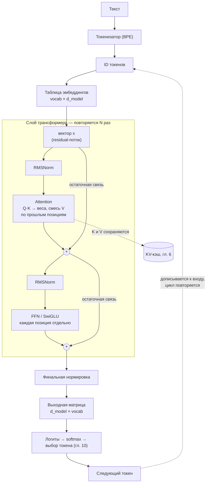

# 1. Токены, эмбеддинги и трансформер на пальцах

> **Зачем эта глава.** Почти все странности локального инференса — размер файла, скорость, требование к памяти — растут из трёх вещей: модель хранит миллиарды чисел, на каждый токен читает их из памяти и делает это последовательно. Чтобы это увидеть, нужно представлять, что именно лежит в файле модели.

> **За 30 секунд**
> - Модель работает с токенами — кусками слов; скорость и контекст считают в токенах.
> - Каждый токен проходит через стопку одинаковых слоёв: attention смешивает информацию между позициями, FFN обрабатывает каждую позицию отдельно.
> - Параметров в слое ≈ `12 d²`, размер файла ≈ параметры × байт на параметр.
> - На каждый новый токен модель читает из памяти все свои (активные) веса — отсюда все ограничения по памяти и скорости.

## 1.1 Токены: единица работы модели

Модель не видит буквы и не видит слова. Текст сначала режется на **токены** — куски, которые встречаются в обучающем корпусе достаточно часто. Алгоритм чаще всего один и тот же: **BPE** (byte-pair encoding) или его варианты. Он начинает с отдельных байтов и постепенно склеивает частые пары в более длинные фрагменты.

Примерно так выглядит разбиение фразы:

```
"локальный инференс" → ["лок", "альный", " ин", "ферен", "с"]
```

Это не точное разбиение конкретного токенизатора, а иллюстрация: частые части слова становятся одним токеном, редкие — дробятся на несколько. У современных моделей словарь (**vocabulary**) содержит от 32 тысяч до 256 тысяч токенов. Чем больше словарь, тем короче текст в токенах, но тем больше весит выходной слой модели.

Два следствия, важных для практики:

1. **Токен — не слово.** «Технические условия» может стать 3–6 токенами, а может и 10 — зависит от токенизатора и языка.
2. **Русский текст обычно дороже английского.** Русские словоформы реже попадают в словарь целиком, поэтому на одну и ту же мысль уходит больше токенов. Прикидка: английский текст — примерно 1,3 токена на слово, русский технический — 2–3 токена на слово. Это именно прикидка: точное число зависит от модели и текста.

Токены важны потому, что **все скорости измеряются в токенах в секунду**, а **все лимиты контекста — в токенах**, а не в символах и не в страницах.

## 1.2 Эмбеддинг: токен становится вектором

Каждому токену соответствует строка в большой таблице **эмбеддингов** (embedding matrix). Если в словаре 128 тысяч токенов, а размерность модели 4096, таблица содержит

```
128 000 × 4096 ≈ 524 млн чисел
```

При 16 битах на число это около 1 ГиБ только на входную таблицу. У некоторых моделей входная и выходная таблицы — это одна и та же матрица (**tied embeddings**), у некоторых — две разные; это видно по числу параметров в карточке.

Полученный вектор — это и есть представление токена, с которым дальше работает сеть. Он сам по себе ничего не «значит»: смысл появляется из комбинации с позицией и контекстом.

## 1.3 Один слой трансформера

Модель — стопка одинаковых слоёв (обычно от 24 до 80+). В каждом слое два основных блока.

Сначала несколько понятий, которые понадобятся дальше. **`d_model`** — ширина вектора, с которым работает слой (обычно 2048–8192). **`d_head`** — ширина одной головы attention; обычно 64–128, а `d_head = d_model / число_голов`. Больше голов — больше независимых подпространств, но каждая голова уже.

**Softmax** — функция, которая превращает произвольные числа в вероятности: возводит каждое в экспоненту и делит на сумму. Результат неотрицателен и в сумме даёт единицу.

### Attention: обмен информацией между позициями

Для каждого токена из его вектора вычисляются три вектора:

- **Query (Q)** — «что я ищу»;
- **Key (K)** — «что я могу предложить»;
- **Value (V)** — «какую информацию я передаю, если меня выберут».

Это делается умножением на три матрицы: `Wq`, `Wk`, `Wv`. Затем для токена `i` считается, насколько он похож на каждый предыдущий токен `j`:

```
score(i, j) = (Q_i · K_j) / sqrt(d_head)
```

Деление на корень из размерности головы нужно, чтобы масштаб скалярных произведений не рос вместе с `d_head` и softmax не становился слишком «острым».

К результатам применяется **causal mask** — запрет смотреть на будущие токены: позиции справа от текущей получают минус бесконечность до softmax. Иначе предсказание следующего токена потеряло бы смысл. После маски — softmax по всем допустимым `j`, и выход:

```
out_i = сумма_j softmax(score(i, j)) × V_j
```

То есть каждый токен собирает взвешенную смесь значений предыдущих токенов. Веса — это и есть «внимание».

**Multi-head attention.** Вместо одного набора Q/K/V используется несколько **голов**. При `d_model = 4096` и 32 головах размер одной головы `d_head = 128`. Каждая голова учится на своём подпространстве, потом результаты склеиваются и проходят через выходную матрицу `Wo`.

Именно на этом шаге появляется **KV-кэш**: чтобы не пересчитывать K и V прошлых токенов заново, их сохраняют. Если несколько Q-голов делят одну пару K/V, это **grouped-query attention (GQA)** — она уменьшает KV-кэш в несколько раз. Обе темы подробно разобраны в главе 6.

### FFN: преобразование каждой позиции отдельно

После attention вектор каждого токена независимо проходит через **feed-forward network**:

```
h = активация(x · W1)
y = h · W2
```

Обычно внутренняя размерность `d_ff` в 4 раза больше `d_model`, то есть при 4096 это 16 384. В современных моделях часто используют **SwiGLU** — вариант с «воротами»: одна матрица даёт значение, другая — коэффициент пропускания, и они перемножаются; поэтому матриц три, а `d_ff` берут примерно `8/3 · d_model`, чтобы число параметров осталось прежним.

В FFN хранится значительная часть «знаний» модели. У плотной (dense) модели на каждом токене работают все веса FFN. У **MoE** (mixture of experts) — только несколько «экспертов»; об этом глава 5.

### Остаточные связи и нормировка

Вокруг каждого блока есть **residual connection**: `x = x + block(x)`. Она позволяет сигналу и градиенту проходить через десятки слоёв, не затухая. Перед блоками стоит нормировка: **LayerNorm** вычитает среднее и делит на стандартное отклонение, а **RMSNorm** — более дешёвый вариант, который делит только на среднеквадратичное значение, без вычитания среднего. Для инференса важно, что residual-поток — это вектор размерности `d_model`, который переносится от слоя к слою; он маленький по сравнению с весами.

### Слой целиком

Вот как всё это складывается в путь одного токена — от текста до следующего токена:



Обратите внимание на пунктирную петлю внизу: чтобы получить следующий токен, весь путь через все слои проходится заново. Из этой петли и вырастает вся глава 2.

## 1.4 Сколько параметров и откуда берётся размер файла

Оценим число параметров одного слоя при `d_model = d`:

| Компонент | Параметров |
|---|---:|
| `Wq`, `Wk`, `Wv`, `Wo` | `4 d²` |
| FFN с расширением 4× (две матрицы) | `8 d²` |
| **Итого на слой** | **`12 d²`** |

Плюс эмбеддинги `vocab × d` и выходной слой (иногда связанный с эмбеддингами).

Пример: `d = 4096`, 32 слоя.

```
32 × 12 × 4096² ≈ 6,4 млрд параметров
эмбеддинги: 128 000 × 4096 ≈ 0,52 млрд
итого ≈ 7 млрд
```

Так получается модель класса 7B. У 70B-модели та же логика, но больше слоёв и шире размерность.

> [!NOTE]
> Формула `12 d²` — упрощение для FFN с расширением 4× и обычного multi-head attention. SwiGLU с `d_ff ≈ 8/3 · d` даёт те же `8 d²` на FFN, а GQA немного уменьшает `Wk` и `Wv`. Для прикидки размера модели этой точности хватает.

Дальше просто: **размер файла ≈ число параметров × байт на параметр**. В FP16 это 2 байта, в реальном 4-битном кванте Q4_K_M — около 0,6 байта (4,8 бита) с учётом масштабов. Поэтому 7B в FP16 весит ~14 ГБ, а в Q4_K_M — ~4,2 ГБ. Именно это делает возможным запуск на потребительской карте; подробности и таблица форматов — в главе 4.

> [!WARNING]
> Размер файла — это ещё не вся нужная память. Сверху добавляются KV-кэш (растёт с длиной контекста, глава 6) и рабочие буферы рантайма. Модель «на 4,2 ГБ» в карту на 4 ГБ не поместится.

**Посчитай сам.** Модель [пример]: `d = 5120`, 40 слоёв, словарь 32 000 токенов, входная и выходная таблицы раздельные. Сколько в ней параметров и сколько весит файл в Q4_K_M?

<details>
<summary>Решение</summary>

```
слои:      40 × 12 × 5120² = 40 × 12 × 26,2 млн ≈ 12,6 млрд
таблицы:   2 × 32 000 × 5120 ≈ 0,33 млрд
итого      ≈ 12,9 млрд → модель класса 13B
Q4_K_M:    12,9 млрд × 0,6 байта ≈ 7,7 ГБ (≈ 7,2 ГиБ)
FP16:      12,9 млрд × 2 байта  ≈ 26 ГБ
```

В Q4_K_M такая модель помещается в карту на 12 ГБ — с запасом под KV-кэш, — а в FP16 не помещается даже в 24 ГБ.
</details>

## 1.5 Как из вектора получается следующий токен

Последний слой выдаёт вектор размерности `d_model`. Его умножают на выходную матрицу `vocab × d_model` и получают **логиты** — по одному числу на каждый токен словаря. Затем softmax превращает их в вероятности, и специальный алгоритм выбирает токен (глава 10).

Важно: модель всегда выдаёт распределение по **всему словарю**, даже если ответ очевиден. Для словаря 128 тысяч это 128 тысяч чисел на каждый шаг — немного по сравнению с чтением весов, но заметно, если словарь огромный.

## 1.6 Что из этого следует для инференса

Три вывода, которые дальше будут повторяться:

1. **Память под веса фиксирована.** Модель не «подгружает знания по мере надобности»: все параметры должны быть доступны на каждом шаге (у MoE — не все, но об этом позже).
2. **Вычисления на токен примерно равны `2 × N` операций**, где `N` — число активных параметров: одно умножение и одно сложение на вес. Одна такая операция называется **FLOP** (floating point operation); для 7B это ~14 млрд FLOP на токен.
3. **Но главное — не операции, а байты.** На каждый токен нужно прочитать веса из памяти. Соотношение «операций на байт» и определяет, во что упирается модель. Это тема следующей главы.

## Ключевые идеи

- Текст режется на токены; скорость и контекст измеряются в токенах, а не в словах.
- Токен становится вектором; вектор проходит через стопку слоёв, в каждом — attention и FFN.
- Attention смешивает информацию между позициями, FFN преобразует каждую позицию отдельно.
- Число параметров слоя ≈ `12 d²`; размер файла ≈ параметры × байт на параметр.
- Модель хранит все веса и читает их на каждом шаге генерации — отсюда все ограничения по памяти и скорости.

## Проверь себя

1. Почему число параметров и число операций на один токен — не одно и то же?
2. При `d_model = 8192` и 80 слоях сколько примерно параметров в блоках трансформера (без эмбеддингов)?
3. Зачем в attention делят на `sqrt(d_head)`?
4. Почему русский текст может быть медленнее английского при одинаковой скорости в ток/с?
5. Где в трансформере хранится большая часть параметров у плотной модели?

## Ответы

1. Плотная модель 35B выполняет на токен примерно `2 × 35 = 70` млрд операций: на каждый вес приходится умножение и сложение, это два FLOP. Поэтому у плотной модели операций на токен примерно вдвое больше, чем параметров. У MoE к этому добавляется второй слой различия: хранятся все параметры, а на токен активируется лишь часть экспертов, поэтому операций ещё меньше.
2. `80 × 12 × 8192² ≈ 64 млрд` параметров. Это модель класса 70B.
3. Скалярное произведение Q и K растёт с размерностью; без масштабирования softmax становится слишком резким, а градиенты — плохо обусловленными. Деление на `sqrt(d_head)` возвращает дисперсию к единице.
4. Русские слова чаще дробятся на несколько токенов, поэтому на ту же фразу уходит больше токенов. При одинаковом ток/с русский текст выдаётся медленнее в пересчёте на слова и символы.
5. В FFN: при расширении 4× на неё приходится `8 d²` из `12 d²`, то есть две трети параметров слоя.

## Источники главы

- **Vaswani et al., «Attention Is All You Need» (2017)** — [arXiv:1706.03762](https://arxiv.org/abs/1706.03762). Первоисточник архитектуры; читать после объяснения, чтобы увидеть точные формулы.
- **Andrej Karpathy, «Let's build GPT: from scratch, in code, spelled out» (2023)** — [YouTube](https://www.youtube.com/watch?v=kCc8FmEb1nY). Пошаговая реализация tiny-трансформера; лучший способ «пощупать» главу.
- **3Blue1Brown, «Transformers, the tech behind LLMs» (глава 5) и «Attention in transformers, step-by-step» (глава 6)** — [видео 1](https://www.youtube.com/watch?v=wjZofJX0v4M), [видео 2](https://www.youtube.com/watch?v=eMlx5fFNoYc). Визуальная интуиция attention без формул.
- **Stanford CS336, «Language Modeling from Scratch»** — [курс](https://stanford-cs336.github.io/). Лекции и задания по токенизации, архитектуре и обучению; полезно для систематического изучения.
- **Dive into Deep Learning, главы про attention и трансформеры** — [d2l.ai](https://d2l.ai/). Бесплатный учебник с кодом.
- **Lilian Weng, «The Transformer Family Version 2.0» (2023)** — [пост](https://lilianweng.github.io/posts/2023-01-27-the-transformer-family-v2/). Обзор вариантов attention и нормализаций.
