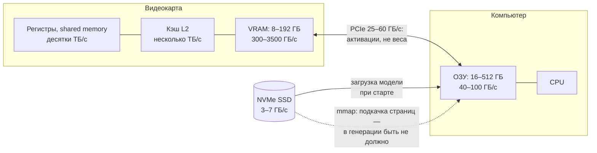

# 3. Иерархия памяти: VRAM, PCIe, ОЗУ, диск и mmap

> **Зачем эта глава.** Локальный инференс — это в первую очередь задача о том, где лежат веса и как быстро их можно прочитать. Понимание иерархии объясняет, почему 35-миллиардная модель может работать с приличной скоростью на 16 ГБ видеопамяти, а может внезапно упасть в 15 раз медленнее.

> **За 30 секунд**
> - Память — это лестница: регистры → VRAM → ОЗУ → PCIe → диск. Каждая ступень больше, но медленнее.
> - Скорость декода задаёт самая медленная ступень, с которой читаются веса.
> - Выгруженные в ОЗУ веса выгоднее считать на CPU, чем гонять по PCIe.
> - Главные ловушки: mmap для CPU-весов и тихая выгрузка VRAM в системную память на Windows.

## 3.1 Лестница памяти

Данные в компьютере живут на разных уровнях, и каждый следующий уровень больше, но медленнее.

| Уровень | Объём | Пропускная способность | Задержка |
|---|---:|---:|---:|
| Регистры / shared memory GPU | килобайты–мегабайты | десятки ТБ/с | единицы наносекунд |
| Кэш L2 GPU | десятки МБ | несколько ТБ/с | ~100–200 нс |
| **VRAM** (GDDR/HBM) | 8–192 ГБ | 300–3500 ГБ/с | ~300–800 нс |
| **ОЗУ** (DDR) | 16–512 ГБ | 40–100 ГБ/с | ~80–120 нс |
| **PCIe** между GPU и ОЗУ | — | 25–60 ГБ/с | микросекунды |
| **NVMe SSD** | терабайты | 3–7 ГБ/с | десятки микросекунд |
| HDD / сеть | терабайты | 0,1–1 ГБ/с | миллисекунды |

Числа — порядки величин для потребительского железа. Точные значения зависят от модели карты, числа каналов памяти и версии PCIe.

Та же лестница в виде схемы — с тем, что по какому пути ходит при инференсе:



Чем дальше уровень от регистров GPU, тем он медленнее. Хорошая конфигурация держит активные веса как можно ближе к вычислителю, который их использует.

Обратите внимание: у VRAM выше **пропускная способность**, но не обязательно ниже **задержка**. Доступ к одному случайному значению в GDDR может занимать сотни наносекунд — сравнимо с DDR или даже дольше. Для декода это не главное: веса читаются потоком, и важна именно пропускная способность. А для случайного доступа к экспертам задержка уже имеет значение.

Ключевое отношение: **VRAM в 5–15 раз быстрее ОЗУ и в десятки раз быстрее PCIe**. Поэтому «положить веса в ОЗУ и читать их на GPU» — плохая идея: вы меняете быструю память на медленную шину.

## 3.2 Что происходит при декоде

На каждом токене нужно прочитать все активные веса. Если они в VRAM, чтение идёт на сотни гигабайт в секунду. Если часть в ОЗУ, есть два варианта:

1. **Перегнать веса по PCIe на GPU и посчитать там.** Тогда на каждый токен 8 ГБ весов поедут по шине 25 ГБ/с — это `8 / 25 ≈ 0,32 с` только на передачу, то есть максимум ~3 ток/с, и это без вычислений.
2. **Посчитать эти веса на CPU прямо в ОЗУ.** Тогда чтение идёт на скорости ОЗУ (40–100 ГБ/с), что в 2–4 раза быстрее PCIe, но всё равно в 5–15 раз медленнее VRAM.

Именно поэтому в llama.cpp выгрузка экспертов MoE (`--n-cpu-moe`) считает выгруженную часть **на CPU**, а не гоняет её туда-обратно. По PCIe передаются только маленькие активации: вектор размерности `d_model` на слой, а не матрицы весов.

## 3.3 mmap: удобно, но коварно

**mmap** (memory-mapped file) — способ не читать файл целиком, а «отобразить» его в адресное пространство. Операционная система подгружает страницы с диска по мере обращения. Это удобно: программа стартует быстро, а память расходуется лениво.

Для инференса это создаёт проблему.

- **Веса на GPU** копируются в VRAM один раз, и mmap для них почти не важен.
- **Веса, которые считаются на CPU** (например, выгруженные эксперты), читаются на каждом токене и в случайном порядке. Если страницы вытеснены из page cache, каждое обращение — это чтение с диска. Скорость падает не на проценты, а в разы.

Симптом: prefill в несколько раз медленнее ожидаемого, свободная ОЗУ почти нулевая, диск активно читается. Лечение — загрузить модель в память явно:

- в llama.cpp: `--load-mode none` (короткая форма `-lm none`), при необходимости `--mlock`;
- в других рантаймах — аналогичные флаги «держать модель в RAM».

Старый флаг `--no-mmap` в современных сборках llama.cpp убран; если он ещё работает в вашей версии, считайте это совместимостью, а не рекомендацией. Проверьте `--help` своей сборки: семантика режимов загрузки менялась.

Цена — более долгий старт (десятки секунд вместо секунд) и занятая ОЗУ. Для постоянно работающего сервера это нормальный размен.

## 3.4 Тихая выгрузка в системную память

На Windows драйвер NVIDIA по умолчанию включает **sysmem fallback**: если видеопамять закончилась, данные молча размещаются в системной ОЗУ, а GPU читает их через PCIe. Приложение не получает ошибку «out of memory» — оно просто становится очень медленным.

Это одна из самых частых причин «модель запустилась, но выдаёт 3 ток/с». Признаки:

- занятая VRAM упирается в предел карты;
- свободная ОЗУ падает;
- скорость на порядок ниже расчётной;
- `nvidia-smi` показывает высокую загрузку шины.

> [!WARNING]
> **Запас VRAM.** Оставляйте 1,5–2 ГБ видеопамяти свободными и смотрите пик потребления под нагрузкой — на длинном промпте и со всеми слотами, — а не только сразу после загрузки модели. Это правило действует для всей книги; главы 12 и 13 на него ссылаются.

На Linux такого тихого fallback обычно нет, и вы получите ошибку — это лучше, чем молчаливая деградация.

## 3.5 Объединённая память: Mac и интегрированные GPU

У Apple Silicon и некоторых интегрированных решений нет отдельной VRAM: CPU и GPU используют один пул **объединённой памяти** (unified memory). Это даёт два преимущества:

- не нужно копировать веса по PCIe — GPU читает их из того же пула;
- можно держать модель больше видеопамяти дискретной карты: 64–128 ГБ против 16–24 ГБ.

Но есть ограничения:

- пропускная способность ниже, чем у топовых дискретных карт: сотни ГБ/с против 1–3 ТБ/с;
- память делится с системой и приложениями;
- вычисления на GPU слабее, чем у дискретной карты того же ценового уровня.

Для декода, который упирается в память, объединённая память с 400–800 ГБ/с может быть вполне конкурентоспособна на моделях, которые целиком помещаются. Для prefill, который упирается в вычисления, дискретная карта обычно быстрее.

## 3.6 Диск: загрузка, а не работа

NVMe SSD со скоростью 3–7 ГБ/с кажется быстрым, но на фоне VRAM это в сотни раз медленнее. Диск влияет на:

- **время загрузки модели**: 20 ГБ файл читается 3–7 секунд теоретически, на практике дольше;
- **первый запуск после вытеснения страниц**;
- **подкачку, если модель не помещается в ОЗУ**.

В установившемся режиме диск не должен участвовать в генерации. Если он участвует — значит, модель не помещается в память или mmap работает против вас.

## 3.7 Практическая арифметика выгрузки

Пример: модель 70B в Q4_K_M, около 42 ГБ. Карта 16 ГБ, ОЗУ 64 ГБ. Нужно выгрузить примерно 28 ГБ, оставив в VRAM около 14 ГБ под веса, KV и буферы.

Если считать выгруженную часть на CPU:

```
28 ГБ на токен / 50 ГБ/с ≈ 0,56 с
```

Это потолок около 1,8 ток/с, и он почти не зависит от того, насколько быстрая видеокарта: узкое место — ОЗУ и CPU.

Если выгрузить только 8 ГБ (на карте, где в VRAM помещается 34 ГБ):

```
8 / 50 ≈ 0,16 с → потолок ~6 ток/с
```

Отсюда правило: **чем меньше выгружено, тем лучше**, а выгрузка — компромисс между объёмом модели и скоростью. Для MoE это работает хорошо, потому что на токен нужна лишь часть экспертов; для плотной модели выгрузка почти всегда означает кратное падение скорости.

**Посчитай сам.** Та же модель 70B в Q4_K_M (42 ГБ), но карта на 24 ГБ с пропускной способностью 1 ТБ/с [пример]. В VRAM кладём 20 ГБ весов (4 ГБ остаются под KV-кэш и буферы), остальное считается на CPU при 60 ГБ/с. Каков потолок декода и какая часть времени уходит на GPU?

<details>
<summary>Решение</summary>

```
GPU:  20 ГБ / 1000 ГБ/с = 0,02 с
CPU:  22 ГБ / 60 ГБ/с   ≈ 0,37 с
итого ≈ 0,39 с на токен → потолок ≈ 2,6 ток/с
```

На GPU уходит около 5% времени. Даже бесконечно быстрая видеокарта подняла бы потолок лишь до `1 / 0,37 ≈ 2,7 ток/с`. Ускорять здесь надо не карту, а объём выгрузки: взять квант поменьше, MoE-модель или машину с большей VRAM.
</details>

## Ключевые идеи

- Иерархия памяти: VRAM быстрее ОЗУ в 5–15 раз, PCIe — в десятки раз медленнее VRAM. Скорость декода задаёт самый медленный уровень, с которого читаются веса.
- Выгруженные веса надо считать там, где они лежат: по PCIe ходят активации, а не матрицы.
- mmap откладывает загрузку и может привести к чтению весов с диска на каждом токене.
- Windows может молча выгрузить часть модели в системную память; следите за пиком VRAM.
- Объединённая память Apple — не «магически быстрая», а другой компромисс: больше объём и нет копирования, но пропускная способность ниже, чем у топовых дискретных карт.

## Проверь себя

1. Почему выгоднее считать выгруженные эксперты на CPU, а не передавать их на GPU?
2. Модель 20 ГБ, VRAM 16 ГБ, ОЗУ 32 ГБ. Что произойдёт на Windows при нехватке VRAM и как это заметить?
3. Зачем `--load-mode none`, если mmap экономит память?
4. У Mac 64 ГБ объединённой памяти и 500 ГБ/с. Можно ли запустить модель 70B в Q4_K_M целиком и с какой примерно скоростью?
5. Почему быстрый NVMe не спасает, если модель не помещается в ОЗУ?

## Ответы

1. Передача 28 ГБ по PCIe со скоростью 25 ГБ/с занимает больше секунды на токен — это порядка 1 ток/с. CPU читает те же данные из ОЗУ на 40–100 ГБ/с, то есть в 2–4 раза быстрее, и не тратит время на копирование.
2. Драйвер молча разместит не влезшее в системной памяти, и генерация замедлится в разы. Заметить можно по пику VRAM у предела, падению свободной ОЗУ, активности диска/шины и скорости, которая ниже расчётной в 5–15 раз.
3. При mmap страницы файла подкачиваются по мере обращения. Для весов, которые считаются на CPU в случайном порядке, это означает чтение с диска. `--load-mode none` загружает их в ОЗУ один раз и убирает этот эффект.
4. 70B в Q4_K_M — около 42 ГБ, то есть по объёму помещается, но на систему остаётся ~22 ГБ. По скорости: `500 / 42 ≈ 12 ток/с` теоретически, реально примерно 6–9 ток/с, если память не делится с другими приложениями.
5. Если модель не помещается в ОЗУ, ОС будет вытеснять страницы на диск и подкачивать их обратно. Скорость тогда определяется диском (3–7 ГБ/с), а не ОЗУ, и падает на порядок.

## Источники главы

- **Alizadeh et al., «LLM in a flash: Efficient LLM Inference with Limited Memory» (2023)** — [arXiv:2312.11514](https://arxiv.org/abs/2312.11514). Про выгрузку весов на флеш-память и цену чтения с диска; не путать со StreamingLLM (Xiao et al., attention sinks), которая разбирается в главе 6.
- **llama.cpp, `tools/server/README.md`** — [GitHub](https://github.com/ggml-org/llama.cpp/blob/master/tools/server/README.md). Флаги `--load-mode`, `--mlock`, `--n-cpu-moe`; старый `--no-mmap` в новых сборках отсутствует.
- **GGUF specification** — [ggml/docs/gguf.md](https://github.com/ggml-org/ggml/blob/master/docs/gguf.md). Как устроен файл модели и его метаданные.
- **llama.cpp Discussion #4167, «Performance of llama.cpp on Apple Silicon M-series»** — [GitHub](https://github.com/ggml-org/llama.cpp/discussions/4167). Практические замеры на объединённой памяти.
- **Apple, Mac Studio — Technical Specifications** — [apple.com](https://www.apple.com/mac-studio/specs/). Пропускная способность объединённой памяти M5 Max/Ultra.
- **Ulrich Drepper, «What Every Programmer Should Know About Memory» (2007)** — [PDF](https://people.freebsd.org/~lstewart/articles/cpumemory.pdf). Классика про кэши, задержки и пропускную способность; глубже, чем нужно для начала.
