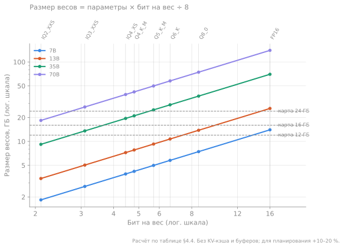

# 4. Квантование весов: GGUF, k-quants, imatrix

> **Зачем эта глава.** Квантование — главный трюк, который позволяет запустить модель на потребительской видеокарте. Но названия вроде `Q4_K_M`, `IQ3_XXS` и `UD-Q4_K_M` выглядят как случайный набор букв, а разница между ними — это разница между «работает» и «работает, но врёт в числах».

> **За 30 секунд**
> - Квантование хранит веса меньшим числом бит с масштабом на каждый блок; «4-битный» Q4_K_M на деле занимает ~4,8 бита на вес.
> - Меньше байт — меньше памяти и быстрее декод: Q4_K_M в 3,3 раза легче FP16.
> - Начинайте с `Q4_K_M`; есть запас памяти — поднимайтесь до Q5/Q6, нет — пробуйте `IQ4_XS`.
> - Ниже 4 бит проверяйте качество на своих задачах: первыми ломаются числа, JSON и вызовы инструментов.

## 4.1 Зачем сжимать веса

Веса модели — это миллиарды чисел. В FP16 каждое занимает 2 байта, поэтому 7B-модель весит 14 ГБ, а 70B — 140 ГБ. Для декода важно не только место, но и **сколько байт читается на каждый токен**: скорость обратно пропорциональна объёму.

Сжатие до Q4_K_M (около 4,8 бита) уменьшает и память, и трафик примерно в 3,3 раза по сравнению с FP16. Именно поэтому 7B в Q4_K_M весит ~4,2 ГБ и может генерировать в разы быстрее, чем та же модель в FP16, — при условии, что качество не пострадало.

## 4.2 Как устроено блочное квантование

Самая простая схема — **аффинное квантование**:

```
w_q = round(w / s) + z
w   ≈ s × (w_q − z)
```

где `s` — масштаб (scale), `z` — смещение (zero point). Если хранить один масштаб на всю матрицу, ошибка будет большой: веса имеют разный размах в разных частях матрицы.

Поэтому веса делят на **блоки** (обычно 32, 64 или 128 чисел), и у каждого блока свой масштаб. Чем меньше блок, тем точнее, но тем больше служебных данных: масштаб тоже надо хранить.

Схема с блоками:

```
[ 32 веса ][ 32 веса ][ 32 веса ] ...
   scale      scale      scale
```

При 4 битах на вес и 32 весах в блоке один FP16-масштаб добавляет `16 / 32 = 0,5` бита на вес. Итого ~4,5 бита. Отсюда реальные 4,5–4,9 бита у «4-битных» форматов.

## 4.3 Форматы GGUF

**GGUF** — формат файла, придуманный в проекте ggml/llama.cpp. В одном файле лежат:

- тензоры весов (в выбранных типах квантования);
- метаданные: архитектура, число слоёв, размерности, контекст;
- токенизатор;
- шаблон чата (chat template);
- при необходимости — данные для мультимодальности.

Метаданные позволяют рантайму понять модель без отдельных конфигов. Именно поэтому GGUF стал де-факто стандартом для локального инференса.

Основные семейства квантов в llama.cpp:

| Семейство | Идея | Примеры |
|---|---|---|
| `Q*_0`, `Q*_1` | раннее простое блочное квантование | `Q4_0`, `Q4_1`, `Q8_0` |
| `Q*_K` | **k-quants**: суперблоки и квантованные масштабы | `Q4_K_M`, `Q5_K_M`, `Q6_K` |
| `IQ*` | **i-quants**: кодовые книги и решётки, часто с imatrix (подробнее в §4.6) | `IQ3_XXS`, `IQ4_XS` |
| `UD-*` | динамический выбор типов по тензорам (Unsloth) | `UD-Q4_K_M` |

### K-quants

В k-quants веса группируются в **суперблок** из 256 значений, внутри — подблоки (у `Q4_K` — 8 по 32). Масштабы подблоков хранятся в сжатом виде, а не как полные FP16. Это даёт лучшее качество при том же размере, чем простое блочное квантование.

Буква после `Q4_K` означает режим смешивания:

- `S` (small) — сильнее сжимает, часть тензоров в более низком бите;
- `M` (medium) — компромисс: важные тензоры точнее, остальные грубее;
- `L` (large) — больше точных тензоров, файл больше.

Поэтому `Q4_K_M` — не «ровно 4 бита», а смесь: где-то 4, где-то 5–6 бит. Среднее — около 4,8 бита на вес.

> [!TIP]
> Название кванта читается по частям: `Q4_K_M` — «около 4 бит, семейство k-quants, режим medium»; `IQ4_XS` — «i-quant, около 4 бит, extra small»; `UD-` спереди — рецепт Unsloth Dynamic поверх обычных типов.

### I-quants

`IQ`-форматы используют кодовые книги (наборы типовых векторов) и решётки. Они лучше сохраняют качество на очень низких битах (2–3), но:

- требуют **imatrix** для хорошего результата;
- медленнее распаковываются на некоторых бэкендах;
- сильнее зависят от реализации.

Для 4-битного уровня `IQ4_XS` (около 4,4–4,5 бита) часто оказывается чуть меньше `Q4_K_M` при сопоставимом качестве, но это надо проверять на своей модели и задачах.

### GGUF и другие форматы

GGUF — не единственный способ сжать модель. Краткая карта:

| Формат | Где обычно используется | Особенности |
|---|---|---|
| **GGUF** | llama.cpp, Ollama, LM Studio | Много квантов, CPU/GPU-гибрид, выгрузка экспертов |
| **safetensors** | исходные веса, Transformers | Не сжат для инференса; нужен движок и отдельное квантование |
| **AWQ / GPTQ** | vLLM, TGI, GPU-серверы | Обычно 4-битные веса, калибровка, обычно без CPU-выгрузки |
| **EXL2** | ExLlamaV2 | Смешанная точность по слоям, только NVIDIA (CUDA) |
| **MLX** | Apple Silicon | Использует объединённую память, свои кванты |
| **FP8** | Hopper/Ada, vLLM, TensorRT-LLM | Почти без потерь, нужна поддержка железа |

Правило выбора простое: одна карта и нужен CPU-offload — GGUF; сервер на NVIDIA и важна пропускная способность — AWQ/FP8 в vLLM; Mac — MLX или GGUF через Metal.

## 4.4 Сколько это весит

Приблизительные биты на вес и размеры. Это **та самая конвенция**, на которую опираются расчёты в главах 2, 3 и 13:

| Формат | Бит/вес | 7B | 13B | 35B | 70B |
|---|---:|---:|---:|---:|---:|
| FP16 | 16,0 | 14 ГБ | 26 ГБ | 70 ГБ | 140 ГБ |
| Q8_0 | ~8,5 | 7,4 ГБ | 13,8 ГБ | 37 ГБ | 74 ГБ |
| Q6_K | ~6,6 | 5,8 ГБ | 10,7 ГБ | 29 ГБ | 58 ГБ |
| Q5_K_M | ~5,7 | 5,0 ГБ | 9,3 ГБ | 25 ГБ | 50 ГБ |
| **Q4_K_M** | **~4,8** | **4,2 ГБ** | **7,9 ГБ** | **21 ГБ** | **42 ГБ** |
| IQ4_XS | ~4,4–4,5 | 3,9 ГБ | 7,2 ГБ | 19,5 ГБ | 39 ГБ |
| Q4_0 | 4,5 | 3,9 ГБ | 7,3 ГБ | 19,7 ГБ | 39 ГБ |
| IQ3_XXS | ~3,1 | 2,7 ГБ | 5,0 ГБ | 13,6 ГБ | 27 ГБ |
| IQ2_XXS | ~2,1 | 1,8 ГБ | 3,4 ГБ | 9,2 ГБ | 18 ГБ |



*Рисунок 4.1. Та же таблица в виде графика: каждая линия — модель, вертикали — форматы, пунктир — объём типовых карт. Видно, например, что 35B в Q4_K_M уже выше линии 16 ГБ, а в IQ3_XXS — ниже. Расчёт по таблице, без KV-кэша и буферов.*

Числа округлены и не учитывают KV-кэш, буферы и служебные данные. Точный размер зависит от архитектуры, размера словаря и рецепта кванта; для планирования памяти прибавляйте 10–20%. `IQ4_XS` в опубликованных замерах llama.cpp даёт ~4,4–4,5 бита на вес (см. [`tools/quantize/README.md`](https://github.com/ggml-org/llama.cpp/blob/master/tools/quantize/README.md) и обсуждение типов), а не 4,25, как иногда пишут в упрощённых таблицах.

## 4.5 Что теряется при сжатии

Квантование — это шум, добавленный к каждому весу. Модель не «забывает» факты целиком, но её ответы становятся менее уверенными и более чувствительными к формулировке.

Типичная картина:

- **Q8_0** — потери почти незаметны на большинстве задач;
- **Q6_K** — очень близко к оригиналу, разница видна на длинных рассуждениях и редких фактах;
- **Q4_K_M** — золотая середина: заметно меньше памяти, качество падает умеренно;
- **Q3 и ниже** — начинаются реальные проблемы: ошибки в числах, путаница в терминах, деградация следования формату;
- **2 бита** — годится для экспериментов и очень больших моделей, но не для задач, где важна точность.

**Perplexity** (перплексия) — экспонента средней отрицательной лог-вероятности правильного токена на тексте. Грубо: насколько модель «удивлена» текстом; чем ниже, тем лучше. Сравнивать перплексию можно только на одном токенизаторе, одном тексте и одинаковой длине контекста.

Важно: **perplexity — не единственная метрика**. Модель может сохранить низкую perplexity, но начать хуже следовать JSON-схеме или путать единицы измерения. Для агентских задач проверяйте именно их (глава 12).

## 4.6 Imatrix: важность весов

Не все веса одинаково важны. Некоторые сильнее влияют на активации при типичных входах. Идея **importance matrix** (imatrix): прогнать через модель калибровочный текст, собрать статистику активаций и квантовать веса с учётом их вклада.

Практически это означает:

- при квантовании в `IQ`-форматы imatrix почти обязательна;
- для `Q4_K_M` она тоже помогает, особенно на маленьких моделях и редких языках;
- калибровочный текст должен быть похож на ваши данные: русский технический текст даст лучший результат для русских технических задач, чем английская википедия.

В llama.cpp imatrix собирается отдельной утилитой и передаётся при квантовании. Это лишний шаг, но он заметно улучшает низкие биты.

## 4.7 «UD» и динамические кванты

`UD` (Unsloth Dynamic) — не отдельный формат, а **рецепт выбора типов для каждого тензора**. Авторы кванта измеряют чувствительность слоёв и оставляют важные части в более высоком бите, а менее важные сжимают сильнее.

Это может дать лучший баланс, чем равномерный `Q4_K_M`, но:

- качество заявлено авторами кванта, а не независимо проверено;
- рецепт меняется от версии к версии;
- на вашей задаче результат может отличаться.

Относитесь к `UD` как к ещё одному кандидату, который надо прогнать на своём наборе проверок.

## 4.8 Как выбирать квант

Практический порядок:

1. **Посчитайте бюджет памяти.** Веса + KV + буферы + запас 1,5–2 ГБ.
2. **Начните с `Q4_K_M`.** Это лучший универсальный компромисс.
3. **Если память позволяет — поднимитесь до `Q5_K_M` или `Q6_K`.** Для моделей до 13B это часто приемлемо.
4. **Если не влезает — попробуйте `IQ4_XS`.** Он меньше при близком качестве.
5. **Ниже 4 бит — только с проверкой на ваших задачах.** Особенно если важны числа, единицы, JSON и вызов инструментов.
6. **KV-кэш квантуйте отдельно** (`q8_0` — безопасно, `q4` — рискованно). Это не то же самое, что квантование весов; подробнее — в главе 6.

**Посчитай сам.** Модель 13B [пример], карта 12 ГБ. KV-кэш на нужный контекст — 1 ГБ, буферы — 0,75 ГБ, запас — 1,5 ГБ. Какой самый «толстый» квант из таблицы §4.4 поместится, если к размеру весов прибавлять 10% на неточность таблицы?

<details>
<summary>Решение</summary>

```
бюджет на веса: 12 − 1 − 0,75 − 1,5 = 8,75 ГБ
Q6_K:    10,7 × 1,1 ≈ 11,8 ГБ — нет
Q5_K_M:   9,3 × 1,1 ≈ 10,2 ГБ — нет
Q4_K_M:   7,9 × 1,1 ≈ 8,7 ГБ  — да, впритык
```

Ответ — `Q4_K_M`. Если хочется запаса побольше или контекста подлиннее, следующий кандидат — `IQ4_XS` (7,2 × 1,1 ≈ 7,9 ГБ).
</details>

> [!WARNING]
> Не сравнивайте кванты по одной perplexity и по чужим отзывам. Модель в Q3 может писать гладкий текст и при этом путать числа в таблице или ломать JSON. Прогоните 20–50 своих типовых задач (глава 12) — это единственная проверка, которая относится к вам.

## 4.9 Квантование не бесплатно

Сжатие экономит память, но добавляет работу:

- веса нужно распаковать перед умножением;
- не все форматы одинаково быстры на CPU, CUDA и Metal;
- на некоторых бэкендах `IQ`-форматы медленнее `Q4_K`;
- смешанные типы усложняют оптимизацию.

Поэтому «самый маленький квант» не всегда самый быстрый. На практике `Q4_K_M` часто оказывается оптимумом и по скорости, и по качеству.

## Ключевые идеи

- Квантование уменьшает и память, и трафик; для декода второе важнее.
- GGUF — контейнер: веса, метаданные, токенизатор, шаблон чата.
- `Q4_K_M` — смесь типов, а не ровно 4 бита; среднее около 4,8 бита на вес.
- `IQ`-форматы хороши на низких битах, но требуют imatrix и проверки скорости.
- Imatrix учитывает важность весов и особенно полезна для низких битов и неанглийских данных.
- Ниже 4 бит качество надо проверять на своей задаче, а не по одной perplexity.

## Проверь себя

1. Почему «4-битный» файл весит не ровно половину от 8-битного?
2. Что означает `M` в `Q4_K_M`?
3. Зачем нужна imatrix и почему калибровочный текст должен быть релевантным?
4. Модель 35B в Q4_K_M занимает ~21 ГБ. Сколько примерно будет весить та же модель в Q6_K и Q8_0?
5. Почему низкий квант может ухудшить вызов инструментов сильнее, чем обычный текст?

## Ответы

1. Кроме самих весов хранятся масштабы блоков, а у k-quants — ещё и сжатые масштабы суперблоков. Поэтому реальные 4,8 бита, а не 4,0; к тому же разные тензоры квантуются по-разному.
2. Medium: смешанный режим, в котором важные тензоры (например, часть attention и выходные) квантуются точнее, а остальные — грубее. Это компромисс между размером и качеством.
3. Imatrix содержит статистику важности весов по активациям на калибровочном тексте. Если текст не похож на ваши данные, статистика будет нерелевантной, и низкие биты пострадают именно на вашем домене.
4. Q6_K — около 29 ГБ, Q8_0 — около 37 ГБ. Это уже не помещается в 16 ГБ и требует выгрузки или другой карты.
5. Структурированный вывод требует точного следования формату и редким токенам (скобки, кавычки, имена полей). Квантование сильнее искажает именно редкие и «хрупкие» части распределения, поэтому JSON и вызовы инструментов ломаются раньше, чем свободный текст.

## Источники главы

- **Frantar et al., «GPTQ: Accurate Post-Training Quantization for Generative Pre-trained Transformers» (2022)** — [arXiv:2210.17323](https://arxiv.org/abs/2210.17323). Пост-тренировочное квантование с компенсацией ошибки.
- **Lin et al., «AWQ: Activation-aware Weight Quantization» (2023)** — [arXiv:2306.00978](https://arxiv.org/abs/2306.00978). Идея защиты важных каналов по активациям.
- **Xiao et al., «SmoothQuant» (2022)** — [arXiv:2211.10438](https://arxiv.org/abs/2211.10438). Перенос сложности квантования с активаций на веса.
- **Dettmers et al., «LLM.int8()» (2022)** — [arXiv:2208.07339](https://arxiv.org/abs/2208.07339). 8-битное матричное умножение с обработкой выбросов.
- **Dettmers & Zettlemoyer, «The case for 4-bit precision» (2022)** — [arXiv:2212.09720](https://arxiv.org/abs/2212.09720). Эмпирика: 4 бита часто достаточно, ниже — уже нет.
- **llama.cpp PR #1684, «k-quants»** — [GitHub](https://github.com/ggml-org/llama.cpp/pull/1684). Исходное обсуждение форматов k-quants.
- **llama.cpp PR #4861, «Importance Matrix calculation»** — [GitHub](https://github.com/ggml-org/llama.cpp/pull/4861). Как собирается imatrix.
- **llama.cpp, `tools/quantize/README.md`** — [GitHub](https://github.com/ggml-org/llama.cpp/blob/master/tools/quantize/README.md). Практика квантования и флаги.
- **llama.cpp Discussion #5063, «Even more quantization types?»** — [GitHub](https://github.com/ggml-org/llama.cpp/discussions/5063). Эволюция типов и компромиссы.
- **Unsloth, «Unsloth Dynamic GGUFs»** — [docs.unsloth.ai](https://docs.unsloth.ai/basics/unsloth-dynamic-2.0-ggufs). Описание динамических квантов; заявления авторов.
- **Hugging Face, «Making LLMs even more accessible with bitsandbytes, 4-bit quantization and QLoRA»** — [блог](https://huggingface.co/blog/4bit-transformers-bitsandbytes). Доступное введение в 4-битное квантование.
