# 8. Батчинг, слоты и PagedAttention

> **Зачем эта глава.** До сих пор мы говорили про один запрос. Но сервер может обслуживать несколько, а обработка промпта вообще выгодна только батчами. Здесь появляются два разных смысла слова «батч» — и путаница между ними стоит людям дней тюнинга.

> **За 30 секунд**
> - Батч из нескольких запросов читает веса один раз на всех: суммарная пропускная способность сервера растёт, а задержка отдельного запроса — нет.
> - В llama.cpp `-b` — логический батч, `-ub` — физический; `-ub` ускоряет prefill и ест VRAM, на декод почти не влияет.
> - Каждый слот (`-np`) — свой KV-кэш: память под контекст умножается на число слотов.
> - Выгода батча по памяти кончается, когда чтение KV догоняет чтение весов: `b* = W / (C × k)`.
> - Непрерывный батчинг и PagedAttention — то, за счёт чего vLLM/SGLang обслуживают сотни пользователей.

## 8.1 Зачем батчить

Декод одного токена читает все активные веса, но делает мало вычислений. Если обрабатывать несколько запросов одновременно, веса читаются один раз, а полезная работа умножается. Это главный источник роста **пропускной способности** (throughput, токенов в секунду на весь сервер).

Но есть компромисс:

- **Пропускная способность** растёт с батчем;
- **задержка** (latency) одного запроса может расти, потому что он ждёт соседей;
- **память** под KV растёт с числом одновременных запросов.

Поэтому «батч побольше» — не всегда хорошо. Для интерактивного чата важна задержка, для пакетной обработки — пропускная способность.

Это не противоречие, а разные метрики. Батч одного запроса не ускоряет его собственный декод (latency), но позволяет серверу выдать больше токенов в секунду суммарно (throughput). Когда в главе 2 сказано «батчинг почти не помогает декоду», речь именно про задержку одного запроса.

### Где выгода батча упирается в KV

При батче `b` сервер за один раунд читает активные веса `W` и KV всех запросов: `b × C × k`, где `C` — длина контекста, `k` — байт KV на токен. На один выходной токен приходится

```
W / b + C × k
```

Первое слагаемое падает с ростом батча, второе — нет: KV каждого запроса читается отдельно. Выгода от повторного использования весов кончается там, где эти слагаемые равны:

```
b* = W / (C × k)
```

`b*` — вещественная оценка; минимальный целый батч получается округлением вверх. Если `b* < 1`, KV доминирует уже при одном запросе.

Для 8B в Q4_K_M (`W ≈ 4,2 ГБ`, `k = 128 КиБ`) на контексте 8k:

| Контекст | `C × k` | `b*` | Что это значит |
|---:|---:|---:|---|
| 2k | 0,27 ГБ | ≈ 16 | батч до 16 ещё заметно снижает байты на токен |
| 8k | 1,07 ГБ | ≈ 4 | дальше выигрыш по памяти почти исчезает |
| 16k | 2,15 ГБ | ≈ 2 | батч почти не помогает |
| 32k | 4,29 ГБ | ≈ 1 | KV читается больше весов уже при одном запросе |

Это оценка «по байтам». На практике раньше может включиться вычисление attention или нехватка KV-памяти, а у MoE `W` — только активные веса, поэтому `b*` меньше. Но порядок величины она даёт правильно: **чем длиннее контекст, тем раньше батч перестаёт экономить память**.

**Посчитай сам.** MoE 35B-A3B в Q4_K_M: активных весов около 1,8 ГБ, KV 64 КиБ на токен. При каком батче на контексте 16k чтение KV догоняет веса? А на 32k?

<details>
<summary>Решение</summary>

```
16k: C × k = 16 384 × 64 КиБ = 1 ГиБ ≈ 1,074 ГБ
     b* = 1,8 / 1,074 ≈ 1,7 → уже второй запрос не даёт выигрыша по байтам

32k: C × k = 2 ГиБ ≈ 2,147 ГБ
     b* = 1,8 / 2,147 ≈ 0,84 → KV доминирует с первого запроса
```

У MoE маленькие активные веса — это плюс для скорости, но именно поэтому батч упирается в KV раньше, чем у плотной модели. Для длинного контекста выгоднее экономить KV (GQA, окно, сжатие), чем надеяться на батч.

</details>

## 8.2 Два батча в llama.cpp: `-b` и `-ub`

В llama.cpp есть два разных параметра:

| Флаг | Смысл |
|---|---|
| `-b`, `--batch-size` | логический максимум токенов, которые сервер собирает за один вызов декодирования |
| `-ub`, `--ubatch-size` | физический максимум токенов, которые GPU обрабатывает за один проход вычислительного графа |

Логический батч может быть больше физического: сервер накопил 2048 токенов, но обрабатывает их кусками по 512 или 1024. Это нужно, чтобы не выделять огромный буфер вычислений и не упасть по памяти.

Что это значит на практике:

- `-ub` влияет на **prefill**: больше микро-батч — плотнее загрузка GPU и выше скорость обработки промпта;
- `-ub` не влияет на **декод**: при генерации на слот всё равно один токен;
- слишком большой `-ub` съедает VRAM и может не влезть вместе с моделью;
- `-b` должен быть не меньше `-ub`; иначе логический батч искусственно ограничивает физический.

Типичная история: `-b 2048 -ub 512` — безопасный дефолт. Подняли `-ub` до 1024 — prefill ускорился в 1,5 раза, VRAM вырос на сотни мегабайт. Подняли до 2048 — prefill ещё быстрее, но модель перестала помещаться. Это не «магия флага», а прямая связь с буфером вычислений.

Как отличить OOM буфера от других проблем: если сервер падает с ошибкой аллокации сразу после увеличения `-ub`, а при возврате значения работает, — это нехватка памяти под вычислительный буфер. Если же падение происходит только на длинном промпте, дело может быть в KV-кэше или в сумме буферов; смотрите пик VRAM.

## 8.3 Параллельные слоты

`-np` (или `--parallel`) задаёт число **слотов** — независимых контекстов, которые сервер может обслуживать одновременно. У каждого слота свой KV-кэш.

Следствия:

- больше слотов — больше параллельных запросов и выше пропускная способность;
- больше слотов — больше памяти под KV;
- контекст делится между слотами (в разных сборках семантика отличается; в новых есть отдельный лимит на слот, проверяйте документацию своей версии);
- при последовательной нагрузке лишние слоты только тратят память.

Пример: модель с KV 128 КиБ на токен, контекст 32k. Один слот — 4 ГиБ KV. Четыре слота — уже 16 ГиБ, что больше, чем вся видеопамять средней карты. Поэтому «поставлю `-np 4`, пусть будет быстрее» — плохая идея без расчёта.

> [!WARNING]
> Обратная ловушка: в части сборок `-c` задаёт **общий** контекст, который делится между слотами. Тогда `-c 32768 -np 4` даёт каждому слоту лишь 8k, и длинный запрос неожиданно обрезается. Посмотрите в логе запуска, какой контекст получил каждый слот.

**Посчитай сам.** Карта 24 ГБ, веса модели 14 ГБ, буферы 1 ГБ, запас 2 ГБ. KV — 96 КиБ на токен в FP16. Нужно обслуживать 4 пользователей одновременно. Какой контекст на слот можно дать в FP16 и в `q8_0`?

<details>
<summary>Решение</summary>

```
на KV:          24 − 14 − 1 − 2 = 7 ГБ ≈ 6,5 ГиБ
на один слот:   6,5 / 4 ≈ 1,63 ГиБ
FP16:  1,63 ГиБ / 96 КиБ ≈ 17 800 токенов → 16k на слот
q8_0:  в 1,88 раза меньше на токен → ~33 500 токенов → 32k на слот
```

Квантование KV в `q8_0` здесь удваивает контекст каждого пользователя — тот же выигрыш, что и сокращение слотов вдвое, но без потери параллельности.
</details>

## 8.4 Непрерывный батчинг

**Статический батчинг**: собрали пачку запросов, обработали, ждём самый длинный. Короткие запросы простаивают, новые ждут конца пачки.

**Непрерывный батчинг** (continuous batching, dynamic batching): на каждом шаге генерации освободившиеся слоты занимаются новыми запросами. Это повышает загрузку GPU и снижает среднее время ожидания.

В llama.cpp непрерывный батчинг включён по умолчанию (`-cb`); отключить можно `-nocb`. В vLLM и SGLang это основа движка.

Аналогия: статический батч — автобус, который ждёт, пока все пассажиры доедут до конечной; непрерывный — маршрутка, которая подбирает новых на каждой остановке.

Так это выглядит на шкале времени (условные шаги генерации; запросы C и D приходят, пока A ещё генерируется).

**Статический батч.** Слот 2 простаивает, пока слот 1 не закончит самую длинную пачку (красное — простой):

```mermaid
gantt
    dateFormat ss
    axisFormat %S
    section Слот 1
    A — длинный ответ :t1, 00, 10
    C                 :t2, 10, 14
    section Слот 2
    B                 :t3, 00, 03
    простой           :crit, t4, 03, 10
    D                 :t5, 10, 13
```



**Непрерывный батч.** Освободившийся слот сразу берёт следующий запрос, очереди нет:

```mermaid
gantt
    dateFormat ss
    axisFormat %S
    section Слот 1
    A — длинный ответ :t6, 00, 10
    section Слот 2
    B                 :t8, 00, 03
    C                 :t9, 03, 07
    D                 :t7, 07, 10
```



В первом случае все четыре запроса закончились к шагу 14, во втором — к шагу 10; запрос C получил ответ на семь шагов раньше, D — на три. На реальном сервере с десятками слотов и разной длиной ответов разница намного больше.

### Закон Литтла: сколько запросов одновременно

Очередь и параллелизм удобно проверять одной формулой. Если запросы приходят со средней интенсивностью `λ` (запросов в секунду) и проводят в системе `T` секунд (ожидание + prefill + генерация), то в системе одновременно находятся

```
N = λ × T
```

Это **закон Литтла**. Он не про железо и не про модель — он верен для любой устойчивой системы. Полезен он тем, что связывает нагрузку, задержку и память: каждому из `N` запросов нужен свой KV-кэш.

Пример: `λ = 2` запроса/с, полное время `T = 25` с. Тогда `N = 50` запросов одновременно. При KV 1 ГиБ на запрос на 8k это 50 ГиБ только под кэш — больше, чем вся память средней карты. Значит, сервер не сможет держать 50 запросов: часть будет ждать в очереди, и `T` вырастет ещё сильнее. Очередь — это не «медленный декод», а нехватка памяти или мощности.

Отсюда практические следствия:

- при `λ`, близкой к `μ` (мощности сервера), очередь растёт неограниченно; держите загрузку заметно ниже 1;
- средняя загрузка 0,8 не спасает от всплесков: считайте `N` по окнам и пикам;
- если запрос ждёт ответа инструмента, он всё равно занимает место в системе, даже если GPU простаивает;
- ограничение приёма и отмена — такие же рычаги, как более быстрый декод.

**Посчитай сам.** Сервер принимает 0,5 запроса/с, среднее время ответа — 40 с. Сколько запросов одновременно в системе? Сколько нужно KV, если на 4k контекста один запрос занимает 512 МиБ?

<details>
<summary>Решение</summary>

```
N = 0,5 × 40 = 20 запросов
KV = 20 × 512 МиБ = 10 ГиБ
```

Плюс веса (например, 4,2 ГБ), буферы и запас. На карте 24 ГБ это помещается, на 16 ГБ — уже нет: 10 ГиБ KV плюс веса и буферы не оставляют запаса. Если интенсивность вырастет до 1 запроса/с, в системе окажется 40 запросов и 20 ГиБ KV: очередь начнёт расти, даже если средняя мощность сервера формально достаточна.

</details>

## 8.5 PagedAttention и проблема фрагментации

Наивный KV-кэш выделяется под максимальную длину контекста для каждого запроса. Если запрос сгенерировал 100 токенов, а лимит был 32k, память всё равно занята под 32k. Это **внутренняя фрагментация**.

**PagedAttention** (vLLM) решает проблему по аналогии с виртуальной памятью:

- KV хранится блоками фиксированного размера (например, 16 токенов);
- блоки не обязаны лежать подряд;
- таблица страниц отображает логические позиции на физические блоки;
- блоки можно разделять между запросами с общим префиксом (copy-on-write).

Плюсы: меньше потерь памяти, больше одновременных запросов, эффективное разделение префиксов. Минусы: сложнее реализация, накладные расходы на таблицы, не все модели и бэкенды поддерживаются одинаково.

В llama.cpp управление KV проще: контекст выделяется под слот. Для одного пользователя этого достаточно; для сотен одновременных запросов vLLM выигрывает.

## 8.6 vLLM против llama.cpp

Это не «кто лучше», а разные задачи.

| | llama.cpp | vLLM |
|---|---|---|
| Основной сценарий | локальный запуск, GGUF, CPU/GPU-гибрид | серверный инференс на GPU |
| Квантование | широкий набор GGUF | в основном GPU-форматы |
| Выгрузка экспертов в ОЗУ | да | не основной сценарий |
| PagedAttention | нет (свой менеджмент KV) | да, ключевая особенность |
| Непрерывный батчинг | есть, проще | развитый |
| Пропускная способность на многих запросах | ниже | выше |
| Простота локального запуска | выше | требует Linux/GPU-стека |

Для домашней машины с одной картой и моделью в GGUF llama.cpp обычно практичнее. Для сервера с десятками пользователей и GPU-памятью vLLM или SGLang дают больше пропускной способности.

Подробный разбор каждого движка, практические команды и сравнение — в главах [«Движки инференса: llama.cpp»](engines-llama-cpp.md), [«vLLM»](engines-vllm.md), [«SGLang»](engines-sglang.md) и [«сравнение и выбор»](engines-comparison.md).

### Параллелизм и разделение фаз

Когда одна карта не вмещает модель, используют несколько. **Tensor parallelism** делит матрицы одного слоя между картами; **pipeline parallelism** раздаёт слои разным картам. Оба требуют быстрой связи между GPU и сложной синхронизации, поэтому на одной карте смысла не имеют.

Отдельный приём — **disaggregated prefill/decode**: prefill и decode выполняются на разных пулах GPU. Prefill упирается в вычисления, decode — в память, и разделение позволяет подобрать железо под каждую фазу. Это серверная история; для локального запуска достаточно знать, что такие схемы существуют.

## 8.7 Как батчинг сочетается с MoE

У MoE большой батч означает больше разных экспертов на шаг. Если каждый токен выбирает 8 из 256 экспертов, но токенов тысячи, в работу вовлекается почти весь слой, и преимущество разреженности падает (это уже обсуждалось в §5.8). Для батчинга отсюда три следствия: prefill большим батчем у MoE выигрывает меньше, чем у плотной модели; параллельные слоты увеличивают нагрузку на экспертов; кэш горячих экспертов (§5.7) может не справиться с разнообразием. Это ещё одна причина мерить, а не экстраполировать.

## 8.8 Практические правила

1. **Для одного пользователя** ставьте `-np 1` и не тратьте KV на пустые слоты.
2. **Для чата на несколько человек** считайте память: `слоты × KV на токен × контекст`.
3. **`-ub` — главный рычаг prefill**, но он ест VRAM. Поднимайте, пока есть запас 1,5–2 ГБ.
4. **`-b` держите ≥ `-ub`**, иначе микро-батч не реализуется.
5. **Не ждите ускорения декода от батча одного запроса**: декод всегда по одному токену на слот.
6. **Для многих одновременных запросов** смотрите в сторону PagedAttention-движков.

## Ключевые идеи

- Батчинг повышает пропускную способность, но может увеличить задержку и память.
- Выгода батча по памяти кончается при `b* = W / (C × k)`: дальше KV каждого запроса читается отдельно.
- Закон Литтла `N = λ × T` связывает интенсивность, задержку и число одновременно живущих запросов.
- `-b` — логический батч, `-ub` — физический; `-ub` ускоряет prefill и ест VRAM.
- `-np` создаёт независимые KV-кэши; лишние слоты — лишняя память.
- Непрерывный батчинг заполняет освободившиеся слоты новыми запросами.
- PagedAttention уменьшает фрагментацию KV и позволяет делить префиксы; это сильная сторона vLLM/SGLang.

## Проверь себя

1. Почему `-ub 1024` ускоряет prefill, но почти не влияет на декод?
2. У вас 16 ГБ VRAM, KV 64 КиБ на токен, контекст 16k. Сколько слотов максимум по памяти, если на модель и буферы уходит 12 ГБ?
3. Чем статический батчинг хуже непрерывного для чата?
4. Какую проблему решает PagedAttention?
5. Почему большой батч может уменьшить преимущество MoE?

## Ответы

1. Prefill обрабатывает много токенов параллельно, и больший микро-батч лучше загружает GPU. Декод генерирует по одному токену на слот, поэтому размер батча не меняет объём вычислений на шаг.
2. На KV остаётся 4 ГБ, а это 3,7 ГиБ. Один слот: 16 384 × 64 КиБ = 1 ГиБ. Значит, по памяти максимум 3 слота — и то впритык. С правилом запаса 1,5–2 ГБ из главы 3 остаётся 2–2,5 ГБ, то есть практически 1–2 слота.
3. Статический батч ждёт самый длинный запрос и не принимает новые, пока пачка не закончится. Непрерывный подставляет новые запросы на освободившиеся слоты, поэтому GPU загружен плотнее, а ожидание короче.
4. Внутреннюю фрагментацию KV: при наивном выделении под максимальный контекст память тратится впустую. PagedAttention хранит KV блоками и отображает их через таблицу страниц.
5. Чем больше токенов в батче, тем больше разных экспертов активируется. При достаточно большом батче в работу вовлекается почти весь слой, и разреженность перестаёт экономить вычисления.

## Источники главы

- **Yu et al., «Orca: A Distributed Serving System for Transformer-Based Generative Models» (OSDI 2022)** — [USENIX](https://www.usenix.org/conference/osdi22/presentation/yu). Итеративное (iteration-level) планирование — прообраз непрерывного батчинга — и selective batching.
- **Kwon et al., «Efficient Memory Management for Large Language Model Serving with PagedAttention» (2023)** — [arXiv:2309.06180](https://arxiv.org/abs/2309.06180). PagedAttention и vLLM.
- **vLLM blog, «Easy, Fast, and Cheap LLM Serving with PagedAttention»** — [blog.vllm.ai](https://blog.vllm.ai/2023/06/20/vllm.html). Доступное объяснение.
- **Anyscale, «How continuous batching enables 23x throughput»** — [блог](https://www.anyscale.com/blog/continuous-batching-llm-inference). Наглядный разбор continuous batching.
- **llama.cpp Discussion #10260, «what does u and s stand for in ubatch and sbatch?»** — [GitHub](https://github.com/ggml-org/llama.cpp/discussions/10260). Разница между логическим и физическим батчем.
- **llama.cpp, `tools/server/README.md`** — [GitHub](https://github.com/ggml-org/llama.cpp/blob/master/tools/server/README.md). `-b`, `-ub`, `-np`, `-cb`.
