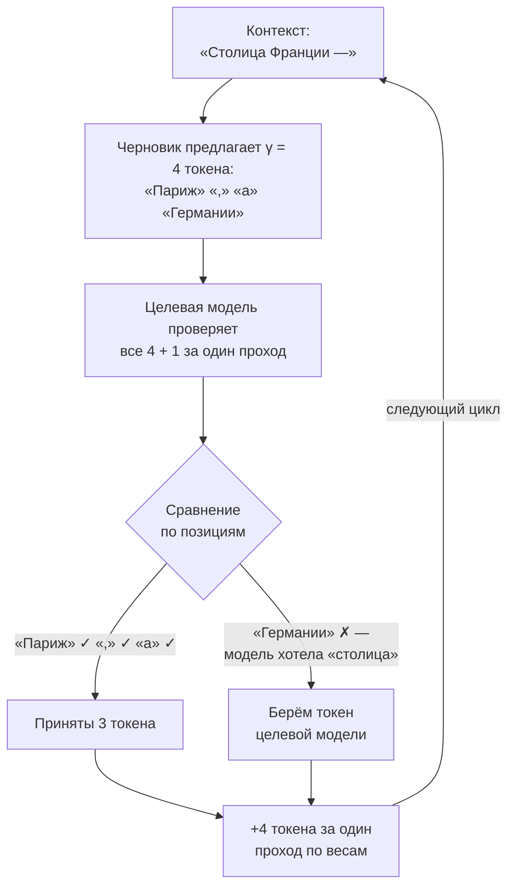
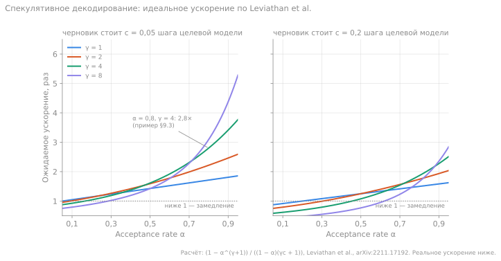

# 9. Спекулятивное декодирование: черновик, MTP, acceptance rate

> **Зачем эта глава.** Декод упирается в память: на каждый токен читаются все активные веса. Спекулятивное декодирование обходит это ограничение, заставляя модель проверять несколько токенов за один проход. Это один из немногих способов ускорить генерацию без потери качества.

> **За 30 секунд**
> - Маленький черновик быстро предлагает несколько токенов, большая модель проверяет их все за один проход — веса читаются один раз на несколько токенов.
> - Распределение ответа не меняется: при `T = 0` текст тот же, при `T > 0` — та же статистика.
> - Выигрыш определяет acceptance rate `α` — насколько часто черновик угадывает. Реально это 1,5–2,5×, при низком `α` — замедление.
> - Меряйте на своём трафике: повторяющийся синтетический промпт даёт фантастические и бесполезные цифры.

## 9.1 Идея

Обычная генерация:

```
прочитать веса → получить 1 токен → прочитать веса → получить 1 токен → ...
```

Спекулятивное декодирование:



За один проход целевой модели получено четыре токена: три угаданных черновиком и один исправленный. Без спекуляции на это ушло бы четыре прохода. Если бы черновик угадал все четыре, целевая модель добавила бы пятый — «бонусный» (§9.2).

Проверка нескольких токенов почти так же дешева, как генерация одного: веса всё равно читаются один раз, а вычисления растут незначительно. Если черновик угадал `k` токенов, вы получили `k` токенов за одну операцию чтения весов.

Ключевое свойство: **распределение результата не меняется**. При жадной генерации (temperature 0) выход в теории совпадает с обычным токен в токен: проверку делает целевая модель, и принимаются только её собственные argmax-токены. На практике проверка идёт батчем из нескольких токенов, и из-за другого порядка вычислений с плавающей точкой при почти равных вероятностях изредка выбирается другой токен (§10.4) — это особенность арифметики, а не метода. При `T > 0` сохраняется распределение, а не конкретная последовательность: для этого нужна корректная схема rejection sampling (Leviathan et al.). Конкретный текст может отличаться — ровно так же, как отличались бы два обычных запуска с сэмплированием.

## 9.2 Формальная схема

1. Черновик (draft) генерирует `γ` токенов авторегрессионно.
2. Целевая модель получает исходный контекст плюс эти `γ` токенов и считает вероятности для каждого шага.
3. Сравниваем:
   - если токен черновика совпал с выбором целевой модели — принимаем;
   - на первом несовпадении берём токен целевой модели и отбрасываем остаток черновика.
4. К принятым токенам добавляется один «бонусный» токен от целевой модели — итого до `γ + 1` токенов за шаг.

Для **жадной** генерации (temperature 0) это просто сравнение argmax. Для **сэмплирования** нужна схема rejection sampling, которая сохраняет распределение целевой модели; иначе ответы начнут отличаться статистически. Именно это имеет в виду Leviathan et al.: спекуляция не «улучшает» и не «портит» распределение, а воспроизводит его быстрее.

## 9.3 Сколько это даёт

Пусть `α` — вероятность принять один токен черновика (acceptance rate), а стоимость черновика — `d` от стоимости одного прохода целевой модели.

Ожидаемое число **выходных** токенов за раунд (принятые плюс один бонусный) обозначим `E[N]`:

```
E[N] = 1 + α + α² + ... + α^γ = (1 − α^(γ+1)) / (1 − α)
```

Ускорение примерно:

```
speedup ≈ E[N] / (1 + γ × d)
```

Пример: `α = 0,8`, `γ = 4`, черновик стоит `d = 0,05`:

```
E[N] = (1 − 0,8^5) / 0,2 = (1 − 0,328) / 0,2 = 3,36
speedup ≈ 3,36 / (1 + 0,2) = 2,8
```

Это оптимистичная оценка: на практике добавляются накладные расходы, неидеальное распараллеливание и падение acceptance на сложных токенах. Реалистичный выигрыш — **1,5–2,5×**.

### E[N] и безубыточный черновик

Из формулы видно условие, при котором спекуляция вообще имеет смысл. Раунд стоит `T_plain + T_draft`, где `T_plain` — обычный шаг целевой модели, а `T_draft` — подготовка черновика. Тогда

```
speedup = E[N] × T_plain / (T_plain + T_draft)
```

Спекуляция окупается, только если числитель больше знаменателя:

```
E[N] > 1 + T_draft / T_plain
```

Отсюда **бюджет на черновик**:

```
T_draft < (E[N] − 1) × T_plain
d < (E[N] − 1) / γ          (если черновик стоит d на токен)
```

Это и есть «безубыточный черновик»: максимальная стоимость, при которой раунд ещё быстрее обычного шага. При `E[N] = 1,33` и шаге 26,3 мс бюджет около 8,7 мс; при `E[N] = 3,05` — около 54 мс. Чем выше acceptance, тем дороже может быть черновик.

**Посчитай сам.** `α = 0,5`, `γ = 4`, обычный шаг 30 мс, черновик 8 мс на токен. Окупается ли спекуляция? Каков бюджет на черновик?

<details>
<summary>Решение</summary>

```
E[N] = (1 − 0,5^5) / 0,5 = 1,94
T_draft = 4 × 8 = 32 мс
speedup = 1,94 × 30 / (30 + 32) = 58,2 / 62 ≈ 0,94
бюджет = (1,94 − 1) × 30 = 28,2 мс, то есть 7,05 мс на токен
```

Спекуляция не окупается: раунд 62 мс даёт 1,94 токена, то есть 32 мс на токен против 30 мс без неё. Черновик должен стоить дешевле 7 мс на токен — или acceptance должен быть выше. Это типичный случай, когда «включил спекуляцию» означает «стало медленнее».

</details>

Зависимость от `α` сильная:

| α | `E[N]` при γ=4 | Оценка speedup (d=0,05) | Бюджет `d`, чтобы окупилось |
|---:|---:|---:|---:|
| 0,5 | 1,94 | 1,6 | 0,235 |
| 0,6 | 2,31 | 1,9 | 0,327 |
| 0,7 | 2,77 | 2,3 | 0,443 |
| 0,8 | 3,36 | 2,8 | 0,590 |
| 0,9 | 4,10 | 3,4 | 0,774 |

Поэтому главный вопрос — не «какой γ поставить», а **насколько хорошо черновик предсказывает именно ваш трафик**.



*Рисунок 9.1. Идеальное ускорение по формуле Leviathan et al. для дешёвого (`c = 0,05`) и дорогого (`c = 0,2`) черновика. Длинный черновик (`γ = 8`) выигрывает только при высоком `α`, а при низком — проигрывает даже обычной генерации. Чем дороже черновик, тем правее точка, где спекуляция начинает окупаться. Расчёт; реальные числа ниже из-за накладных расходов.*

## 9.4 Выбор γ

`γ` — длина черновика. Слишком маленький даёт мало выигрыша; слишком большой тратит время на проверку токенов, которые всё равно будут отброшены.

Оптимум зависит от `α` и стоимости черновика. При высоком `α` выгодно увеличивать `γ`; при низком — уменьшать. На практике:

- на свободной прозе `α` часто 0,5–0,7, оптимум `γ` около 2–3;
- на структурированном выводе, JSON и повторяющихся формулировках `α` выше, и `γ = 4–5` может быть лучше;
- при `α < 0,4` спекуляция часто не окупается.

**Посчитай сам.** Проза, `α = 0,6`, черновик стоит `d = 0,1` шага целевой модели. Какой `γ` из 2, 3, 4 даёт наибольшее ускорение по формуле §9.3?

<details>
<summary>Решение</summary>

```
γ = 2:  E[N] = (1 − 0,6³) / 0,4 = 1,96;   speedup = 1,96 / 1,2 ≈ 1,63
γ = 3:  E[N] = (1 − 0,6⁴) / 0,4 = 2,18;   speedup = 2,18 / 1,3 ≈ 1,67
γ = 4:  E[N] = (1 − 0,6⁵) / 0,4 = 2,31;   speedup = 2,31 / 1,4 ≈ 1,65
```

Оптимум — `γ = 3`, но кривая очень пологая: между 2 и 4 разница меньше 3%. Поэтому подбирать `γ` до единицы бессмысленно — гораздо важнее поднять `α`.
</details>

## 9.5 Откуда взять черновик

Сразу оговорка про llama.cpp: в нём реализованы `draft-simple` (отдельная модель), `draft-eagle3` (для ограниченного набора архитектур), `draft-mtp` и n-граммные варианты (`ngram-simple`, `ngram-cache`, `ngram-mod` и др.), а также более новые `draft-dflash`/`draft-dspark`. Medusa и EAGLE-1/2 в llama.cpp нет — это архитектурный экскурс, а не готовые флаги.

### Отдельная маленькая модель

Берут модель того же семейства и токенизатора, например 0,5–1,5B, и запускают рядом. Плюсы: просто, работает с любой целевой моделью. Минусы: занимает память, добавляет задержку, acceptance на вашем домене может быть низким.

### N-gram / lookup decoding

Черновик не модель, а поиск по уже имеющемуся тексту: если последовательность встречалась раньше, её можно предложить. Плюсы: почти бесплатно, не занимает память. Минусы: хорошо работает на копировании и повторяющемся тексте, плохо — на новом.

Важная ловушка: на синтетическом тесте с повторяющимся промптом acceptance может быть близок к 1, и вы получите фантастические цифры. На реальном трафике всё иначе.

### MTP-головы

**Multi-token prediction** (MTP): модель обучают предсказывать не только следующий токен, но и, в общем случае, несколько следующих — через дополнительные головы. У DeepSeek-V3 один MTP-модуль (глубина `D = 1`), то есть на один шаг вперёд; в других моделях глубина может быть больше. Черновик получается почти бесплатно и хорошо откалиброван, потому что головы обучались вместе с моделью.

В llama.cpp поддержка MTP появилась для моделей с соответствующими тензорами: сервер создаёт draft-контекст на основе головы целевой модели.

Плюсы: высокий acceptance, нет отдельного файла модели. Минусы: нужна модель с MTP-головами; не все архитектуры поддерживаются; голова и её KV занимают память.

### Medusa

**Medusa** добавляет несколько выходных голов к целевой модели и строит «дерево» кандидатов. Проверка идёт с attention-маской, чтобы кандидаты не видели друг друга. Плюсы: не нужна отдельная модель. Минусы: головы надо обучать, дерево усложняет реализацию.

### EAGLE

**EAGLE** использует признаки целевой модели (hidden states), а не только токены, и предсказывает следующие представления. EAGLE-2 строит динамическое дерево кандидатов. EAGLE-3 отказывается от предсказания признаков в пользу прямого предсказания токенов и использует приём **training-time test** — обучение на поведении, которое модель увидит на инференсе, а не масштабирование рассуждений во время генерации. Плюсы: высокий acceptance. Минусы: привязка к архитектуре целевой модели, сложная конвертация.

## 9.6 Почему проверка дешева

Проверка `γ + 1` токенов — это маленький prefill. Веса читаются один раз, а вычисления на нескольких токенах всё ещё намного меньше, чем позволяет GPU. Поэтому декод остаётся memory-bound, и дополнительные токены почти не добавляют времени.

Но есть пределы:

- при больших `γ` вычисления и KV-кэш начинают расти заметно;
- у MoE каждый дополнительный токен может активировать новых экспертов, и рабочий набор растёт;
- на длинном контексте attention по проверяемым токенам тоже стоит времени.

## 9.7 Взаимодействие с другими оптимизациями

- **Кэш экспертов.** При спекуляции за один шаг через экспертов проходит несколько токенов, рабочий набор «горячих» экспертов растёт. Фиксированный кэш может перестать попадать.
- **KV-квантование.** Черновик может иметь свой KV; его точность влияет на acceptance.
- **Батчинг.** Спекуляция и параллельные слоты конкурируют за память и вычисления.
- **Промпт-кэш.** Спекуляция не отменяет выгоду кэша префикса.

> [!WARNING]
> N-граммный черновик на бенчмарке, где один и тот же промпт гоняется по кругу, легко показывает acceptance около 1 и ускорение «в 3–4 раза». На живых задачах с новым текстом то же самое может дать 1,1× или замедление. Проверяйте на реальных запросах (глава 12).

## 9.8 Как измерять

Меряйте на **реальном трафике**, а не на повторяющемся промпте:

- acceptance rate (доля принятых токенов);
- средняя длина принятой цепочки;
- ток/с декода;
- время на задачу целиком;
- качество (для жадной генерации оно не должно меняться).

Если acceptance на вашем домене низкий, спекуляция может сделать хуже: вы платите за черновик и проверку, но мало принимаете.

## 9.9 Практические правила

1. **Сначала измерьте baseline.** Без него вы не отличите эффект спекуляции от шума.
2. **Начните с `γ = 3–4`.** Дальше двигайте по acceptance.
3. **Проверяйте на своих данных.** Повторяющийся тест даёт завышенный acceptance.
4. **Следите за памятью.** Черновик, его KV и буферы проверки стоят VRAM.
5. **Не включайте спекуляцию вместе с кэшем экспертов, не измерив взаимный эффект.**
6. **Помните: качество не улучшается.** Это ускорение, а не новая модель.

## Ключевые идеи

- Спекуляция проверяет несколько токенов за один проход целевой модели.
- Выигрыш определяется acceptance rate и стоимостью черновика.
- `E[N] = (1 − α^(γ+1)) / (1 − α)` — ожидаемое число выходных токенов за раунд.
- Черновик бывает отдельной моделью, n-граммным, MTP-головой, Medusa или EAGLE.
- На реальном трафике acceptance может сильно отличаться от синтетики.

## Проверь себя

1. Почему спекулятивное декодирование не меняет ответ при temperature 0?
2. При α = 0,7 и γ = 4 чему равно ожидаемое число принятых токенов?
3. Почему большой γ может ухудшить результат?
4. Чем MTP отличается от отдельной draft-модели?
5. Почему спекуляция может конфликтовать с кэшем горячих экспертов?

## Ответы

1. При temperature 0 целевая модель выбирает argmax. Проверка принимает токен только если он совпал с argmax целевой модели, поэтому итоговая последовательность та же, что при обычной жадной генерации.
2. `E[N] = (1 − 0,7^5) / 0,3 = (1 − 0,168) / 0,3 = 2,77`.
3. Черновик генерирует больше токенов, а проверка стоит времени. Если acceptance невысок, большая часть черновика отбрасывается, и вы платите за неё зря.
4. MTP — это дополнительные головы внутри целевой модели, обученные предсказывать будущие токены. Отдельная draft-модель — другой файл и другой процесс, её нужно загружать и держать в памяти.
5. За один шаг проверки через экспертов проходит несколько токенов, поэтому активируется больше разных экспертов. Рабочий набор растёт, и фиксированный кэш перестаёт в него попадать.

## Источники главы

- **Leviathan, Kalman, Matias, «Fast Inference from Transformers via Speculative Decoding» (2022)** — [arXiv:2211.17192](https://arxiv.org/abs/2211.17192). Формализация и анализ ускорения.
- **Chen et al., «Accelerating Large Language Model Decoding with Speculative Sampling» (2023)** — [arXiv:2302.01318](https://arxiv.org/abs/2302.01318). Схема с сохранением распределения.
- **Cai et al., «Medusa: Simple LLM Inference Acceleration Framework with Multiple Decoding Heads» (2024)** — [arXiv:2401.10774](https://arxiv.org/abs/2401.10774). Множественные головы и дерево.
- **Li et al., «EAGLE: Speculative Sampling Requires Rethinking Feature Uncertainty» (2024)** — [arXiv:2401.15077](https://arxiv.org/abs/2401.15077). Черновик на признаках.
- **Li et al., «EAGLE-2» (2024)** — [arXiv:2406.16858](https://arxiv.org/abs/2406.16858). Динамическое дерево.
- **Li et al., «EAGLE-3» (2025)** — [arXiv:2503.01840](https://arxiv.org/abs/2503.01840). Отказ от предсказания признаков в пользу прямых токенов и приём training-time test.
- **DeepSeek-AI, «DeepSeek-V3 Technical Report» (2024)** — [arXiv:2412.19437](https://arxiv.org/abs/2412.19437). MTP как часть архитектуры.
- **llama.cpp, `docs/speculative.md`** — [GitHub](https://github.com/ggml-org/llama.cpp/blob/master/docs/speculative.md). Типы спекуляции и флаги.
- **llama.cpp PR #22673, «llama + spec: MTP Support»** — [GitHub](https://github.com/ggml-org/llama.cpp/pull/22673). Поддержка MTP-голов.
