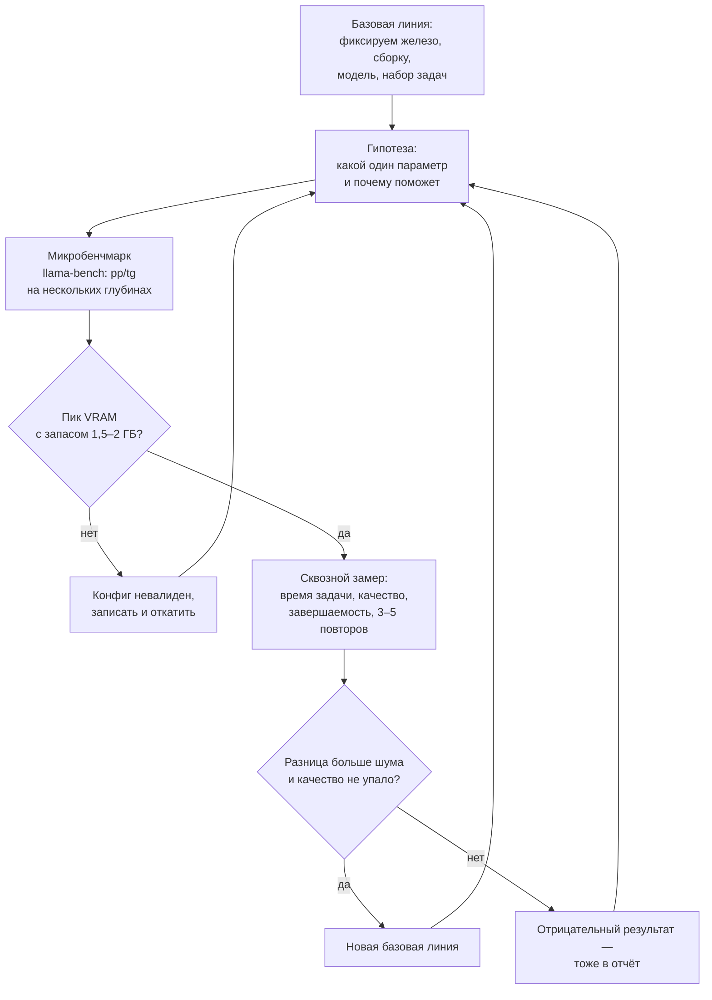
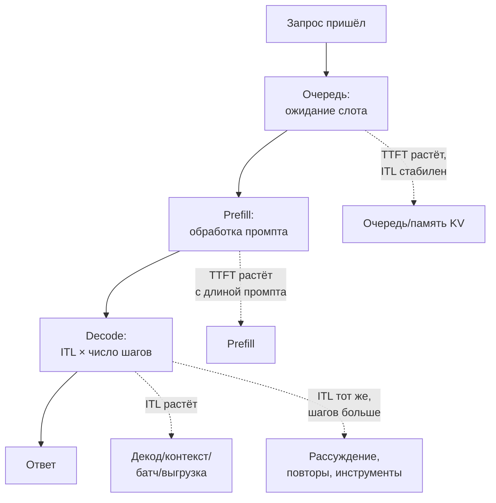

# 12. Методика бенчмарка и тюнинга

> **Зачем эта глава.** Локальный тюнинг полон самообмана: кэш прогревает промпт, синтетика повторяет ответ, фоновая программа ест VRAM, а разница в 3% оказывается шумом. Здесь — как мерить так, чтобы цифрам можно было верить.

> **За 30 секунд**
> - Есть три уровня замеров: микробенчмарк (`llama-bench`), серверный и сквозной (реальная задача). Решение принимают по сквозному.
> - Меняйте один параметр за раз, повторяйте минимум 3–5 раз и смотрите медиану и разброс.
> - Разница меньше 3–5% на домашнем железе обычно шум; VRAM смотрят в пике под нагрузкой.
> - Лучший конфиг — не максимальный ток/с, а самое короткое время задачи без потери качества.
> - Сравнивайте с нижней границей и разбирайте, какой отрезок вырос: очередь, prefill, decode или число шагов.

## 12.1 Три уровня измерений

Не смешивайте их.

1. **Микробенчмарк** — `llama-bench` или аналог: фиксированные промпты, измерение pp и tg на разных глубинах контекста. Хорош для сравнения конфигов, плох для предсказания времени задачи.
2. **Серверный замер** — реальные запросы к `/v1/chat/completions`, метрики из ответа и логов: prompt eval, eval, TTFT, общее время.
3. **Сквозной замер** — прогон реальной задачи: качество, число шагов, завершаемость, время на документ/запрос.

Конфиг, который выигрывает микробенчмарк, может проиграть сквозной замер. И наоборот.

Весь тюнинг — это цикл, в котором каждая итерация меняет ровно одну вещь:



## 12.2 llama-bench: что и как

`llama-bench` измеряет:

- **pp** (`-p N`) — обработку промпта длиной N;
- **tg** (`-n N`) — генерацию N токенов;
- **depth** (`-d ...`) — на какой глубине контекста мерить;
- **repeats** (`-r N`) — число повторов;
- **load mode** (`-lm`) — как загружается модель.

Типичный запуск:

```
llama-bench -m model.gguf -p 512 -n 128 -d 0,8192,16384,32768 -r 3 -lm none
```

Почему важны глубина и режим загрузки:

- на пустом контексте всё быстро; на 32k attention дороже;
- при mmap страницы весов могут подкачиваться с диска, и prefill падает в разы. Для честного замера загружайте модель так же, как сервер (`-lm none`). Старый `--no-mmap` в новых сборках llama.cpp уже не используется — проверьте `--help`.

В выводе смотрите **медиану и разброс**. Одно число без разброса почти бесполезно.

## 12.3 Контроль переменных

Меняйте **один параметр за раз**. Иначе не поймёте, что помогло.

Фиксируйте:

- модель и квант (хеш файла);
- версию рантайма и бэкенда;
- контекст;
- число слотов;
- температуру и другие параметры сэмплирования;
- набор промптов;
- фоновую нагрузку.

Записывайте всё это в отчёт. Через месяц вы не вспомните, на какой сборке получены цифры.

## 12.4 Шум и повторы

Источники шума:

- тепловой троттлинг и изменение частот GPU;
- фоновые процессы (браузер, обновления, антивирус);
- кэш промпта: первый запрос холодный, последующие горячие;
- разные длины ответов;
- округление и планировщик.

Практика:

- минимум 3 повтора, лучше 5;
- медиана устойчивее среднего;
- сообщайте стандартное отклонение или интерквартильный размах;
- сравнивайте конфиги на одних и тех же промптах;
- отдельно измеряйте холодный и горячий кэш.

Разница меньше 3–5% на потребительском железе часто находится в пределах шума. Не принимайте решение по одному прогону.

> [!TIP]
> Перед серией замеров закройте браузер и другие программы, использующие GPU, дайте карте прогреться одним «холостым» прогоном и только потом начинайте записывать числа. Холодная карта в первые минуты может держать более высокие частоты и показать результат лучше устоявшегося.

## 12.5 Память: смотреть в пике

VRAM после загрузки модели — не показатель. Пик возникает под нагрузкой, на длинном промпте или при генерации.

Как мерить:

- опрашивайте `nvidia-smi` несколько раз в секунду во время прогона;
- смотрите максимум, а не среднее;
- проверяйте свободную ОЗУ и активность диска;
- на Windows помните про тихую выгрузку в системную память (подробнее — глава 3).

Бюджет и запас — как в главе 3: оставляйте 1,5–2 ГБ VRAM. Если пик упирается в предел, конфиг нестабилен даже если «сейчас работает».

Минимальный набор команд для диагностики:

```bash
# пик и динамика VRAM/загрузки/частот
nvidia-smi --query-gpu=memory.used,memory.total,utilization.gpu,power.draw,clocks.sm \
  --format=csv -l 1

# краткая сводка по памяти и загрузке
nvidia-smi dmon -s mu
```

В логах llama-server смотрите `prompt eval time`, `eval time`, `draft acceptance` и размер обработанного промпта. Если `eval time` растёт, а частоты падают — вероятен троттлинг; если падает `prompt eval`, проверьте mmap и диск.

## 12.6 Что именно измерять

Для декода:

- ток/с (tg), медиана по запросам;
- время до первого токена (TTFT);
- inter-token latency;
- acceptance rate, если включена спекуляция.

Для prefill:

- ток/с на разных длинах (4k, 16k, 32k);
- сколько токенов реально обработано (с учётом кэша).

Для задачи:

- время на документ/запрос;
- число шагов;
- доля завершённых;
- качество (recall, точность, доля валидного JSON).

Для памяти:

- пик VRAM;
- свободная ОЗУ под нагрузкой;
- размер KV.

## 12.7 Измерение против нижней границы

Обычный тюнинг сравнивает конфиг с прошлым конфигом: «стало на 20% быстрее». Этого мало. Прошлый конфиг мог быть плохим, а 20% — долей одной накладной расходной части. Правильная точка отсчёта — **физическая нижняя граница** для той же модели, кванта, контекста и батча.

### Нижняя граница на тех же условиях

Для раунда с `b` одновременными запросами:

```
T_шага ≥ max( 2 × N_active × B / Π,  (W_active + b × C × k) / β )
```

где `B` — число токенов, обрабатываемых за раунд: для декода `B = b` (по одному токену на запрос), для prefill `B = P` (длина промпта). `N_active` — активные параметры, `Π` — пиковая производительность нужной точности, `W_active` — байты активных весов, `C` — контекст, `k` — байты KV на токен, `β` — достижимая пропускная способность памяти. Первое слагаемое — вычисления, второе — чтение весов и KV. При больших `b` вычисления растут вместе с батчем и могут догнать чтение — тогда батч перестаёт быть бесплатным и по времени.

Это **нижняя граница**, а не прогноз: быстрее физически нельзя, медленнее — можно. Отношение

```
MBU = T_нижняя / T_измеренная
```

показывает, какая доля времени шага приходится на полезное чтение. Для prefill аналогично считают `MFU` по вычислениям.

Пример: 8B в Q4_K_M (`W = 4,2 ГБ`), контекст 8k (`KV = 1,074 ГБ`), `β = 400 ГБ/с`, измерено 32 ток/с.

```
T_нижняя = (4,2 + 1,074) / 400 = 13,2 мс
T_измер. = 1000 / 32 = 31,25 мс
MBU = 13,2 / 31,25 ≈ 0,42
разрыв = 18 мс
```

18 мс — это не «плохая память», а то, чего нет в формуле: запуск ядер, синхронизация, хост, сэмплинг, неполная загрузка. Разрыв нужно объяснить, а не просто замерить.

### Две причины разрыва

Их всего две, и различаются они экспериментом.

- **Неполнота модели.** Разрыв растёт вместе с байтами или FLOPs: не учтены чтение KV, векторные операции, сэмплинг, дополнение до формы блока.
- **Накладные расходы реализации.** Разрыв почти не меняется, когда меняется объём: хост отправляет ядра по одному, синхронизация, журналирование, планировщик, выгрузка.

Проверка: измените **объём**, оставив всё остальное. Поднимите контекст с 8k до 32k. Нижняя граница вырастет на `3 × 1,074 / 400 ≈ 8,1 мс`. Если измерение выросло примерно на столько же — вы упёрлись в чтение KV, модель неполна. Если почти не выросло — разрыв фиксированный, это накладные расходы. Аналогично с батчем: если нижняя граница выросла на 10 мс, а измерение на 3 мс, вы распределяете постоянную часть, а не ускоряете память.

### Какой отрезок вырос

Прежде чем что-то менять, разложите время запроса:



| Что выросло | Признак | Что проверить | Что делать |
|---|---|---|---|
| Очередь | TTFT растёт, ITL стабилен | загрузка по окнам, `N = λT`, заполнение пула KV | мощность, допуск, отмена, меньше слотов/контекста |
| Prefill | TTFT растёт с длиной промпта | `prompt eval time`, `-ub`, mmap/диск | кэш префикса, `-ub`, загрузка в память |
| Decode | ITL растёт | длина контекста, батч, CPU-эксперты, троттлинг | квант, KV, спекуляция, раскладка слоёв |
| Число шагов | ITL тот же, ответ длиннее | бюджет рассуждений, повторы, циклы инструментов | ограничить reasoning, чинить промпт/парсер |
| Вне модели | GPU простаивает, ITL не меняется | инструменты, сеть, клиент, логирование | ускорять инструмент, а не модель |

В `llama-server` смотрите `prompt eval time`, `eval time` и `draft acceptance`; в vLLM — очередь, заполнение KV-пула и вытеснения. Если ITL подскакивает ровно в моменты, когда другой запрос делает длинный prefill, — это не «медленная модель», а планирование: лечится блочным prefill или ограничением бюджета токенов.

### Одна гипотеза — одно изменённое условие

Правило простое и его трудно соблюсти: **за один эксперимент меняется одна вещь**. Если включили граф, выключили кэш префикса и заново собрали входы, вы не узнаете, что дало эффект. В примере книги одновременное отключение журналирования, кэша и пересборка входов дали падение с 26,5 до 12,1 мс — но вклад каждого условия не разделён.

Как сравнивать:

- чередуйте A и B: A, B, A, B, … — а не серию A, потом серию B;
- считайте **медиану парной разницы** на одинаковых запросах, а не разность двух медиан;
- заранее назовите ожидаемый эффект в миллисекундах и долю этапа по Амдалу;
- назовите порог, после которого исправление перестанет помогать.

**Посчитай сам.** TTFT = 30 с, ITL = 25 мс, промпт 6000 токенов, `pp = 1500` ток/с, интенсивность 0,8 запроса/с. Где потеряно время и что проверять в первую очередь?

<details>
<summary>Решение</summary>

```
prefill = 6000 / 1500 = 4,0 с
один шаг decode = 0,025 с
TTFT_нижняя ≈ 4,025 с
очередь ≈ 30 − 4,025 ≈ 26 с
```

Почти всё время — очередь, а не prefill. Проверяем закон Литтла: `N = 0,8 × 30 = 24` запроса в системе. Если каждому нужно 1 ГиБ KV на 8k, это 24 ГиБ только под кэш — на 24-гигабайтной карте невозможно. Значит, сервер держит очередь из-за памяти, а не из-за медленного prefill. Первый эксперимент — уменьшить контекст или число слотов и посмотреть, упадёт ли TTFT; ускорять `pp` бессмысленно.

</details>

## 12.8 Ловушки самообмана

**Прогретый кэш.** Первый запрос медленный, последующие быстрые. Если мерить только второй, вы измерите кэш, а не модель.

**Синтетический повтор.** Если промпт и ответ повторяются, n-граммная спекуляция и кэш дают фантастические цифры. Годится только реальный трафик.

**Разные длины ответов.** Время задачи зависит от того, сколько модель «наболтала». Сравнивайте ток/с, а не только секунды.

**Кэш экспертов и VRAM.** Флаг может ускорить генерацию и незаметно ухудшить завершаемость. Смотрите качество, а не только скорость.

**Фон.** Браузер с 50 вкладками, обновление Windows или другой сервер на той же карте меняют результат.

**Версия рантайма.** Поведение флагов меняется между сборками. Записывайте версию.

**Один прогон.** Разброс на потребительском железе легко достигает 10–20% на коротких задачах.

## 12.9 Пример: тюнинг на 16 ГБ (вымышленный)

> **Это пример.** Числа вымышлены и приведены только для иллюстрации методики. Не переносите их на своё железо.

Железо: карта 16 ГБ, 32 ГБ ОЗУ, модель 30B MoE в Q4 (~18 ГБ), контекст 32k. Бюджет VRAM — 14,5 ГБ (запас 1,5 ГБ).

| Конфиг | pp, ток/с | tg, ток/с | Пик VRAM | Время задачи | Завершено |
|---|---:|---:|---:|---:|---:|
| База, `-ub 512` | 900 | 38 | 13,6 ГБ | 95 с | 5/5 |
| `-ub 1024` | 1450 | 38 | 14,1 ГБ | 78 с | 5/5 |
| `-ub 2048` | 1900 | 37 | 15,2 ГБ | — | не влезло |
| `--n-cpu-moe 22` (+2 слоя) | 850 | 35 | 12,9 ГБ | 92 с | 5/5 |
| `-ub 1024` + MTP γ=4 | 1450 | 58 | 14,5 ГБ | 62 с | 5/5 |
| `-ub 1024` + MTP γ=5 | 1450 | 60 | 14,5 ГБ | 71 с | 4/5 |

Как читать:

- `-ub 2048` не влез — это не «медленно», это невалидный конфиг;
- выгрузка двух слоёв освободила память, но стоила скорости;
- MTP дал +53% к декоду, но γ=5 добавил 2 ток/с и сломал один прогон;
- итог: `-ub 1024` + MTP γ=4, потому что время задачи и завершаемость важнее пикового ток/с.

> [!WARNING]
> «5/5 против 4/5» на пяти прогонах — слабое доказательство. Это разница в один прогон, и §12.12 объясняет, почему её нельзя считать надёжной. В реальном тюнинге такой результат — повод прогнать 20–50 задач, а не повод для вывода.

Обратите внимание: **выбран не самый быстрый по ток/с конфиг**, а самый быстрый по времени задачи при сохранении качества. Это типичный результат.

## 12.10 Отчёт о замере

Минимальный шаблон:

```
Железо: GPU, VRAM, CPU, RAM, ОС
Рантайм: версия, бэкенд, флаги
Модель: имя, квант, хеш файла
Контекст: -c, -np, KV-квант
Нагрузка: набор промптов, длины, температура
Повторы: n, медиана, stdev
Результаты: pp/tg по глубинам, TTFT, время задачи
Память: пик VRAM, свободная RAM
Качество: метрики, доля завершённых
Вывод: что меняем и почему
```

Без этого отчёта через неделю вы будете гадать, что означала цифра «42».

## 12.11 Отрицательные результаты

Записывайте то, что **не** сработало:

- флаг, который не дал эффекта;
- конфиг, который не влез;
- квант, который ухудшил качество;
- спекуляцию, которая замедлила.

Это экономит время вам и другим. «Не помогло» — такой же результат, как «помогло».

## 12.12 Статистика без магии

- Для бинарных метрик (завершено/нет) используйте доверительные интервалы, а не проценты из 5 наблюдений.
- Для сравнения конфигов лучше **парные** прогоны на одних и тех же кейсах.
- Учитывайте, что при сравнении многих конфигов один может случайно оказаться лучшим.
- Эффект должен быть больше шума, чтобы ему верить.

Формальная статистика не нужна для домашнего тюнинга, но понимание разброса — обязательно.

**Посчитай сам.** Конфиг A завершил 5 задач из 5, конфиг B — 4 из 5. Насколько это различие надёжно? Оцените 95%-ные доверительные интервалы для доли успеха (удобная формула для малых выборок — интервал Уилсона).

<details>
<summary>Решение</summary>

```
A: 5/5 → интервал ≈ [0,57; 1,00]
B: 4/5 → интервал ≈ [0,38; 0,96]
```

Интервалы почти целиком перекрываются: по пяти прогонам нельзя утверждать, что A надёжнее B. Даже при 20 задачах результаты 20/20 и 18/20 дают интервалы `[0,84; 1,00]` и `[0,70; 0,97]` — всё ещё с перекрытием. Отсюда практическое правило: для решений о качестве нужны десятки задач, а не пять.
</details>

## Ключевые идеи

- Микро-, серверный и сквозной замеры отвечают на разные вопросы.
- Сравнивайте измерение с нижней границей; разрыв — это либо неполнота модели, либо накладные расходы.
- Разложите время на очередь, prefill, decode и число шагов — и лечите тот отрезок, который вырос.
- Меняйте один параметр, фиксируйте версию, модель и нагрузку.
- Медиана и разброс важнее одного числа; меньше 3–5% — часто шум.
- VRAM смотрите в пике под нагрузкой, а не после загрузки.
- Лучший конфиг — не максимальный ток/с, а лучший баланс времени, качества и завершаемости.
- Записывайте отрицательные результаты.

## Проверь себя

1. Почему `llama-bench` с mmap может показать prefill в разы ниже реального?
2. Вы получили 41 и 43 ток/с на двух конфигах. Можно ли утверждать, что второй лучше?
3. Почему время задачи — плохая метрика, если модель сгенерировала разное число токенов?
4. Зачем мерить VRAM в пике, а не после загрузки?
5. Почему синтетический тест спекуляции на повторяющемся промпте бесполезен?
6. Измеренный шаг 31 мс, нижняя граница 13 мс. Что это говорит и как понять, куда ушли 18 мс?

## Ответы

1. При mmap страницы весов подкачиваются с диска по мере обращения. На prefill это добавляет чтение с диска, и скорость падает в разы по сравнению с явной загрузкой в память.
2. Нет. Разница 5% может быть шумом. Нужны повторы, одинаковая нагрузка и оценка разброса; лучше сравнить на нескольких прогонах.
3. Время зависит от длины ответа, а она у конфигов может различаться. Время задачи остаётся итоговой метрикой (§12.9), но чтобы понять причину разницы, сравнивайте отдельно ток/с декода, длину ответов, качество и завершаемость.
4. После загрузки модель может занимать мало, а под длинным промптом или при генерации пик вырастет. Именно пик определяет, не уйдёт ли часть в системную память.
5. Повторяющийся промпт разогревает n-граммный пул и кэш, acceptance становится близок к 1. На реальном новом тексте он будет другим.
6. Это значит, что MBU ≈ 0,42: большая часть шага — не чтение весов и KV. 18 мс могут быть неполнотой модели (сэмплинг, векторные операции, дополнение) или накладными расходами (запуск ядер, хост, синхронизация). Различить можно, меняя объём при прочих равных: если контекст 8k→32k поднимает нижнюю границу на 8 мс, а измерение — почти нет, разрыв фиксированный, это накладные расходы. Если измерение растёт вместе с границей — модель не учла чтение KV.

## Источники главы

- **llama.cpp, `tools/llama-bench/README.md`** — [GitHub](https://github.com/ggml-org/llama.cpp/blob/master/tools/llama-bench/README.md). Флаги и формат вывода.
- **Databricks, «LLM Inference Performance Engineering: Best Practices»** — [блог](https://www.databricks.com/blog/llm-inference-performance-engineering-best-practices). Метрики и методика продакшн-замеров.
- **MLCommons, MLPerf Inference** — [mlcommons.org](https://mlcommons.org/benchmarks/inference-datacenter/). Пример строгой методологии бенчмарка.
- **Miller, «Adding Error Bars to Evals» (2024)** — [arXiv:2411.00640](https://arxiv.org/abs/2411.00640). Статистика для оценок моделей.
- **llama.cpp Discussion #4167** — [GitHub](https://github.com/ggml-org/llama.cpp/discussions/4167). Пример аккуратных замеров на разном железе.
- **Bojie Li, «AI Infra in Depth», гл. 1, §1.3.4 и гл. 8, §8.6.3** — [GitHub](https://github.com/bojieli/ai-infra-book), Apache-2.0. Разложение разрыва на неполноту модели и накладные расходы, MBU/MFU и закон Амдала; идея §12.7 адаптирована под локальный сервер.
