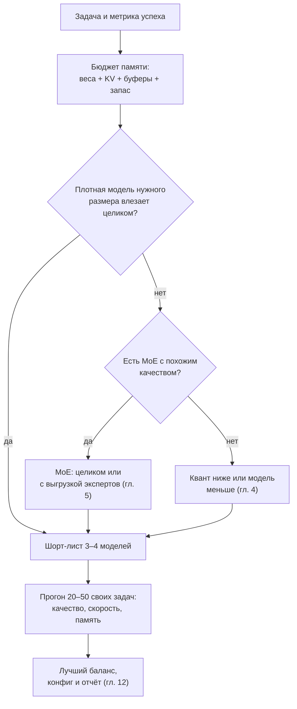

# 13. Выбор модели под железо

> **Зачем эта глава.** «Какая модель лучше?» — неправильный вопрос. Правильный: «какая модель лучше всего решает мою задачу на моём железе при приемлемой скорости и качестве». Здесь — как читать карточки, считать бюджет и не верить маркетингу.

> **За 30 секунд**
> - Сначала бюджет памяти (веса + KV + буферы + запас), потом модель.
> - Скорость оценивается заранее: пропускная способность ÷ байт активных весов на токен.
> - Бенчмарки в карточках самозаявленные и часто не про ваш домен; решает прогон 20–50 своих задач.
> - Лицензия, язык, токенизатор и наличие квантов под ваш рантайм — такие же критерии, как качество.

## 13.1 Сначала бюджет, потом модель

Любая модель должна уложиться в:

```
вес + KV-кэш + буферы + запас = доступная память
```

Составляющие:

- **вес** — по таблице «бит на вес» из главы 4;
- **KV** — по формуле из главы 6;
- **буферы** — 0,5–1,5 ГБ в зависимости от батча и бэкенда;
- **запас** — 1,5–2 ГБ, чтобы не уйти в системную память (глава 3).

Пример: 13B dense в Q4_K_M (около 7,9 ГБ), 40 слоёв, 8 KV-голов, `d_head = 128`, контекст 16k, KV в q8:

```
KV = 2 × 40 × 8 × 128 × 1,06 × 16 384 ≈ 1,43 ГБ (1,33 ГиБ)
вес + KV + буферы ≈ 7,9 + 1,4 + 1 ≈ 10,3 ГБ
```

На карте 12 ГБ это помещается с запасом ~1,7 ГБ — на грани. На 16 ГБ — комфортно, можно поднять контекст до 32k.

Формулы здесь коротко; подробный вывод и единая таблица квантов — в главах 2, 4 и 6.

## 13.2 Что читать в карточке модели

| Параметр | Зачем |
|---|---|
| Всего параметров | Объём весов и памяти |
| Активных параметров (MoE) | Скорость декода |
| Число слоёв | Размер KV и глубина |
| `n_kv_heads`, `head_dim` | Точный расчёт KV |
| Контекст обучения | Верхняя граница, но не гарантия качества |
| Тип внимания | Full / GQA / MLA / гибрид / sliding window |
| Токенизатор и языки | Длина текста в токенах, качество языка |
| Лицензия | Можно ли коммерческое использование |
| Форматы квантов | Есть ли GGUF/MLX/AWQ под ваш рантайм |
| Tool calling | Поддержка формата и шаблона |
| Бенчмарки | Что и как измеряли (см. ниже) |

Если в карточке нет конфига или числа KV-голов, придётся лезть в `config.json`. Это нормально: карточки часто написаны для маркетинга, а не для планирования памяти.

## 13.3 Dense или MoE

**Dense** — все параметры активны на каждом токене. Плюсы: предсказуемая скорость, проще квантовать, меньше памяти при том же качестве на простых задачах. Минусы: чтобы получить больше знаний, нужно больше параметров, а значит, больше памяти и медленнее декод.

**MoE** — хранит много параметров, активирует мало. Плюсы: больше знаний при высокой скорости. Минусы: вся модель должна помещаться в память (или часть — в ОЗУ), сложнее батчинг и квантование, качество на редких доменах может быть неравномерным.

Правило: если память позволяет и нужна скорость на большой модели — MoE. Если память ограничена и задача простая — dense меньшего размера.

## 13.4 Сколько влезает: ориентиры

Это **оценки**, а не гарантии: всё зависит от архитектуры, KV, контекста и кванта.

| Память | Что обычно влезает | Ожидаемая скорость |
|---|---|---|
| 8 ГБ | 7–9B dense Q4_K_M, контекст 8k; или 3–4B Q8_0, 16k | 30–50 ток/с |
| 12 ГБ | 13B dense Q4_K_M, 16k (KV в q8_0); или 8B Q8_0, 8k | 25–40 ток/с |
| 16 ГБ | 13B dense Q5_K_M, 32k (KV в q8_0); или 30B MoE Q4_K_M с выгрузкой | 20–45 ток/с |
| 24 ГБ | 30B dense Q4_K_M, 16k (KV в q8_0); или 30B MoE Q4_K_M целиком | dense 25–40 ток/с; MoE — в разы быстрее |
| 48 ГБ | 70B dense Q4_K_M, 16k (KV в q8_0) | 12–18 ток/с |
| 64 ГБ unified | 70B Q4_K_M, 16–32k (KV в q8_0); или 30B Q6_K | 6–12 ток/с (Mac) |
| 128 ГБ unified | 70B Q8_0, 64k (KV в q8_0); или 120B MoE Q4_K_M | 70B Q8_0: 5–8 ток/с; MoE заметно быстрее (Mac) |

Как получены строки: размер весов — по таблице §4.4, KV — по формуле главы 6 для типичной GQA-конфигурации (8 KV-голов по 128), плюс 1 ГБ буферов и запас 1,5–2 ГБ на дискретной карте. Скорость — 50–75% от потолка из главы 2. Числа — порядок величины. Для MoE скорость зависит от того, сколько экспертов в VRAM; для Mac — от пропускной способности объединённой памяти.

## 13.5 Оценка скорости до загрузки

Оценка — по формуле из главы 2: пропускная способность делится на байты, которые читаются на токен. Для dense берите все параметры, для MoE — активные. Если часть экспертов в ОЗУ, к времени добавляется второе слагаемое — чтение из более медленной памяти.

Пример: 30B MoE, 3B активных, Q4_K_M (1,8 ГБ на токен), половина в ОЗУ, VRAM 600 ГБ/с, ОЗУ 60 ГБ/с:

```
0,9 / 600 + 0,9 / 60 = 1,5 + 15 = 16,5 мс → ~60 ток/с
```

Это потолок; по правилу 50–75% из главы 2 реально получится 30–45 ток/с.

**Посчитай сам.** Карта 24 ГБ, 1 ТБ/с. Кандидаты: плотная 32B в Q4_K_M и MoE 30B-A3B в Q4_K_M, обе целиком в VRAM. Каковы потолки декода и какую скорость ждать на практике?

<details>
<summary>Решение</summary>

```
32B dense:   32 млрд × 0,6 = 19,2 ГБ на токен → 1000 / 19,2 ≈ 52 ток/с → реально 26–39
30B-A3B MoE: 3 млрд × 0,6 = 1,8 ГБ на токен   → 1000 / 1,8 ≈ 555 ток/с — формальный потолок
```

У MoE потолок по весам настолько высок, что упираться начнут уже другие вещи: attention и KV-кэш, роутинг, накладные расходы на запуск ядер. Поэтому реальная скорость MoE будет заметно ниже 50–75% от 555 — но всё равно в разы выше, чем у плотной 32B. Зато плотная 32B на одинаковой памяти часто качественнее; что важнее, решает ваш набор задач.
</details>

## 13.6 Как читать бенчмарки

Проблемы:

- **Самозаявленность.** Числа в карточке получены авторами на их промптах и их настройках. Независимой проверки может не быть.
- **Контаминация.** Тестовые вопросы могли попасть в обучение. Особенно у популярных бенчмарков.
- **Разные настройки.** Temperature, число попыток, формат ответа, длина рассуждения — всё влияет.
- **Насыщение.** Когда все модели набирают 90%+, бенчмарк перестаёт различать.
- **Не ваш домен.** MMLU не измеряет качество русского технического текста или следование JSON-схеме.
- **Arena — это предпочтения.** Люди выбирают более приятный ответ, а не более правильный.

Что делать:

- смотреть на несколько бенчмарков и на методологию;
- проверять, есть ли независимые прогоны;
- для своей задачи собрать 20–50 реальных примеров и прогнать кандидатов;
- сравнивать при одинаковых настройках и одинаковом кванте;
- смотреть не только качество, но и скорость, память, завершаемость.

## 13.7 Лицензии

«Открытые веса» не всегда значит «open source».

- **Apache 2.0 / MIT** — разрешительное использование, включая коммерческое.
- **Community licenses** (например, у некоторых семейств) могут ограничивать масштаб, использование конкурентами или требовать указания;
- **Non-commercial** — только для исследований;
- **Custom** — читать целиком.

Если модель нужна для продукта, лицензия — такой же критерий, как качество. Проверяйте её до того, как влюбитесь в бенчмарки.

## 13.8 Язык и токенизатор

Для русского текста важны:

- покрытие языка в обучении;
- эффективность токенизатора (сколько токенов на слово);
- наличие русских инструкций и tool calling;
- качество на технических терминах, числах, единицах, ГОСТах.

Модель с большим словарём может тратить меньше токенов на русский, но это не гарантирует качества. Проверяйте на своих текстах: длина в токенах, сохранение чисел и обозначений.

## 13.9 Контекст: «поддерживает» не значит «использует»

Смотрите:

- `max_position_embeddings` / `n_ctx_train` — обученный контекст;
- поддерживается ли расширение (YaRN, PI) и до какой длины;
- есть ли sliding window или гибридное внимание;
- как модель ведёт себя на «иголке в стоге сена»;
- сколько KV стоит каждый шаг.

Модель с 128k может быть хуже на 64k, чем модель с 32k, если её не обучали на длинных зависимостях. Тестируйте на своей задаче.

## 13.10 Не только NVIDIA и Apple

Большая часть книги написана про дискретную NVIDIA-карту, потому что это самый распространённый локальный сценарий. Но не единственный:

- **CPU-only.** Модели 7–9B в Q4 работают, но скорость — единицы токенов в секунду. Для чата это терпимо, для агента — медленно. Главное — пропускная способность ОЗУ и число физических ядер.
- **AMD ROCm / Vulkan.** llama.cpp поддерживает ROCm и Vulkan; поддержка зависит от карты и версии драйвера. Проверяйте, собран ли бэкенд под вашу архитектуру.
- **Intel XPU / iGPU.** Возможен через SYCL/Vulkan, но выбор моделей и квантов уже, а производительность ниже.
- **Apple Silicon.** Объединённая память и Metal; для моделей, которые помещаются, это удобный вариант, но пропускная способность ниже топовых дискретных карт.

Общие формулы памяти и скорости остаются теми же; меняются доступная память, пропускная способность и зрелость бэкенда.

## 13.11 Русский домен

Для русских технических текстов общие бенчмарки почти бесполезны. Проверяйте:

- длину текста в токенах (токенизатор может быть неэффективен);
- сохранение чисел, единиц и обозначений;
- качество на терминах и аббревиатурах;
- следование JSON-схеме и вызов инструментов;
- галлюцинации на редких фактах.

Соберите 20–50 реальных примеров из своих документов и прогоните кандидатов. Публичные русские лидерборды полезны как ориентир, но не заменяют ваш набор.

## 13.12 Процесс выбора




1. **Опишите задачу и метрику.** Что считается успехом: правильный ответ, валидный JSON, время, стоимость?
2. **Посчитайте бюджет памяти** по формулам.
3. **Составьте шорт-лист из 3–4 моделей**, которые влезают.
4. **Проверьте доступность квантов и поддержку рантаймом.**
5. **Прогоните на 20–50 реальных примерах.** Одинаковые промпты, температура, контекст.
6. **Сравните качество, скорость, память, завершаемость.**
7. **Выберите не «лучшую», а лучший баланс.**
8. **Запишите конфиг и результаты** (глава 12).

> [!WARNING]
> Ориентиры этой главы — для одного слота и типичной GQA-архитектуры. Если вам нужно несколько параллельных пользователей (глава 8) или модель без GQA, пересчитайте KV по формуле главы 6: именно он чаще всего превращает «влезает» в «не влезает».

## 13.13 Красные флаги в карточке

- Нет лицензии или она «other» без пояснений.
- Нет конфига и числа KV-голов.
- «Превосходит GPT-4» без цифр и методики.
- Бенчмарки только самозаявленные, без независимых прогонов.
- Нет информации о языках и токенизаторе.
- Нет GGUF/MLX, хотя модель заявлена для локального запуска.
- Обещания «работает на 8 ГБ» без указания кванта и контекста.

## Ключевые идеи

- Сначала бюджет памяти, потом модель.
- Dense предсказуем, MoE даёт больше знаний за ту же скорость, но требует памяти.
- Скорость можно оценить по пропускной способности и активным параметрам.
- Бенчмарки самозаявленные, контаминированные и часто не про ваш домен.
- Лицензия, язык и поддержка квантов — такие же критерии, как качество.
- Выбирайте по своим 20–50 примерам, а не по лидерборду.

## Проверь себя

1. Как оценить, поместится ли модель на карту, до скачивания?
2. Почему MoE может быть быстрее dense при большем числе параметров?
3. Почему MMLU не поможет выбрать модель для русского JSON?
4. Чем «open weights» отличается от open source?
5. Что делать, если модель заявляет 128k, а вам нужно 64k?

## Ответы

1. Посчитать вес по параметрам и кванту, KV по формуле, добавить буферы и запас. Сравнить с доступной памятью.
2. MoE активирует только часть параметров на токен, поэтому чтение памяти и вычисления меньше, чем у dense с тем же общим числом параметров. Но хранить нужно все параметры.
3. MMLU измеряет общие знания на английских вопросах с выбором ответа. Он не проверяет русский технический текст, следование JSON-схеме и вызов инструментов.
4. Open weights означает, что веса доступны, но лицензия может ограничивать использование. Open source обычно требует свободного использования, изменения и распространения.
5. Проверить, как контекст получен: обучение, YaRN/PI, гибридное внимание. Затем измерить качество и скорость на 64k на своих задачах, а не доверять числу в карточке.

## Источники главы

- **Hugging Face, LLM Course** — [huggingface.co/learn/llm-course](https://huggingface.co/learn/llm-course/chapter1/1). Основы моделей, токенизаторов и выбора.
- **Mitchell et al., «Model Cards for Model Reporting» (2018)** — [arXiv:1810.03993](https://arxiv.org/abs/1810.03993). Что должно быть в карточке модели.
- **Liang et al., «Holistic Evaluation of Language Models» (2022)** — [arXiv:2211.09110](https://arxiv.org/abs/2211.09110). Почему один бенчмарк не описывает модель.
- **Hendrycks et al., «Measuring Massive Multitask Language Understanding» (2020)** — [arXiv:2009.03300](https://arxiv.org/abs/2009.03300). MMLU и его ограничения.
- **Chiang et al., «Chatbot Arena» (2024)** — [arXiv:2403.04132](https://arxiv.org/abs/2403.04132). Что измеряют предпочтения людей.
- **Miller, «Adding Error Bars to Evals» (2024)** — [arXiv:2411.00640](https://arxiv.org/abs/2411.00640). Как не переоценить разницу между моделями.
- **llama.cpp, `tools/server/README.md`** — [GitHub](https://github.com/ggml-org/llama.cpp/blob/master/tools/server/README.md). Поддержка моделей, квантов и флагов.
