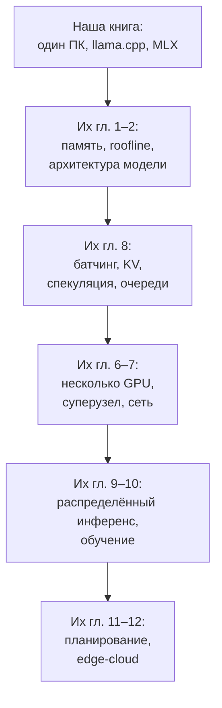

# 15. Куда расти

> **Зачем эта глава.** Книга заканчивается, а инференс — нет. Здесь — карта дальнейшего движения: что читать, что писать руками и как не утонуть в потоке статей.

> **За 30 секунд**
> - Вся книга сводится к нескольким формулам: размер весов, KV-кэш, потолок декода, ускорение спекуляции. Числа устаревают, формулы — нет.
> - Дальше три пути: системы и serving, ядра GPU, качество моделей и оценка.
> - Лучше всего закрепляют знание маленькие проекты своими руками — от tiny GPT до бенчмарк-харнесса.
> - Следите за областью через первоисточники и release notes, а не через пресс-релизы.

## 15.1 Что вы теперь знаете

Кратко, весь путь:

1. Модель — это токены, эмбеддинги и стопка слоёв attention + FFN.
2. Prefill параллелен и упирается в вычисления; decode последователен и упирается в память.
3. Память иерархична: VRAM быстрее ОЗУ, PCIe медленный, диск — для загрузки.
4. Квантование уменьшает и память, и трафик; ниже 4 бит нужна проверка качества.
5. MoE хранит много, активирует мало; выгрузка экспертов в ОЗУ — рабочий трюк.
6. KV-кэш растёт с контекстом; GQA, MLA и линейное внимание его сокращают.
7. Кэш промпта убирает prefill из критического пути агента.
8. Батчинг повышает пропускную способность; PagedAttention борется с фрагментацией.
9. Спекуляция ускоряет декод, если черновик хорошо угадывает.
10. Сэмплинг и бюджет рассуждений управляют поведением и временем.
11. Tool calling — это шаблон чата плюс парсер плюс грамматика.
12. Бенчмарк без методики — самообман.
13. Выбор модели начинается с бюджета памяти и своих примеров.
14. Речь и OCR — отдельные пайплайны с теми же принципами.

## 15.2 Направления роста

### Системы и инфраструктура

Если нравится «почему быстро/медленно»:

- **CMU 11-868 LLM Systems** — курс про GPU, serving, распределённый инференс, quantization, paged attention.
- **Stanford CS336** — языковое моделирование с нуля: токенизация, архитектура, обучение, масштабирование.
- **vLLM / SGLang** — читать код и документацию, разбирать, как устроены батчинг и кэш.
- **llama.cpp / ggml** — читать исходники, особенно квантование, бэкенды (CUDA, Metal) и сервер.

Практика: собрать свой сервер, прогнать нагрузку, найти узкое место, починить.

### Ядра и производительность

Если хочется «под капот GPU»:

- **CUDA** или **Triton**; начать с матричного умножения и softmax.
- **FlashAttention 1/2/3** — прочитать статьи и реализовать упрощённую версию.
- **PagedAttention** — понять, как блоки KV отображаются на память.
- **Roofline** — научиться считать, во что упирается конкретный кернел.

Практика: написать attention на Triton, сравнить с PyTorch, посчитать арифметическую интенсивность.

### Модели и качество

Если ближе «что модель умеет»:

- **Hugging Face LLM Course** — практика с моделями и токенизаторами.
- **CS224n** — NLP и трансформеры.
- **Evals** — как измерять качество, а не любоваться демо.
- **Tool calling и агенты** — HF Agents Course, BFCL, свои сценарии.

Практика: собрать набор из 50 реальных задач, прогнать 3 модели, сравнить честно.

### Следующий уровень: от одного ПК к кластеру и обучению

Когда одна машина перестаёт быть достаточной, меняются не формулы, а число членов в них: появляются обмен между картами, сеть, отказы, планирование и стоимость. Главный маршрут в эту сторону — книга **Bojie Li (Боцзе Ли), «AI Infra in Depth: Quantitative Analysis and System Design»** (Apache-2.0; есть [русский перевод community edition](https://github.com/ilkruglov/ai-infra-book)). Она построена на том же принципе, что и наша: сначала ограничения, потом конструкция.

Карта перехода:

Порядок чтения под локальный опыт:

1. **Гл. 1–2** — те же веса, KV и roofline, но с формальным выводом и модельными примерами. Сюда стоит заглянуть, если хочется не «формула на салфетке», а полный расчёт по `config.json`.
2. **Гл. 8** — прямое продолжение наших глав 8–9: батчинг, страничный KV, кэш префикса, выгрузка, спекуляция, эффективная пропускная способность. Многое из §12.7 выросло отсюда.
3. **Гл. 6–7** — что происходит, когда карт несколько: tensor/pipeline parallelism, AllReduce, топология, цена обмена. Наши §8.6 и §9.7 — только вход в тему.
4. **Гл. 9–10** — распределённый инференс и обучение: размещение prefill/decode, ZeRO, checkpoint, отказы. Это уже другой масштаб, но законы Амдала и Литтла те же.
5. **Гл. 11–12** — планирование ресурсов и edge-cloud: очереди, допуск, стоимость принятой задачи.

Что меняется по сравнению с одним ПК:

- **Память делится между картами**, и появляется обмен: выигрыш от N карт не равен N, а иногда отрицателен.
- **Сеть становится членом формулы**: маленькие сообщения упираются в задержку, большие — в полосу.
- **Отказы — норма**: checkpoint и восстановление входят в проект, а не в «потом».
- **Стоимость считается на принятую задачу**, а не на токен: очереди, повторы и простой входят в числитель.
- **Обучение — отдельная дисциплина**: данные, оптимизатор, параллелизм, стабильность. Наша книга её не покрывает; у Bojie Li — глава 10.

> [!TIP]
> Не начинайте с распределённого обучения. Сначала доведите до предела одну машину по §12.7: посчитайте нижнюю границу, разберите разрыв, убедитесь, что узкое место действительно в железе. Тогда переход на несколько карт будет решением, а не побегом от неизмеренной проблемы.

## 15.3 Что написать руками

Чтение без практики забывается. Небольшие проекты, которые дают больше всего:

1. **Tiny GPT** — токенизатор, attention, обучение на маленьком корпусе. Karpathy, «Let's build GPT».
2. **GPT-2 reproduction** — загрузка весов, генерация, KV-кэш. Karpathy, «Let's reproduce GPT-2».
3. **FlashAttention на Triton** — упрощённая версия с тайлингом и online softmax.
4. **Paged KV cache** — блоки, таблица страниц, разделение префиксов.
5. **Квантование** — реализовать блочное 4-битное квантование и сравнить ошибку.
6. **Спекулятивное декодирование** — draft + verify, замерить acceptance.
7. **Бенчмарк-харнесс** — повторяемые прогоны, медиана, разброс, VRAM.
8. **Tool-calling агент** — шаблон, схема, валидация, лимиты.
9. **OCR/ASR пайплайн** — от файла до текста, с метриками.

Даже по одному вечеру на проект даёт больше, чем десять обзоров.

## 15.4 Порядок чтения

Для новичка:

1. Karpathy, «Deep Dive into LLMs like ChatGPT» — общая картина.
2. Karpathy, «Let's build GPT» — код.
3. 3Blue1Brown, серия про трансформеры — визуальная интуиция.
4. «The Little Book of Deep Learning» — компактный учебник.
5. Эта книга, главы 1–4.

Для среднего уровня:

1. «Attention Is All You Need» — первоисточник.
2. «Efficiently Scaling Transformer Inference» — память и вычисления.
3. FlashAttention 1/2 — IO-aware attention.
4. vLLM / PagedAttention — serving.
5. Главы 5–9 этой книги.

Для продвинутого:

1. CS336 и CMU 11-868 — курсы целиком.
2. FlashAttention-3, EAGLE-3, Gated DeltaNet — свежие статьи.
3. Код vLLM, SGLang, llama.cpp.
4. Свои эксперименты и замеры.

## 15.5 Как следить за областью

- **arXiv** — cs.CL, cs.LG, cs.DC; подписка на нужные категории.
- **Hugging Face Papers** — подборки свежих статей со ссылками на код и модели (бывший адрес Papers with Code теперь перенаправляет сюда).
- **Блоги лабораторий** — Hugging Face, vLLM, SGLang, llama.cpp.
- **Конференции** — NeurIPS, ICML, ICLR, MLSys, OSDI/NSDI, ACL.
- **GitHub** — release notes и discussions дают больше, чем пресс-релизы.

Фильтруйте: не каждая статья с «достигает 2×» проверена на вашем железе. Читайте методологию, а не только abstract.

## 15.6 Что осталось за рамками

- **Обучение и fine-tuning** — LoRA, QLoRA, RLHF/DPO; это отдельная книга.
- **Мультимодальность** — зрение, аудио, видео в одной модели; в книге лишь кратко затронуты VLM (§14.9).
- **Распределённый инференс** — tensor/pipeline parallelism, disaggregated prefill/decode; в книге — только обзор (§8.6), маршрут дальше — в §15.2.
- **Серверная эксплуатация** — очереди, автомасштабирование, мониторинг, стоимость.
- **Безопасность** — prompt injection, утечки, изоляция инструментов; основы — в §11.8.

Каждая тема заслуживает отдельного изучения.

## 15.7 Честные ограничения

- **Железо меняется.** Числа из статей устаревают; формулы — нет.
- **Бенчмарки не равны качеству.** Ваш домен может дать другую картину.
- **Вендоры заявляют лучшее.** Проверяйте независимо.
- **Оптимизации конфликтуют.** Спекуляция, кэш экспертов, батчинг и KV-квантование влияют друг на друга.
- **Локальный инференс — компромисс.** Облако часто быстрее и умнее; локально вы покупаете приватность, контроль и отсутствие счёта за токены.

> [!TIP]
> Самый полезный следующий шаг — не новая статья, а собственный отчёт по шаблону §12.10 для вашей машины и вашей задачи. Он сразу покажет, какие главы вы поняли, а какие стоит перечитать.

## 15.8 Финальный чек-лист

- [ ] Я могу объяснить разницу prefill и decode и посчитать потолок скорости.
- [ ] Я считаю KV-кэш по формуле и знаю, сколько стоит контекст.
- [ ] Я понимаю, что означают `Q4_K_M`, `IQ4_XS`, `UD`.
- [ ] Я знаю, зачем `--n-cpu-moe` и когда он помогает.
- [ ] Я умею мерить ток/с, VRAM и качество, не обманывая себя.
- [ ] Я проверяю модель на своих задачах, а не по лидерборду.
- [ ] Я записываю конфиги и отрицательные результаты.
- [ ] Я знаю, куда читать дальше.

## Ключевые идеи

- Дальше три пути: системы, ядра, качество моделей.
- Чтение без практики забывается; маленькие проекты дают больше.
- Начинайте с общей картины, затем первоисточники, затем код.
- Следите за областью, но фильтруйте маркетинг.
- Локальный инференс — это инженерия компромиссов, а не волшебная кнопка.

## Проверь себя

1. Какой проект лучше всего проверит понимание KV-кэша?
2. Зачем читать исходники llama.cpp или vLLM, если есть документация?
3. Почему числа из статей нельзя переносить на своё железо без проверки?
4. Что из этой книги не покрывает обучение моделей?
5. Какой первый шаг, если вы хотите углубиться в ядра?

## Ответы

1. Реализовать Paged KV cache или хотя бы кэш с блоками и таблицей страниц, затем сравнить память и скорость с наивным вариантом.
2. Документация описывает интерфейс, а исходники — реальное поведение: какие оптимизации включены, как обрабатываются края, где узкие места. Версии и флаги меняются, код — источник истины.
3. Разное железо, версии рантайма, кванты, драйверы и нагрузки. Статья даёт метод и порядок величины, а не гарантию для вашей машины.
4. Fine-tuning, RLHF/DPO, обучение с нуля и распределённое обучение; мультимодальность и эксплуатация серверов — только обзорно.
5. Написать простой CUDA/Triton кернел для матричного умножения или softmax, замерить его и сравнить с библиотечным.

## Источники главы

- **Andrej Karpathy, «Deep Dive into LLMs like ChatGPT» (2025)** — [YouTube](https://www.youtube.com/watch?v=7xTGNNLPyMI). Общая картина обучения и инференса.
- **Andrej Karpathy, «Intro to Large Language Models» (2023)** — [YouTube](https://www.youtube.com/watch?v=zjkBMFhNj_g). Доступное введение.
- **Andrej Karpathy, «Neural Networks: Zero to Hero»** — [плейлист](https://www.youtube.com/playlist?list=PLAqhIrjkxbuWI23v9cThsA9GvCAUhRvKZ). От backprop до GPT.
- **nanoGPT** — [GitHub](https://github.com/karpathy/nanoGPT). Минимальная реализация GPT для экспериментов.
- **llm.c** — [GitHub](https://github.com/karpathy/llm.c). Обучение LLM на C/CUDA.
- **Stanford CS336** — [курс](https://stanford-cs336.github.io/). Языковое моделирование с нуля.
- **CMU 11-868 LLM Systems** — [курс](https://llmsystem.github.io/llmsystem2026fall/). Системы, serving, GPU.
- **MIT 6.5940 TinyML and Efficient Deep Learning** — [курс](https://hanlab.mit.edu/courses/2024-fall-65940). Эффективные модели и квантование.
- **Hugging Face Agents Course** — [курс](https://huggingface.co/learn/agents-course/unit0/introduction). Практика агентов и инструментов.
- **«The Little Book of Deep Learning»** — [PDF](https://fleuret.org/public/lbdl.pdf). Компактное введение в глубокое обучение.
- **Bojie Li, «AI Infra in Depth: Quantitative Analysis and System Design»** — [GitHub](https://github.com/bojieli/ai-infra-book), Apache-2.0; [русский перевод](https://github.com/ilkruglov/ai-infra-book). Уровень: продвинутый. Зачем: следующий уровень после одного ПК — serving, несколько GPU, сеть, распределённый инференс и обучение; количественный метод тот же.
