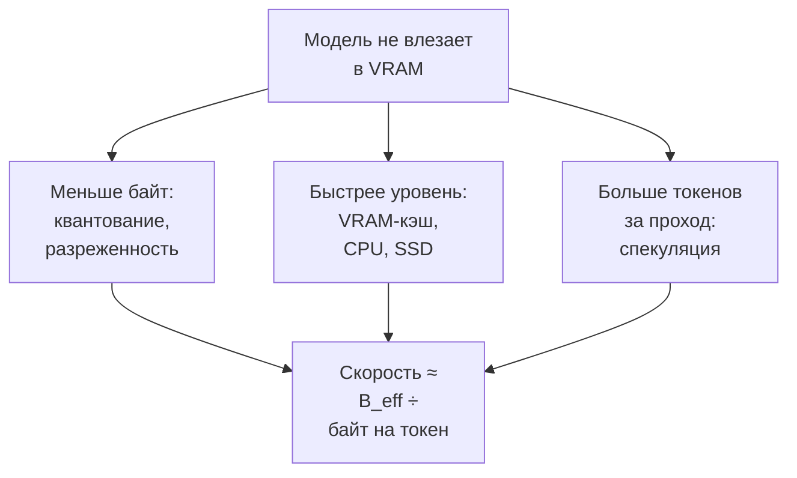
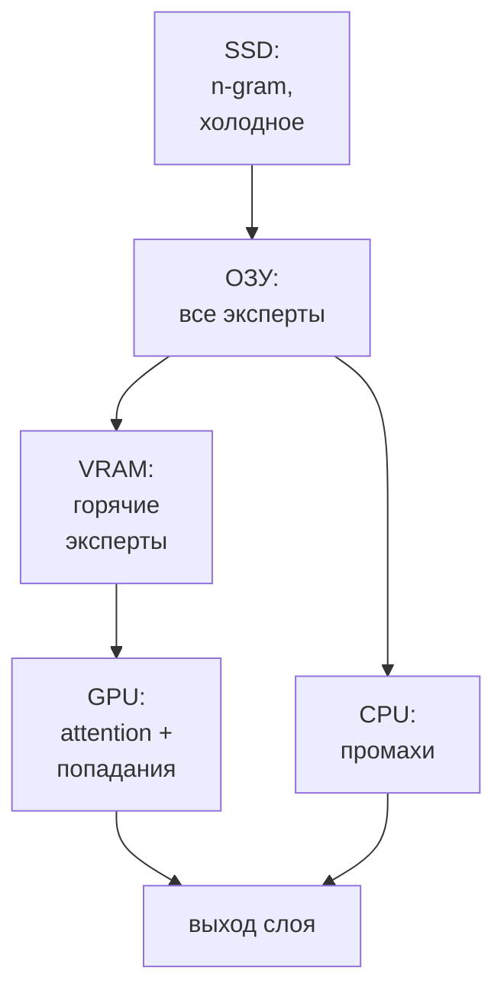

# Новые эксперименты: большие модели на маленьком железе

> **Зачем эта глава.** В главах 3 и 5 уже было главное: веса можно выгрузить в ОЗУ, а эксперты MoE — считать на CPU. К ноябрю 2026 появился целый слой проектов, которые идут дальше: держат в VRAM только «горячую» часть модели, холодную считают на CPU, редкое читают с SSD и добавляют спекуляцию. Эта глава — карта таких приёмов: что реально работает, сколько стоит и что пробовать первым на 8, 16 и 24 ГБ.

> **За 30 секунд**
> - «Запустить больше, чем влезает» — это не один трюк, а три рычага: меньше байт на токен, более быстрый уровень памяти для горячих байт и больше токенов за один проход.
> - Главная величина — **эффективная пропускная способность**: если 90% байт приходят из VRAM, а 10% из ОЗУ, скорость падает не в 30 раз, а примерно в 4.
> - Громкие проекты работают, но в узких нишах: Strata — под конкретные Qwen/DeepSeek, AirLLM — скорее «запустить и посмотреть», чем «работать», PowerInfer — только на специально обученных ReLU-моделях.
> - Сначала посчитайте рабочее множество (горячие эксперты + KV + буферы). Если оно не влезает в VRAM, выбирайте приём под узкое место, а не самый громкий заголовок.

## Три рычага вместо «магии»

Напомню формулу из главы 2: скорость декода примерно равна пропускной способности памяти, делённой на байты, которые читаются на один токен. Все новые приёмы меняют одну из трёх величин:

1. **Меньше байт.** Сильнее квантовать веса, хранить разреженные активации, не читать холодных экспертов.
2. **Быстрее память для горячей части.** Держать часто используемые эксперты в VRAM, остальные — в ОЗУ, совсем редкое — на SSD.
3. **Больше токенов за проход.** Спекулятивное декодирование проверяет несколько токенов за одно чтение весов.



### Эффективная пропускная способность

Если модель читает `W` байт на токен, а доля `s_i` этих байт приходит из уровня памяти с пропускной способностью `B_i`, то время на токен:

```
t ≈ Σ (s_i × W / B_i)
```

Эффективная пропускная способность:

```
B_eff = 1 / Σ (s_i / B_i)
```

Пример: 90% байт из VRAM с 1,8 ТБ/с и 10% из ОЗУ с 60 ГБ/с.

```
B_eff = 1 / (0,9 / 1800 + 0,1 / 60)
      = 1 / (0,0005 + 0,001667)
      ≈ 461 ГБ/с
```

То есть скорость падает не в 30 раз (как если бы всё шло из ОЗУ), а примерно в 4 раза. Именно на этом стоит вся идея экспертного кэша: чем выше доля попаданий в VRAM, тем ближе система к нормальной скорости.

При 70% попаданий:

```
B_eff = 1 / (0,7 / 1800 + 0,3 / 60) ≈ 186 ГБ/с
```

Это уже в 10 раз меньше VRAM. Отсюда практическое правило: **90% попаданий — это рабочая скорость, 70% — уже «тяжело»**, а 50% — почти режим ОЗУ.

> [!NOTE]
> Это оценка только по памяти. Когда промахи считает CPU, добавляется второй потолок — его вычислительная мощность. Для 6 млрд активных параметров нужно около 12 ГФЛОП на токен; CPU с 100–300 ГФЛОП/с даёт потолок 8–25 ток/с, даже если ОЗУ бесконечно быстрое. Это грубая оценка: реальные ядра и накладные расходы меняют цифру.

### Почему это стало возможным в 2026

Три вещи совпали. Во-первых, MoE-модели стали нормой: у большой модели активна малая доля параметров, и её можно считать частями. Во-вторых, кванты вроде IQ2/IQ3 довели большие модели до десятков-сотен гигабайт, которые ещё можно купить в виде ОЗУ и SSD. В-третьих, появились движки, которые рассматривают ПК как иерархию памяти, а не как «видеокарту с довеском».

## SSD-стриминг: AirLLM и «LLM in a Flash»

### Идея

Самый простой способ запустить модель больше памяти — держать на GPU только один слой, а остальные читать с диска. На каждом токене модель проходит все слои, поэтому с диска читается примерно весь объём весов. Это не «кэш», а именно потоковая подгрузка.

Почему это вообще работает: слой большой модели весит единицы гигабайт и помещается в VRAM, а не вся модель. Почему это медленно: диск в сотни раз медленнее VRAM, и чтение повторяется на каждом токене.

### AirLLM

**AirLLM** — самый известный проект этого класса: [github.com/lyogavin/airllm](https://github.com/lyogavin/airllm), Apache-2.0, около 41,9 тыс. звёзд на 7 ноября 2026, последний коммит в тот же день. Он разбивает модель на слои, держит на GPU один слой и подгружает следующий, перекрывая загрузку с вычислением. Заявлено: 70B на 4 ГБ VRAM, DeepSeek-V3 671B примерно на 12 ГБ, Kimi K3 2.8T на 3,72 ГБ, Qwen3.8-Flash-Next 125B на 5,95 ГБ (README считает полный объём ~180B вместе с 51B n-gram embedding) ([README](https://github.com/lyogavin/airllm)). Всё это — **самозаявленные** числа; независимые замеры есть только по скорости, и они ниже.

Что здесь правда: модель действительно **запускается** на маленькой карте, без квантования и дистилляции. Что здесь не сказано в заголовке: скорость. Независимые замеры дают для 70B порядка **5–35 секунд на токен** на нормальном NVMe и ещё медленнее на слабом диске; на 16-гигабайтном Mac Mini Llama 3.1 8B шла около **19,6 секунды на токен**, а для 70B прогноз — 2,5–3 минуты на токен ([разбор](https://dev.to/arshtechpro/airllm-runs-a-70b-model-on-a-4gb-gpu-its-true-and-thats-not-the-interesting-part-hha), [тест на Mac Mini](https://kunalvohra.com/blog/airllm-on-a-16gb-mac-mini)).

Посчитаем потолок. 70B в FP16 — около 140 ГБ. NVMe на 5 ГБ/с:

```
140 / 5 = 28 с на токен ≈ 0,036 ток/с
```

Даже в 4 бита (около 42 ГБ) — 8,4 с на токен, то есть 0,12 ток/с. Это режим «оставить на ночь», а не чат. Именно поэтому AirLLM честно называет себя инструментом для запуска и обучения на маленькой VRAM, а не быстрым сервером.

> [!WARNING]
> «70B на 4 ГБ» не означает «70B работает как обычно». Считайте не только объём, но и байты на токен: при потоковой загрузке с диска это весь размер модели. Если вам нужен интерактивный чат, SSD-стриминг почти всегда проигрывает меньшей модели, которая целиком помещается в память.

### «LLM in a Flash»

Работа Apple [«LLM in a flash»](https://arxiv.org/abs/2312.11514) (Alizadeh et al., 2023) — научная основа этого подхода. Идеи две:

- **windowing** — переиспользовать недавно активированные нейроны, чтобы не читать их с флеша повторно;
- **row-column bundling** — читать веса крупными непрерывными кусками, потому что флеш-память любит последовательный доступ.

Результат: модель до **2× больше объёма DRAM**, ускорение в **4–5× на CPU** и **20–25× на GPU** по сравнению с наивной загрузкой. Важно: это не «20× быстрее обычного инференса», а «20× быстрее наивного стриминга». Обычная модель, целиком лежащая в VRAM, всё равно будет быстрее.

Готового продукта Apple не выпустила; идеи разошлись по движкам и статьям. AirLLM — самый доступный их родственник, но без windowing и bundling в том же виде.

**Посчитай сам.** У вас 70B в 4-битном кванте (42 ГБ), NVMe на 3,5 ГБ/с и 32 ГБ ОЗУ. Модель не помещается в ОЗУ целиком. Оцените потолок, если читать с диска каждый токен, и потолок, если 20 ГБ весов всё же лежат в ОЗУ, а 22 ГБ читаются с диска.

<details>
<summary>Решение</summary>

```
Всё с диска: 42 / 3,5 = 12 с/токен ≈ 0,083 ток/с
20 ГБ в ОЗУ, 22 ГБ с диска:
  ОЗУ:  20 / 60 ≈ 0,33 с
  диск: 22 / 3,5 ≈ 6,3 с
  итого ≈ 6,6 с/токен ≈ 0,15 ток/с
```

Выигрыш всего в 1,8 раза: диск всё равно остаётся самым медленным звеном. Даже если 40 ГБ лежат в ОЗУ, а с диска читается только 2 ГБ, потолок — около 0,8 ток/с: `40 / 60 ≈ 0,67 с` плюс `2 / 3,5 ≈ 0,57 с`. Отсюда правило: **для интерактива диск не должен участвовать в каждом токене**; SSD-стриминг — режим offline/batch, когда время не важно.
</details>

## Экспертный кэш: Strata, ktransformers, PowerInfer

### Чем MoE отличается от плотной модели

В главе 5 уже объяснено: MoE хранит всех экспертов, но на токен активирует нескольких. Поэтому эксперт можно держать в ОЗУ и считать на CPU, а в VRAM — только те, что нужны чаще всего. Новые движки добавили к этому три вещи:

1. **адаптивный кэш** — какие эксперты «горячие», решается по ходу разговора, а не один раз при загрузке;
2. **параллельную работу GPU и CPU** — пока GPU считает попавшие в кэш эксперты, CPU считает промахи;
3. **предсказание** — следующий токен часто использует похожий набор экспертов, поэтому можно подгрузить их заранее.

### Strata: самый громкий проект 2026 года

**Что это.** [Strata](https://github.com/Niko1221/Strata) — MIT-движок на C++/CUDA/HIP/Metal/SYCL под конкретные большие MoE: Qwen3.8-Flash-Next (125B-A6B; [Akita](https://akitaonrails.com/en/2026/10/22/best-open-source-llm-strata-with-qwen-3-8-flash-next/)), Qwen3.6-35B-A3B и DeepSeek V4.1-Flash. Проект создан 24 сентября 2026 года; по снимку GitHub API на 7 ноября 2026 у него **41,2 тыс. звёзд**, **1059 открытых issue/PR** и релиз **v0.2.12** ([GitHub](https://github.com/Niko1221/Strata), [релиз](https://github.com/Niko1221/Strata/releases/tag/v0.2.12)). Это очень молодой и очень быстро растущий проект; цифры звёзд здесь — мера внимания, а не зрелости.

**Как устроено.** У Qwen3.8-Flash-Next 48 слоёв и 24 576 экспертов (512 на слой), на токен выбирается 10 экспертов плюс общий ([How it works](https://github.com/Niko1221/Strata/blob/main/docs/HOW_IT_WORKS.md)). Схема:

- **VRAM** — attention, DeltaNet-миксеры, роутеры, shared experts, выходная голова, MTP-черновик, KV-кэш и **кэш горячих экспертов**; на 32 ГБ RTX 5090 помещается 10–11,5 тыс. экспертов, почти половина;
- **ОЗУ** — все 24 576 экспертов, закреплённые в памяти; если нужного эксперта нет в VRAM, его считает CPU прямо в ОЗУ, параллельно с GPU;
- **SSD** — большая таблица n-gram (Engram) на 28,8 ГБ; на токен читается несколько строк.

У DeepSeek V4.1-Flash та же идея, но другие числа: 40 слоёв, 384 эксперта на слой (6 активных), полная таблица Engram на 203 ГБ (в 4-битном кванте — 111 ГБ). Полные 2-битные наборы (веса + Engram + черновик) весят 239–274 ГБ и требуют 12 ГБ VRAM и 46–64 ГБ ОЗУ ([DeepSeek guide](https://github.com/Niko1221/Strata/blob/main/docs/DEEPSEEK41.md)).



**Что заявлено.** Производитель заявляет 1,6–1,8× ускорение от MTP-спекуляции, 2,4–3,2 принятых токена за проход, 90–97% попаданий в кэш экспертов и скорость 4–6 ток/с для DeepSeek V4.1 на RTX 5070 12 ГБ с 64 ГБ ОЗУ, 9–11 ток/с на RTX 3060 с 46 ГБ ОЗУ, 19–21 ток/с на Strix Halo 128 ГБ и 74–77 ток/с на четырёх R9700 ([README](https://github.com/Niko1221/Strata), [MODELS](https://github.com/Niko1221/Strata/blob/main/docs/MODELS.md)). Всё это — **самозаявленные** числа. Важно: это README-таблица для 2.00 bpw на Strata 0.2.5 (Strix Halo — 0.2.7); в MODELS.md на Strata 0.2.4 (до Speed choice) те же конфигурации дают ~5, 6–9 и ~31, а с DSpark — 8,2–8,7 и 55–69. Числа расходятся из-за версии и режима.

**Что подтверждено.** Независимый обзор Fabio Akita на RTX 5090 (32 ГБ), Ryzen 9 7950X3D и 96 ГБ ОЗУ: Qwen3.8-Flash-Next IQ3_S прошла его тест на **91 балл, Tier A**, всего на 1,5 балла ниже той же модели на B300, со скоростью около **159 ток/с** ([AkitaOnRails](https://akitaonrails.com/en/2026/10/22/best-open-source-llm-strata-with-qwen-3-8-flash-next/)). В логах действительно было 10–11,5 тыс. экспертов в VRAM и **90–97% попаданий**; холодный старт — 35–40 с; при работе занято 88 из 92 ГБ ОЗУ и около 48 ГБ swap. Это не «магия»: на 5090 просто очень быстрая память, а кэш покрывает почти всё.

Есть и независимый пользовательский замер на RTX 5080 16 ГБ и 61,6 ГБ ОЗУ: 90–113 ток/с на Qwen3.8-Flash-Next IQ3_S, но режим `--kv-resident` оказался на **13–20% медленнее** `--kv-grow` даже при коротком контексте ([issue #4815](https://github.com/Niko1221/Strata/issues/4815)). Это хороший пример того, что даже у работающего движка отдельные флаги могут стоить дороже, чем обещают.

**Цена приёма.** Strata — не «любая модель на любом ПК». Официально: от 32 ГБ ОЗУ+VRAM вместе для самого сжатого варианта, около 64 ГБ ОЗУ для IQ3_S, 80 ГБ диска, карта от 12 ГБ; на практике для комфортной работы нужны 64–96 ГБ ОЗУ и NVMe. Первый промпт читается целиком: ориентир README — около 60 с на 30 тыс. токенов, на 5090 — 100 тыс. за 16–20 с. По умолчанию сервер обслуживает один запрос за раз; параллельные агенты встают в очередь. Поддержка моделей узкая: Qwen3.8-Flash-Next, Qwen3.6-35B-A3B и DeepSeek V4.1-Flash, а не «any consumer hardware», как в заголовке.

> [!TIP]
> Если хотите повторить опыт Akita, начните с `strata launch --plan`: команда ничего не скачивает и показывает, сколько ОЗУ, VRAM и диска уйдёт. Это дешевле, чем скачать 80 ГБ и узнать, что не хватает 8 ГБ ОЗУ.

### ktransformers: серверный CPU-GPU гибрид

**Что это.** [ktransformers](https://github.com/kvcache-ai/ktransformers) — Apache-2.0, около 19,7 тыс. звёзд, последний коммит 6 ноября 2026. Это не «ещё один llama.cpp», а набор оптимизированных CPU-ядер для MoE-экспертов плюс GPU-часть для attention. Проект вырос из работ SJTU/IPADS и теперь поддерживает DeepSeek V4, Kimi K2.5/K2.6, GLM-5.3, MiniMax M3, Qwen3-Next и другие модели.

**Идея.** Эксперты, которые не помещаются в VRAM, считаются на CPU с использованием AMX (Intel Sapphire Rapids и новее), AVX-512 или AVX2; GPU делает attention и то, что помещается. Ключевое — не гонять веса по PCIe, а считать их там, где они лежат. Это ровно тот же принцип, что в главе 5, но с ядрами, заточенными под серверные CPU.

**Что заявлено.** Для DeepSeek-V3/R1 671B в Q4_K_M: 14 ГБ VRAM и **382 ГБ DRAM**, prefill 54–286 ток/с, декод 8,7–13,7 ток/с; против llama.cpp на той же машине — до **3,03×** в декоде и до **27,79×** в prefill ([туториал](https://github.com/kvcache-ai/ktransformers/blob/main/doc/en/DeepseekR1_V3_tutorial.md)). Это агрегат разных версий: 3,03×/9,44× — V0.2, 27,79× — V0.3-preview. Тестировали на двухсокетном Xeon Gold 6454S с 1 ТБ DDR5 — это сервер, а не домашний ПК. Все цифры — **самозаявленные**.

**Что подтверждено.** Это замеры команды на их железе; независимых повторений на домашнем железе в открытом виде мало. Важно: «24 ГБ VRAM» в заголовке скрывает 382 ГБ ОЗУ; без серверной памяти и AMX/AVX-512 выигрыш будет скромнее.

**Цена.** Linux x86-64, Python 3.10–3.12, GPU NVIDIA Ampere/Ada/Hopper (для CUDA-части), много ОЗУ, сложная установка. На обычном десктопе с 64 ГБ ОЗУ 671B не запустить: только меньшие MoE или модели с сильным квантованием. Зато для «домашней лаборатории на старом сервере» это один из самых сильных вариантов.

### PowerInfer: горячие и холодные нейроны

**Что это.** [PowerInfer](https://github.com/Tiiny-AI/PowerInfer) — MIT, около 9,9 тыс. звёзд, последний коммит 11 мая 2026. Идея: активации нейронов в LLM распределены по степенному закону — небольшая часть нейронов («горячие») активна почти всегда, остальные («холодные») зависят от входа. Горячие держим на GPU, холодные считаем на CPU. Это не MoE-эксперты, а отдельные нейроны внутри FFN.

**Что заявлено.** В среднем 13,20 ток/с и пик 29,08 ток/с на одной RTX 4090 для набора моделей, до 11,69× быстрее llama.cpp; на RTX 2080 Ti с INT4 — до 8× ([README](https://github.com/Tiiny-AI/PowerInfer), [статья](https://arxiv.org/abs/2312.12456)). PowerInfer-2 для смартфонов: 11,68 ток/с на TurboSparse-Mixtral-47B, до 22× быстрее аналогов по README (в статье — до 27,8×) ([статья](https://arxiv.org/abs/2406.06282)). Все эти числа — **самозаявленные**; независимой проверки в открытом виде я не нашёл.

**Что подтверждено и в чём подвох.** Проект работает, но только с моделями, у которых ReLU/ReGLU/Squared ReLU и разреженность около 90%: Falcon-40B (ReLU), семейство Llama2 (ReLU), ProSparse, Bamboo. Обычные Llama/Mistral/Qwen с SiLU не поддерживаются. Для 70B авторы дообучали ReLU-вариант всего на 5 млрд токенов, и в FAQ честно сказано, что качество просело. Код предсказателя обучения не выложен; PowerInfer-2 для смартфонов в этом репозитории тоже нет — это отдельная исследовательская работа. То есть «11× быстрее» — это про узкое семейство специально подготовленных моделей, а не про вашу любимую Qwen.

**Цена.** Конвертация модели, профилирование активаций, потеря качества, отдельный формат GGUF, только Linux/Windows x86 с AVX2 (macOS есть, но без выигрыша). Для повседневного запуска сегодня проще взять MoE и llama.cpp с выгрузкой экспертов.

### Что добавляют исследования: MoE-Infinity и ExpertFlow

Два проекта показывают, куда движется предсказание экспертов.

**MoE-Infinity** ([arXiv:2401.14361](https://arxiv.org/abs/2401.14361), [код](https://github.com/EfficientMoE/MoE-Infinity)) предлагает кэш экспертов с трассировкой активаций для batch=1 и предзагрузкой по истории. В статье заявлено ускорение per-token latency в **3,1–16,7×** по сравнению с vLLM, Ollama, DeepSpeed и BrainStorm на DeepSeek и Mixtral. Это исследовательский прототип, а не готовый продукт; README кода прямо предупреждает, что открытая версия отличается от версии из статьи. Цифры — из статьи, независимой проверки я не нашёл.

**ExpertFlow** ([arXiv:2410.17954](https://arxiv.org/abs/2410.17954)) добавляет трансформер-предиктор маршрутизации, планировщик токенов и кэш с исправлением ошибок. В abstract заявлены снижение памяти GPU до **93,72%** и ускорение до **10×** относительно сильных offload-баз. Это исследование, а не «поставил и поехал»; независимой проверки я не нашёл.

Общий вывод: предсказание экспертов работает, но требует либо обучения предиктора, либо трассировки на вашем трафике. В Strata и ktransformers это уже встроено; в llama.cpp пока есть только кэш `--moe-cache-mib` без предсказания.

### llama.cpp как база

Не стоит забывать, что большая часть этого уже есть в llama.cpp:

- `--n-cpu-moe N` — экспертные FFN первых N слоёв оставить на CPU;
- `--cpu-moe` — все эксперты на CPU;
- `--moe-cache-mib N` — кэш горячих экспертов в VRAM для тех, что остались на CPU;
- `-ot "\.ffn_.*_exps\.weight=CPU"` — точечная выгрузка по шаблону.

В текущей документации `--n-cpu-moe` — именно «первые N слоёв»; семантику стоит проверить в своей сборке ([server README](https://github.com/ggml-org/llama.cpp/blob/master/tools/server/README.md)). Этого достаточно, чтобы запустить 30B-A3B на 8–12 ГБ VRAM, но не чтобы получить 90% попаданий на 125B: для этого нужен адаптивный кэш и параллельная работа CPU.

## Новое поколение «движков под одну модель»

В 2026 году появился отдельный жанр: движок, заточенный под одну модель, одну видеокарту или одну платформу. Он жертвует универсальностью ради скорости.

| Проект | Звёзды | Лицензия | Ниша | Что заявлено |
|---|---:|---|---|---|
| [Strata](https://github.com/Niko1221/Strata) | 41,2 тыс. | MIT | Qwen3.8-Flash-Next, DeepSeek V4.1; NVIDIA/AMD/Intel/Mac | 4–159 ток/с (разные модели и железо) |
| [Splash](https://github.com/incoai/splash) | 2,1 тыс. | Apache-2.0 | Apple Silicon, M3+; Qwen3.8-27B, 35B-A3B, Flash-Next | 95 ток/с Flash-Next Q2_0 на M5 Pro 64 ГБ |
| [NInfer](https://github.com/Neroued/ninfer) | 3,3 тыс. | Apache-2.0 | RTX 5090 и DGX Spark; Qwen3.6/3.8, GLM-5.3 | 101 ГиБ Flash-Next на RTX 5090 с CPU-offload |
| [HyperQwen](https://github.com/syv-ai/HyperQwen) | 2,6 тыс. | Apache-2.0 | Qwen3.8-27B на одной 24-ГБ карте через vLLM | 127 ток/с single, 1 035 ток/с при 64 запросах |

**Splash** — пример того, как ANE и Metal используются вместе. По README (Splash 1.0): Flash-Next Q2_0 — 95 ток/с на M5 Pro 20-core/64 ГБ; 35B-A3B — 210 и 27B — 74 на M5 Pro 16-core/48 ГБ. Для 27B prefill частично идёт на Neural Engine ([README](https://github.com/incoai/splash)). Числа — **самозаявленные**, сравнение — с Strata на той же машине.

**NInfer** — наоборот, только NVIDIA: RTX 5090 (sm_120a) и DGX Spark (sm_121a), выбранные чекпоинты, CUDA Graph, MTP/DFlash2, CPU expert offload. Flash-Next занимает 101 ГиБ в четырёх файлах; без большого объёма ОЗУ и быстрого NVMe не обойтись ([README](https://github.com/Neroued/ninfer)).

**HyperQwen** не пытается запустить модель больше VRAM: он берёт 27B dense, патчит vLLM, переквантовывает головы и добавляет спекуляцию, чтобы выжать 127 ток/с на RTX 3090 и 150k контекста. Это пример «скорость на слабом железе» без offload, но только для одной модели и одной карты; числа — **самозаявленные**. В README NInfer заявлен размер (101 ГиБ), а не скорость; независимых замеров Splash, NInfer и HyperQwen я не нашёл.

> [!WARNING]
> У всех четырёх проектов возраст — месяцы, а не годы. Они могут быть быстрее универсальных движков, но у них меньше тестов, уже поддержка железа и больше шансов сломаться после обновления драйвера. Проверяйте на копии модели и не тащите в продакшен без запасного варианта.

## Распределённый инференс: exo, llama.cpp RPC, Petals, distributed-llama

Идея простая: если модель не влезает в одну машину, сложите память нескольких. Проблема в том, что сеть — это новая PCIe, и она почти всегда медленнее.

### exo

[exo](https://github.com/exo-explore/exo) — Apache-2.0, около 48,2 тыс. звёзд, активен. Он автоматически находит устройства в локальной сети, строит граф топологии и распределяет слои с учётом ресурсов и задержек. Бэкенд — MLX (Apple Silicon), поэтому основной сценарий — Mac. Заявлено: tensor parallel даёт до 1,8× на двух устройствах и 3,2× на четырёх; RDMA over Thunderbolt 5 снижает задержку между устройствами ([README](https://github.com/exo-explore/exo)). Заявленные 1,8×/3,2× — **самозаявленные**; независимый тест ниже.

Независимый тест Jeff Geerling на четырёх Mac Studio M3 Ultra (1,5 ТБ объединённой памяти, около $40 тыс.): Qwen3 235B — около **32 ток/с**, Kimi K2 Thinking 1T (32B active) — около **30 ток/с** ([отчёт](https://www.jeffgeerling.com/blog/2025/15-tb-vram-on-mac-studio-rdma-over-thunderbolt-5)). Там же важное наблюдение: llama.cpp RPC на той же сети **замедляется** при добавлении узлов, а exo ускоряется.

Цена: Mac-кластер стоит как автомобиль; RDMA требует macOS 26.2 и настройки в Recovery; практически работают кластеры до четырёх Mac; стабильность предрелизная (в тесте были падения и отказы загрузки). Плюс история: разработчики exo на время пропадали из публичного доступа ([issue #819](https://github.com/exo-explore/exo/issues/819)). Для дома это скорее эксперимент, чем рабочий сервер.

### llama.cpp RPC

В llama.cpp есть `ggml-rpc-server` и флаг `--rpc host:port`: удалённый хост отдаёт свои CUDA/Metal/CPU устройства, а главный процесс распределяет по ним веса и KV. Документация прямо говорит: это **proof-of-concept**, функциональность хрупкая и небезопасная, не выставляйте RPC-сервер в открытую сеть ([tools/rpc/README.md](https://github.com/ggml-org/llama.cpp/blob/master/tools/rpc/README.md)). Поддерживаются TCP и RDMA (RoCEv2 на Linux, RDMA over Thunderbolt на macOS 26.2+).

Практика: на 10GbE и двух машинах 70B-class может дать 4,9–5,5 ток/с; с MoE-моделью — 21–25 ток/с ([замер](https://note.com/takkunblue/n/n779d0ff53d30)). На 1GbE и неудачной топологии легко получить 3 ток/с и меньше ([обсуждение](https://github.com/ggml-org/llama.cpp/discussions/9136)). Причина: каждый слой ждёт данные по сети, а не только читает быструю память.

### Petals

[Petals](https://github.com/bigscience-workshop/petals) — MIT, около 10,7 тыс. звёзд, но последний коммит — **сентябрь 2024**. Идея BitTorrent-стиля: разные люди держат разные слои одной модели и соединяются в публичный swarm; можно запускать Llama 3.1 405B, Mixtral 8x22B, BLOOM 176B. Это pipeline-parallel, а не tensor-parallel, поэтому сеть нагружается меньше, но задержка растёт.

Статус: проект фактически не развивается; публичный swarm на `health.petals.dev` при проверке не ответил. Для чувствительных данных публичный swarm не подходит в принципе: ваши промпты обрабатываются на чужих GPU. Приватный swarm можно поднять самому, но это уже инфраструктурный проект.

### distributed-llama

[distributed-llama](https://github.com/b4rtaz/distributed-llama) — MIT, около 3,1 тыс. звёзд, активен. Он соединяет домашние устройства в кластер через Ethernet, делит модель по слоям (tensor parallelism) и поддерживает Linux/macOS/Windows, ARM и x86 с AVX2. Ограничения: число узлов — 1, 2, 4, 8… (2^n), максимум равен числу KV-голов; поддерживаются только Q4_0 и F32; на Raspberry Pi и Mac Mini работает, но скорость упирается в сеть. В обсуждениях есть запуск Llama 3.3 70B на четырёх Mac Mini M4 Pro 24 ГБ.

> [!NOTE]
> Домашняя сеть 1GbE — это 0,125 ГБ/с, 10GbE — 1,25 ГБ/с, PCIe 5.0 x16 — до 64 ГБ/с. Распределённый инференс имеет смысл, когда модель иначе не влезает, а не когда нужна максимальная скорость. Если модель помещается в одну машину, один быстрый GPU почти всегда выиграет у кластера.

## Экстремальное квантование: IQ1/IQ2, BitNet, HQQ, AQLM, QTIP

### IQ1/IQ2 в llama.cpp

`IQ1_*` и `IQ2_*` — i-quants с кодовыми книгами и решётками, которые позволяют ужать веса до **1,75–2,25 бита** на параметр. Именно на них держится запуск DeepSeek V4.1-Flash: 2-битный набор весит 138 ГБ, 2,25-битный — 155 ГБ, плюс 111 ГБ Engram и 8 ГБ черновика ([Strata docs](https://github.com/Niko1221/Strata/blob/main/docs/DEEPSEEK41.md)). Это уже не «немного сжать», а «уместить большую MoE в домашний ПК».

Цена — качество. По данным ISTA-DASLab (их приводит Strata): 2,0 bpw даёт **+15,5% perplexity**, **+8,6%** на коде и **+5,3%** на агентских задачах; 1,75 bpw — **+21%** perplexity и **+53%** на обычной прозе. 2,25 bpw — около +7,7–8,3% perplexity и +2,2–3,5% на коде. Это самозаявленные числа, но порядок величины правдоподобен: ниже 2 бит сильнее всего страдает именно свободный текст, а код и JSON держатся дольше.

> [!WARNING]
> Ниже 3 бит качество зависит от задачи сильнее, чем от модели. Проверяйте не только perplexity, но и свои 20–50 задач: числа, единицы, JSON, вызовы инструментов. Модель может писать гладкий текст и ломать таблицу.

### BitNet b1.58 и bitnet.cpp

[BitNet b1.58](https://arxiv.org/abs/2402.17764) — не квантование готовой модели, а **обучение с нуля** с тернарными весами {-1, 0, 1}. Один вес занимает около 1,58 бита; умножения заменяются сложениями, поэтому на CPU это очень выгодно. [bitnet.cpp](https://github.com/microsoft/BitNet) — MIT, около 41,5 тыс. звёзд, последний коммит июль 2026; по данным авторов, даёт **2,37–6,17×** на x86 и **1,37–5,07×** на ARM, снижает энергию на 55–82% ([техотчёт](https://arxiv.org/abs/2410.16144)).

Что подтверждено: официальная модель **BitNet-b1.58-2B-4T** (2,4 млрд параметров, 4 трлн токенов) действительно работает и даёт конкурентное качество для своего размера. Что не подтверждено публично: «100B на одном CPU со скоростью 5–7 ток/с» — это заявление из отчёта; весов 100B-модели в открытом доступе нет. И главное: BitNet нельзя применить к обычной Llama/Qwen постфактум — модель должна быть обучена тернарной.

### HQQ

[HQQ](https://github.com/dropbox/hqq) — Apache-2.0, около 1 тыс. звёзд, последний коммит февраль 2026. Это не рантайм, а быстрый квантователь: 8/4/3/2/1 бит, **без калибровочных данных**, за минуты. Авторы заявляют около **158 ток/с** для Llama-3-8B в 4 битах на RTX 4090 с бэкендом GemLite ([README](https://github.com/dropbox/hqq)). HQQ удобен, когда надо быстро получить 4-битную модель и прогнать её в Transformers/vLLM; для 1–2 бит лучше HQQ+ с LoRA-адаптерами.

### AQLM и QTIP

[AQLM](https://github.com/Vahe1994/AQLM) — аддитивное квантование с обучаемыми кодовыми книгами, 2–3 бита. Заявлено: Llama-3-70B в 2 битах весит **21,9 ГБ**, MMLU падает с 0,79 до 0,75; 1-битная Llama-2-7B даёт perplexity 7,85 на WikiText-2 ([README](https://github.com/Vahe1994/AQLM), [статья](https://arxiv.org/abs/2401.06118)). AQLM требует калибровки и дообучения, зато даёт одно из лучших качеств на 2 битах; есть ядра для GPU и поддержка vLLM.

[QTIP](https://arxiv.org/abs/2406.11235) — квантизация с решётками (trellis coded quantization), которая позволяет использовать очень высокую размерность вектора и обходит ограничение кодовых книг. На 2 битах авторы показывают state-of-the-art; это прежде всего исследование, а не повседневный инструмент.

| Формат | Бит/вес | Готовность | Когда брать |
|---|---:|---|---|
| IQ2/IQ1 (llama.cpp) | 1,75–2,25 | рабочая, но качество падает | большая MoE, мало памяти |
| BitNet b1.58 | 1,58 | только обученные ternary-модели | если есть готовая BitNet-модель |
| HQQ | 1–8 | быстрый квантователь | быстро получить 4 бита |
| AQLM | 2–3 | ядра + vLLM, нужна калибровка | максимум качества на 2 битах |
| QTIP | 2 | исследование | следить, не для продакшена |

## Разреженность активаций: Deja Vu, CATS, PowerInfer

Идея: в каждом слое активна не вся матрица, а небольшая часть нейронов или голов. Если предсказать эту часть до вычисления, можно не читать и не считать остальное.

**Deja Vu** ([arXiv:2310.17157](https://arxiv.org/abs/2310.17157), [код](https://github.com/FMInference/DejaVu)) предсказывает контекстную разреженность — набор голов attention и нейронов MLP, которые дадут примерно тот же выход. Заявлено ускорение OPT-175B в **2×+** против FasterTransformer и **6×+** против Hugging Face без потери качества. Предсказатель дешёвый, но его надо обучать; разреженные ядра должны реально пропускать работу, иначе выигрыша нет.

**CATS** ([arXiv:2404.08763](https://arxiv.org/abs/2404.08763)) заменяет активацию на пороговую и получает 50% разреженности при падении качества на 1–2% без дообучения; по данным авторов, собственное GPU-ядро даёт около **15%** реального ускорения генерации на Llama-7B и Mistral-7B. Это меньше, чем обещают заголовки, потому что нерегулярный доступ к памяти съедает часть выигрыша.

**PowerInfer** — практическая реализация той же идеи для FFN, но с жёстким требованием ReLU-моделей (см. раздел о PowerInfer). Общий вывод: разреженность активаций — реальный рычаг, но он требует модели, предсказателя и специальных ядер; «просто включить» его в llama.cpp нельзя.

## Спекуляция и KV: что добавилось в 2026

### Спекуляция

Теория — в главе 9; здесь важен 2026-й слой. Крупные MoE-движки стали встраивать черновик в модель:

- **MTP-голова** Qwen3.8-Flash-Next черновит до 3 токенов; Strata заявляет 2,4–3,2 принятых токена за проход и 1,6–1,8× ускорения;
- **DFlash2** используется в Splash и HyperQwen; HyperQwen заявляет 381 ток/с, когда ответ цитирует промпт, и 127 ток/с в обычном режиме;
- **DSpark** — отдельный маленький черновик для DeepSeek V4.1; по MODELS.md (2.00 bpw, Strata 0.2.4) на RTX 3060 поднимает 6,1–6,7 до 8,2–8,7 ток/с, на четырёх R9700 даёт 55–69 ток/с вместо ~31, а на RTX 5070 с 6-ядерным CPU выигрыша не даёт;
- **lookup/ngram** — поиск по уже сгенерированному тексту; Strata включает его только там, где принятие окупается: правки кода — 6–11%, обычный текст — без изменений.

Все эти числа — самозаявленные. Независимый эффект обычно ниже: спекуляция помогает на предсказуемом тексте (код, JSON, цитаты) и почти не помогает на свободной прозе.

### KV-кэш

KV-кэш — вторая по величине часть памяти после весов, и его тоже можно выгружать и квантовать.

- В llama.cpp `--kv-offload` включён по умолчанию; `--no-kv-offload` оставляет KV в ОЗУ, освобождая VRAM; `-ctk/-ctv q8_0` сжимает кэш примерно вдвое ([server README](https://github.com/ggml-org/llama.cpp/blob/master/tools/server/README.md)).
- Strata хранит KV в int8, а `--kv-resident N` держит в VRAM только N ячеек на слой, остальное — в закреплённом ОЗУ; по логам 97% чтений KV всё равно попадают в VRAM. Но независимый замер показал, что `--kv-resident` может быть на 13–20% медленнее `--kv-grow` даже при коротком контексте ([issue #4815](https://github.com/Niko1221/Strata/issues/4815)).
- LMCache заявляет 10× по p99 TTFT (13,55 → 1,30 с); средний декод при этом ускоряется примерно в 3,8× (37,47 против 9,81 ток/с). Это vendor-блог, независимой проверки я не нашёл ([LMCache](https://blog.lmcache.ai/en/2026/04/03/lmcaches-new-architecture-boosts-moe-inference-performance-by-10x/)).

Главное: KV-кэш помогает длинному контексту, но не делает модель меньше. Если веса не влезают, выгрузка KV даст несколько гигабайт, а не десятки.

## NPU, iGPU, WebGPU и телефоны

### Ryzen AI NPU: FastFlowLM

[FastFlowLM](https://github.com/ROCm/FastFlowLM) (FLM) — NPU-first рантайм для AMD Ryzen AI (XDNA2: Strix, Strix Halo, Kraken, Gorgon). Около 2 тыс. звёзд, активен, лицензия смешанная: оркестрация MIT, NPU-ядра — проприетарные бинарники, бесплатные для использования ([README](https://github.com/ROCm/FastFlowLM)).

В официальном бенчмарке AMD на Ryzen AI 5 340 (Kraken Point, 64 ГБ): Qwen3.8-27B даёт **2,04–2,70 ток/с** декода, prefill **105–113 ток/с**, TTFT **9,35 с** на 1K и **68,7 с** на 8K ([бенчмарк](https://fastflowlm.com/docs/benchmarks/qwen3.8_results/)). Это **самозаявленные** числа; независимой проверки я не нашёл. Важный отрезвляющий факт: 27B на NPU **работает**, но в разы медленнее, чем на видеокарте. NPU выигрывает по энергии и prefill, а не по декоду большой модели.

### Apple Neural Engine

[ANEMLL](https://github.com/Anemll/Anemll) — открытый пайплайн конвертации LLM в CoreML для ANE: LLaMA 3.1/3.2 (1B, 8B), Qwen 3 (0.6B, 1.7B), Gemma 3 (270M–4B), DeepSeek R1 Distill 8B. Версия 0.3.5 beta, около 1,7 тыс. звёзд, активен. Ограничения: контекст обычно до 4K, LUT4-квантование заметно снижает качество, **MIT заявлен в README, но отдельного LICENSE-файла нет** — проверьте перед коммерческим использованием ([README](https://github.com/Anemll/Anemll)).

ANE хорошо работает для небольших моделей и prefill; Splash использует его для prefill 27B. Но это не способ запустить 70B: память общая с CPU/GPU, а конвертация и качество квантования требуют отдельной проверки.

### Intel NPU

Intel NPU (AI Boost) поддерживается через OpenVINO GenAI. В препринте 2026 года о pipeline-шардах для Intel AI PC Llama 3.1 8B INT4 на Lunar Lake NPU даёт **3,55 ток/с** при одном слоте и **11,46 ток/с** при четырёх; это aggregate throughput двухстадийного шарда, §8.6 ([arXiv:2608.19147, §8.6](https://arxiv.org/html/2608.19147v1#S8.SS6)). Гибрид «NPU prefill + CPU decode» даёт около 9,3 ток/с ([Cascadia](https://cascadia.to/blog/where-npus-fit-into-llm-inference)). При этом INT8 weight-only модели на NPU в OpenVINO 2026.0 могли падать с access violation — проверяйте версию и формат ([issue #35641](https://github.com/openvinotoolkit/openvino/issues/35641)).

### iGPU и объединённая память

AMD Strix Halo (Ryzen AI Max+ 395) — 128 ГБ объединённой памяти и около **256 ГБ/с**. Это меньше, чем у RTX 5090 (1,8 ТБ/с), но больше, чем у обычного DDR5. Поэтому большая MoE на нём работает: Strata заявляет 19–21 ток/с для Qwen3.8-Flash-Next на 128 ГБ, а плотная Qwen3.8-27B в Q8 на Strix Halo идёт около **7,7 ток/с** при теоретическом потолке 9 ([Akita](https://akitaonrails.com/en/2026/10/22/best-open-source-llm-strata-with-qwen-3-8-flash-next/)). Это ровно roofline из главы 2: памяти много, но она медленная.

### WebGPU: WebLLM

[WebLLM](https://github.com/mlc-ai/web-llm) — Apache-2.0, около 19,4 тыс. звёзд, активен. Он запускает модель целиком в браузере через WebGPU, с OpenAI-совместимым API. Модели — Llama 3, Phi 3, Gemma, Mistral, Qwen2; на практике это 1–8B в 4 битах, потому что модель должна поместиться в память GPU и не может выгружаться в ОЗУ.

Замер в блоге: Llama 3.1 8B 4-bit на M3 Max — около **41 ток/с**, примерно 80% от нативной скорости ([tianpan.co](https://tianpan.co/blog/2026/04/17/browser-native-llm-inference-webgpu)). Плюсы: ничего не устанавливать, данные не уходят с машины. Минусы: скачивание 4–5 ГБ, ограничение памятью вкладки, нет 70B и нет нормального агентского контекста.

### Телефоны

[MLC LLM](https://github.com/mlc-ai/mlc-llm) — Apache-2.0, около 23,3 тыс. звёзд, активен; компилирует модель под Metal/OpenCL/Vulkan и запускает на iOS/Android. По разным замерам, на Snapdragon-устройствах 3–7B модели идут единицы-десятки токенов в секунду; 7B — обычно около 5–15 ток/с в зависимости от памяти и охлаждения. PowerInfer-2 заявляет 11,68 ток/с для 47B на смартфоне, но это специально разреженная TurboSparse-модель и исследовательская работа, а не массовый рантайм.

## Таблица: приём → выигрыш → цена → зрелость

### Паспорт проектов (снимок на 7 ноября 2026)

Звёзды и даты — по GitHub API; «коммит» — последний push, а не последний релиз. У исследовательских проектов (MoE-Infinity, ExpertFlow, Deja Vu, CATS, QTIP) паспорта нет: это статьи и прототипы, а не готовые продукты.

| Проект | Звёзды | Коммит | Лицензия | Модели | ОС |
|---|---:|---|---|---|---|
| [Strata](https://github.com/Niko1221/Strata) | 41,2 тыс. | 07.11.2026 | MIT | Qwen3.8-Flash-Next, Qwen3.6-35B-A3B, DeepSeek V4.1 | Windows, Linux, macOS |
| [ktransformers](https://github.com/kvcache-ai/ktransformers) | 19,7 тыс. | 06.11.2026 | Apache-2.0 | DeepSeek V4, Kimi K2.5/2.6, GLM-5.3, MiniMax M3, Qwen3-Next | Linux x86-64 |
| [PowerInfer](https://github.com/Tiiny-AI/PowerInfer) | 9,9 тыс. | 11.05.2026 | MIT | ReLU: Falcon-40B, Llama2, ProSparse, Bamboo | Linux, Windows, macOS (CPU) |
| [AirLLM](https://github.com/lyogavin/airllm) | 41,9 тыс. | 07.11.2026 | Apache-2.0 | почти любые HF-модели (macOS — Llama-style) | Linux, macOS |
| [exo](https://github.com/exo-explore/exo) | 48,2 тыс. | 06.11.2026 | Apache-2.0 | MLX-модели: Qwen, DeepSeek, Kimi | macOS, Linux |
| [Petals](https://github.com/bigscience-workshop/petals) | 10,7 тыс. | 07.09.2024 | MIT | Llama 3.1 405B, Mixtral 8x22B, BLOOM 176B | Linux, macOS, WSL |
| [bitnet.cpp](https://github.com/microsoft/BitNet) | 41,5 тыс. | 27.07.2026 | MIT | BitNet b1.58 (2B) | Linux (CPU/GPU), Windows (CPU) |
| [llama.cpp](https://github.com/ggml-org/llama.cpp) | 133,6 тыс. | 07.11.2026 | MIT | GGUF, почти все архитектуры | все |
| [MLC LLM](https://github.com/mlc-ai/mlc-llm) | 23,3 тыс. | 30.10.2026 | Apache-2.0 | Llama, Qwen, Gemma, Phi и др. | iOS, Android, WebGPU, desktop |
| [WebLLM](https://github.com/mlc-ai/web-llm) | 19,4 тыс. | 03.11.2026 | Apache-2.0 | Llama 3, Phi 3, Gemma, Mistral, Qwen2 | браузер (WebGPU) |
| [HQQ](https://github.com/dropbox/hqq) | 0,96 тыс. | 26.02.2026 | Apache-2.0 | любые HF-модели | CUDA/CPU |
| [AQLM](https://github.com/Vahe1994/AQLM) | 1,3 тыс. | 26.02.2026 | Apache-2.0 | Llama, Mistral, Mixtral | CUDA/CPU |
| [Splash](https://github.com/incoai/splash) | 2,1 тыс. | 06.11.2026 | Apache-2.0 | Qwen3.8-27B, 35B-A3B, Flash-Next, Ornith, Flint | macOS 26.4+, M3+ |
| [NInfer](https://github.com/Neroued/ninfer) | 3,3 тыс. | 07.11.2026 | Apache-2.0 | Qwen3.6/3.8-27B, 35B-A3B, Flash-Next, GLM-5.3 | Linux, RTX 5090/DGX Spark |
| [HyperQwen](https://github.com/syv-ai/HyperQwen) | 2,6 тыс. | 03.11.2026 | Apache-2.0 | Qwen3.8-27B | Linux, NVIDIA 24 ГБ |
| [FastFlowLM](https://github.com/ROCm/FastFlowLM) | 2,0 тыс. | 07.11.2026 | смешанная | LLaMA, Qwen, Gemma, gpt-oss, Phi, DeepSeek | Windows, Linux (Ryzen AI) |
| [ANEMLL](https://github.com/Anemll/Anemll) | 1,7 тыс. | 31.10.2026 | MIT (в README, без LICENSE) | LLaMA 3.x, Qwen 3, Gemma 3, DeepSeek R1 8B | macOS, iOS |
| [distributed-llama](https://github.com/b4rtaz/distributed-llama) | 3,1 тыс. | 07.11.2026 | MIT | Llama 3.x, Qwen 3, Qwen3 MoE | Linux, macOS, Windows |

**Релизы, на которые стоит смотреть:** Strata v0.2.12 (7 ноября 2026), ktransformers v0.7.0 (17 августа 2026), AirLLM v3.0 (июнь 2026), FastFlowLM 1.0.0 (11 августа 2026), exo 1.0 (декабрь 2025), Splash 1.6.0 (6 ноября 2026), bitnet.cpp 1.0 (октябрь 2024). У NInfer и HyperQwen пока нет версий — они живут в `main`. У llama.cpp, MLC и WebLLM релизы выходят часто; фиксируйте коммит или тег, а не «последнюю версию».

### Сводная таблица приёмов

| Приём | Что даёт | Реалистичный выигрыш | Цена | Зрелость (ноябрь 2026) |
|---|---|---|---|---|
| Выгрузка экспертов в ОЗУ (llama.cpp) | запускает MoE больше VRAM | 2–5× против плотной выгрузки; зависит от доли CPU | скорость, сложность флагов | зрелая |
| Адаптивный кэш экспертов (Strata, KT) | 90–97% попаданий | 3–10× против «всё на CPU» (оценка) | ОЗУ, NVMe, молодой код | ранняя |
| SSD-стриминг (AirLLM) | запускает почти всё | 0,03–0,2 ток/с для 70B | диск, время, конверсия | рабочая, но медленная |
| Предсказание экспертов (MoE-Infinity, ExpertFlow) | меньше промахов | 3–16× latency в статьях | обучение/трассировка | исследовательская |
| IQ1/IQ2 | 1,75–2,25 бита | в 2–3 раза меньше Q4_K_M | качество, особенно проза | рабочая |
| BitNet b1.58 | 1,58 бита, CPU | 2–6× на CPU | нужна ternary-модель | рабочая для 2B |
| HQQ | быстрые 4–2 бита | без калибровки | качество на <3 битах | зрелая как квантователь |
| AQLM | 2–3 бита | лучшее качество на 2 битах | калибровка, экосистема | рабочая |
| Разреженность (Deja Vu, CATS) | меньше FLOPs | 15%–2× | ядра, обучение | исследовательская |
| Спекуляция (MTP, DFlash2) | больше токенов за проход | 1,3–1,8× | память под черновик | зрелая |
| KV offload/квантование | длинный контекст | 2× памяти KV | скорость, качество | зрелая |
| exo / RPC | несколько машин | exo: 1,8–3,2× на 2–4 узлах; RPC часто медленнее | цена, сеть, стабильность | ранняя |
| NPU (FLM, OpenVINO) | энергия, prefill | 2–3 ток/с для 27B; до 11 для 8B | маленькие модели, драйверы | ранняя |
| WebGPU | ноль установки | 40 ток/с для 8B | 8B-потолок | рабочая |
| Телефоны (MLC) | карманный инференс | 5–15 ток/с для 7B | память, тепло | рабочая |

## Маршрут: что пробовать первым на 8, 16 и 24 ГБ

### 8 ГБ VRAM

1. **Плотная 7–8B в Q4_K_M** — база. Ожидайте 20–50 ток/с в зависимости от пропускной способности; контекст 8k.
2. **14B в IQ3_XXS/Q3_K_M** с частичной выгрузкой — 5–15 ток/с, если 32 ГБ ОЗУ.
3. **MoE 30B-A3B в Q4** с `--n-cpu-moe` на 10–20 слоёв — 10–25 ток/с; это лучший способ получить «умнее» без покупки карты.
4. **Не начинайте с AirLLM/Strata DeepSeek**: первый запустится, но будет считаться секундами на токен; второй потребует 46–64 ГБ ОЗУ и 250+ ГБ диска.

### 16 ГБ VRAM

1. **14B в Q4/Q5** целиком — 20–40 ток/с.
2. **27B в IQ3/IQ4** с выгрузкой части слоёв — 10–25 ток/с.
3. **35B-A3B в Q4** с небольшим `--n-cpu-moe` — 20–40 ток/с, если 32–64 ГБ ОЗУ.
4. **Strata Qwen3.8-Flash-Next IQ2_XS** — 39 ГБ ОЗУ+VRAM, 64 ГБ ОЗУ желательно; в community-замерах около 48–77 ток/с на 16-ГБ картах. Начните с `--plan`.
5. **exo/llama.cpp RPC** — только если есть 10GbE и вторая машина; иначе не тратьте время.

### 24 ГБ VRAM

1. **27B dense в Q4/Q5** целиком — 30–60 ток/с.
2. **35B-A3B в Q4** целиком — 60–100+ ток/с (зависит от памяти).
3. **70B в IQ2/IQ3** — 10–25 ток/с, если влезает целиком; 5–15 ток/с с выгрузкой. Для чата терпимо, для агента на длинном контексте — нет.
4. **125B-A6B Q2** через Strata/NInfer/Splash — 50–100 ток/с при 64 ГБ ОЗУ; это лучший «большой» вариант на сегодня.
5. **DeepSeek V4.1 2-bit** — 4–10 ток/с, 46–64 ГБ ОЗУ и NVMe; только если очень нужна именно эта модель.

> [!TIP]
> Правило выбора: сначала модель, которая влезает **целиком**; потом MoE с выгрузкой экспертов; потом сильное квантование; и только в конце — SSD-стриминг и распределённый кластер. Каждый следующий шаг добавляет сложность быстрее, чем скорость.

## Как экспериментировать безопасно

Эти проекты часто просят `curl | sh`, `sudo`, проприетарные бинарники и десятки гигабайт с чужих серверов. Минимальная гигиена:

**Изоляция.**
- Ставьте в отдельного пользователя, контейнер (Docker/Podman) или VM; не давайте `sudo` установщику, который в этом не нуждается.
- Читайте `install.sh`/`install.ps1` до запуска; используйте `--plan`, `--dry-run`, `--check`, если они есть.
- Не выставляйте сервер в сеть без API-ключа; по умолчанию — `127.0.0.1`. Туннель с `--no-api-key` означает «кто нашёл адрес, тот пользуется вашей моделью».
- Для RPC-серверов llama.cpp: только доверенная сеть, никогда не открытый интернет; документация прямо называет их небезопасными.

**Контрольные суммы и версии.**
- Скачивайте релизы с официального GitHub/Hugging Face, проверяйте `SHA256SUMS` или хеш из карточки модели; фиксируйте версию/коммит.
- Не берите «оптимизированные» бинарники с форумов и зеркал; если очень надо — прогоните через VirusTotal и запускайте в песочнице без доступа к вашим файлам.
- Проверяйте лицензию: у ANEMLL MIT заявлен в README, но отдельного LICENSE-файла нет; у FastFlowLM NPU-ядра проприетарные; у моделей — свои лицензии. «MIT» на движке не делает модель MIT.

**Ресурсы.**
- Оставляйте 1,5–2 ГБ VRAM свободными (правило главы 3); следите за пиком, а не за состоянием после загрузки.
- Следите за swap: если система ушла в swap, скорость падает на порядок, а SSD изнашивается. В тесте Akita Strata занимала 48 ГБ swap — это не «норма», это признак нехватки ОЗУ.
- Для SSD-стриминга считайте ресурс записи/чтения и температуру; NVMe под постоянной нагрузкой греется и троттлит.

**Измерения.**
- Сначала baseline на меньшей модели, потом один приём за раз; иначе не поймёте, что помогло.
- 3–5 прогонов, медиана, одинаковые промпты и версии; записывайте GPU, драйвер, квант, контекст и объём ОЗУ.
- Проверяйте качество на своих задачах: JSON, числа, вызовы инструментов; не только «на глаз».
- Для Strata используйте `strata bench run`, для llama.cpp — `llama-bench`; сохраняйте `results.json` и логи.

**Приватность.**
- Публичный Petals-swarm обрабатывает ваши данные на чужих GPU; для секретов — только приватный swarm или локальный движок.
- Локальный сервер с API-ключом всё равно логирует запросы; проверьте, куда пишутся логи и не попадают ли туда документы.

## Что работает, а что — хайп

**Работает и стоит пробовать:**
- **llama.cpp с `--n-cpu-moe` и `--moe-cache-mib`** — самый дешёвый способ запустить 30B-A3B на 8–16 ГБ.
- **ktransformers** — если у вас есть серверная память и AMX/AVX-512; для 671B на 14 ГБ VRAM это реальный путь.
- **Strata** — если ваша модель — Qwen3.8-Flash-Next или DeepSeek V4.1 и у вас 64–96 ГБ ОЗУ; независимый замер на 5090 подтверждает 159 ток/с и 90–97% попаданий.
- **exo** — если у вас несколько Mac и вы готовы к цене и сырости; 30+ ток/с на 235B–1T в кластере подтверждены независимо.
- **IQ2/IQ3 + MoE** — главный практический способ получить большую модель на домашнем железе.
- **MTP/DFlash2** — реальный, но скромный выигрыш 1,3–1,8× на предсказуемом тексте.
- **FastFlowLM/MLC/WebLLM** — для маленьких моделей, низкого энергопотребления и демо, а не для 70B.

**Хайп или узкая ниша:**
- **AirLLM** — технически честно, но «70B на 4 ГБ» означает секунды-минуты на токен. Для интерактива не подходит.
- **PowerInfer** — сильная идея, но только ReLU-модели, потеря качества на 70B и нет кода предиктора; как общий движок не работает.
- **BitNet** — реальные 2–6× на CPU, но только для моделей, обученных ternary; «100B на CPU» пока заявление без весов.
- **«Любая модель на любом железе»** — маркетинг. У каждого движка есть список моделей, ОС, квантов и минимальный объём памяти.
- **NPU** — не «бесплатное ускорение»: 27B на NPU идёт 2–3 ток/с; выигрыш в энергии и prefill, а не в декоде.
- **Публичный Petals** — проект не развивается с 2024 года, а данные уходят на чужие GPU.

## Ключевые идеи

- Большая модель на маленьком железе — это иерархия памяти: горячее в VRAM, тёплое в ОЗУ, холодное на SSD.
- Эффективная пропускная способность `B_eff = 1 / Σ(s_i / B_i)` объясняет, почему 90% попаданий в кэш дают почти нормальную скорость, а 70% — уже нет.
- Экспертный кэш работает, потому что MoE активирует малую часть весов; но CPU должен успеть посчитать промахи, а ОЗУ — вместить всех экспертов.
- SSD-стриминг запускает всё, но платит секундами на токен; это режим batch/эксперимента, не чата.
- Экстремальное квантование ниже 3 бит требует проверки на своих задачах; BitNet — отдельный класс моделей, а не квантование готовой.
- Распределённый инференс упирается в сеть; 1GbE почти всегда хуже одной быстрой карты.
- NPU/ANE/WebGPU хороши для малых моделей и энергии, но не отменяют пропускную способность памяти.

## Проверь себя

1. Почему при 90% попаданий в кэш экспертов скорость падает не в 30 раз, а примерно в 4?
2. Чем SSD-стриминг AirLLM отличается от выгрузки экспертов в ОЗУ и почему он на порядки медленнее?
3. Почему ktransformers с 14 ГБ VRAM не запустит DeepSeek 671B на обычном домашнем ПК с 64 ГБ ОЗУ?
4. В чём подвох заявления «BitNet: 100B на одном CPU»?
5. Почему 27B на NPU может быть медленнее, чем 7B на той же машине, и что это говорит о роли NPU?
6. Когда распределённый инференс на двух домашних ПК имеет смысл?

## Ответы

1. Потому что 90% байт идут из быстрой памяти, и только 10% — из медленной. Эффективная пропускная способность считается как гармоническое среднее: `1 / (0,9/1800 + 0,1/60) ≈ 461 ГБ/с`, то есть примерно в 4 раза меньше 1,8 ТБ/с, а не в 30.
2. AirLLM держит на GPU один слой и на каждом токене читает с диска почти все веса плотной модели (у MoE — активных экспертов); выгрузка экспертов держит всех экспертов в ОЗУ, а на токен читает только активных. Диск в 10–100 раз медленнее ОЗУ, поэтому потоковая загрузка даёт секунды на токен, а выгрузка экспертов — десятки токенов в секунду.
3. Потому что 671B в 4 битах — это сотни гигабайт, и ktransformers требует около 382 ГБ ОЗУ (или 1 ТБ на два сокета), плюс серверный CPU с AMX/AVX-512. 64 ГБ ОЗУ физически не хватит для всех экспертов; начнётся swap или чтение с диска.
4. В отчёте заявлено 5–7 ток/с для 100B-модели на одном CPU, но публично выложена только 2B-модель. Кроме того, BitNet требует обучения с нуля с тернарными весами, а не квантования готовой Llama/Qwen.
5. NPU имеет свою пропускную способность и ограниченный объём памяти; 27B читает больше байт на токен и не помещается в быстрый кэш, поэтому декод упирается в память. NPU помогает с энергией и prefill, но не увеличивает пропускную способность памяти.
6. Когда модель не помещается в одну машину, а сеть достаточно быстрая (10GbE/RDMA), и вы готовы платить за электричество, шум и сложность. Если модель помещается в одну карту, одна карта почти всегда быстрее и проще.

## Источники главы

- **Strata** — [GitHub](https://github.com/Niko1221/Strata), [How it works](https://github.com/Niko1221/Strata/blob/main/docs/HOW_IT_WORKS.md), [Models](https://github.com/Niko1221/Strata/blob/main/docs/MODELS.md), [DeepSeek V4.1](https://github.com/Niko1221/Strata/blob/main/docs/DEEPSEEK41.md), [issue #4815](https://github.com/Niko1221/Strata/issues/4815). Движок, документация и независимый пользовательский замер.
- **Fabio Akita, «Best Open Source LLM: Strata with Qwen 3.8 Flash Next» (2026)** — [akitaonrails.com](https://akitaonrails.com/en/2026/10/22/best-open-source-llm-strata-with-qwen-3-8-flash-next/). Независимый обзор и замеры на RTX 5090 и Strix Halo.
- **Benjamin Marie, «Qwen3.8 Flash Next Review» (2026)** — [kaitchup.substack.com](https://kaitchup.substack.com/p/qwen38-flash-next-review-benchmarks). Доп. чтение: в лиде — 125B-A6B, 51B n-gram-таблица и 4B MTP; бенчмарки за пейволом.
- **ktransformers** — [GitHub](https://github.com/kvcache-ai/ktransformers), [DeepSeek R1/V3 tutorial](https://github.com/kvcache-ai/ktransformers/blob/main/doc/en/DeepseekR1_V3_tutorial.md). CPU-GPU гибрид, AMX/AVX-512, цифры команды.
- **PowerInfer** — [GitHub](https://github.com/Tiiny-AI/PowerInfer), [arXiv:2312.12456](https://arxiv.org/abs/2312.12456); **PowerInfer-2** — [arXiv:2406.06282](https://arxiv.org/abs/2406.06282). Горячие/холодные нейроны и смартфонный вариант.
- **AirLLM** — [GitHub](https://github.com/lyogavin/airllm). Послойная загрузка; независимые замеры: [dev.to](https://dev.to/arshtechpro/airllm-runs-a-70b-model-on-a-4gb-gpu-its-true-and-thats-not-the-interesting-part-hha), [Mac Mini](https://kunalvohra.com/blog/airllm-on-a-16gb-mac-mini).
- **Alizadeh et al., «LLM in a flash» (2023)** — [arXiv:2312.11514](https://arxiv.org/abs/2312.11514). Windowing и row-column bundling.
- **MoE-Infinity** — [arXiv:2401.14361](https://arxiv.org/abs/2401.14361), [GitHub](https://github.com/EfficientMoE/MoE-Infinity); **ExpertFlow** — [arXiv:2410.17954](https://arxiv.org/abs/2410.17954). Предсказание и кэш экспертов.
- **exo** — [GitHub](https://github.com/exo-explore/exo); **Jeff Geerling, «1.5 TB of VRAM on Mac Studio» (2025)** — [jeffgeerling.com](https://www.jeffgeerling.com/blog/2025/15-tb-vram-on-mac-studio-rdma-over-thunderbolt-5). Кластер Mac и RDMA.
- **llama.cpp RPC** — [tools/rpc/README.md](https://github.com/ggml-org/llama.cpp/blob/master/tools/rpc/README.md), [обсуждение #9136](https://github.com/ggml-org/llama.cpp/discussions/9136); **llama.cpp server** — [tools/server/README.md](https://github.com/ggml-org/llama.cpp/blob/master/tools/server/README.md). RPC, `--n-cpu-moe`, `--moe-cache-mib`, KV.
- **Petals** — [GitHub](https://github.com/bigscience-workshop/petals); **distributed-llama** — [GitHub](https://github.com/b4rtaz/distributed-llama). Распределённый инференс на домашних устройствах.
- **BitNet b1.58** — [arXiv:2402.17764](https://arxiv.org/abs/2402.17764); **bitnet.cpp** — [GitHub](https://github.com/microsoft/BitNet), [arXiv:2410.16144](https://arxiv.org/abs/2410.16144). Тернарные модели и CPU-ядра.
- **HQQ** — [GitHub](https://github.com/dropbox/hqq); **AQLM** — [GitHub](https://github.com/Vahe1994/AQLM), [arXiv:2401.06118](https://arxiv.org/abs/2401.06118); **QTIP** — [arXiv:2406.11235](https://arxiv.org/abs/2406.11235). Экстремальное квантование.
- **Deja Vu** — [arXiv:2310.17157](https://arxiv.org/abs/2310.17157); **CATS** — [arXiv:2404.08763](https://arxiv.org/abs/2404.08763). Разреженность активаций.
- **Splash** — [GitHub](https://github.com/incoai/splash); **NInfer** — [GitHub](https://github.com/Neroued/ninfer); **HyperQwen** — [GitHub](https://github.com/syv-ai/HyperQwen). Движки под одну модель.
- **FastFlowLM** — [GitHub](https://github.com/ROCm/FastFlowLM), [бенчмарк Qwen3.8](https://fastflowlm.com/docs/benchmarks/qwen3.8_results/); **ANEMLL** — [GitHub](https://github.com/Anemll/Anemll). NPU/ANE.
- **Intel NPU** — [arXiv:2608.19147, §8.6](https://arxiv.org/html/2608.19147v1#S8.SS6), [OpenVINO issue #35641](https://github.com/openvinotoolkit/openvino/issues/35641), [Cascadia](https://cascadia.to/blog/where-npus-fit-into-llm-inference). NPU на Lunar Lake: 3,55 → 11,46 ток/с на четырёх слотах.
- **WebLLM** — [GitHub](https://github.com/mlc-ai/web-llm), [arXiv:2412.15803](https://arxiv.org/abs/2412.15803); **MLC LLM** — [GitHub](https://github.com/mlc-ai/mlc-llm). WebGPU и мобильные движки.
- **LMCache** — [блог](https://blog.lmcache.ai/en/2026/04/03/lmcaches-new-architecture-boosts-moe-inference-performance-by-10x/). Vendor-заявление об offload KV: 10× по p99 TTFT, декод — около 3,8× (не независимая проверка).
