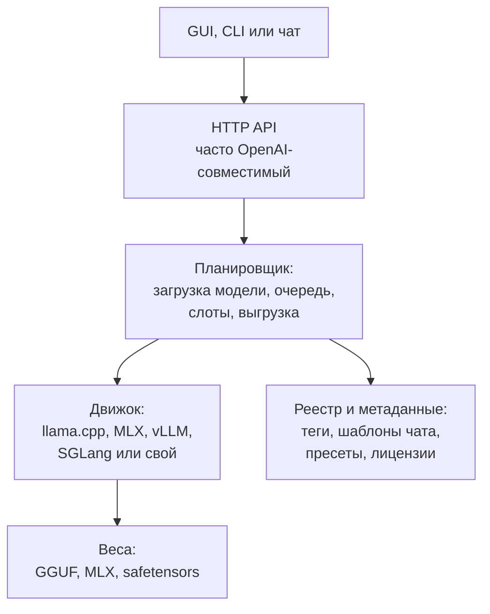
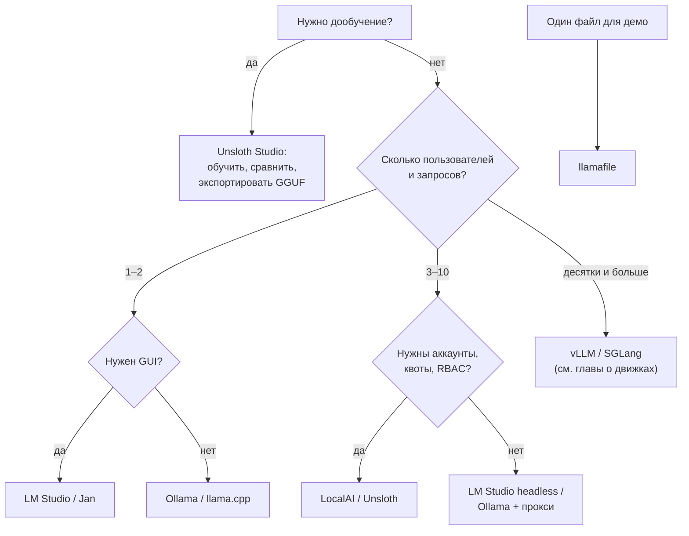

# Готовые «коробки»: Ollama, LM Studio и Unsloth Studio

> **Зачем эта глава.** До сих пор книга почти всегда требовала собирать конфиг руками: выбрать GGUF, посчитать KV, выставить `-ngl`, `-c`, `-np`. Большинство людей начинает не с этого, а с приложения: скачал, выбрал модель, нажал «чат». Такие приложения — «коробки» — экономят дни, но прячут ровно те параметры, от которых зависит, поместится ли длинный промпт и не превратится ли агент в тыкву. Здесь — что находится внутри Ollama, LM Studio и Unsloth Studio, что они умеют на ноябрь 2026 года, где их дефолты обманывают и когда пора доставать голый движок.

> **За 30 секунд**
> - «Коробка» — это движок + менеджер моделей + HTTP-API + набор дефолтов. Удобство оплачивается контролем: версией движка, размером контекста, KV-квантом и набором флагов.
> - **Ollama** — самый простой путь к OpenAI-совместимому API: llama.cpp (и MLX на Apple), свой реестр, Modelfile. Но контекст по умолчанию — 4k на картах до 24 ГиБ, а KV-квант задаётся глобально.
> - **LM Studio** — GUI и headless-ядро `llmster`: llama.cpp + MLX, до четырёх параллельных запросов по умолчанию, спекулятивное декодирование и KV-квант в интерфейсе. Приложение закрытое, но бесплатное и для работы.
> - **Unsloth Studio** — не только инференс, но и дообучение: GGUF/MLX, экспорт, API, несколько пользователей. Это бета с AGPL-лицензией на UI и маркетинговыми цифрами «2× быстрее, 70% меньше VRAM».
> - Коробки хватает одному человеку или небольшой команде на стандартных GGUF. Для тензорного параллелизма, сотен конкурентных запросов, точного апстрим-коммита и нестандартных квантов нужен голый движок — см. главы о движках.

Версии и ссылки в этой главе проверены **8 ноября 2026 года**. Поведение коробок меняется между сборками быстрее, чем выходит книга; перед повторением команд сверьтесь с `--help` и release notes своей версии.

## 1. Что такое «коробка» и из чего она состоит

У любой коробки, будь то десктопное приложение или сервер в контейнере, одна и та же слоёная структура:



Четыре слоя можно менять по отдельности, но коробка продаёт их как одно целое. Отсюда главный компромисс: вы получаете работающий сервер за минуты, но не выбираете, какой именно коммит llama.cpp внутри, как посчитан KV и что случится, когда промпт длиннее окна.

**Что коробка берёт на себя:**

- определяет GPU и раскладывает слои;
- скачивает модель из своего реестра или с Hugging Face;
- подставляет шаблон чата и стоп-токены;
- поднимает HTTP-сервер и иногда веб-интерфейс;
- хранит пресеты, историю и настройки;
- обновляет движок вместе с приложением.

**Что она обычно скрывает:**

- точную версию движка и его отставание от апстрима;
- фактический размер контекста и число слотов;
- тип KV-кэша (FP16, `q8_0`, `q4_0`);
- политику выгрузки экспертов MoE в ОЗУ;
- момент, когда промпт обрезается или сдвигается;
- лицензию модели — она почти всегда отдельная от лицензии приложения.

> [!NOTE]
> Лицензия приложения не делает модель коммерчески свободной. Ollama и LM Studio распространяются по своим лицензиям, а веса Llama, Gemma, Qwen и других моделей — по своим. Проверяйте карточку конкретной модели, а не название коробки.

### 1.1 Кто на чём работает (ноябрь 2026)

| Решение | Версия и дата | Движок | Формат поставки |
|---|---|---|---|
| **Ollama** | v0.40.15, 3 ноября 2026 | llama.cpp; MLX-сборки для Apple | CLI + сервер, GUI-приложение |
| **LM Studio** | линейка 0.4.x; 0.4.0 — 28 января 2026 | llama.cpp + MLX на Apple Silicon | GUI + headless `llmster` + CLI `lms` |
| **Unsloth Studio** | v0.1.916-beta, 6 ноября 2026 | llama.cpp + Hugging Face; MLX; опционально vLLM/SGLang | Desktop, web UI, Docker |
| **Jan** | v0.8.8, 28 октября 2026 | llama.cpp + MLX | Desktop + локальный API |
| **llamafile** | 0.10.6, 15 сентября 2026 | llama.cpp + Cosmopolitan Libc | Один исполняемый файл |
| **GPT4All** | 3.10.0, 25 февраля 2025 | llama.cpp | Desktop + Python SDK |
| **LocalAI** | 4.12.1, 23 октября 2026 | llama.cpp, ik_llama.cpp, vLLM, SGLang, Transformers и др. | Сервер, Docker, веб-UI |

Эта таблица — не рейтинг. Разные инструменты решают разные задачи: llamafile — «отправить один файл», LocalAI — «поднять шлюз на команду», Unsloth — «дообучить и тут же проверить».

## 2. Ollama

### 2.1 Что внутри

Ollama — Go-сервер, который запускает модели через **llama.cpp**; на Apple Silicon у него есть и **MLX-бэкенд** для части моделей (в релизах есть отдельные MLX-сборки и заметки об обновлении MLX). Сверху есть собственный реестр моделей, менеджер загрузки, шаблоны, Modelfile и HTTP-API. Проект под MIT, текущая версия на момент проверки — v0.40.15 ([релиз](https://github.com/ollama/ollama/releases/tag/v0.40.15)).

Установка:

```bash
# Linux
curl -fsSL https://ollama.com/install.sh | sh

# macOS / Windows — установщик с ollama.com
ollama run gemma4
```

Ollama не просто «обёртка над одной командой». Это полноценный локальный сервер с:

- собственным реестром `ollama.com/library`;
- тегами моделей и квантов (`qwen3:8b-q4_K_M`);
- Modelfile — рецептом из базовой модели, параметров, шаблона и системного промпта;
- OpenAI-совместимыми `/v1/chat/completions`, `/v1/responses`, `/v1/embeddings`;
- нативным `/api/chat` с `options`, `keep_alive` и метриками;
- автоматической раскладкой по GPU/CPU.

Важно: **Ollama не квантует GGUF при импорте**. Если у вас safetensors или неудобный квант, сначала готовьте GGUF через `llama-quantize`, потом импортируйте ([документация](https://docs.ollama.com/import)).

### 2.2 Модели, теги и Modelfile

Базовый сценарий:

```bash
ollama pull qwen3:8b
ollama run qwen3:8b
ollama list
ollama ps
```

Тег — это не только имя модели, но и квант, и шаблон. Один и тот же `qwen3` в разных тегах может иметь разный размер файла, разный шаблон и разные стоп-токены. Поэтому «я запустил qwen3, почему ответы другие» — почти всегда не про модель, а про тег.

Свой рецепт собирается через `Modelfile`:

```dockerfile
FROM qwen3:8b
PARAMETER num_ctx 32768
PARAMETER temperature 0.6
PARAMETER top_p 0.95
SYSTEM Ты помогаешь с кодом. Отвечай по-русски.
```

```bash
ollama create my-qwen -f Modelfile
ollama run my-qwen
```

Посмотреть, что реально лежит внутри чужого тега, можно так:

```bash
ollama show --modelfile qwen3:8b
```

Это полезнее, чем карточка на сайте: вы увидите `TEMPLATE`, `PARAMETER stop`, `num_ctx` и путь к блобу. Если шаблон чата не совпадает с тем, на котором модель обучали, tool calling и рассуждения ломаются — см. [главу 11](11-tool-calling.md).

### 2.3 API: OpenAI-совместимый и нативный

Минимальный запрос к OpenAI-совместимому endpoint:

```bash
curl http://localhost:11434/v1/chat/completions \
  -H "Content-Type: application/json" \
  -d '{
    "model": "my-qwen",
    "messages": [{"role": "user", "content": "Привет!"}]
  }'
```

Нативный API даёт больше контроля над параметрами модели:

```bash
curl http://localhost:11434/api/chat -d '{
  "model": "my-qwen",
  "messages": [{"role": "user", "content": "Привет!"}],
  "stream": false,
  "options": {"num_ctx": 32768, "temperature": 0.6}
}'
```

Ollama поддерживает значительную часть OpenAI API, но **не всю**. На ноябрь 2026 в `/v1/chat/completions` нет `tool_choice`, `logit_bias`, `logprobs`, `user` и `n`; изображения принимаются в base64, но не по URL; `reasoning_effort` поддержан для моделей с рассуждениями ([таблица совместимости](https://docs.ollama.com/api/openai-compatibility)). Этого достаточно для большинства чатов и простых агентов, но для строгого продакшн-клиента проверяйте каждое поле.

Tool calling устроен как в OpenAI: вы передаёте `tools`, получаете `tool_calls`, возвращаете `role: "tool"` с результатом. Поддержаны и параллельные вызовы ([документация](https://docs.ollama.com/capabilities/tool-calling)). Это работает, если шаблон модели и парсер Ollama понимают формат; для экзотических моделей проверяйте, что тег действительно объявляет capability `tools`.

### 2.4 Контекст: главный дефолт, который надо проверить

Ollama — самый частый источник истории «модель забыла начало промпта». Причина в дефолтном контексте.

Официальная страница [Context length](https://docs.ollama.com/context-length) на ноябрь 2026 говорит:

| VRAM | Контекст по умолчанию |
|---:|---:|
| меньше 24 ГиБ | 4k |
| 24–48 ГиБ | 32k |
| 48 ГиБ и больше | 256k |

Это ориентир по VRAM; при чисто CPU-инференсе он не работает, и фактический размер надо смотреть в `ollama ps`. Для агентов, веб-поиска и кодинг-инструментов документация рекомендует ставить **не меньше 64 000 токенов**. Это не «рекомендация для красоты»: системный промпт агента, история инструментов и файлы легко дают 20–50k ещё до первого вопроса.

Управлять контекстом можно тремя способами:

```bash
# 1. Глобально для сервера
OLLAMA_CONTEXT_LENGTH=64000 ollama serve

# 2. В Modelfile для конкретной модели
# PARAMETER num_ctx 32768

# 3. В нативном API
# "options": {"num_ctx": 32768}
```

А вот в OpenAI-совместимом API поля для контекста **нет**. Документация прямо предлагает создать модель с нужным `num_ctx` через Modelfile и обращаться к ней по имени ([OpenAI compatibility](https://docs.ollama.com/api/openai-compatibility)). Это неочевидный, но важный момент: клиент, который привык к OpenAI, не может попросить «дай 64k» — это решается только на стороне Ollama.

Проверить фактический контекст и раскладку можно командой:

```bash
ollama ps
```

В выводе есть `SIZE`, `PROCESSOR` (`100% GPU`, `100% CPU`, `48%/52% CPU/GPU`) и `CONTEXT`. Именно `CONTEXT`, а не то, что вы написали в конфиге, определяет, сколько модель реально видит.

> [!WARNING]
> В документации Ollama есть расхождение: страница Modelfile указывает `num_ctx` по умолчанию 2048, а страница Context length — 4k/32k/256k в зависимости от VRAM. Это не повод верить одной из страниц: смотрите `CONTEXT` в `ollama ps` и `prompt_eval_count` в ответе. Если `prompt_eval_count` заметно меньше числа токенов, которое вы отправили, — контекст обрезан или сдвинут.

### 2.5 Параллельные запросы и память

Ollama умеет обслуживать несколько запросов, но дефолт — последовательный:

- `OLLAMA_NUM_PARALLEL` — сколько запросов одна модель обрабатывает одновременно; по умолчанию **1**;
- при параллельной обработке контекст увеличивается кратно числу запросов: «2K контекста × 4 параллельных = 8K и дополнительная память» ([FAQ](https://docs.ollama.com/faq));
- `OLLAMA_MAX_LOADED_MODELS` — сколько моделей держать в памяти; по умолчанию 3 × число GPU или 3 для CPU;
- `OLLAMA_MAX_QUEUE` — длина очереди, по умолчанию 512; при переполнении сервер отвечает 503.

Это не «многопользовательский режим», а именно параллельная обработка запросов к одной модели. Аутентификации, квот и разделения пользователей в Ollama нет. Если нужно выставить сервер в сеть, ставьте reverse proxy с авторизацией и не биндитесь на `0.0.0.0` без необходимости (`OLLAMA_HOST`).

Память:

- Ollama автоматически решает, сколько слоёв положить на GPU, а сколько оставить в ОЗУ; `ollama ps` показывает фактическое соотношение;
- KV-кэш квантуется глобально: `OLLAMA_KV_CACHE_TYPE=f16|q8_0|q4_0`, по умолчанию `f16`; настройка действует на все модели ([FAQ](https://docs.ollama.com/faq));
- Flash Attention включается автоматически, если бэкенд поддерживает; можно форсировать `OLLAMA_FLASH_ATTENTION=1`;
- отдельной ручки «сколько экспертов MoE оставить на CPU» (`--n-cpu-moe`) в Ollama нет. Это одна из причин уходить на llama.cpp, если модель большая и MoE.

Модель выгружается через 5 минут простоя по умолчанию; `keep_alive` в запросе или `OLLAMA_KEEP_ALIVE` меняет таймер. Для агента, который ходит в модель каждые полчаса, это означает повторную загрузку и холодный старт; для ноутбука — наоборот, экономию памяти. Кэш промпта при этом живёт по правилам слота и тоже теряется при выгрузке; как это влияет на агентские нагрузки — в [главе 7](07-prompt-cache.md).

### 2.6 Подводные камни Ollama

1. **Тихий дефолт 4k.** На карте 16 ГБ вы можете месяцами работать с 4k, даже не подозревая, что модель не видит половину инструкции. Поставьте `num_ctx` явно и проверьте `ollama ps`.
2. **Контекст умножается на параллельность.** `OLLAMA_NUM_PARALLEL=4` и `OLLAMA_CONTEXT_LENGTH=32768` — это не 32k памяти, а четыре слота по 32k плюс накладные расходы. Считайте по [главе 6](06-kv-cache-context.md), а не по названию флага.
3. **KV-квант глобальный.** Нельзя одной модели дать `q8_0`, а другой `f16`. Если нужен разный режим — либо разные инстансы, либо llama.cpp.
4. **Имена и кванты — свои.** `qwen3:8b` и `qwen3:8b-q4_K_M` могут отличаться не только размером. Смотрите `ollama show --modelfile` и размер блоба.
5. **Импорт не квантует.** Ollama не делает `llama-quantize` за вас; «загрузил safetensors и стало 4 бита» — не про этот инструмент.
6. **OpenAI-совместимость — подмножество.** `tool_choice`, `logprobs`, `logit_bias` и `n` отсутствуют. Для агентов, которым нужен `tool_choice: required`, это блокер.
7. **Облако и телеметрия.** Локальные промпты не отправляются, но приложение умеет предлагать облачные модели и веб-поиск. Для полностью локального режима: `OLLAMA_NO_CLOUD=1` или `"disable_ollama_cloud": true` в `~/.ollama/server.json` ([FAQ](https://docs.ollama.com/faq), [политика](https://ollama.com/privacy)). Лицензия самого Ollama — MIT, но лицензии моделей отдельные.
8. **Отставание от апстрима.** Ollama обновляет llama.cpp и MLX в своих релизах (например, v0.40.12: «Updated MLX and llama.cpp»), но вы не выбираете коммит и не можете поставить патч отдельно. Новая архитектура может потребовать обновления приложения, а не только нового GGUF.

## 3. LM Studio

### 3.1 Что внутри

LM Studio — десктопное приложение с закрытым исходным кодом. Внутри два движка:

- **llama.cpp** — на Windows, Linux и Apple Silicon; в 0.4.0 движок получил версию «llama.cpp v2.0.0» в нумерации LM Studio;
- **MLX** — на Apple Silicon, отдельный `mlx-engine`.

С 0.4.0 ядро отделено от GUI и поставляется как headless-демон **llmster**; управление — CLI `lms` ([релиз 0.4.0](https://lmstudio.ai/blog/0.4.0)). Приложение бесплатно для личного и рабочего использования с июля 2025 года ([анонс](https://lmstudio.ai/blog/free-for-work)), но остаётся проприетарным: EULA запрещает реверс-инжиниринг, распространение и встраивание не через публичные интерфейсы ([условия](https://lmstudio.ai/app-terms)).

Установка headless-варианта:

```bash
# Linux / macOS
curl -fsSL https://lmstudio.ai/install.sh | bash

lms daemon up
lms get qwen/qwen3.6-27b
lms load qwen/qwen3.6-27b --context-length 32768 --gpu max
lms server start
```

GUI-версия ставится установщиком с `lmstudio.ai`; CLI `lms` идёт вместе с ней.

> [!NOTE]
> В 2026 году под брендом LM Studio появился отдельный агентский продукт **Bionic**. Это не то же самое, что классическое приложение LM Studio и `llmster`; ниже речь только о последних.

### 3.2 Модели и пресеты

LM Studio умеет:

- искать и скачивать модели из Hugging Face через встроенный Discover;
- работать с GGUF и MLX;
- импортировать локальные файлы;
- хранить **пресеты** — именованные наборы системного промпта и параметров сэмплирования;
- задавать **per-model defaults** — контекст, GPU offload, Flash Attention для каждой модели ([per-model defaults](https://lmstudio.ai/docs/app/advanced/per-model));
- публиковать `model.yaml` и пресеты в LM Studio Hub.

Для API-сервера важно, что модель можно загрузить заранее (`lms load`) или по первому запросу (**JIT**). JIT включён по умолчанию: `/v1/models` показывает все скачанные модели, а не только загруженные; модель подгружается при первом обращении. Простаивающая JIT-модель выгружается через **60 минут** по умолчанию; TTL можно задать в запросе или через `lms load --ttl`. Auto-evict выгружает предыдущую JIT-модель перед загрузкой новой ([TTL](https://lmstudio.ai/docs/developer/core/ttl-and-auto-evict)).

### 3.3 API

LM Studio предоставляет:

- OpenAI-совместимые `/v1/chat/completions`, `/v1/completions`, `/v1/responses`, `/v1/embeddings`, `/v1/models`;
- Anthropic-совместимый `/v1/messages`;
- собственный REST `/api/v1` с загрузкой/выгрузкой моделей и статистикой;
- stateful `/v1/chat` с `previous_response_id` и поддержкой локальных MCP-серверов;
- **permission keys** — ключи доступа к серверу, которыми можно ограничить клиентов.

Пример:

```bash
curl http://localhost:1234/v1/chat/completions \
  -H "Content-Type: application/json" \
  -H "Authorization: Bearer $LM_API_TOKEN" \
  -d '{
    "model": "qwen/qwen3.6-27b",
    "messages": [{"role": "user", "content": "Привет!"}]
  }'
```

OpenAI-совместимость здесь шире, чем у Ollama: есть tools, structured output, Responses API и Anthropic Messages. Но это всё равно не полный OpenAI: часть полей игнорируется или реализована иначе, а load-time параметры через REST ограничены (`context_length`, `eval_batch_size`, `flash_attention`, `num_experts`, `offload_kv_cache_to_gpu`).

### 3.4 Контекст, параллельность и память

Контекст задаётся при загрузке:

```bash
lms load qwen/qwen3.6-27b --context-length 32768
```

В GUI есть настройка **Default Context Length** с выбором пользовательского значения или максимума модели. Официальная документация не фиксирует одно число для всех сборок, поэтому не полагайтесь на «по умолчанию же должно быть максимум». Проверяйте фактический `context_length` в ответе REST (список моделей или конфиг загруженной модели) или в индикаторе контекста. Даже если глобально выбран максимум, per-model профиль может переопределить значение; это одна из самых частых причин «модель не видит файл».

С 0.4.0 LM Studio умеет **параллельные запросы через continuous batching**:

- **Max Concurrent Predictions** по умолчанию **4**;
- **Unified KV Cache** включён по умолчанию: буфер не делится жёстко на четыре равные части, запросы могут быть разной длины;
- запросы сверх лимита ставятся в очередь;
- на момент 0.4.0 параллельность была только для llama.cpp; для MLX её обещали позже ([документация](https://lmstudio.ai/docs/app/advanced/parallel-requests)).

Это важный сдвиг: раньше LM Studio был строго последовательным, и «сервер на 4 пользователя» на нём был невозможен. Теперь — возможен, но с оговорками: четыре параллельных запроса по 32k контекста — это не «бесплатно», а четыре KV-кэша, пусть и в общем буфере.

Память:

- GPU offload — ползунком или `--gpu 0.5|max|off`;
- `n_cpu_moe` — ползунок для выгрузки экспертов MoE в ОЗУ (появился в 0.4.0);
- KV-квант — в GUI и через SDK (`llamaKCacheQuantizationType`, `llamaVCacheQuantizationType`); на практике его включают вместе с Flash Attention и проверяют, что выбранный тип поддерживается бэкендом;
- `offload_kv_cache_to_gpu` — можно оставить KV в ОЗУ, если VRAM не хватает;
- `--estimate-only` показывает оценку памяти до загрузки.

### 3.5 Tool calling, MCP и спекуляция

Tool calling:

- OpenAI-совместимые `tools` в `/v1/chat/completions`;
- MCP-серверы можно подключить в приложении и использовать в чате;
- stateful `/v1/chat` умеет вызывать локальные MCP с permission keys;
- серверный vs клиентский цикл инструментов зависит от клиента: LM Studio отдаёт `tool_calls`, но не обязана исполнять их сама.

Спекулятивное декодирование:

- включается в GUI (Power User / Developer mode) выбором **Draft Model**;
- черновик должен иметь тот же словарь, что и основная модель;
- ориентиры LM Studio: для 7B — черновик до 1B, для 14B — до 3B, для 32B — до 7B; больше — может стать медленнее;
- выигрыш зависит от промпта: математика и код ускоряются лучше, чем свободная проза;
- черновик ест дополнительную память и вычисления ([документация](https://lmstudio.ai/docs/app/advanced/speculative-decoding)).

Это ровно та ручка, которой нет в Ollama «из коробки» в таком виде: там есть `draft_num_predict` и автоматический подбор черновика для некоторых моделей, но выбрать произвольную пару main/draft в UI нельзя. Формулы выигрыша, acceptance rate и безубыточный размер черновика — в [главе 9](09-speculative-decoding.md).

### 3.6 Подводные камни LM Studio

1. **Четыре параллельных запроса по умолчанию.** Если вы привыкли к последовательному серверу, после 0.4.0 память может уйти в четыре KV-кэша. Для одного пользователя ставьте `--parallel 1` или Max Concurrent Predictions = 1.
2. **Контекст не равен максимуму модели.** Проверяйте `context_length`; «загрузил 128k-модель» не значит «получил 128k».
3. **KV-квант и параллельность не всегда сочетаются программно.** Открытый баг-репорт #2024 (июнь 2026, LM Studio 0.4.16) показывает: CLI умеет `--parallel 1`, SDK умеет KV-квант, но один headless-путь не даёт задать и то, и другое; REST не принимает поля KV-кванта. Это баг-репорт, а не официальная документация; на ноябрь 2026 проверяйте свою сборку.
4. **Движок обновляется отдельно.** `lms runtime update llama.cpp` и `lms runtime update mlx`; версия рантайма — не версия приложения. Записывайте её в отчёт.
5. **MLX и параллельность.** На 0.4.0 параллельные запросы были только для llama.cpp; проверьте, доехало ли до MLX в вашей версии.
6. **Проприетарная лицензия.** Бесплатно — не значит open source. Для встраивания в продукт читайте EULA, а не только «free for work».
7. **Нет многопользовательских аккаунтов.** Permission keys — это ключи доступа, а не роли, квоты и изоляция пользователей. Для команды с разными правами нужен LocalAI или прокси сверху.
8. **Телеметрии нет, но сеть есть.** Политика LM Studio говорит: локальные чаты и документы не передаются; приложение ходит в сеть за обновлениями и при поиске/скачивании моделей; облачные функции — только если вы их включили ([privacy](https://lmstudio.ai/app-privacy)). Для полностью офлайн-режима скачайте модели заранее и не включайте облако.

## 4. Unsloth Studio

### 4.1 Что внутри

Unsloth Studio — открытый no-code интерфейс (web UI и desktop) для **дообучения и запуска** моделей. Это не только «ещё один чат»: внутри два разных стека.

- **Инференс:** GGUF через llama.cpp, MLX на Apple, safetensors через Hugging Face; опционально vLLM и SGLang.
- **Обучение:** PyTorch + ядра Unsloth, LoRA/QLoRA, полное дообучение, GRPO/DPO, обучение vision/audio/embedding-моделей.
- **Экспорт:** GGUF, safetensors, NVFP4, FP8, LoRA-адаптеры.
- **API:** OpenAI-совместимый `/v1/chat/completions` и `/v1/responses`, Anthropic-совместимый `/v1/messages`.

Версия на момент проверки — **v0.1.916-beta** (6 ноября 2026), то есть проект всё ещё в бете ([changelog](https://unsloth.ai/docs/new/changelog), [релиз](https://github.com/unslothai/unsloth/releases/tag/v0.1.916-beta)).

Установка:

```bash
# macOS / Linux / WSL
curl -fsSL https://unsloth.ai/install.sh | sh
unsloth studio

# или desktop-приложение с unsloth.ai/download
```

Для API-сценария можно запустить модель одной командой:

```bash
unsloth run --model unsloth/gemma-4-26B-A4B-it-GGUF:UD-Q4_K_XL \
  -c 131072 --threads 32
```

`unsloth run` поднимает llama-server, печатает URL и API-ключ, а лишние флаги передаёт в llama.cpp ([документация](https://unsloth.ai/docs/basics/api)).

### 4.2 Дообучение: что именно умеет

Заявленные возможности на ноябрь 2026:

- 500+ моделей: text, vision, TTS/audio, embedding, decision;
- LoRA, QLoRA, полное дообучение, continued pretraining, GRPO, DPO, FP8;
- multi-GPU обучение (включая FSDP2 в alpha);
- Data Recipes: превращение PDF/CSV/JSON/DOCX в датасет;
- наблюдение за loss, gradient norm, GPU utilization;
- сравнение base и fine-tuned в Model Arena;
- экспорт в GGUF и safetensors для llama.cpp, Ollama, LM Studio, vLLM.

Маркетинговые цифры Unsloth — «2× быстрее и на 70% меньше VRAM без потери точности» — это **заявление вендора**, а не независимый замер. Для книги важно другое: сам подход (LoRA/QLoRA + оптимизированные ядра) действительно снижает требования к памяти, но конкретный выигрыш зависит от модели, длины последовательности, батча и GPU. Проверяйте на своей задаче по [главе 12](12-benchmark-methodology.md), а не переносите цифру из баннера.

Практический сценарий:

1. Загрузить базовую модель.
2. Импортировать датасет или собрать его из документов.
3. Выбрать LoRA/QLoRA и пресет.
4. Обучить, следя за loss и памятью.
5. Сравнить с базой на своих промптах.
6. Экспортировать GGUF и запустить в llama.cpp/Ollama/LM Studio.

Это единственная из «коробок» в этой главе, которая закрывает цикл «дообучил → проверил → экспортировал → запустил» без переключения между пятью инструментами.

### 4.3 Инференс: контекст, слоты, выгрузка

Инференс в Studio — это llama.cpp (и MLX), поэтому модель ведёт себя как в llama.cpp, но с автоматикой:

- **Smart auto context**: Studio заявляет, что подбирает контекст под доступную память и не грузит лишнего; ручной слайдер контекста при этом остаётся;
- **4 слота llama-server по умолчанию**, число настраивается в web UI; при нехватке памяти Studio снижает число слотов ([changelog, 29 июля 2026](https://unsloth.ai/docs/new/changelog));
- multi-GPU inference и автоматическая выгрузка слоёв/экспертов в ОЗУ;
- можно держать несколько моделей загруженными и переключаться;
- опционально можно включить vLLM или SGLang как движок (с октября 2026);
- поддерживаются кастомные сборки llama.cpp и большинство флагов `llama-server` ([документация](https://unsloth.ai/docs/basics/api)).

«Smart auto context» — удобно, но это ещё один дефолт, который вы не выбирали. Если вы делаете агента с длинным системным промптом, задайте контекст явно (`-c 64000` или слайдер) и проверьте фактическое значение в мониторе API. Автоматика хороша, когда она совпадает с вашей задачей; когда не совпадает — вы снова отлаживаете «почему модель забыла инструкцию».

### 4.4 API, инструменты и многопользовательский режим

API:

- `POST /v1/chat/completions` — OpenAI-совместимый, streaming, tools, vision;
- `POST /v1/responses` — OpenAI Responses, без stateful `previous_response_id`;
- `POST /v1/messages` — Anthropic Messages для Claude Code и подобных клиентов;
- `GET /v1/models`, `GET /v1/props`, `POST /v1/embeddings`, `POST /v1/chat/count_tokens`;
- API-ключи `sk-unsloth-...`, монитор запросов, latency, TTFT, throughput.

Инструменты:

- клиентские tools в формате OpenAI/Anthropic;
- **server-side tools**: Python, bash, web search — выполняются на сервере и возвращаются как `tool_result`;
- self-healing tool calling: Unsloth пытается чинить сломанный JSON/разметку; вендор заявляет +50% точности, это не независимая проверка;
- sandbox для кода: ограничение доступа к файлам; политика зависит от ОС.

Многопользовательский режим:

- с 17 сентября 2026 есть **аккаунты с изоляцией** (Settings → Accounts): отдельные пароли, одноразовые коды настройки, разделение работ;
- загруженная модель может шариться между пользователями, если настройки совпадают;
- это не полноценный RBAC с квотами, как в LocalAI, но для небольшой команды уже лучше, чем один общий API-ключ.

### 4.5 Подводные камни Unsloth Studio

1. **Бета.** Версия 0.1.x, changelog выходит почти каждую неделю; поведение и флаги меняются. Для продакшна фиксируйте версию и тестируйте обновления.
2. **Обучение и инференс делят GPU.** Во время тренировки инференс может быть выгружен или замедлен; планируйте ресурсы, а не запускайте всё сразу.
3. **AGPL-3.0 на UI.** Ядро Unsloth — Apache 2.0, но Studio UI — AGPL-3.0 ([FAQ](https://unsloth.ai/docs/new/studio)). Если вы встраиваете UI в коммерческий продукт, это важно; для локального использования — нет.
4. **Автоконтекст — не прозрачен.** Он подбирается по памяти, а не по вашей задаче. Для агентов и RAG задавайте контекст руками.
5. **Вендорские цифры.** «2× быстрее», «+50% tool calls», «3× длиннее контекст» — заявления Unsloth. Проверяйте на своих промптах и своей модели.
6. **Не production-оркестратор.** Аккаунты и слоты есть, но по документации на ноябрь 2026 нет распределённого батчинга, квот, OIDC и горизонтального масштабирования, как в LocalAI/vLLM. Для одного сервера и малой команды — да; для сотен пользователей — нет.
7. **Телеметрия.** Unsloth заявляет, что не собирает usage-телеметрию и берёт только минимальную информацию о железе для совместимости ([FAQ](https://unsloth.ai/docs/new/studio)). Это заявление вендора; для строгих требований проверяйте сетевой трафик и настройки.

## 5. Остальные: Jan, llamafile, GPT4All, LocalAI

### 5.1 Jan

**Что это.** Открытый десктопный клиент (Apache 2.0) с локальным API и MCP. Версия 0.8.8 — 28 октября 2026 ([релиз](https://github.com/janhq/jan/releases/tag/v0.8.8), [quickstart](https://jan.ai/docs/desktop/quickstart)).

**Движок.** llama.cpp, на Apple Silicon — MLX. Движок встроен в приложение и обновляется вместе с ним; отдельной версии llama.cpp для выбора нет ([документация](https://github.com/janhq/jan/blob/docs-stable/docs/content/desktop/local-engine/llama-cpp.mdx)).

**Установка.** Установщик с `jan.ai`; локальный API включается в **Settings → Local API Server**, по умолчанию на `127.0.0.1:1337`.

**Что умеет.** Чат, проекты, ассистенты, MCP, локальный OpenAI-совместимый сервер на `127.0.0.1:1337` с опциональным API-ключом, tool calling, grammars/JSON Schema, continuous batching, параллельные последовательности, KV-квант `f16/q8_0/q4_0`, context shift, prompt cache, настройки RoPE. Для десктопа это неожиданно много ручек llama.cpp.

**Ограничения.** Один пользователь, нет аккаунтов и квот; на Intel Mac локальный движок не поддерживается с v0.8.5; API-сервер требует заранее выбранную локальную модель. Хороший выбор, если нужен открытый GUI с контролем, а не сервер на команду.

### 5.2 llamafile

**Что это.** Один исполняемый файл, внутри — llama.cpp и Cosmopolitan Libc. Версия 0.10.6 — 15 сентября 2026 ([репозиторий](https://github.com/mozilla-ai/llamafile)). Запуск:

```bash
curl -LO https://huggingface.co/mozilla-ai/llamafile_0.10/resolve/main/Qwen3.5-0.8B-Q8_0.llamafile
chmod +x Qwen3.5-0.8B-Q8_0.llamafile
./Qwen3.5-0.8B-Q8_0.llamafile
```

**Что умеет.** CLI, чат, сервер (`--server`, по умолчанию `127.0.0.1:8080`), OpenAI- и Anthropic-совместимые API, `--api-key`, `--jinja`, `--ctx-size`, `--tools all` для встроенных инструментов, whisperfile для речи. Лицензия Apache 2.0; патчи к llama.cpp/whisper.cpp — MIT ([лицензирование](https://github.com/mozilla-ai/llamafile#licensing)).

**Ограничения.** Это не менеджер моделей: обновлять и раскладывать модели вы будете руками. На Windows исполняемые файлы больше 4 ГБ не запускаются — нужен внешний GGUF и отдельный бинарник. Предсобранные llamafile привязаны к конкретному коммиту llama.cpp, поэтому новые архитектуры могут отставать. Многопользовательского режима нет, только общий `--api-key`.

**Когда брать.** Демо, «отправить коллеге один файл», запуск без установки, быстрый стенд на чужой машине. Для постоянного сервера — нет.

### 5.3 GPT4All

**Что это.** Десктопное приложение и Python SDK от Nomic, MIT, на llama.cpp. Умеет чат, LocalDocs (RAG по локальным файлам), запуск GGUF, простой API-сервер. Ставится установщиком с `gpt4all.io`; Python-пакет — `pip install gpt4all`.

**Состояние на ноябрь 2026.** Последний релиз — **3.10.0 от 25 февраля 2025** ([релиз](https://github.com/nomic-ai/gpt4all/releases/tag/v3.10.0)); с тех пор новых стабильных релизов нет. Проект не «умер» — репозиторий и Python-пакет живут, — но темп разработки несопоставим с Ollama/LM Studio, и поддержка свежих архитектур, tool calling и длинного контекста может отставать.

**Когда брать.** Если нужен максимально простой офлайн-чат с LocalDocs на старом железе и вы готовы к тому, что новые модели могут не завестись. Для новых проектов — скорее нет.

### 5.4 LocalAI

**Что это.** Открытый (MIT) серверный шлюз, а не десктопная коробка. Версия 4.12.1 — 23 октября 2026 ([релиз](https://github.com/mudler/LocalAI/releases/tag/v4.12.1)). Умеет OpenAI-, Anthropic- и Open Responses-совместимые API, веб-UI, галерею моделей, агентов, MCP, RAG, изображения, аудио, видео.

**Движки.** Не один, а набор бэкендов: llama.cpp, ik_llama.cpp, turboquant (llama.cpp с TurboQuant KV), vLLM, SGLang, Transformers, RWKV и другие ([документация](https://localai.io/docs/features/text-generation/)). Модель описывается YAML; бэкенд можно менять без смены API.

**Установка.** Быстрее всего Docker: `docker run -p 8080:8080 --name local-ai -ti localai/localai:latest`; модель ставится из галереи (`local-ai models install qwen3-4b`) или описывается YAML ([quickstart](https://localai.io/docs/basics/getting_started/)).

**Многопользовательский режим.** Здесь он настоящий: `LOCALAI_AUTH=true` включает пользователей, роли admin/user, сессии, GitHub OAuth, OIDC (Keycloak, Google, Okta, Authentik), персональные API-ключи и учёт токенов. Есть распределённый режим, P2P-федерация и шардирование моделей ([аутентификация](https://localai.io/docs/features/authentication/)).

**Когда брать.** Нужен один OpenAI-совместимый вход для команды, разные модели/бэкенды, авторизация и учёт. Это уже не «коробка для ноутбука», а сервис; сложнее в установке и требует понимания бэкендов.

## 6. Сравнительная таблица

### 6.1 Основные три

| | **Ollama** | **LM Studio** | **Unsloth Studio** |
|---|---|---|---|
| **Движок** | llama.cpp; MLX на Apple | llama.cpp + MLX на Apple | llama.cpp; MLX; опционально vLLM/SGLang |
| **Модели** | Свой реестр, теги, GGUF-импорт, Modelfile | Hugging Face, GGUF/MLX, импорт, пресеты | Hugging Face, GGUF/MLX/safetensors, свои и старые GGUF |
| **API** | OpenAI-подмножество + нативный `/api/chat` | OpenAI + Anthropic + REST + stateful `/v1/chat` | OpenAI + Anthropic + Responses + API-ключи |
| **Контекст** | 4k/32k/256k по VRAM; `num_ctx`; в OpenAI API не задать | `--context-length`; Default Context Length; JIT TTL 60 мин | Auto context; `-c`; 4 слота по умолчанию |
| **Параллельность** | `OLLAMA_NUM_PARALLEL`, по умолчанию 1 | Max Concurrent Predictions, по умолчанию 4, unified KV (llama.cpp; MLX — проверяйте) | 4 llama-server слота, настраивается |
| **Tool calling** | Да, включая параллельные вызовы; нет `tool_choice` | Да, OpenAI tools + MCP | Да, OpenAI/Anthropic + server-side tools |
| **KV-квант** | Глобально `OLLAMA_KV_CACHE_TYPE` | GUI/SDK; обычно с Flash Attention | Флаги llama-server |
| **Многопользовательский** | Нет; только параллельные запросы | Permission keys, без аккаунтов | Аккаунты с изоляцией, без полноценного RBAC |
| **Лицензия** | MIT (модели — отдельно) | Проприетарная, бесплатна для работы | Apache 2.0 ядро + AGPL-3.0 UI |
| **Когда брать** | Быстрый API, один пользователь, стандартные GGUF | Десктоп + headless, спекуляция, 2–5 пользователей | Дообучение + инференс + экспорт |

### 6.2 Остальные

| | **Jan** | **llamafile** | **GPT4All** | **LocalAI** |
|---|---|---|---|---|
| **Движок** | llama.cpp + MLX | llama.cpp + Cosmopolitan | llama.cpp | llama.cpp, ik_llama.cpp, vLLM, SGLang, Transformers |
| **Форма** | Desktop + API | Один файл | Desktop + Python | Сервер/Docker |
| **API** | OpenAI на `:1337` | OpenAI + Anthropic на `:8080` | Простой API-сервер | OpenAI + Anthropic + Responses |
| **Контекст/память** | Много ручек llama.cpp, KV-квант | Флаги llama.cpp | Ограниченно | YAML + флаги бэкенда |
| **Многопользовательский** | Нет | Нет (общий ключ) | Нет | Да: роли, OAuth/OIDC, квоты |
| **Лицензия** | Apache 2.0 | Apache 2.0 | MIT | MIT |
| **Когда брать** | Открытый GUI с контролем | Демо/перенос одного файла | Старый простой офлайн-чат | Шлюз на команду/сервер |

### 6.3 Коробка или голый движок

| Критерий | Коробки достаточно | Нужен голый движок |
|---|---|---|
| Пользователей | 1–5 | десятки и больше, с квотами |
| Нагрузка | последовательная или 4 слота | сотни конкурентных запросов |
| Модели | стандартные GGUF/MLX | новая архитектура в день релиза, свои кванты |
| Контекст | до 32–64k на слот | 128k+ с точным KV-бюджетом |
| Тюнинг | контекст, GPU layers, KV-квант | tensor parallel, `n-cpu-moe`, спекуляция, prefix caching |
| Воспроизводимость | версия приложения | закреплённый коммит движка |
| API | OpenAI-подмножество | полный набор полей, свои парсеры |
| Эксплуатация | ноутбук/одна машина | SLO, мониторинг, балансировка |

## 7. Подводные камни: что именно ломается

### 7.1 Контекст: дефолт, который вы не выбирали

Это самая дорогая ошибка главы. У Ollama дефолт — 4k на карте до 24 ГиБ. У LM Studio контекст задаётся настройкой, а не максимумом модели. У Unsloth — «smart auto». У Jan — per-model. У llamafile — `--ctx-size`, по умолчанию из llama.cpp.

Механика описана в [главе 6](06-kv-cache-context.md): KV-кэш растёт линейно с контекстом и числом слотов, а внимание на длинном контексте дорожает. Коробка может незаметно выбрать за вас и то, и другое.

**Посчитай сам.** Карта 16 ГиБ. Веса 4,5 ГиБ, буферы 1,5 ГиБ, запас 1 ГиБ. KV — 128 КиБ на токен в FP16. Сколько контекста на слот можно дать при 4 параллельных запросах? А если перевести KV в `q8_0`?

<details>
<summary>Решение</summary>

```
На KV:          16 − 4,5 − 1,5 − 1 = 9 ГиБ = 9216 МиБ
Токенов всего:  9216 × 1024 / 128 = 73 728
На слот (4):    73 728 / 4 = 18 432 ≈ 18k
q8_0:           примерно вдвое меньше байт на токен → ≈ 36k на слот
```

Дефолт Ollama 4k на такой карте оставляет на KV всего `4 × 4k × 128 КиБ = 2 ГиБ`; ещё около 7 ГиБ простаивают. Если поставить 18k на слот, модель увидит в четыре раза больше — при той же карте. Это не «магия флага», а арифметика из [главы 6](06-kv-cache-context.md).

</details>

> [!WARNING]
> «Тихое обрезание» выглядит по-разному: Ollama может сдвинуть окно или обрезать начало, LM Studio — упереться в `context_length`, Unsloth — в auto context. Универсальная проверка одна: сравните число токенов промпта с `prompt_eval_count` (Ollama), `context_length` (LM Studio) или «Context used» (Unsloth). Если модель отвечает так, будто не видела системную инструкцию, — почти всегда контекст.

### 7.2 Имена, кванты и шаблоны

«Модель» в коробке — это не только веса. Это ещё:

- квант (Q4_K_M, Q5_K_M, Q8_0, IQ4_XS, UD-Q4_K_XL);
- шаблон чата и стоп-токены;
- парсер tool calls;
- версия токенизатора.

В реестре Ollama тег может выглядеть как `qwen3:8b-q4_K_M`, в LM Studio ключ включает квант, в Unsloth — `UD-Q4_K_XL`, в Jan — имя файла. Один и тот же «Q4» у разных авторов может означать разные типы и разный размер. Сравнивать модели по названию — то же, что сравнивать автомобили по цвету. Типы квантов и их цена по качеству разобраны в [главе 4](04-quantization-gguf.md).

Практика:

- смотрите размер файла и тип кванта, а не только имя;
- для Ollama — `ollama show --modelfile`, для LM Studio — `lms ls` и `lms ps`;
- проверяйте, что шаблон чата соответствует модели ([глава 11](11-tool-calling.md));
- для tool calling прогоняйте свой тест, а не полагайтесь на «supported» в карточке.

Динамические кванты Unsloth (`UD-Q4_K_XL` и т.п.) — отдельная история: вендор утверждает, что сохраняет важные слои в более высокой точности, но это его методика и его замеры. Проверяйте на своих задачах по [главе 12](12-benchmark-methodology.md).

### 7.3 Отставание от апстрима

У коробки всегда есть «свой» движок:

- **Ollama** обновляет llama.cpp и MLX в релизах, но вы не выбираете коммит; новая архитектура может потребовать обновления приложения.
- **LM Studio** поставляет рантаймы отдельно (`lms runtime update`), но версия — это версия LM Studio, а не тег upstream. В 0.4.0 это «llama.cpp v2.0.0» в их нумерации.
- **Jan** встраивает движок в приложение; отдельной версии нет — обновляете приложение целиком.
- **Unsloth** тащит llama.cpp, но разрешает кастомные сборки и передачу флагов; это ближе к голому движку.
- **llamafile** прибит к коммиту llama.cpp в каждом релизе; предсобранные файлы могут отставать.
- **LocalAI** держит бэкенды отдельными образами; их можно обновлять независимо, но и следить надо за совместимостью.

Что это значит на практике: если модель вышла сегодня и требует нового оператора attention, коробка может её не запустить, даже если GGUF уже лежит. Проверяйте release notes и `--help`, а не «должно работать».

### 7.4 Телеметрия, лицензии и данные

- **Ollama:** MIT; локальные промпты не отправляются; облачные функции отключаются `OLLAMA_NO_CLOUD=1`; политика говорит о limited metadata ([privacy](https://ollama.com/privacy)).
- **LM Studio:** проприетарная; бесплатна для работы; политика утверждает, что телеметрии и трекинга нет, сеть — обновления, поиск/скачивание моделей и облачные функции по желанию ([privacy](https://lmstudio.ai/app-privacy)).
- **Unsloth:** ядро Apache 2.0, UI AGPL-3.0; вендор заявляет отсутствие usage-телеметрии ([FAQ](https://unsloth.ai/docs/new/studio)).
- **Jan:** Apache 2.0; локальный режим по умолчанию; облачные провайдеры — по желанию.
- **llamafile:** Apache 2.0; локальный бинарник, облака нет by design.
- **GPT4All:** MIT; локальный чат и LocalDocs.
- **LocalAI:** MIT; self-hosted, данные остаются у вас, если вы сами не настроили внешние бэкенды.

> [!WARNING]
> Лицензия приложения ничего не говорит о модели. Llama 3.x — Community License, Gemma — Gemma Terms, Qwen часто Apache-2.0, но бывают исключения. Коммерческое использование модели проверяйте по её карточке, а не по слову «open source» на сайте коробки.

### 7.5 Где кончаются ручки

Сводка по состоянию на ноябрь 2026. «Частично» значит «есть в API/UI, но не во всех режимах; проверяйте сборку».

| Ручка | Ollama | LM Studio | Unsloth | Jan | LocalAI |
|---|---|---|---|---|---|
| Контекст на модель | Да (`num_ctx`) | Да (`--context-length`) | Да (`-c`) | Да | Да (YAML) |
| KV-квант | Глобально | GUI/SDK; CLI/REST — нет | Флаги llama-server | Да (`q8_0/q4_0`) | Да (`cache_type_k/v`) |
| `n-cpu-moe` | Нет | Да (ползунок) | Да (флаги) | Не видно в UI | Да (опции) |
| Спекуляция | Частично (`draft_num_predict`) | Да (Draft Model) | Да (llama-server) | Не видно в UI | Частично (vLLM/движок) |
| Tensor parallel | Нет | Нет (только layer split) | Да (флаги) | Нет | Да (llama.cpp/vLLM) |
| Грамматика/JSON Schema | JSON Schema | Structured output | Да | GBNF/JSON Schema | Constrained grammars |
| Многопользовательский | Нет | Ключи | Аккаунты | Нет | Полный RBAC |

Если нужной ручки нет в таблице — это не обязательно приговор: можно поднять рядом llama.cpp и проксировать, но это уже гибрид, а не коробка.

### 7.6 OpenAI-совместимость — это подмножество

Все коробки говорят «OpenAI-compatible», но набор полей разный:

- Ollama не поддерживает `tool_choice`, `logprobs`, `logit_bias`, `n`, URL-изображения; контекст не задаётся через API.
- LM Studio поддерживает tools и Responses, но не все load-time параметры через REST; KV-квант — через SDK/GUI.
- Unsloth поддерживает OpenAI и Anthropic, но Responses без `previous_response_id`.
- llamafile наследует поля llama-server; поведение зависит от вкомпилированного коммита.
- LocalAI поддерживает больше всего, но за счёт сложности и YAML-конфигов.

Проверка простая: возьмите реальный запрос вашего клиента (с tools, JSON Schema, картинкой, `tool_choice`) и прогоните его. «Работает в чате» не значит «работает в API».

### 7.7 Бенчмарк коробки

Коробка добавляет свои накладные расходы: планировщик, JIT-загрузку, шаблоны, возможно — сериализацию. Поэтому цифры из `llama-bench` и из коробки могут расходиться. Это нормально, но сравнивать надо одинаково:

- фиксируйте версию приложения и рантайма;
- прогревайте модель (JIT/TTL);
- смотрите `prompt_eval_count`, `eval_count`, TTFT;
- проверяйте пик VRAM, а не только размер файла;
- для длинного контекста мерьте на 8k/32k/64k, а не только на пустом.

Методика — в [главе 12](12-benchmark-methodology.md). Если разница между коробкой и голым движком меньше 5–10%, это часто шум или разные дефолты, а не «коробка медленная».

## 8. Когда коробки достаточно, а когда — голый движок

### 8.1 Коробка достаточна, если...

- у вас один пользователь или небольшая команда (1–5 человек);
- модели — стандартные GGUF/MLX из популярных семейств;
- нагрузка последовательная или до 4 параллельных запросов;
- контекст до 32–64k на слот;
- вам нужны чат, API, tool calling и быстрый старт, а не сотни запросов в секунду;
- вы готовы принять дефолты и проверять их, а не настраивать каждый слой.

Типичные сценарии:

- **Ноутбук/десктоп:** LM Studio или Jan; Ollama, если нужен API для скриптов.
- **Один сервер на команду:** Ollama + reverse proxy или LM Studio headless; для аккаунтов — Unsloth/LocalAI.
- **Дообучение:** Unsloth Studio, затем экспорт GGUF и запуск где угодно.
- **Демо/перенос:** llamafile.
- **Шлюз с разными бэкендами:** LocalAI.

### 8.2 Пора на голый движок, если...

- нужен **tensor parallel** или pipeline parallel на несколько GPU;
- нужны сотни конкурентных запросов, честный continuous batching и PagedAttention;
- нужен точный контроль KV: `q8_0`/`q4_0`, `--n-cpu-moe`, `--cache-reuse`, `--swa-full`, `--split-mode tensor`;
- нужна спекуляция с выбором черновика, `γ`, acceptance rate и замером;
- нужна новая архитектура в день релиза или свой квант;
- нужна воспроизводимость: закреплённый коммит llama.cpp, а не «версия приложения»;
- нужен полный OpenAI API: `logprobs`, `logit_bias`, `tool_choice`, `n`;
- нужен SLO, мониторинг, балансировка и изоляция пользователей.

Здесь начинаются главы о движках: **llama.cpp** для одного-двух GPU и гибридного CPU/GPU, **vLLM** и **SGLang** для серверной пропускной способности. Коробка и движок — не враги: разумная схема — разрабатывать и отлаживать в коробке, а на нагрузку выносить тот же GGUF в vLLM/SGLang.

### 8.3 Дерево решений



### 8.4 Промежуточные варианты

- **LocalAI как шлюз:** оставляет OpenAI-совместимый вход, но позволяет менять бэкенд (llama.cpp → vLLM/SGLang) без переписывания клиента. Это разумный мост от коробки к движку.
- **Unsloth как лаборатория:** обучить/экспортировать, а сервировать в vLLM. Не тащите тренировочный UI в продакшн-сервинг.
- **Ollama для прототипа, llama.cpp для тюнинга:** один и тот же GGUF, но во втором случае вы видите все флаги и версию.
- **LM Studio для десктопа, llama-server для сервера:** переносите не настройки, а модель и подобранные параметры; проверьте, что шаблон чата совпадает.

## 9. Практикум: настроить коробку и не обмануть себя

Этот чек-лист работает для любой коробки.

1. **Зафиксируйте версию.** Приложение, рантайм, бэкенд (CUDA/Metal/ROCm/Vulkan), модель и квант. Без этого через неделю вы не поймёте, что изменилось.
2. **Задайте контекст явно.** Не надейтесь на дефолт. Для агента — минимум 32k, лучше 64k, если память позволяет.
3. **Проверьте фактический контекст.** Ollama — `ollama ps` (`CONTEXT`), LM Studio — `context_length` в REST, Unsloth — монитор API.
4. **Посчитайте KV и слоты.** `C × k × N` по [главе 6](06-kv-cache-context.md); оставьте 1–2 ГиБ запаса.
5. **Настройте KV-квант.** `q8_0` обычно почти бесплатен по качеству и экономит память; `q4_0` — только если очень тесно.
6. **Проверьте tool calling.** Один инструмент, параллельный вызов, ошибка в аргументах, повтор. Смотрите, не ломается ли JSON.
7. **Прогоните длинный промпт.** 8k, 32k, 64k. Сравните `prompt_eval_count` с ожидаемым.
8. **Замерьте TTFT и tg.** На прогретой модели, 3–5 повторов, с пиком VRAM. Методика — [глава 12](12-benchmark-methodology.md).
9. **Проверьте выгрузку/повторную загрузку.** JIT/TTL, `keep_alive`, `lms unload`, `ollama stop`. Холодный старт может быть дороже, чем кажется.
10. **Запишите отчёт.** Версия, флаги, контекст, KV, слоты, результаты, что не сработало.

> [!TIP]
> Начните с `q8_0` для KV и `--parallel 1` для одного пользователя. Это два изменения, которые чаще всего дают предсказуемый результат без потери качества. Четыре слота и `q4_0` включайте только после замера.

## Ключевые идеи

- Коробка — это движок, менеджер моделей, API и дефолты в одном флаконе; удобство оплачивается контролем.
- Ollama — самый быстрый путь к API, но 4k контекста на картах до 24 ГиБ и глобальный KV-квант — главные ловушки.
- LM Studio — лучший десктопный компромисс: llama.cpp + MLX, 4 параллельных запроса, спекуляция, KV-квант; но приложение закрытое и не multi-tenant.
- Unsloth Studio — единственная коробка, которая закрывает дообучение, инференс и экспорт; бета, AGPL UI, вендорские цифры.
- Jan — открытый GUI с неожиданно глубокими ручками llama.cpp; llamafile — один файл для демо; GPT4All — скорее наследие; LocalAI — серверный шлюз с настоящим RBAC.
- Контекст, KV-квант, число слотов и версия движка — четыре параметра, которые надо проверять в любой коробке.
- Коробки хватает одному-пяти пользователям на стандартных GGUF; для нагрузки, тензорного параллелизма и точной воспроизводимости — голый llama.cpp/vLLM/SGLang (см. главы о движках).

## Проверь себя

1. Почему Ollama на карте 16 ГБ может показывать контекст 4k, даже если модель обучена на 128k?
2. Вы поставили `OLLAMA_NUM_PARALLEL=4` и `OLLAMA_CONTEXT_LENGTH=32768`. Сколько примерно памяти уйдёт на KV, если KV — 128 КиБ/токен?
3. Чем `Max Concurrent Predictions` в LM Studio отличается от `OLLAMA_NUM_PARALLEL`?
4. Почему «OpenAI-совместимый» API у коробок может не принять ваш запрос с `tool_choice`?
5. В чём разница между лицензией LM Studio и лицензией модели, которую вы в нём запускаете?
6. Когда Unsloth Studio достаточно, а когда лучше экспортировать GGUF и уйти в vLLM?
7. Почему `q8_0` для KV-кэша обычно безопаснее, чем `q4_0`?
8. Как проверить, что промпт не был тихо обрезан?

## Ответы

1. Потому что дефолт зависит от VRAM, а не от возможностей модели: до 24 ГиБ Ollama ставит 4k. Модель «умеет» 128k, но сервер выделил окно 4k. Нужно задать `num_ctx` или `OLLAMA_CONTEXT_LENGTH` и проверить `ollama ps`.
2. `4 × 32 768 × 128 КиБ = 16 ГиБ` только на KV, не считая весов и буферов. На 16-гигабайтной карте это не влезет; нужно уменьшать контекст, число слотов или квантовать KV.
3. Оба задают число параллельных запросов, но LM Studio с 0.4.0 использует continuous batching и unified KV, а Ollama — слоты, где контекст умножается на параллельность. Дефолты тоже разные: у LM Studio 4, у Ollama 1.
4. Потому что «совместимость» — подмножество. Ollama, например, не поддерживает `tool_choice`; клиент должен либо не отправлять его, либо использовать нативный API/другой сервер.
5. LM Studio — проприетарное приложение под EULA; модель — отдельный продукт под своей лицензией (Llama Community License, Gemma Terms, Apache 2.0 и т.д.). Бесплатность приложения не меняет права на веса.
6. Unsloth достаточно для обучения, сравнения и локального инференса малой команды. Для сотен конкурентных запросов, тензорного параллелизма и SLO — экспорт GGUF и vLLM/SGLang.
7. `q8_0` даёт примерно вдвое меньше памяти на токен при небольшой потере точности; `q4_0` — вчетверо меньше, но деградация заметнее, особенно на длинном контексте и моделях с большим GQA. См. [главу 6](06-kv-cache-context.md).
8. Сравнить число токенов промпта с `prompt_eval_count` (Ollama), `context_length`/индикатором (LM Studio) или «Context used» (Unsloth); прогнать длинный промпт с маркером в начале и проверить, видит ли его модель.

## Источники главы

- **Ollama, документация** — [docs.ollama.com](https://docs.ollama.com/). Context length, FAQ, Modelfile, OpenAI compatibility, tool calling, import. Основные факты о дефолтах и ограничениях.
- **Ollama v0.40.15** — [GitHub](https://github.com/ollama/ollama/releases/tag/v0.40.15), 3 ноября 2026. Версия и состав релиза.
- **Ollama, политика приватности** — [ollama.com/privacy](https://ollama.com/privacy), март 2026. Локальный режим и облачные функции.
- **LM Studio 0.4.0** — [блог](https://lmstudio.ai/blog/0.4.0), 28 января 2026. `llmster`, параллельные запросы, unified KV, stateful REST.
- **LM Studio, Parallel Requests** — [docs](https://lmstudio.ai/docs/app/advanced/parallel-requests). Max Concurrent Predictions = 4 по умолчанию; MLX позже.
- **LM Studio, Headless / TTL** — [docs](https://lmstudio.ai/docs/developer/core/headless), [TTL](https://lmstudio.ai/docs/developer/core/ttl-and-auto-evict). JIT, TTL 60 минут, auto-evict.
- **LM Studio, lms load** — [docs](https://lmstudio.ai/docs/cli/local-models/load). `--context-length`, `--gpu`, `--ttl`, `--estimate-only`.
- **LM Studio, Speculative Decoding** — [docs](https://lmstudio.ai/docs/app/advanced/speculative-decoding). Черновик, словарь, ориентиры размеров.
- **LM Studio, App Terms / Privacy** — [terms](https://lmstudio.ai/app-terms), [privacy](https://lmstudio.ai/app-privacy). Проприетарная лицензия и отсутствие телеметрии.
- **LM Studio, bug #2024** — [GitHub](https://github.com/lmstudio-ai/lmstudio-bug-tracker/issues/2024), июнь 2026. Ограничения программной настройки KV-кванта и параллельности (пользовательский отчёт).
- **Unsloth Studio** — [документация](https://unsloth.ai/docs/new/studio), [chat](https://unsloth.ai/docs/new/studio/chat), [API](https://unsloth.ai/docs/basics/api). Возможности, лицензия, API, auto context.
- **Unsloth changelog** — [docs](https://unsloth.ai/docs/new/changelog), 6 ноября 2026. 4 слота, аккаунты, vLLM/SGLang, версии.
- **Jan** — [quickstart](https://jan.ai/desktop/quickstart), [репозиторий](https://github.com/janhq/jan), [движок](https://github.com/janhq/jan/blob/docs-stable/docs/content/desktop/local-engine/llama-cpp.mdx), [API](https://github.com/janhq/jan/blob/docs-stable/docs/content/desktop/api-server.mdx). Версия, лицензия, настройки.
- **llamafile** — [репозиторий](https://github.com/mozilla-ai/llamafile), [запуск](https://docs.mozilla.ai/llamafile/using-llamafile/running_llamafile), [API](https://docs.mozilla.ai/llamafile/using-llamafile/api). Один файл, сервер, API, ограничения Windows.
- **GPT4All 3.10.0** — [GitHub](https://github.com/nomic-ai/gpt4all/releases/tag/v3.10.0), 25 февраля 2025. Последний стабильный релиз.
- **LocalAI 4.12.1** — [GitHub](https://github.com/mudler/LocalAI/releases/tag/v4.12.1), 23 октября 2026; [quickstart](https://localai.io/docs/basics/getting_started/), [text generation](https://localai.io/docs/features/text-generation/), [auth](https://localai.io/docs/features/authentication/). Бэкенды, API, RBAC.
