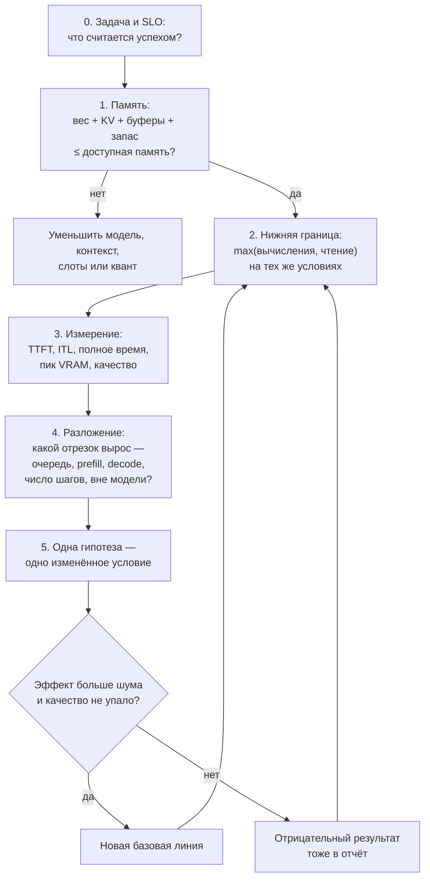

# Приложение. Порядок анализа: шпаргалка

> **Зачем это приложение.** Когда генерация медленная, хочется сразу крутить флаги. Правильный порядок другой: сначала проверить, что всё помещается, потом посчитать нижнюю границу, затем измерить и только после этого искать причину. Эта страница — короткий маршрут по книге на один экран.

> **За 30 секунд**
> - Сначала память, потом время: если не помещается, считать скорость бессмысленно.
> - Любое измерение сравнивайте с нижней границей, а не с прошлой версией конфига.
> - Разложите время на очередь, prefill, decode и число шагов — и лечите тот отрезок, который вырос.
> - Меняйте одно условие за раз; иначе не узнаете, что помогло.

## Порядок анализа



| Шаг | Вопрос | Что считать | Что обычно забывают | Глава |
|---|---|---|---|---|
| 0 | Что считается успехом? | TTFT, ITL, полное время, доля правильных и завершённых, бюджет | throughput без SLO и качества ничего не говорит о пригодности | [12](12-benchmark-methodology.md) |
| 1 | Помещается ли? | `вес + KV × слоты + буферы + запас ≤ память`, всё в одних единицах | KV на конец генерации, а не после prefill; ГБ против ГиБ; запас 1,5–2 ГБ | [3](03-memory-hierarchy-mmap.md), [6](06-kv-cache-context.md), [13](13-model-selection.md) |
| 2 | Быстрее чего нельзя? | `T ≥ max(2N_active × B / Π, (W + b × C × k) / β)` | чтение KV вдобавок к весам; пик не той точности; достижимая, а не паспортная пропускная способность | [2](02-prefill-decode-roofline.md), [8](08-batching-vllm.md) |
| 3 | Насколько далеко от предела? | `MBU = T_lower / T_measured`, `MFU = T_compute / T_measured` | одинаковые определения метрик; один прогон; холодный и горячий кэш | [12](12-benchmark-methodology.md) |
| 4 | Какой отрезок вырос? | очередь + prefill + ITL × шаги + время вне модели | очередь при неизменном ITL; заполненный пул KV; вставка чужого prefill; инструменты и сеть | [8](08-batching-vllm.md), [12](12-benchmark-methodology.md) |
| 5 | Что менять? | одна гипотеза, один параметр, чередующиеся пары, медиана разницы | несколько изменённых условий сразу; сравнение «медиана против медианы» вместо парной разницы | [12](12-benchmark-methodology.md) |

> [!WARNING]
> Нижняя граница — не прогноз и не обещание скорости. Это время, быстрее которого шаг физически невозможен. Реальное время всегда больше; задача анализа — объяснить, насколько и почему, а не «догнать предел».

## Пять ограничений, которые упускают

Это те же пять пунктов, на которых чаще всего ломаются оценки, но пересказанные для одной машины (Боцзе Ли, предисловие; см. [sources.md](sources.md)):

1. **Учли только веса.** На каждом шаге attention читает KV всех токенов контекста. На 8k это может быть 1 ГиБ, на 32k — 4 ГиБ; при больших батчах чтение KV сравнивается с весами.
2. **Посчитали время, но не проверили ёмкость.** Веса, KV всех слотов, буферы и запас должны поместиться **вместе**, и в конце генерации, а не только после загрузки.
3. **Взяли пиковые FLOP/s.** Если память не успевает подавать данные, вычисления ждут. Время — максимум из вычислений и чтения; для декода почти всегда чтение.
4. **Разделили работу на N и решили, что время уменьшится в N раз.** При выгрузке в ОЗУ и нескольких GPU появляется канал: PCIe, NVLink или сеть. Его время не делится на N и может стать критическим путём.
5. **Получили высокий throughput и забыли задержку.** Батч повышает ток/с на сервер, но каждый запрос ждёт очередь и соседей. Пропускную способность и TTFT/ITL указывают вместе.

## Рычаг под доминирующий член

| Доминирует | Помогает | Не помогает | Глава |
|---|---|---|---|
| Чтение весов (декод, батч 1) | меньше байт (квант), больше пропускная способность, батч до `b*` | больше TFLOPS, больше ёмкости | [2](02-prefill-decode-roofline.md), [4](04-quantization-gguf.md) |
| Чтение KV (длинный контекст, много слотов) | GQA/MLA, окно, сжатие KV, общий префикс | батч: KV каждого запроса читается отдельно | [6](06-kv-cache-context.md), [8](08-batching-vllm.md) |
| Вычисления (prefill, большой батч) | больше FLOP/s нужной точности, меньше токенов, блочный prefill | больше пропускной способности памяти | [2](02-prefill-decode-roofline.md), [8](08-batching-vllm.md) |
| Очередь | загрузка ниже 1, допуск, отмена, ограничение приёма | рост средней мощности без учёта всплесков | [8](08-batching-vllm.md) |
| Запуск ядер и хост | CUDA Graph, меньше синхронизаций, крупнее батч | более быстрая карта | [8](08-batching-vllm.md), [12](12-benchmark-methodology.md) |
| Выгрузка в ОЗУ/PCIe | считать на CPU, меньше выгруженных слоёв, быстрее канал | больше VRAM без изменения раскладки | [3](03-memory-hierarchy-mmap.md), [5](05-moe.md) |

## Вопрос → формула → глава

| Вопрос | Формула | Глава |
|---|---|---|
| Сколько весит модель? | `байт ≈ N × bpw / 8`; Q4_K_M — около 4,8 бита | [4](04-quantization-gguf.md) |
| Сколько места под KV? | `KV = 2 × L_full × n_kv_heads × d_head × C × bytes` | [6](06-kv-cache-context.md) |
| Влезет ли всё? | `W + KV × слоты + буферы + запас ≤ M` | [13](13-model-selection.md) |
| Потолок декода? | `ток/с ≤ β / W_active` | [2](02-prefill-decode-roofline.md) |
| Нижняя граница шага? | `T ≥ max(2N_active × B / Π, (W + b × C × k) / β)`, `B = b` для декода, `B = P` для prefill | [2](02-prefill-decode-roofline.md), [8](08-batching-vllm.md) |
| Когда батч перестаёт помогать? | `b* = W / (C × k)`; минимальный целый — округлением вверх; дальше чтение KV догоняет веса | [8](08-batching-vllm.md) |
| TTFT? | `TTFT ≈ очередь + prefill + один шаг decode` | [2](02-prefill-decode-roofline.md) |
| Полное время ответа? | `T = TTFT + Σ ITL` | [2](02-prefill-decode-roofline.md) |
| Сколько запросов в системе? | `N = λ × T` (закон Литтла) | [8](08-batching-vllm.md) |
| Сколько токенов даёт спекуляция? | `E[N] = (1 − α^(γ+1)) / (1 − α)` | [9](09-speculative-decoding.md) |
| Окупается ли черновик? | `E[N] > 1 + γ × d`, или `d < (E[N] − 1) / γ` | [9](09-speculative-decoding.md) |
| Ускорение задачи? | `S = 1 / ((1 − f) + f / s)` | [12](12-benchmark-methodology.md) |
| Эффективная пропускная способность? | `R_good = правильные и вовремя / время` | [12](12-benchmark-methodology.md) |
| Насколько мы далеки от предела? | `MBU = T_lower / T_measured` | [12](12-benchmark-methodology.md) |

## Пример на салфетке

Дано: плотная 8B в Q4_K_M (`W = 4,2 ГБ`), контекст 8k, KV `k = 128 КиБ/токен`, карта `β = 400 ГБ/с`, измерено 32 ток/с.

```
KV на 8k:      8192 × 128 КиБ = 1 ГиБ ≈ 1,074 ГБ
нижняя граница: (4,2 + 1,074) / 400 = 13,2 мс
измерено:       1000 / 32 = 31,25 мс
MBU:            13,2 / 31,25 ≈ 0,42
разрыв:         31,25 − 13,2 ≈ 18 мс
```

18 мс почти не зависят от объёма — **похоже** на накладные расходы шага (запуск ядер, хост, синхронизация), но это гипотеза, а не доказательство. Проверка одним условием: включить CUDA Graph или Metal-граф и посмотреть, уменьшится ли разрыв. Если да — причина в запуске; если нет — искать очередь, кэш экспертов или выгрузку. Второе условие — поднять контекст до 32k: нижняя граница вырастет на `3 × 1,074 / 400 ≈ 8,1 мс`. Если измерение выросло примерно на столько же, виновато чтение KV; если почти не выросло — разрыв фиксированный.

## Чек-лист перед выводом

- [ ] Все единицы приведены к байтам или ГиБ.
- [ ] Посчитан KV на все слоты и на конец генерации.
- [ ] Нижняя граница посчитана для той же модели, кванта, контекста и батча.
- [ ] Понятно, какой отрезок вырос: очередь, prefill, ITL, число шагов или время вне модели.
- [ ] Изменено одно условие; замеров 3–5; есть медиана и разброс.
- [ ] Проверено качество, а не только ток/с.
- [ ] Записан отрицательный результат и версия рантайма.

## Источники

- **Bojie Li, «AI Infra in Depth»** — [GitHub](https://github.com/bojieli/ai-infra-book), Apache-2.0: порядок анализа, пять упускаемых ограничений, нижняя граница и разложение разрыва.
- **Русский перевод community edition** — [GitHub](https://github.com/ilkruglov/ai-infra-book), Apache-2.0.
- **Скилл «Designing AI Infra»** — [GitHub](https://github.com/ilkruglov/designing-ai-infra-skill), Apache-2.0: шпаргалка и плейбук `diagnose-serving`, адаптированные под локальный сервер.
