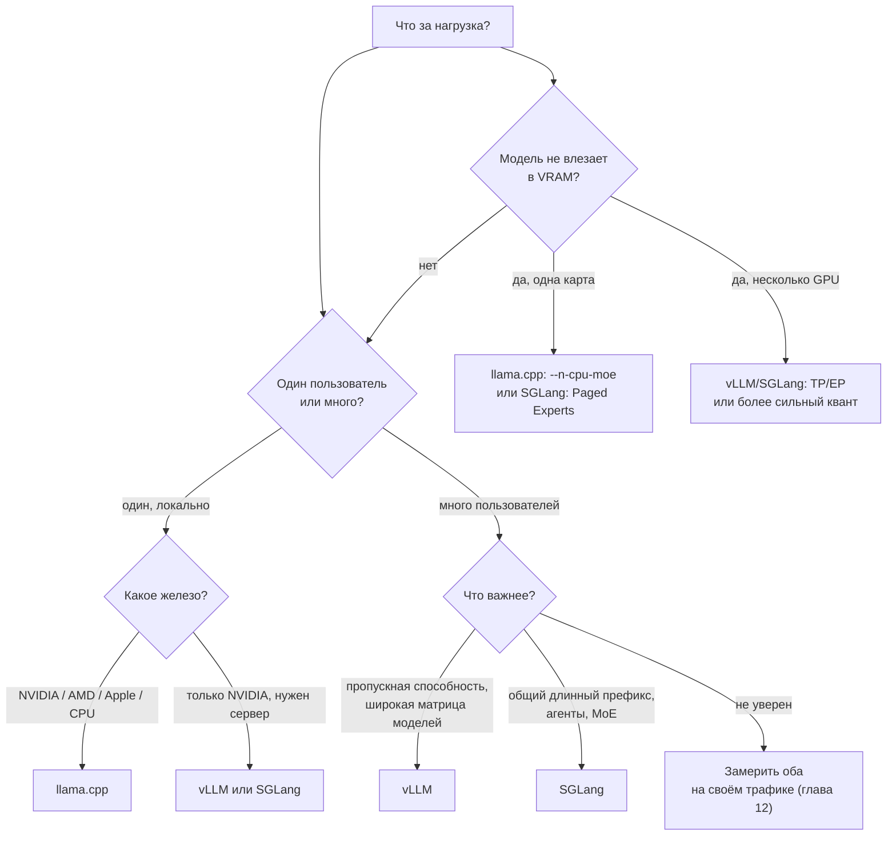

# Движки инференса: сравнение и выбор

> **Зачем эта глава.** Три предыдущие главы разобрали llama.cpp, vLLM и SGLang по отдельности. Теперь — главный практический вопрос: что выбрать под конкретную нагрузку. Ответ не сводится к «самый быстрый движок»: у каждого своя ниша, и часто выигрывает не тот, у кого выше пиковый tok/s, а тот, чья модель памяти и планирования совпадает с вашей задачей.

> **За 30 секунд**
> - **llama.cpp** — один пользователь, разнородное железо, GGUF, CPU/GPU-гибрид и MoE-offload.
> - **vLLM** — много пользователей на NVIDIA/AMD GPU, широкая поддержка моделей и квантов, TP/PP/EP.
> - **SGLang** — агенты и многоходовые диалоги с длинным общим префиксом, RadixAttention, HiCache, Paged Experts.
> - Абсолютного победителя нет: сравнивайте на своём трафике по методике главы 12.

## 1. Три движка в одной таблице

| | **llama.cpp** | **vLLM** | **SGLang** |
|---|---|---|---|
| **Ниша** | локальный запуск, edge, CPU/GPU-гибрид | серверный GPU-инференс | агенты, structured programs, MoE |
| **Стек** | C/C++ над ggml | Python + C++/CUDA | Python + C++/CUDA |
| **Формат весов** | GGUF | HF safetensors | HF safetensors |
| **Кванты** | k-quants, i-quants, MXFP4/NVFP4, FP8 | FP8, INT8, INT4, AWQ, GPTQ, bnb, GGUF | FP8, FP4, AWQ, GPTQ, INT8, GGUF, MLX |
| **Бэкенды** | CPU, CUDA, ROCm, Metal, Vulkan, SYCL, CANN, MUSA, OpenCL | CUDA, ROCm, XPU, CPU, Apple через vLLM-Metal | CUDA, ROCm, Ascend, TPU, XPU, CPU, Jetson, Apple через MLX |
| **Один пользователь** | отлично | нормально, но тяжелее | нормально |
| **Много пользователей** | ограниченно | отлично | отлично |
| **Prefix cache** | слот + LCP | хеш блоков | radix-дерево |
| **MoE-offload в ОЗУ** | да, `--n-cpu-moe` | только общий `--cpu-offload-gb` | Paged Experts (узко) |
| **Спекуляция** | draft, EAGLE-3, DFlash, DSpark, MTP, n-граммы | draft, EAGLE-3, MTP, n-граммы, suffix, DFlash | EAGLE, MTP, NGRAM, UNO, DFLASH |
| **Structured output** | GBNF, JSON Schema | XGrammar/guidance | XGrammar/Outlines/llguidance |
| **Tool calling** | нативные/generic обработчики | парсеры + strict schema | парсеры + auto |
| **OpenAI API** | да | да | да |
| **Метрики** | Prometheus, `/slots`, логи | Prometheus, per-request | Prometheus, cache report, OTel |
| **Multi-GPU** | layer/row, tensor экспериментально | TP/PP/EP/DP | TP/DP/EP/PP, PD |
| **Сложность** | низкая | средняя | средне-высокая |
| **Версия на 08.11.2026** | v0.9.0 | v0.33.0 | v0.5.23 |

> [!NOTE]
> Таблица — ориентир, а не истина в последней инстанции. Матрицы поддерживаемых моделей, квантов и функций меняются от релиза к релизу; перед выбором проверьте конкретную модель в документации движка.

## 2. Дерево выбора



Дерево даёт первый вариант, а не окончательный ответ. Дальше — три проверки: влезает ли модель с нужным контекстом, хватает ли пропускной способности на пике и совпадает ли движок с вашим железом.

## 3. Когда что выбирать

| Сценарий | Первый выбор | Почему | Ограничения |
|---|---|---|---|
| **Один пользователь, ПК с 16–24 ГБ VRAM** | llama.cpp | GGUF, гибридный запуск, минимум зависимостей | меньше пропускной способности на многих запросах |
| **Один пользователь, Mac** | llama.cpp | Metal, объединённая память | нет CUDA-экосистемы |
| **Один пользователь, AMD Radeon** | llama.cpp | HIP/ROCm, Vulkan | vLLM/SGLang на Radeon сложнее |
| **Один пользователь, CPU-only** | llama.cpp | лучший CPU-путь и кванты | скорость ограничена ОЗУ |
| **Агент с длинным системным промптом** | SGLang, затем vLLM | RadixAttention и `lpm` | сложнее настройка |
| **Много параллельных пользователей** | vLLM или SGLang | непрерывный батчинг, KV-менеджмент | нужен GPU-сервер |
| **MoE 235B, не влезает в одну карту** | llama.cpp `--n-cpu-moe`; SGLang Paged Experts | вычисления на CPU/с подкачкой экспертов | скорость и ограничения квантов |
| **4–8 GPU, 70B+** | vLLM или SGLang | TP/PP/EP, PD disaggregation | сеть и синхронизация |
| **Нужна максимальная матрица моделей/квантов** | vLLM | самая широкая поддержка | Linux-only |
| **Нужен structured output и tool calling** | все; SGLang/vLLM удобнее | готовые парсеры и грамматики | проверяйте шаблон модели |
| **Нужна минимальная сложность** | llama.cpp | один бинарь, один файл | меньше серверных функций |
| **Нужен долгий общий кэш на диске** | SGLang HiCache | L1/L2/L3 | host-память и I/O |

### 3.1 Если сомневаетесь

Начните с llama.cpp, если работа идёт на одной машине. Переходите на vLLM или SGLang, когда появляется одно из трёх:

1. **Очередь.** Пользователи ждут, GPU загружен, но пропускной способности не хватает.
2. **Общий префикс.** Агенты или диалоги тратят много времени на prefill одного и того же начала.
3. **Масштаб.** Модель не влезает в одну карту, или нужно несколько GPU.

Если появилась очередь, сначала проверьте, не упираетесь ли вы в KV и закон Литтла (§8.4), а уже потом меняйте движок.

## 4. Производительность: что действительно отличается

Физика одна для всех: декод упирается в чтение весов и KV, prefill — в вычисления (глава 2). Если модель, квант, контекст и железо одинаковы, **потолок декода одного запроса** у всех трёх движков близок. Разница появляется в другом:

| Аспект | llama.cpp | vLLM | SGLang |
|---|---|---|---|
| Декод одного запроса | близок к потолку памяти | близок к потолку | близок к потолку |
| Prefill на GPU | хороший | очень хороший | очень хороший |
| Пропускная способность на многих запросах | ниже | высокая | высокая |
| Повторное использование префикса | ограниченное | хорошее | очень хорошее |
| Накладные расходы на маленькой карте | низкие | выше | выше |
| Вытеснение/очередь | проще | развитое | развитое |
| MoE-offload | сильный | слабый | узкий, но быстрый |

Это **качественное** сравнение, не замер. Числа зависят от модели, кванта, контекста, драйвера и версии. Единственный способ получить цифры для своего случая — прогнать главу 12 на своём трафике.

> [!WARNING]
> Не сравнивайте «tok/s» из разных источников: они почти всегда измерены на разных промптах, контекстах и размере батча. Сравнивайте конфиги на одном наборе запросов, с одинаковыми шаблонами и температурой.

### 4.1 Почему на одной карте разница мала

При декоде одного запроса все три движка читают веса и KV. Накладные расходы на планировщик, Python, HTTP и сэмплинг — это доли миллисекунды на фоне 20–50 мс шага. Поэтому «vLLM быстрее llama.cpp в 3 раза» на одном запросе — почти всегда ошибка измерения или разные кванты.

Другое дело — **много запросов**. Здесь vLLM/SGLang выигрывают за счёт непрерывного батчинга, эффективного KV-менеджмента и разделяемого кэша префиксов. Именно поэтому для сервера выбирают их, а не потому, что у них «лучше ядро» на одном токене.

### 4.2 Почему на длинном префиксе выигрывает SGLang

Агент из 60 шагов с общим префиксом 20k токенов тратит почти всё время на prefill, если кэш не работает (глава 7). RadixAttention уменьшает prefill до хвоста, а `lpm` дополнительно группирует запросы с общим префиксом. vLLM тоже умеет APC, но хеш блоков менее естественно разделяет ветвящиеся диалоги. llama.cpp умеет кэш на слот, но не разделяет его между многими запросами так же эффективно.

## 5. Форматы, переносимость и lock-in

| Вопрос | llama.cpp | vLLM | SGLang |
|---|---|---|---|
| Основной формат | GGUF | safetensors | safetensors |
| Конвертация | `convert_hf_to_gguf.py`, `llama-quantize` | обычно не нужна | обычно не нужна |
| GGUF | родной | ограниченно | ограниченно |
| Кванты | самые разные, включая i-quants | FP8/INT8/INT4/AWQ/GPTQ | FP8/FP4/AWQ/GPTQ |
| Токенизатор | из GGUF | из HF | из HF |
| Chat template | Jinja из GGUF | Jinja из HF | Jinja из HF |
| Перенос между движками | через конвертацию | обычно без конвертации | обычно без конвертации |

Практическое следствие: **выбор движка — это ещё и выбор формата**. Если вы квантуете модель в GGUF и настраиваете её под llama.cpp, перенос в vLLM/SGLang потребует конвертации и проверки, что архитектура поддерживается. И наоборот: safetensors-чекпойнт с AWQ может не иметь GGUF-версии.

> [!TIP]
> Если планируете сравнивать движки, держите один и тот же исходный чекпойнт и один и тот же chat template. Разные кванты и шаблоны — самая частая причина «движок X отвечает хуже».

## 6. Стоимость эксплуатации

Движок не меняет физику памяти, но меняет утилизацию:

- **llama.cpp** позволяет запустить модель на уже имеющемся железе, включая CPU и Apple; это часто дешевле, чем покупать GPU.
- **vLLM/SGLang** требуют GPU-сервера, но дают больше токенов в час на той же карте при многопользовательской нагрузке.
- **Paged Experts** и **MoE-offload** могут отсрочить покупку GPU, но добавляют зависимость от ОЗУ и PCIe.

Для оценки «покупать или арендовать» используйте главу «Как выбрать железо»: там есть порог по часам в год и стоимость электричества. Для оценки «хватает ли текущего GPU» — закон Литтла и `b*` из главы 8.

## 7. Чек-лист миграции

Если решили перейти с одного движка на другой, проверьте по порядку:

1. **Модель и квант.** Тот же чекпойнт? Если нет — качество может отличаться.
2. **Токенизатор и шаблон.** Тот же chat template? Иначе изменятся и ответы, и tool calls.
3. **Контекст.** Тот же `max_model_len`/`-c`? Иначе часть запросов обрежется.
4. **Сэмплинг.** Та же температура, top-p, min-p, seed? Разные дефолты меняют вывод.
5. **Кэш.** Включён ли prefix caching? Какой размер блока/страницы?
6. **Батч.** Сколько одновременных запросов? Какой TTFT/ITL на пике?
7. **Память.** Пик VRAM и ОЗУ под нагрузкой; есть ли запас 1,5–2 ГБ?
8. **Метрики.** Сравните TTFT, ITL, tok/s, долю завершённых, качество на одном наборе задач.
9. **Ошибки.** Проверьте OOM, обрезку контекста, парсинг tool calls.
10. **Откат.** Оставьте старый движок запущенным, пока новый не пройдёт приёмку.

**Посчитай сам.** Агент делает 40 шагов, средний промпт 18k токенов, хвост 300 токенов, prefill 1200 ток/с, декод 35 ток/с, ответ 200 токенов. Сколько времени экономит prefix cache за задачу? Сравните с выигрышем от ускорения декода в 1,5 раза.

<details>
<summary>Решение</summary>

```
Без кэша: prefill 18 000 / 1200 = 15 с
          decode 200 / 35 ≈ 5,7 с
          шаг ≈ 20,7 с; 40 шагов ≈ 828 с ≈ 13,8 мин

С кэшем:  prefill 300 / 1200 = 0,25 с
          шаг ≈ 5,95 с; 40 шагов ≈ 238 с ≈ 4 мин

Экономия ≈ 590 с ≈ 9,8 мин.
Ускорение декода в 1,5 раза: шаг 0,25 + 3,8 = 4,05 с;
40 шагов ≈ 162 с. Против варианта без кэша это ≈ 666 с,
но против варианта с кэшем и обычным декодом — только ≈ 76 с.
```

Вывод: кэш префикса убирает основную часть времени; после него ускорять декод всё ещё полезно, но абсолютный выигрыш меньше, потому что задача стала короче. Это типичный пример из главы 7.

</details>

## 8. Итоговая рекомендация

- **Дома, на одной машине, с GGUF и ограниченной VRAM** — llama.cpp. Он даст лучший баланс простоты, совместимости и гибридного запуска.
- **Сервер на NVIDIA/AMD, много пользователей, широкая матрица моделей** — vLLM. Это самый предсказуемый выбор для «обычного» GPU-сервинга.
- **Агенты, длинные общие префиксы, MoE, structured programs** — SGLang. RadixAttention и HiCache дают преимущество именно на таких нагрузках.
- **Сомневаетесь** — начните с llama.cpp для локальной разработки и прототипа, а для продакшена замерьте vLLM и SGLang на своём трафике.

> [!NOTE]
> Все три движка предоставляют OpenAI-совместимый API. Это позволяет менять движок, не переписывая клиента, — но только если вы не зависите от специфичных полей, парсеров и шаблонов. Проверяйте совместимость на своём клиенте.

## 9. Что здесь не проверено

- **Независимых замеров нет.** Все сравнения в этой главе качественные; числа производительности нужно получать по методике главы 12 на своём железе и трафике.
- **Матрицы поддержки меняются.** Списки моделей, квантов, бэкендов и функций в vLLM/SGLang обновляются каждый релиз; таблицы отражают документацию на 8 ноября 2026.
- **Заявления авторов.** Отдельно отмеченные цифры (например, «до 30× быстрее CPU-offload» для Paged Experts) — самозаявленные; независимой проверки в книге нет.
- **Железо и драйверы.** Реальная скорость зависит от конкретной карты, драйвера, охлаждения и версии ядра; в книге — порядки величин.
- **Цены и доступность.** Экономические выводы — в главе «Как выбрать железо»; здесь они не пересчитываются.

## Ключевые идеи

- Выбор движка определяется нагрузкой, железом и форматом весов, а не абсолютным «tok/s».
- llama.cpp — локальный и гибридный запуск; vLLM — многопользовательский GPU-сервер; SGLang — общий префикс, агенты и MoE.
- На одном запросе разница между движками невелика; на многих запросах и общем префиксе — решающая.
- Формат весов (GGUF vs safetensors) — часть выбора движка.
- Сравнивайте на одном чекпойнте, шаблоне и наборе задач; иначе получите разницу квантов, а не движков.
- Перед миграцией проверьте контекст, сэмплинг, кэш, батч и метрики.

## Проверь себя

1. Почему на одном запросе разница между llama.cpp и vLLM часто меньше, чем ожидают?
2. В каком сценарии RadixAttention даёт больше выигрыша, чем APC в vLLM?
3. Когда стоит выбрать llama.cpp, даже если есть GPU-сервер?
4. Почему перенос модели между движками — это не только «поменять команду запуска»?
5. Какой движок выбрать для 235B MoE на одной карте 24 ГБ и 256 ГБ ОЗУ?
6. Что проверить перед миграцией, чтобы не сравнить разные модели?

## Ответы

1. На декоде одного запроса все читают те же веса и KV; накладные расходы движка малы по сравнению с шагом. Разница растёт на батче, кэше и планировании.
2. Когда много запросов делят длинный префикс и ветвятся (агенты, диалоги): дерево естественно разделяет общие начала, а хеш блоков менее эффективен при ветвлении.
3. Когда нужен GGUF, экзотическое железо, CPU/GPU-гибрид, MoE-offload или максимальная простота; либо когда нагрузка последовательная и очередь не возникает.
4. Нужно проверить формат, квант, токенизатор, chat template, контекст, сэмплинг, кэш и поддержку архитектуры. Иначе изменится не только скорость, но и качество.
5. llama.cpp с `--n-cpu-moe` — самый предсказуемый путь; SGLang Paged Experts — если квант и архитектура поддерживаются. vLLM для одной карты здесь не лучший выбор.
6. Один и тот же чекпойнт, квант, токенизатор, шаблон, температура и набор промптов; иначе разница будет не в движке.

## Источники главы

- **llama.cpp, релиз v0.9.0** — ggml-org, 04.11.2026. [GitHub](https://github.com/ggml-org/llama.cpp/releases/tag/v0.9.0). Уровень: продвинутый. Зачем: версия и возможности.
- **llama.cpp, `tools/server/README.md`** — ggml-org, 2026. [GitHub](https://github.com/ggml-org/llama.cpp/blob/master/tools/server/README.md). Уровень: средний. Зачем: флаги, endpoints, метрики.
- **vLLM, релиз v0.33.0** — vLLM Project, 02.11.2026. [GitHub](https://github.com/vllm-project/vllm/releases/tag/v0.33.0). Уровень: продвинутый. Зачем: версия, CUDA/ROCm, изменения.
- **vLLM, «Optimization and Tuning»** — vLLM, 2026. [docs.vllm.ai](https://docs.vllm.ai/en/latest/configuration/optimization/). Уровень: средний. Зачем: батчинг, preemption, параллелизм.
- **SGLang, релиз v0.5.23** — SGLang Project, 02.11.2026. [GitHub](https://github.com/sgl-project/sglang/releases/tag/v0.5.23). Уровень: продвинутый. Зачем: версия, Paged Experts, HiCache.
- **SGLang, «Server Arguments»** — SGLang, 2026. [docs.sglang.io](https://docs.sglang.io/docs/advanced_features/server_arguments). Уровень: средний. Зачем: флаги и значения по умолчанию.
- **Kwon et al., «PagedAttention»** — 2023. [arXiv:2309.06180](https://arxiv.org/abs/2309.06180). Уровень: продвинутый. Зачем: теория KV-менеджмента.
- **Zheng et al., «SGLang»** — 2023. [arXiv:2312.07104](https://arxiv.org/abs/2312.07104). Уровень: продвинутый. Зачем: RadixAttention.
