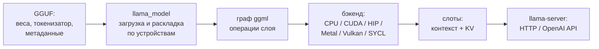
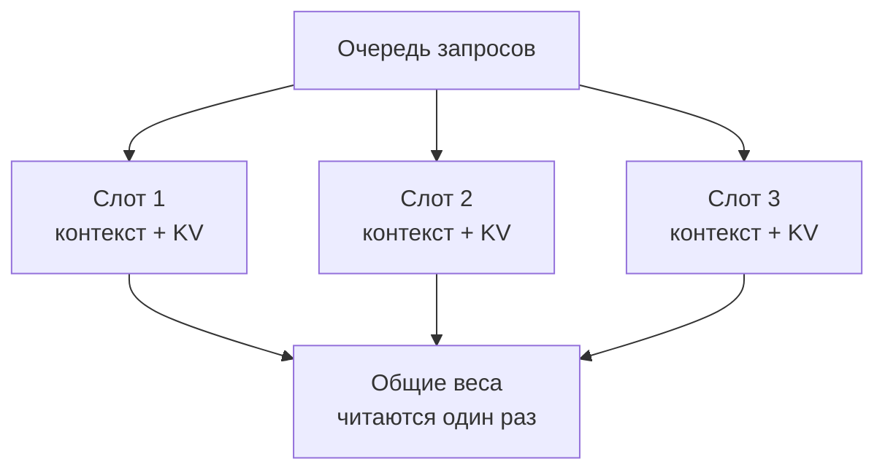

# Движки инференса: llama.cpp

> **Зачем эта глава.** До сих пор речь шла о том, как устроена модель и как её считать. Теперь — о том, чем именно её запускают. llama.cpp — самый короткий путь от файла GGUF до OpenAI-совместимого сервера: один бинарь, широкая поддержка железа, гибридный запуск «часть на GPU, часть на CPU». Эта глава о том, что у него внутри, какие флаги действительно важны и где заканчиваются его возможности.

> **За 30 секунд**
> - llama.cpp — C/C++-движок над тензорной библиотекой **ggml**; создавался для локального инференса на разнородном железе, а не для кластерного сервинга.
> - Его сильные стороны: GGUF, CPU/GPU-гибрид, выгрузка экспертов MoE в ОЗУ, Metal/Vulkan/ROCm/SYCL, простой сервер и кэш на слот.
> - Слабое место — планировщик: слоты и непрерывный батчинг есть, но до многопользовательских vLLM/SGLang он не дотягивает.
> - Версия на 8 ноября 2026 — **v0.9.0** (4 ноября 2026); флаги меняются между сборками, сверяйтесь с `--help`.

## 1. Архитектура и для чего создан

llama.cpp вырос из проекта **ggml** — небольшой тензорной библиотеки на C. Идея была простой: взять модель LLaMA, конвертировать веса в компактный формат и считать её на обычном компьютере, без Python, CUDA-стека и облака. Отсюда три свойства, которые сохранились до сих пор:

- **минимум зависимостей** — один исполняемый файл и файл модели;
- **гибридный запуск** — слои можно разложить между GPU и CPU;
- **широкий набор бэкендов** — от CUDA до Vulkan и Metal.

Упрощённо путь запроса выглядит так:



Внутри есть несколько уровней:

| Уровень | Что делает |
|---|---|
| **ggml** | тензоры, граф вычислений, квантованные матричные операции, бэкенды |
| **libllama** | загрузка модели, токенизация, KV-кэш, сэмплирование, спекуляция |
| **common** | общий код утилит: чат-шаблоны, парсеры, параметры |
| **tools** | `llama-cli`, `llama-server`, `llama-bench`, `llama-quantize` и другие |

Для локального инференса это удачная раскладка: ядро маленькое, а всё, что нужно пользователю, собрано в утилитах. Для серверного инференса — наоборот: планировщик и управление памятью проще, чем в движках, которые строились вокруг многопользовательской нагрузки.

> [!NOTE]
> В 2026 году у проекта появился единый CLI `llama` (`llama cli`, `llama serve`). Исторические бинари `llama-cli` и `llama-server` никуда не делись, и в этой главе используются они: так проще сверять флаги с документацией сервера. Если вы ставите свежий установщик, проверьте, какое имя команды у вас в `PATH`.

### 1.1 Чего llama.cpp не делает

- **Не планирует сотни пользователей так же эффективно, как vLLM/SGLang.** Непрерывный батчинг есть, но block manager, вытеснение и разделяемый кэш устроены проще (глава 8).
- **Не является распределённой системой.** Tensor parallelism появился недавно и в основном экспериментальный; pipeline parallelism и disaggregated prefill/decode — не его сценарий.
- **Не заменяет GPU-стек для обучения.** Это инференс-движок.

## 2. Форматы весов и квантование

Основной формат — **GGUF**: контейнер с метаданными модели, токенизатором и тензорами. В одном файле лежит всё, что нужно для запуска; поэтому GGUF так удобен для обмена моделями. Устройство формата и k-quants/i-quants разобраны в главе 4, здесь — только то, что важно для выбора движка.

| Формат | Что это | Типичный размер | Комментарий |
|---|---|---:|---|
| **F16 / BF16** | половинная точность | 2 байта на вес | максимум качества, но 8B — уже ~16 ГБ |
| **Q8_0** | 8-битный блоковый квант | ~1,06 байта на вес | почти без потерь, удобен для проверки |
| **Q4_K_M** | 4-битный k-quant | ~0,60 байта на вес | рабочий дефолт для локального запуска |
| **IQ4_XS / IQ3** | i-quants с imatrix | 3–4 бита | меньше при том же качестве, но медленнее в подготовке |
| **MXFP4 / NVFP4** | 4-битные форматы с общими масштабами | ~4–4,5 бита | поддержка зависит от архитектуры и бэкенда |
| **FP8 E4M3** | 8-битный float | ~1 байт на вес | добавлен в v0.9.0; полезен на новых GPU |

Квантовать можно штатной утилитой:

```bash
llama-quantize model-f16.gguf model-Q4_K_M.gguf Q4_K_M
```

Для i-quants полезно сначала посчитать **imatrix** на своём тексте — это меняет не размер, а качество квантования на вашем домене (глава 4, §4.6). Для обычного чата чаще достаточно Q4_K_M или Q5_K_M.

> [!WARNING]
> GGUF — не универсальный формат. vLLM и SGLang читают его ограниченно и не для всех архитектур; их родной формат — HF safetensors. Если вы планируете переносить модель между движками, заранее решите, какой формат будет основным, и проверьте поддержку конкретной архитектуры.

### 2.1 Квантование KV-кэша

Отдельный рычаг — тип KV-кэша. В llama.cpp он задаётся независимо для K и V:

```bash
-ctk q8_0 -ctv q8_0
```

Допустимые значения в текущей сборке: `f32`, `f16`, `bf16`, `q8_0`, `q4_0`, `q4_1`, `iq4_nl`, `q5_0`, `q5_1`. По умолчанию — `f16`. `q8_0` обычно почти не заметен по качеству и экономит примерно вдвое; `q4_0` экономит сильнее, но требует проверки на вашей модели. Квантованный KV работает через Flash Attention, поэтому включайте `-fa on`.

Формула размера KV и влияние GQA/MLA — в главе 6. Здесь важно запомнить: **квантование KV не меняет веса и не ускоряет декод само по себе; оно позволяет держать более длинный контекст или больше слотов в той же VRAM.**

## 3. Поддержка железа

llama.cpp — самый «всеядный» из трёх движков. Список бэкендов в v0.9.0:

| Бэкенд | Железо | Замечание |
|---|---|---|
| **CPU** | x86, ARM, RISC-V | AVX/AVX2/AVX512, NEON, SVE; работает всегда |
| **CUDA** | NVIDIA | основной быстрый путь |
| **HIP / ROCm** | AMD | Radeon и Instinct; на Linux |
| **Metal** | Apple Silicon | первый класс поддержки, объединённая память |
| **Vulkan** | NVIDIA, AMD, Intel | переносимый GPU-путь, хорош на нестандартных сборках |
| **SYCL** | Intel GPU | Arc, Data Center Max, встроенные GPU |
| **CANN** | Huawei Ascend | отдельная сборка |
| **MUSA** | Moore Threads | отдельная сборка |
| **OpenCL** | Adreno и др. | мобильные/встроенные GPU |
| **WebGPU** | браузер/эксперимент | не для продакшена |
| **RPC** | несколько машин | экспериментальная распределённая схема |

### 3.1 Сколько слоёв на GPU

Главный флаг — `-ngl` (`--n-gpu-layers`):

```bash
-ngl all        # все слои на GPU
-ngl 32         # только 32 слоя
-ngl 0          # только CPU
```

Значение `all` (или большое число) означает «сколько влезет»; лишнее просто останется на CPU. В свежих сборках по умолчанию работает `--fit on`: сервер сам подгоняет незаданные параметры под память. Для воспроизводимых замеров лучше задавать `-ngl`, `-c` и `-np` явно, иначе конфиг будет меняться от запуска к запуску.

### 3.2 Гибридный запуск и выгрузка MoE

Если модель не влезает в VRAM целиком, есть два разных сценария.

**Плотная модель.** Часть слоёв остаётся на CPU:

```bash
-ngl 28          # остальное — на CPU
```

Каждый токен тогда проходит часть слоёв на GPU, часть на CPU. Это работает, но декод упирается в пропускную способность ОЗУ и PCIe; подробности — в главе 3.

**MoE-модель.** Выгоднее выгрузить не целые слои, а только экспертные FFN, оставив attention, роутер и общие части на GPU:

| Флаг | Что делает |
|---|---|
| `--n-cpu-moe N` (`-ncmoe`) | экспертные FFN первых N слоёв считаются на CPU |
| `--cpu-moe` (`-cmoe`) | все эксперты на CPU |
| `--moe-cache-mib N` | кэш горячих экспертов в VRAM для тех, что остались на CPU |
| `-ot "\.ffn_.*_exps\.weight=CPU"` | точечная выгрузка по шаблону имён тензоров |
| `-ncffn N` | выгрузить плотные FFN первых N слоёв (для плотных моделей) |

Смысл тот же, что в главе 5: по PCIe едут только активации, а тяжёлые матрицы экспертов считаются там, где лежат. Это принципиально дешевле, чем «держать веса в ОЗУ и перегонять их на GPU на каждом токене».

> [!WARNING]
> В README `--n-cpu-moe N` описано как «первые N слоёв», но в разных сборках и гайдах семантика менялась. Проверяйте на своей версии: поднимите N, посмотрите на лог загрузки и пик VRAM. Если модель не стала помещаться, возможно, вы выгружаете не те слои.

**Посчитай сам.** MoE 35B-A3B в Q4_K_M весит около 21 ГБ, активных весов — около 1,8 ГБ. Карта 16 ГБ, ОЗУ 64 ГБ. Сколько примерно слоёв экспертов нужно оставить на CPU, чтобы модель поместилась с запасом 1,5 ГБ?

<details>
<summary>Решение</summary>

```
бюджет VRAM:        16 − 1,5 = 14,5 ГБ
на GPU остаётся:    attention + роутер + общие части + буферы
Пусть неэкспертные части — около 5 ГБ, буферы — 1 ГБ.
Тогда на экспертов в VRAM: 14,5 − 5 − 1 = 8,5 ГБ.
Все эксперты — около 16 ГБ. Значит, на CPU уходит ~7,5 ГБ,
то есть примерно половина экспертных слоёв.
```

Точное число зависит от архитектуры и разбиения по слоям; начинайте с `--n-cpu-moe 12–16` и подбирайте по пику VRAM. Оценка скорости такой конфигурации — по формуле §5.6: часть экспертов читается из ОЗУ, и именно она ограничивает декод.

</details>

### 3.3 Несколько GPU

Для нескольких карт есть `-sm` (`--split-mode`):

| Режим | Что делит | Когда использовать |
|---|---|---|
| `layer` (по умолчанию) | слои и KV между GPU | самый простой и предсказуемый |
| `row` | веса слоя по строкам | лучше параллелизм, больше обмена |
| `tensor` | веса и KV | экспериментальный, ближе к tensor parallelism |
| `none` | одна GPU | отладка |

Пропорции задаются `-ts 3,1` (например, если карты разного объёма). Для равных карт можно не задавать. В v0.9.0 появилась поддержка NCCL для multi-node tensor parallelism, но это всё ещё не основной сценарий: для больших кластеров логичнее vLLM или SGLang.

## 4. Батчинг, слоты и кэш префиксов

### 4.1 Слоты

Сервер обслуживает несколько независимых контекстов — **слотов**. Число задаётся `-np` (`--parallel`). Исторически у каждого слота был свой KV-кэш; в новых сборках KV может быть общим пулом на все слоты, но логически слот по-прежнему остаётся отдельным запросом.



Важно: в новых сборках KV может быть **единым пулом** на все слоты (`--kv-unified`, включён по умолчанию при автоматическом числе слотов). Тогда `-c` задаёт общий объём пула, а не «контекст каждого слота». Отдельный лимит на слот задаётся `--kv-unified-per-slot N`; если `-c` не указан, пул получается `n_parallel × N`.

Это удобнее старой схемы «`-c` делится на `-np`», но требует внимательности: проверяйте в логе, какой контекст реально получил слот. Подробнее про слоты и `-b`/`-ub` — в главе 8.

### 4.2 Два батча

- `-b` — логический батч: сколько токенов сервер собирает за один вызов;
- `-ub` — физический микро-батч: сколько токенов GPU обрабатывает за один проход.

`-ub` ускоряет prefill и ест VRAM; на декод почти не влияет. Типичный безопасный дефолт — `-b 2048 -ub 512`; для длинных промптов и запаса VRAM можно поднять `-ub` до 1024. Разбор — в §8.2.

Непрерывный батчинг включён по умолчанию (`-cb`); отключается `-nocb`.

### 4.3 Кэш промпта

В llama.cpp кэш привязан к слоту. При новом запросе сервер ищет наибольший общий префикс с тем, что уже лежит в слоте, и считает только хвост. Флаги:

| Флаг | Смысл |
|---|---|
| `--cache-prompt` / `--no-cache-prompt` | включить/выключить кэш (по умолчанию включён) |
| `--cache-reuse N` | минимальный блок для переиспользования через сдвиг KV |
| `--cache-ram N` | сколько МиБ отдать под кэш простаивающих слотов (по умолчанию 8192) |
| `--cache-idle-slots` | сохранять простаивающие слоты в кэш и очищать их |
| `--ctx-checkpoints N` | число контрольных точек контекста на слот |
| `--checkpoint-min-step N` | минимальный шаг между контрольными точками |

`--cache-reuse` полезен, когда вы редактируете промпт в середине: сервер может сдвинуть KV, а не пересчитывать всё. Для агента, который всегда дописывает в конец, важнее обычный LCP-кэш и достаточно длинный контекст слота.

> [!TIP]
> Если кажется, что кэш не работает, отправьте один и тот же длинный запрос дважды и посмотрите в лог `prompt eval time`. Второй раз обработанных токенов должно быть мало. Если нет — ищите изменяющуюся строку в начале промпта (глава 7).

### 4.4 Чем это отличается от vLLM и SGLang

| | llama.cpp | vLLM | SGLang |
|---|---|---|---|
| Единица кэша | слот + LCP | блок KV по хешу | узел radix-дерева |
| Разделение между запросами | ограниченное, через unified KV | да | да, естественное |
| Вытеснение | проще | block manager | LRU/LFU и политики |
| Когда хватает | один пользователь, последовательные запросы | много пользователей | агенты с общим префиксом |

Если у вас один пользователь и последовательные запросы, разница между этими схемами невелика. Если десять агентов одновременно работают с одним системным промптом — она становится решающей (глава 7).

## 5. Спекулятивное декодирование и MTP

llama.cpp поддерживает несколько семейств спекуляции. Включаются они флагом `--spec-type`:

| Тип | Что использует |
|---|---|
| `draft-simple` | отдельная маленькая draft-модель |
| `draft-eagle3` | EAGLE-3: читает скрытые состояния целевой модели |
| `draft-dflash` | блок-диффузионный черновик, выдаёт блок за проход |
| `draft-dspark` | DFlash + полуавторегрессивная Markov-голова |
| `draft-mtp` | MTP-головы самой целевой модели |
| `ngram-cache`, `ngram-simple`, `ngram-map-k`, `ngram-map-k4v`, `ngram-mod` | n-граммы без отдельной модели |

Типичный запуск с draft-моделью:

```bash
llama-server -m target-Q4_K_M.gguf \
  -md draft-Q8_0.gguf \
  --spec-type draft-simple \
  --spec-draft-n-max 4 \
  --spec-draft-p-min 0.0
```

Для EAGLE-3 черновик конвертируют с `--target-model-dir`, чтобы он унаследовал токенизатор и нужные слои. Для MTP отдельный файл не нужен: `--spec-type draft-mtp` использует головы целевой модели, если они есть в GGUF.

> [!WARNING]
> Спекуляция не бесплатна. При низком acceptance rate она замедляет генерацию, потому что вы платите за черновик и проверку. Формула `E[N]` и правило «черновик должен стоить дешевле `(E[N] − 1) × T_plain`» — в главе 9. Всегда меряйте `draft acceptance rate` в логе, а не включайте «на всякий случай».

Для повторяющегося текста (рефакторинг кода, переписывание документа, рассуждения с повторами) хорош `ngram-mod`: он не требует второй модели и делит пул n-грамм между слотами.

## 6. Структурированный вывод и tool calling

### 6.1 Грамматики

llama.cpp умеет ограничивать генерацию **GBNF**-грамматикой или JSON Schema:

```bash
llama-server -m model.gguf \
  --grammar-file grammar.gbnf
```

или на уровне запроса:

```json
{
  "response_format": {
    "type": "json_object",
    "schema": {
      "type": "object",
      "properties": {
        "answer": {"type": "string"},
        "confidence": {"type": "number"}
      },
      "required": ["answer", "confidence"]
    }
  }
}
```

Грамматика гарантирует синтаксис, но не смысл. И помните: если `max_tokens` кончился посреди объекта, вы получите обрезанный JSON, хотя каждый токен был допустим (глава 11).

### 6.2 Tool calling

Сервер поддерживает OpenAI-style function calling. В текущих сборках Jinja-шаблоны включены по умолчанию (`--no-jinja` отключает); исторически для этого был нужен `--jinja`. Дальше работает одно из двух:

- **нативный обработчик** — если шаблон модели распознан (Llama 3.x, Hermes, Qwen 2.5, Mistral Nemo, Command R7B, GPT-OSS и др.);
- **generic-обработчик** — если шаблон не распознан; он универсальнее, но ест больше токенов.

Если модель вызывает инструменты «не тем» синтаксисом, задайте шаблон явно:

```bash
--chat-template-file my-template.jinja
```

Параллельные вызовы включаются в запросе:

```json
{"parallel_tool_calls": true}
```

Подробно про шаблоны, парсеры и дизайн инструментов — в главе 11.

## 7. OpenAI-совместимый сервер

`llama-server` поднимает HTTP-сервер с OpenAI-совместимыми маршрутами:

| Маршрут | Назначение |
|---|---|
| `/v1/chat/completions` | чат |
| `/v1/completions` | генерация по тексту |
| `/v1/responses` | Responses API |
| `/v1/embeddings` | эмбеддинги |
| `/v1/rerank`, `/rerank` | реранкинг |
| `/v1/models` | список моделей |
| `/v1/messages` | Anthropic-совместимый API |
| `/health`, `/props`, `/slots`, `/metrics` | служебные |

Минимальный запуск:

```bash
llama-server -m ./models/model-Q4_K_M.gguf \
  --host 0.0.0.0 --port 8080 \
  --alias local-model \
  --api-key secret \
  --jinja
```

По умолчанию сервер слушает `127.0.0.1:9931`. Для доступа с другой машины нужен `--host 0.0.0.0`; для защиты — `--api-key` (можно несколько ключей через запятую или файл `--api-key-file`).

> [!WARNING]
> OpenAI-совместимость здесь практическая, а не побайтовая. Не все поля и не все ошибки совпадают с OpenAI; некоторые клиенты требуют `stream_options`, `tool_calls` или `response_format` в конкретном виде. Проверяйте своим клиентом, а не только `curl`.

## 8. Метрики и наблюдаемость

Включаются флагом `--metrics`; метрики отдаются в Prometheus-формате на `/metrics`:

| Метрика | Смысл |
|---|---|
| `llamacpp:prompt_tokens_total` | обработано токенов промпта |
| `llamacpp:prompt_seconds_total` | время prefill |
| `llamacpp:predicted_tokens_seconds` | средняя скорость генерации |
| `llamacpp:requests_processing` | запросов в работе |
| `llamacpp:requests_deferred` | запросов в очереди |
| `llamacpp:n_tokens_max` | максимум занятого контекста |
| `llamacpp:n_busy_slots_per_decode` | средняя занятость слотов на шаг |
| `llamacpp:spec_decode_num_accepted_tokens_total` | принято спекулятивных токенов |

Дополнительно:

- `/slots` — состояние каждого слота: сколько токенов, скорость, параметры;
- `/props` — глобальные свойства и шаблон чата;
- `/health` — проверка живости;
- лог сервера — `prompt eval time`, `eval time`, `draft acceptance rate`;
- `--log-jsonl` — структурированный лог, удобно для парсинга.

Для микробенчмарка используйте `llama-bench` (глава 12):

```bash
llama-bench -m model.gguf -p 512 -n 128 -d 0,8192,32768 -r 3 -lm none
```

## 9. Практика: установка, запуск, ошибки, тюнинг

### 9.1 Установка

Самый быстрый путь — установщик с [llama.app](https://llama.app):

```bash
curl -LsSf https://llama.app/install.sh | sh
```

Альтернативы:

- готовые бинари со [страницы релизов](https://github.com/ggml-org/llama.cpp/releases);
- Docker (`ghcr.io/ggml-org/llama.cpp:server-cuda` и другие теги);
- сборка из исходников:

```bash
cmake -B build -DGGML_CUDA=ON
cmake --build build --config Release -j
```

Для AMD — `-DGGML_HIP=ON`, для Intel GPU — `-DGGML_SYCL=ON`, для Vulkan — `-DGGML_VULKAN=ON`. Metal на macOS включён по умолчанию. Полный список — в `docs/build.md`.

### 9.2 Одна потребительская карта: 16 ГБ VRAM + 64 ГБ ОЗУ, MoE 35B-A3B

Задача: запустить MoE 35B-A3B в Q4_K_M (~21 ГБ) на карте 16 ГБ, сохранив длинный контекст и один слот.

```bash
llama-server \
  -m ./models/moe-35b-a3b-Q4_K_M.gguf \
  -ngl all \
  --n-cpu-moe 14 \
  -c 32768 \
  -np 1 \
  -b 2048 -ub 512 \
  -fa on \
  -ctk q8_0 -ctv q8_0 \
  --load-mode none \
  --jinja \
  --metrics \
  --host 0.0.0.0 --port 8080 \
  --alias local-moe
```

Что здесь важно:

- `-ngl all` — все неэкспертные слои на GPU;
- `--n-cpu-moe 14` — первые 14 слоёв экспертов считаются на CPU; число подбирается по пику VRAM;
- `-c 32768` — контекст одного слота; при `-np 1` он же общий;
- `-ub 512` — безопасный prefill; поднимайте до 1024, если есть запас;
- `-ctk q8_0 -ctv q8_0` — KV в 8 битах, чтобы контекст поместился;
- `--load-mode none` — не полагаться на mmap для весов, которые считаются на CPU (глава 3).

Ожидания: декод будет заметно медленнее, чем у плотной 3B, потому что часть экспертов читается из ОЗУ. Оценка — по формуле §5.6; реальные цифры меряйте `llama-bench` и серверным логом (глава 12). Если 16 ГБ мало, сначала уменьшайте контекст и KV, потом увеличивайте `--n-cpu-moe`.

> [!TIP]
> Если карта 24 ГБ, а модель 35B-A3B, часто удаётся уложить **все** эксперты в VRAM при контексте 8–16k; для 32k может понадобиться KV в `q8_0` или меньший контекст. Тогда `--n-cpu-moe` не нужен, а декод будет близок к потолку памяти GPU. Это самый выгодный сценарий для MoE.

### 9.3 Сервер с несколькими GPU: 4×48 ГБ, плотная 70B

Задача: обслуживать несколько пользователей, модель 70B в Q4_K_M (~42 ГБ), контекст до 16k на запрос, 8 слотов.

```bash
llama-server \
  -m ./models/70b-Q4_K_M.gguf \
  -ngl all \
  -sm layer \
  --kv-unified \
  --kv-unified-per-slot 16384 \
  -np 8 \
  -b 2048 -ub 512 \
  -fa on \
  -ctk q8_0 -ctv q8_0 \
  --host 0.0.0.0 --port 8080 \
  --metrics
```

Почему так:

- `-sm layer` делит слои между картами; для равных карт пропорции можно не задавать;
- `--kv-unified` + `--kv-unified-per-slot 16384` создают общий пул на 8 × 16k и не требуют вручную считать `-c`;
- `-np 8` — восемь одновременных запросов;
- KV в `q8_0` экономит память; на 4×48 ГБ можно попробовать `f16`, если контекст позволяет.

Для MoE на нескольких GPU вместо `--n-cpu-moe` лучше держать экспертов в VRAM и делить слои через `-sm layer`; если модель не влезает, комбинируйте `--n-cpu-moe` с `-ts`, но следите за балансом.

### 9.4 Типичные ошибки

| Симптом | Вероятная причина | Что делать |
|---|---|---|
| `CUDA error: out of memory` при загрузке | слишком много слоёв/контекста | уменьшить `-ngl`, `-c`, `-ub`; включить `--n-cpu-moe` |
| OOM только на длинном промпте | KV и буферы | уменьшить `-c`, квантовать KV, уменьшить `-ub` |
| «контекст закончился» на коротком запросе | `-c` меньше, чем ждёт клиент, или контекст делится между слотами | проверить `--kv-unified-per-slot`, лог слотов |
| Модель печатает `<|im_start|>` или `<|endoftext|>` | неверный chat template | `--jinja`, `--chat-template-file` |
| Tool calls не разбираются | шаблон не распознан | проверить `Chat format` в логе, задать шаблон |
| GPU простаивает | `-ngl 0`, CPU-сборка или не тот бэкенд | `-ngl all`, проверить `--list-devices` |
| Очень медленный декод на CPU | слишком много потоков, mmap, эксперты в ОЗУ | `-t` по физическим ядрам, `--load-mode none`, глава 3 |
| `--n-cpu-moe` не помогает | не та архитектура или семантика флага | проверить имена тензоров, `-ot`, лог |
| Спекуляция замедлила | низкий acceptance | выключить или сменить черновик, глава 9 |
| На Windows скорость резко падает | тихая выгрузка VRAM в ОЗУ | уменьшить `-ngl`/`-c`, глава 3 |

### 9.5 Порядок тюнинга

Ориентиры по теории: prefill/decode и потолок памяти — глава 2; размер KV и контекст — глава 6; кэш префиксов — глава 7; батчинг и слоты — глава 8; спекуляция — глава 9; методика замера — глава 12.

1. **Модель и квант.** Сначала убедитесь, что модель влезает и качество достаточное (главы 4, 13).
2. **Контекст.** Задайте `-c` и `-np` под реальную нагрузку; посчитайте KV по главе 6.
3. **Слоты.** Для одного пользователя `-np 1`; для нескольких — столько, сколько выдерживает KV.
4. **Prefill.** Поднимайте `-ub` до 1024, пока есть запас VRAM 1,5–2 ГБ.
5. **KV-квант.** `q8_0` почти всегда; `q4_0` — только с проверкой качества.
6. **Выгрузка.** Для MoE — `--n-cpu-moe` и `--moe-cache-mib`; для плотной — `-ngl`.
7. **Спекуляция.** Включайте последней и только с замером acceptance.
8. **Замер.** Один параметр за раз, 3–5 повторов, медиана (глава 12).

## Ключевые идеи

- llama.cpp — C/C++-движок над ggml, созданный для локального инференса и разнородного железа.
- GGUF — его родной формат; кванты k-quants/i-quants, а также MXFP4/NVFP4/FP8 поддерживаются в зависимости от архитектуры и бэкенда.
- `-ngl` управляет слоями на GPU; `--n-cpu-moe` выгружает экспертов MoE в ОЗУ, оставляя вычисления на CPU.
- `-np` создаёт слоты, `--kv-unified-per-slot` задаёт лимит на слот; кэш промпта привязан к слоту и ищет LCP.
- Спекуляция: draft-модель, EAGLE-3, DFlash, DSpark, MTP и n-граммы; включать только по замеру.
- Сервер OpenAI-совместимый, с грамматиками, tool calling и Prometheus-метриками.
- Сильная сторона — простота и охват железа; слабая — многопользовательская пропускная способность.

## Проверь себя

1. Чем `--n-cpu-moe` отличается от `-ngl` при запуске MoE?
2. Почему `-ub` ускоряет prefill, но не декод?
3. Что произойдёт с кэшем промпта, если в начало системного сообщения поставить текущее время?
4. Зачем нужен `--kv-unified-per-slot`, если есть `-c`?
5. Почему спекуляция с низким acceptance rate может замедлить генерацию?
6. В каких случаях llama.cpp проигрывает vLLM и SGLang?

## Ответы

1. `-ngl` оставляет на CPU целые слои (attention + FFN), а `--n-cpu-moe` — только экспертные FFN первых N слоёв, оставляя attention и роутер на GPU. Второй вариант для MoE обычно выгоднее: по PCIe едут только активации.
2. Prefill обрабатывает много токенов параллельно, и больший микро-батч лучше загружает GPU. Декод генерирует по одному токену на слот, поэтому размер микро-батча не меняет объём вычислений на шаг.
3. Кэш перестанет попадать: общий префикс с прошлым запросом закончится на изменяющейся строке, и всё после неё будет пересчитано.
4. `-c` задаёт общий пул KV, а `--kv-unified-per-slot` — сколько из него может занять один запрос. Без второго длинный запрос может занять весь пул и вытеснить остальные.
5. Вы платите за генерацию черновика и проверку, а принимаете мало токенов. Если `E[N]` недостаточно велик, раунд становится дороже обычного шага (глава 9).
6. При многих одновременных пользователях, необходимости в распределённом инференсе, сложном планировании KV и максимальной пропускной способности. Для одного пользователя и локального железа его преимущества часто перевешивают.

## Источники главы

Версии и флаги проверены **8 ноября 2026** по документации и исходникам llama.cpp.

- **llama.cpp, релиз v0.9.0** — ggml-org, 04.11.2026. [GitHub](https://github.com/ggml-org/llama.cpp/releases/tag/v0.9.0). Уровень: продвинутый. Зачем: версия, ggml 0.29.0, FP8 E4M3, unified KV, список бэкендов.
- **llama.cpp, `tools/server/README.md`** — ggml-org, 2026. [GitHub](https://github.com/ggml-org/llama.cpp/blob/master/tools/server/README.md). Уровень: средний. Зачем: все флаги сервера, endpoints, метрики.
- **llama.cpp, `docs/speculative.md`** — ggml-org, 2026. [GitHub](https://github.com/ggml-org/llama.cpp/blob/master/docs/speculative.md). Уровень: средний. Зачем: типы спекуляции, EAGLE-3, DFlash, DSpark, MTP, n-граммы.
- **llama.cpp, `docs/build.md`** — ggml-org, 2026. [GitHub](https://github.com/ggml-org/llama.cpp/blob/master/docs/build.md). Уровень: средний. Зачем: сборка под CUDA, HIP, SYCL, Vulkan, Metal.
- **llama.cpp, `docs/function-calling.md`** — ggml-org, 2026. [GitHub](https://github.com/ggml-org/llama.cpp/blob/master/docs/function-calling.md). Уровень: средний. Зачем: нативные и generic-обработчики tool calls.
- **llama.cpp, `docs/development/token_generation_performance_tips.md`** — ggml-org, 2026. [GitHub](https://github.com/ggml-org/llama.cpp/blob/master/docs/development/token_generation_performance_tips.md). Уровень: средний. Зачем: потоки CPU, проверка offload.
- **llama.cpp, `grammars/README.md`** — ggml-org, 2026. [GitHub](https://github.com/ggml-org/llama.cpp/blob/master/grammars/README.md). Уровень: средний. Зачем: синтаксис GBNF.
- **GGUF specification** — ggml-org, 2026. [GitHub](https://github.com/ggml-org/ggml/blob/master/docs/gguf.md). Уровень: продвинутый. Зачем: устройство контейнера.
