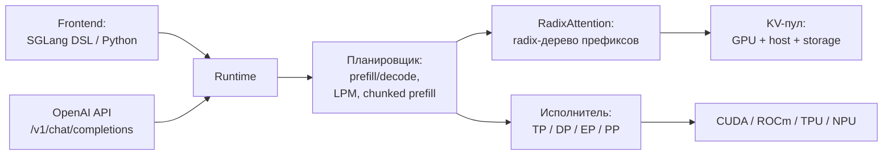
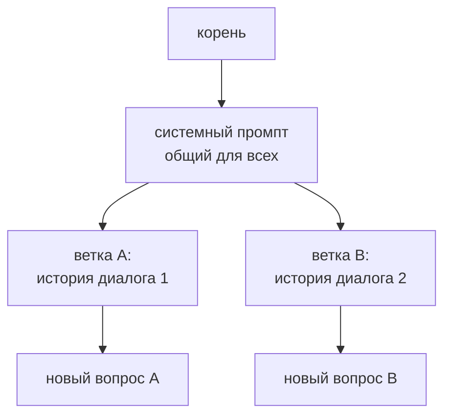

# Движки инференса: SGLang

> **Зачем эта глава.** SGLang вырос из идеи «язык программ для LLM» и стал серверным движком, который делает ставку на повторяющиеся префиксы: системные промпты агентов, многоходовые диалоги, RAG с одинаковыми инструкциями. Если vLLM — это про «много пользователей вообще», то SGLang — про «много запросов с общим началом». Здесь — как устроен RadixAttention, что даёт HiCache и Paged Experts и как этим пользоваться.

> **За 30 секунд**
> - SGLang — frontend-язык плюс runtime; главная идея — **RadixAttention**: KV-кэш хранится в radix-дереве и делится между запросами с общим префиксом.
> - Сильные стороны: агентские нагрузки, многоходовые диалоги, MoE, структурированный вывод, HiCache на GPU/CPU/диск.
> - Слабые: сложнее в настройке, чем llama.cpp; уже поддерживаемое железо, чем у llama.cpp; часть функций новая и требует проверки.
> - Версия на 8 ноября 2026 — **v0.5.23** (2 ноября 2026), CUDA 13, PyTorch 2.14.

## 1. Архитектура и для чего создан

SGLang начинался как исследовательский проект про **structured language model programs**: вместо одного запроса «промпт → ответ» вы описываете программу с ветвлениями, параллельными генерациями и ограничениями. Для таких программ нужен runtime, который умеет переиспользовать общий префикс между ветками. Отсюда RadixAttention.

Современный SGLang — это два слоя:



| Слой | Роль |
|---|---|
| **Frontend** | описание программ: `gen`, `fork`, `select`, ограничения; не обязателен для обычного OpenAI-клиента |
| **Runtime** | HTTP-сервер, планировщик, RadixAttention, батчинг, спекуляция |
| **RadixAttention** | дерево префиксов, в узлах которого лежат KV-блоки |
| **HiCache** | расширение кэша на host-память и внешнее хранилище |
| **Paged Experts** | выгрузка экспертов MoE в pinned host-память с вычислением на GPU |

### 1.1 RadixAttention

Представьте, что все промпты, которые видел сервер, сложены в дерево. Корень — пустой префикс, каждый узел — кусок токенов, а листья — полные последовательности. Если два запроса начинаются одинаково, они идут по одной ветке и **делят одни и те же KV-блоки**.



Когда приходит новый запрос, runtime ищет самый длинный совпадающий путь, берёт KV из дерева и считает только новый хвост. Это не «кэш на слот», как в llama.cpp, и не «хеш блоков», как в vLLM: дерево само хранит структуру префиксов, поэтому ветвление диалога не требует копирования всего общего начала.

| Свойство | RadixAttention |
|---|---|
| Единица | узел дерева (кусок токенов + KV) |
| Совпадение | самый длинный префикс в дереве |
| Разделение | естественное, между любыми запросами |
| Вытеснение | LRU/LFU/SLRU/priority, настраивается |
| Отключение | `--disable-radix-cache` |

Флаги:

```bash
--disable-radix-cache              # выключить кэш
--radix-eviction-policy lru        # lru, lfu, slru, priority
--schedule-policy lpm              # longest prefix match при планировании
--enable-cache-report              # показывать число кэшированных токенов в usage
```

`--schedule-policy lpm` важен для агентов: планировщик сначала берёт запросы, у которых больше шансов попасть в кэш, а не просто в порядке прихода (по умолчанию `fcfs`). Это уменьшает prefill и выравнивает нагрузку.

> [!NOTE]
> RadixAttention — это не «магический кэш на всё». Первый запрос всегда холодный; если префикс меняется в начале, дерево ветвится и общая часть уменьшается; при переполнении KV узлы вытесняются. Выигрыш зависит от того, насколько стабильно начало ваших промптов (глава 7).

### 1.2 Чем SGLang отличается от vLLM и llama.cpp

| | llama.cpp | vLLM | SGLang |
|---|---|---|---|
| Кэш префиксов | слот + LCP | хеш блоков | radix-дерево |
| Единица кэша | контекст слота | блок 16 токенов (v0.33.0) | узел дерева |
| Разделение между запросами | ограниченное | да | да, естественное |
| Планирование по префиксу | нет | косвенно | `lpm` |
| Расширение кэша | `--cache-ram` | KV offload | HiCache (GPU/CPU/диск) |
| Много пользователей | проще | сильнее | сильнее |
| Агенты с общим промптом | нормально | хорошо | лучше всего |

### 1.3 Чего SGLang не делает

- **Не является самым простым способом запустить модель на ноутбуке.** Для этого есть llama.cpp.
- **Не поддерживает все GPU-сценарии vLLM.** Матрица моделей и квантов уже, хотя AMD/Ascend/TPU/XPU поддерживаются.
- **Не гарантирует, что новая функция подойдёт вашей модели.** Paged Experts, HiCache и часть спекуляции имеют ограничения по архитектуре, кванту и параллелизму.

## 2. Форматы весов и квантование

SGLang работает с **HF safetensors** и конфигурацией Hugging Face. Поддерживаются предквантованные чекпойнты и онлайн-квантование.

| Формат | Что это | Комментарий |
|---|---|---|
| **BF16 / FP16** | половинная точность | базовый вариант |
| **FP8 W8A8** | веса и активации FP8 | NVIDIA Hopper/Blackwell, AMD |
| **FP4 / NVFP4 / MXFP4** | 4-битные float | новые GPU; проверяйте модель и бэкенд |
| **AWQ** | 4-битные веса | готовые чекпойнты |
| **GPTQ** | 4/8-битные веса | поддержка зависит от ядра |
| **INT8 W8A8** | целочисленный 8-бит | NVIDIA/AMD |
| **GGUF** | формат llama.cpp | ограниченный `--load-format gguf`; не основной путь |
| **MLX q4/q8** | кванты для Apple Silicon | через MLX-бэкенд |

Выбор:

```bash
--quantization fp8          # онлайн-квантование FP16-чекпойнта
--kv-cache-dtype fp8_e4m3   # KV в FP8
```

Для готового AWQ/GPTQ-чекпойнта `--quantization` обычно не нужен: метод уже записан в `config.json` и определяется автоматически. Флаг нужен для онлайн-квантования FP16-модели, а не для «включения» готового AWQ.

> [!WARNING]
> Если чекпойнт уже квантован, не добавляйте `--quantization` «для надёжности»: это может привести к повторному квантованию или ошибке загрузки. Смотрите `quantization_config` в `config.json`. Теория квантования — глава 4.

### 2.1 KV-кэш

SGLang поддерживает FP8 E4M3/E5M2 и экспериментальные FP4-форматы:

```bash
--kv-cache-dtype fp8_e4m3
--kv-cache-dtype fp8_e5m2
--kv-cache-dtype nvfp4          # экспериментально
--kv-cache-dtype fp4_mx_block16 # экспериментально
```

FP8 KV обычно удваивает доступный контекст; FP4 — ещё сильнее, но требует подходящего attention-бэкенда и проверки качества. Если бэкенд не умеет читать квантованный KV напрямую, деквантование может съесть весь выигрыш. Смотрите матрицу attention-бэкендов и главу 6.

## 3. Поддержка железа

| Платформа | Поддержка | Комментарий |
|---|---|---|
| **NVIDIA CUDA** | основная | CUDA 13 в v0.5.23 |
| **AMD ROCm** | да | MI300X/MI325X/MI350X и Radeon; отдельные инструкции |
| **Huawei Ascend NPU** | да | отдельная ветка документации и сборка |
| **Google TPU** | через SGLang-TorchTPU | PyTorch-плагин |
| **Intel XPU** | да | отдельные сборки |
| **CPU** | да | для совместимости и небольших моделей |
| **NVIDIA Jetson** | да | отдельные инструкции |
| **Moore Threads** | да | MUSA |
| **Apple Silicon** | через MLX | экспериментально, `SGLANG_USE_MLX=1` |

### 3.1 Параллелизм

| Режим | Флаг | Когда нужен |
|---|---|---|
| **Tensor parallelism** | `--tp-size N` | модель не влезает или нужен KV |
| **Data parallelism** | `--dp-size N` | пропускная способность, несколько копий |
| **Expert parallelism** | `--ep-size N` | MoE |
| **Pipeline parallelism** | `--pp-size N` | глубокие модели, несколько узлов |
| **PD disaggregation** | отдельная конфигурация | prefill и decode на разных пулах |

Для нескольких узлов есть `--nnodes`, а для балансировки — SGLang Model Gateway (бывший router). PD disaggregation — серверная история: prefill и decode разводятся по разным GPU-пулам, чтобы подобрать железо под каждую фазу (глава 8).

### 3.2 Выгрузка в ОЗУ и Paged Experts

У SGLang два разных механизма:

- **`--cpu-offload-gb N`** — часть весов в host-памяти, вычисления могут уходить на CPU; это медленный путь, близкий к `--cpu-offload-gb` в vLLM;
- **`--enable-paged-experts`** — эксперты MoE хранятся в pinned host-памяти, но **вычисляются на GPU**: на каждом шаге нужные эксперты копируются в K-слотовую таблицу на GPU. Это позволяет запустить MoE, который не влезает в VRAM, на одной карте.

Paged Experts — главное отличие SGLang для домашнего сценария «модель больше VRAM». Ограничения (по документации v0.5.23):

- только один GPU; TP/EP/PP/DP и EPLB не поддерживаются;
- поддерживаются не все кванты: unquantized, FP8, INT8, GPTQ int4/int8, AWQ int4, некоторые NVFP4/MXFP4 — через соответствующие MoE-runner'ы;
- спекулятивное декодирование не поддерживается;
- host-память должна быть достаточно большой, чтобы pinned-буфер вместил всех экспертов;
- CUDA graphs работают, но с ограничениями.

```bash
python3 -m sglang.launch_server \
  --model-path ./models/moe-35b-a3b-gptq-int4 \
  --enable-paged-experts \
  --paged-experts-num-resident 16 \
  --context-length 16384 \
  --mem-fraction-static 0.80 \
  --max-running-requests 2
```

В текущей документации `--paged-experts-num-resident` по умолчанию равен `auto`: K подбирается после загрузки всех весов, а в лог печатается выбранное значение и подсказка для фиксации. В v0.5.23, на которой зафиксирована эта глава, флаг ещё обязателен — поэтому в примере стоит явное число; в более новой сборке его можно не указывать. Начните с 16–32 и подбирайте по логу и пику VRAM; явное значение полезно, когда нужно воспроизвести конфиг.

Авторы релиза заявляют до 30× быстрее CPU-offload; независимой проверки в этой книге нет, поэтому воспринимайте цифру как заявку, а не как гарантию.

> [!WARNING]
> Paged Experts — новая и узкая функция. Если ваша модель/квант/конфигурация не входит в поддерживаемый список, сервер откажется стартовать. Для универсального «MoE на 16 ГБ» по-прежнему надёжнее llama.cpp с `--n-cpu-moe`; Paged Experts стоит пробовать, когда модель и квант точно поддерживаются.

## 4. Батчинг, планировщик и кэш

### 4.1 Основные рычаги

| Флаг | Что делает | Осторожно |
|---|---|---|
| `--mem-fraction-static F` | доля GPU под веса + KV | слишком высоко — OOM на активациях |
| `--context-length N` | максимальный контекст | больше — больше KV |
| `--max-running-requests N` | одновременные запросы | больше — больше KV и задержка |
| `--max-total-tokens N` | размер KV-пула | обычно auto |
| `--chunked-prefill-size N` | размер chunked prefill | меньше — лучше ITL, хуже TTFT |
| `--schedule-policy` | `fcfs`, `lpm`, `random`, `dfs-weight`, `priority` | для агентов — `lpm` |
| `--schedule-conservativeness F` | насколько осторожно принимать запросы | больше — меньше retraction |
| `--page-size N` | размер страницы KV | по умолчанию 1 |

`--mem-fraction-static` — главный рычаг памяти. SGLang выделяет под веса и KV долю GPU, а остальное оставляет на активации и CUDA graphs. Если в логе `available_gpu_mem` слишком велик (10–20 ГБ), можно поднять `mem-fraction-static`; если слишком мал (меньше 5 ГБ), ждите OOM.

### 4.2 Radix-кэш и вытеснение

Когда KV-пул заполнен, radix-дерево вытесняет узлы. Политика задаётся `--radix-eviction-policy`:

| Политика | Кого вытесняет | Когда использовать |
|---|---|---|
| `lru` (по умолчанию) | давно не использованный префикс | общий случай |
| `lfu` | реже всего попадавший в кэш | небольшой набор частых промптов |
| `slru` | сначала probationary-сегмент | защита проверенных префиксов |
| `priority` | префикс запроса с низким приоритетом | вместе с priority scheduling |

### 4.3 HiCache

RadixAttention по умолчанию живёт в GPU. **HiCache** добавляет уровни:

- **L1** — GPU;
- **L2** — host-память;
- **L3** — внешнее хранилище (файл, Mooncake, HF3FS, NIXL и др.).

```bash
--enable-hierarchical-cache
--hicache-ratio 2              # host-пул в 2 раза больше GPU
--hicache-size 100             # или точный размер в ГБ
--hicache-io-backend kernel
--hicache-storage-backend file # или mooncake, hf3fs, nixl...
```

L1 и L2 приватны для инстанса; L3 может быть общим для нескольких инстансов. Если host-пул не больше GPU-пула, попадания в L3 могут не уместиться и промпт придётся пересчитывать. Подробности — в документации HiCache.

> [!TIP]
> Если у вас агент с длинным системным промптом и историей, сначала включите RadixAttention (он включён по умолчанию) и `--schedule-policy lpm`. HiCache добавляйте, когда GPU-пула перестаёт хватать, а не «на всякий случай»: он расходует ОЗУ и добавляет I/O.

**Посчитай сам.** Агент делает 50 шагов. Общий префикс — 24k токенов, новый хвост — 400 токенов. Prefill идёт со скоростью 1500 ток/с, декод — 40 ток/с, ответ — 150 токенов. Сколько времени экономит RadixAttention за всю задачу?

<details>
<summary>Решение</summary>

```
Без кэша:
  prefill = 24 000 / 1500 = 16 с
  decode  = 150 / 40 = 3,75 с
  шаг ≈ 19,75 с; 50 шагов ≈ 988 с ≈ 16,5 мин

С RadixAttention:
  prefill = 400 / 1500 ≈ 0,27 с
  шаг ≈ 4,02 с; 50 шагов ≈ 201 с ≈ 3,4 мин

Экономия ≈ 787 с ≈ 13 мин, то есть примерно в 5 раз.
```

Это идеализированный расчёт: часть шагов может не попасть в кэш из-за ветвления или вытеснения. Но порядок величины показывает, почему для агентов кэш префиксов важнее, чем несколько процентов скорости декода.

</details>

## 5. Спекулятивное декодирование и MTP

SGLang поддерживает:

| Метод | Флаг | Комментарий |
|---|---|---|
| **EAGLE / EAGLE-3** | `--speculative-algorithm EAGLE3` | нужен draft-чекпойнт |
| **MTP** | `--speculative-algorithm NEXTN` (алиас EAGLE) | MTP-головы целевой модели |
| **STANDALONE** | `--speculative-algorithm STANDALONE` | отдельная draft-модель |
| **NGRAM** | `--speculative-algorithm NGRAM` | без модели, CUDA-only |
| **UNO** | `--speculative-algorithm UNO` | LoRA-адаптер к целевой модели |
| **DFLASH** | `--speculative-algorithm DFLASH` | блок-диффузионный черновик |

Пример EAGLE-3:

```bash
python3 -m sglang.launch_server \
  --model-path ./models/target \
  --speculative-algorithm EAGLE3 \
  --speculative-draft-model-path ./models/eagle3-draft \
  --speculative-num-steps 3 \
  --speculative-eagle-topk 4 \
  --speculative-num-draft-tokens 16 \
  --mem-fraction-static 0.70
```

> [!WARNING]
> Спекуляция ест память под draft-модель и KV и может ухудшить пропускную способность на высоком QPS. Начинайте с малых `num-steps`/`num-draft-tokens`, меряйте acceptance и ITL (глава 9). Для MTP не нужен отдельный чекпойнт, но нужна модель с MTP-головами.

## 6. Структурированный вывод и tool calling

### 6.1 Грамматики

SGLang поддерживает JSON Schema, regex и EBNF через три бэкенда:

- **XGrammar** (по умолчанию);
- **Outlines**;
- **llguidance**.

```bash
--grammar-backend xgrammar
```

Запрос:

```json
{
  "model": "local-model",
  "messages": [{"role": "user", "content": "Верни JSON"}],
  "response_format": {
    "type": "json_schema",
    "json_schema": {
      "name": "answer",
      "schema": {
        "type": "object",
        "properties": {"answer": {"type": "string"}},
        "required": ["answer"]
      }
    }
  }
}
```

Ограничение гарантирует синтаксис, но не смысл; и обрыв по `max_tokens` всё равно даёт невалидный JSON. Подробно — глава 11.

### 6.2 Tool calling

```bash
--tool-call-parser auto
--reasoning-parser auto
```

`auto` пытается определить парсер по шаблону модели. Если не получается, укажите явно: `qwen`, `llama3`, `deepseekv3`, `glm`, `gpt-oss`, `kimi_k2`, `mistral` и др. Список зависит от версии.

Если tool calls приходят текстом, а не в `tool_calls`, почти всегда виноват парсер или шаблон. Проверьте `--chat-template` / `--hf-chat-template-name` и документацию парсера. Дизайн инструментов — глава 11.

## 7. OpenAI-совместимый сервер

Запуск:

```bash
python3 -m sglang.launch_server \
  --model-path ./models/model \
  --host 0.0.0.0 \
  --port 30000 \
  --api-key secret
```

Или новый CLI:

```bash
sglang serve --model-path ./models/model --host 0.0.0.0 --port 30000
```

Поддерживаются:

- `/v1/chat/completions`, `/v1/completions`;
- `/v1/models`, `/v1/embeddings`;
- `/v1/rerank`, `/v1/score`;
- `/v1/messages` (Anthropic-совместимый);
- native `/generate`, `/get_model_info`, `/server_info`, `/health`, `/health_generate`, `/flush_cache`.

По умолчанию сервер слушает `127.0.0.1:30000`. Для доступа извне — `--host 0.0.0.0`; для защиты — `--api-key`.

> [!NOTE]
> SGLang исторически силён в native API и frontend-языке, но OpenAI-совместимый слой у него тоже полноценный. Если вы пишете обычное приложение, используйте `/v1/chat/completions`; если нужны ветвления и параллельные генерации — frontend-язык.

## 8. Метрики и наблюдаемость

Включаются флагом `--enable-metrics`; `/metrics` отдаёт Prometheus-метрики с префиксом `sglang:`:

| Метрика | Смысл |
|---|---|
| `sglang:prompt_tokens_total` | обработано токенов промпта |
| `sglang:generation_tokens_total` | сгенерировано токенов |
| `sglang:token_usage` | заполнение KV-пула |
| `sglang:cache_hit_rate` | доля попаданий в radix-кэш |
| `sglang:time_to_first_token_seconds` | TTFT |
| `sglang:e2e_request_latency_seconds` | полное время |
| `sglang:num_running_reqs` | запросов в работе |
| `sglang:num_queue_reqs` | запросов в очереди |
| `sglang:num_retracted_reqs` | вытесненных запросов |

Имена метрик — по документации v0.5.23; в своей сборке проверьте `curl /metrics`.

Дополнительно:

- `--enable-cache-report` — число кэшированных токенов в `usage.prompt_tokens_details`;
- `--log-requests` — логи запросов;
- лог сервера — `#running-req`, `token usage`, `gen throughput`, `#queue-req`;
- `/server_info` — параметры и размеры пулов;
- OpenTelemetry (`--enable-trace`) — трассировка запросов.

Для замеров используйте `sglang.bench_serving` / `bench_serving` (глава 12). Смотрите не только средний tok/s, но и `cache_hit_rate`, `token_usage`, `num_retracted_reqs`.

## 9. Практика: установка, запуск, ошибки, тюнинг

### 9.1 Установка

SGLang требует Linux, Python 3.11+ и CUDA 13 для NVIDIA-сборок.

```bash
uv venv --python 3.12
source .venv/bin/activate
uv pip install --prerelease=allow sglang
```

Docker:

```bash
docker pull lmsysorg/sglang:latest
docker run --rm --gpus all --ipc=host \
  -p 30000:30000 \
  -v ~/.cache/huggingface:/root/.cache/huggingface \
  -v "$PWD/models:/models" \
  lmsysorg/sglang:latest \
  sglang serve --model-path /models/model --host 0.0.0.0 --port 30000
```

Для AMD — отдельная сборка `sgl-kernel` и ROCm-образ; для Apple — `SGLANG_USE_MLX=1` и MLX-зависимости.

### 9.2 Одна потребительская карта: 16 ГБ, 8B AWQ

Задача: 8B в AWQ (~5,5 ГБ), контекст 32k, несколько одновременных запросов.

```bash
python3 -m sglang.launch_server \
  --model-path ./models/qwen3-8b-awq \
  --context-length 32768 \
  --mem-fraction-static 0.82 \
  --max-running-requests 8 \
  --chunked-prefill-size 4096 \
  --schedule-policy lpm \
  --enable-metrics \
  --enable-cache-report \
  --host 0.0.0.0 --port 30000
```

Что важно:

- `--quantization awq` в команде нет: метод уже записан в конфиге чекпойнта и определяется автоматически. Флаг нужен для онлайн-квантования FP16-модели, а не для готового AWQ.
- `--mem-fraction-static 0.82` оставляет около 2,9 ГБ на активации и CUDA graphs; на 16 ГБ это разумная отправная точка.
- `--context-length 32768` — максимум; реальный KV-пул может позволить меньше одновременных запросов.
- `--schedule-policy lpm` помогает, если запросы делят префикс; для одиночного чата разницы почти нет.
- `--enable-cache-report` показывает, сколько токенов пришло из кэша.

Для MoE 35B-A3B, который не влезает в 16 ГБ, используйте Paged Experts (см. §3.2), если квант поддерживается; иначе — llama.cpp с `--n-cpu-moe`.

### 9.3 Сервер с несколькими GPU: 4×48 ГБ, 70B FP8

Задача: 70B FP8, 4 GPU, контекст 32k, до 32 одновременных запросов.

```bash
python3 -m sglang.launch_server \
  --model-path ./models/70b-fp8 \
  --tp-size 4 \
  --context-length 32768 \
  --mem-fraction-static 0.85 \
  --max-running-requests 32 \
  --chunked-prefill-size 8192 \
  --schedule-policy lpm \
  --enable-metrics \
  --enable-cache-report \
  --host 0.0.0.0 --port 30000
```

Почему так:

- `--tp-size 4` делит веса и KV между картами;
- `--mem-fraction-static 0.85` оставляет запас на активации;
- `--max-running-requests 32` ограничивает конкурентность, чтобы не уйти в постоянные retraction;
- `--chunked-prefill-size 8192` даёт хороший TTFT на длинных промптах;
- `lpm` помогает агентам и многоходовым диалогам.

Для MoE добавьте `--ep-size` (expert parallelism) и проверьте поддержку архитектуры. Для очень больших кластеров смотрите PD disaggregation и Model Gateway.

### 9.4 Типичные ошибки

| Симптом | Вероятная причина | Что делать |
|---|---|---|
| OOM при старте | `mem-fraction-static` слишком высок, длинный контекст | снизить до 0.75–0.85, уменьшить `--context-length` |
| `KV cache pool is full. Retract requests.` | мало KV, слишком много запросов | поднять `--schedule-conservativeness`, снизить `--max-running-requests` |
| Низкий `cache_hit_rate` | префиксы меняются, `fcfs` вместо `lpm` | стабилизировать начало, `--schedule-policy lpm` |
| Модель печатает спецтокены | неверный chat template | `--chat-template`, `--hf-chat-template-name` |
| Tool calls не разбираются | неверный `--tool-call-parser` | указать парсер явно |
| `peer access is not supported` | несколько GPU без P2P | `--enable-p2p-check` |
| OOM при захвате CUDA graph | слишком большой batch | `--disable-cuda-graph` или уменьшить max bs |
| Paged Experts не стартует | неподдерживаемый квант/режим | проверить список в документации, один GPU |
| Apple Silicon не работает | не включён MLX | `SGLANG_USE_MLX=1`, `--disable-cuda-graph` |

### 9.5 Порядок тюнинга

Ориентиры по теории: prefill/decode и потолок памяти — глава 2; размер KV и контекст — глава 6; кэш префиксов — глава 7; батчинг и слоты — глава 8; спекуляция — глава 9; методика замера — глава 12.

1. **Модель и квант.** Проверьте поддержку архитектуры и кванта.
2. **Контекст.** `--context-length` под задачу; KV считается по главе 6.
3. **Память.** `--mem-fraction-static`; смотрите `available_gpu_mem` в логе.
4. **Конкурентность.** `--max-running-requests`, `--chunked-prefill-size`.
5. **Кэш.** RadixAttention включён; `lpm` для агентов; `--enable-cache-report`.
6. **HiCache.** Только когда GPU-пула не хватает; следите за host-памятью.
7. **Спекуляция.** Последней, с замером acceptance.
8. **Замер.** `bench_serving`, 3–5 повторов, медиана (глава 12).

## Ключевые идеи

- SGLang — frontend-язык плюс runtime; RadixAttention хранит префиксы в дереве и делит KV между запросами.
- Радикс-кэш естественно подходит агентам и многоходовым диалогам; `lpm` планирует запросы с учётом префикса.
- HiCache расширяет кэш на host-память и внешнее хранилище; L1/L2 приватны, L3 может быть общим.
- Paged Experts позволяют запустить MoE больше VRAM на одной карте, но имеют узкие ограничения.
- Поддержка: NVIDIA, AMD, Ascend, TPU, XPU, CPU, Jetson, Moore Threads, Apple через MLX.
- Структурированный вывод — XGrammar/Outlines/llguidance; tool calling — через парсеры.
- Слабости — сложность настройки и более узкая матрица моделей/квантов, чем у vLLM.

## Проверь себя

1. Чем radix-кэш отличается от хеша блоков в vLLM?
2. Зачем нужен `--schedule-policy lpm` для агента?
3. Когда HiCache помогает, а когда только добавляет задержку?
4. Почему Paged Experts не поддерживает спекуляцию и multi-GPU?
5. Что означает `KV cache pool is full. Retract requests.` и как это лечить?
6. В каком сценарии SGLang проигрывает llama.cpp?

## Ответы

1. Radix-кэш хранит префиксы в дереве и делит узлы между запросами; хеш блоков в vLLM — плоская таблица блоков, где ключ включает хеш предыдущего блока. Дерево естественнее для ветвления диалога, хеш проще для плоского параллельного батча.
2. `lpm` (longest prefix match) сначала планирует запросы, у которых больше общего с уже закэшированным, что уменьшает prefill и повышает попадания.
3. Помогает, когда GPU-пула не хватает, а префиксы повторяются и host-память быстрая. Вредит, когда попаданий мало, L3 медленный или host-пул меньше GPU-пула: тогда данные перекладываются зря.
4. Paged Experts копируют экспертов в слоты на GPU и используют CUDA graphs; спекуляция и multi-GPU требуют другой раскладки памяти и синхронизации, поэтому в v0.5.23 они исключены.
5. KV-пул переполнен, и планировщик вытесняет запросы. Лечится уменьшением контекста/конкурентности, повышением `schedule-conservativeness` или добавлением GPU.
6. Когда нужен один пользователь на ноутбуке, максимальная простота, широкий набор экзотического железа или надёжный CPU-MoE-offload без ограничений Paged Experts.

## Источники главы

Версии и флаги проверены **8 ноября 2026** по релизу v0.5.23 и документации SGLang.

- **SGLang, релиз v0.5.23** — SGLang Project, 02.11.2026. [GitHub](https://github.com/sgl-project/sglang/releases/tag/v0.5.23). Уровень: продвинутый. Зачем: версия, Paged Experts, HiCache, новые модели.
- **SGLang, «Server Arguments»** — SGLang, 2026. [docs.sglang.io](https://docs.sglang.io/docs/advanced_features/server_arguments). Уровень: средний. Зачем: все флаги, значения по умолчанию.
- **SGLang, «Radix Cache Eviction Policies»** — SGLang, 2026. [docs.sglang.io](https://docs.sglang.io/docs/advanced_features/radix_eviction_policy). Уровень: средний. Зачем: LRU/LFU/SLRU/priority.
- **SGLang, «HiCache Best Practices»** — SGLang, 2026. [docs.sglang.io](https://docs.sglang.io/docs/advanced_features/hicache_best_practices). Уровень: продвинутый. Зачем: L1/L2/L3 и настройка.
- **SGLang, «Speculative Decoding»** — SGLang, 2026. [docs.sglang.io](https://docs.sglang.io/docs/advanced_features/speculative_decoding). Уровень: продвинутый. Зачем: EAGLE, MTP, NGRAM, UNO, DFLASH.
- **SGLang, «Structured Outputs»** — SGLang, 2026. [docs.sglang.io](https://docs.sglang.io/docs/advanced_features/structured_outputs). Уровень: средний. Зачем: XGrammar/Outlines/llguidance.
- **SGLang, «Tool Parser»** — SGLang, 2026. [docs.sglang.io](https://docs.sglang.io/docs/advanced_features/tool_parser). Уровень: средний. Зачем: парсеры и поддерживаемые модели.
- **SGLang, «Production Metrics»** — SGLang, 2026. [docs.sglang.io](https://docs.sglang.io/docs/references/production_metrics). Уровень: средний. Зачем: `sglang:` метрики.
- **SGLang, «Quantization»** — SGLang, 2026. [docs.sglang.io](https://docs.sglang.io/docs/advanced_features/quantization). Уровень: продвинутый. Зачем: FP8/FP4/AWQ/GPTQ.
- **SGLang, «Paged Experts»** — SGLang, 2026. [docs.sglang.io](https://docs.sglang.io/docs/advanced_features/paged_experts). Уровень: продвинутый. Зачем: MoE больше VRAM и ограничения.
- **Zheng et al., «SGLang: Efficient Execution of Structured Language Model Programs»** — 2023. [arXiv:2312.07104](https://arxiv.org/abs/2312.07104). Уровень: продвинутый. Зачем: RadixAttention и frontend-язык.
