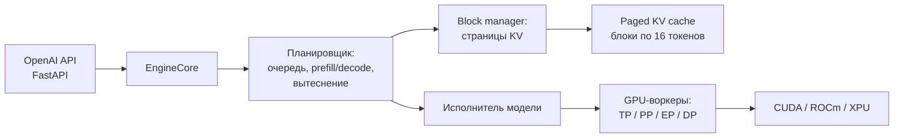

# Движки инференса: vLLM

> **Зачем эта глава.** vLLM — один из основных серверных движков для NVIDIA/AMD GPU. В главе 8 уже разобраны PagedAttention, непрерывный батчинг и закон Литтла; здесь — как из этих идей собран конкретный движок, что означают его флаги и где он перестаёт быть удобным. Это не повторение теории, а разбор эксплуатации.

> **За 30 секунд**
> - vLLM — Python/C++/CUDA-движок для GPU-серверов: PagedAttention, непрерывный батчинг, V1-планировщик, prefix caching по хешу блоков.
> - Его сильные стороны — много одновременных пользователей, tensor/pipeline/expert parallelism и широкая поддержка моделей и квантов.
> - Слабые — Linux-only, требовательность к GPU-стеку, ограниченная поддержка GGUF и отсутствие удобного CPU-MoE-offload, как в llama.cpp.
> - Версия на 8 ноября 2026 — **v0.33.0** (тег `v0.33.0` — 1 ноября 2026, релиз опубликован 2 ноября), PyTorch 2.14, CUDA 13.0, ROCm 10.0 — по [release notes](https://github.com/vllm-project/vllm/releases/tag/v0.33.0rc3).

## 1. Архитектура и для чего создан

vLLM строился вокруг одной задачи: обслуживать много запросов к одной модели на GPU так, чтобы память под KV-кэш не превращалась в узкое место. PagedAttention (§8.5) решил проблему фрагментации, непрерывный батчинг (§8.4) — проблему простоя слотов. Дальше вырос полноценный серверный движок.

В v0.33.0 работает **V1**-архитектура:



| Компонент | Роль |
|---|---|
| **API-сервер** | OpenAI-совместимые маршруты, стриминг, парсинг tool calls, метрики |
| **EngineCore** | цикл движка: принять запросы, спланировать, выполнить шаг, отдать токены |
| **Планировщик** | решает, какие запросы идут в prefill, какие в decode, кого вытеснить |
| **Block manager** | выдаёт и освобождает блоки KV, считает хеши префиксов |
| **Исполнитель** | запускает модель на GPU-воркерах, включая CUDA graphs и компиляцию |

### 1.1 Что важно в планировщике

- **Chunked prefill включён по умолчанию.** Длинный промпт режется на куски и подмешивается к декоду, чтобы не блокировать остальных (глава 8).
- **Декод приоритетнее prefill.** Планировщик сначала набирает декод-запросы, а остаток бюджета отдаёт prefill.
- **Вытеснение (preemption).** Если KV не хватает, vLLM вытесняет запросы; в V1 по умолчанию режим `RECOMPUTE` — вытесненный запрос потом пересчитывается, а не хранится в ОЗУ.
- **Бюджеты.** `--max-num-seqs` ограничивает число последовательностей, `--max-num-batched-tokens` — число токенов за итерацию.

> [!NOTE]
> PagedAttention, внутренняя и внешняя фрагментация, закон Литтла и `b* = W / (C × k)` уже разобраны в главе 8. Здесь мы не выводим их заново; важно лишь, что vLLM эксплуатирует эти идеи агрессивнее, чем llama.cpp.

### 1.2 Чего vLLM не делает

- **Не работает на Windows нативно.** Нужен Linux или WSL; это не «поставил и забыл» для домашнего ПК.
- **Не является лучшим выбором для одной карты 16 ГБ.** Ему нужен запас под CUDA graphs, компиляцию и KV; на маленькой карте llama.cpp часто практичнее.
- **Не поддерживает GGUF так же полно, как llama.cpp.** GGUF есть, но это не основной путь.
- **Не выгружает экспертов MoE в ОЗУ так, как llama.cpp.** Для модели, не влезающей в VRAM, обычно добавляют GPU или берут более сильный квант.

## 2. Форматы весов и квантование

vLLM работает с **HF safetensors** и конфигурацией модели. Это родной формат экосистемы Hugging Face: его отдают обученные модели, его же понимают квантователи.

| Формат | Что это | Типичное применение |
|---|---|---|
| **BF16 / FP16** | половинная точность | базовый вариант на Hopper/Blackwell/Ada |
| **FP8 W8A8** | веса и активации в FP8 | Hopper, Ada, Blackwell; хороший баланс |
| **INT8 W8A8** | целочисленный 8-бит | Ampere и новее, CPU |
| **INT4 W4A16** | 4-битные веса, 16-битные активации | экономия VRAM |
| **AWQ / GPTQ** | популярные 4-битные схемы | готовые чекпойнты с HF |
| **bitsandbytes** | динамическое квантование | быстрый старт, не для максимальной скорости |
| **GGUF** | формат llama.cpp | ограниченная поддержка; проверяйте архитектуру |
| **NVFP4 / MXFP4** | 4-битные float-форматы | Blackwell и новее, где есть аппаратная поддержка |
| **FP8 KV cache** | квантование KV | экономия памяти под контекст |

Выбор кванта задаётся `--quantization` (или определяется из чекпойнта):

```bash
vllm serve ./models/model-awq --quantization awq
```

> [!WARNING]
> Если чекпойнт уже квантован, не включайте поверх него другой `--quantization`: это не «улучшит», а сломает загрузку или качество. Сначала посмотрите `quantization_config` в `config.json`. Подробно про схемы квантования — глава 4.

### 2.1 KV-кэш

`--kv-cache-dtype` принимает `auto`, `fp8`, `fp8_e4m3`, `fp8_e5m2` и (на новых платформах) FP4-варианты. FP8 KV удобен, когда нужно удвоить контекст или число одновременных запросов; качество обычно страдает мало, но проверять надо на своей модели (глава 6).

Есть и точечное исключение слоёв:

```bash
--kv-cache-dtype fp8 --kv-cache-dtype-skip-layers sliding_window
```

Это полезно для гибридных моделей, где скользящее окно чувствительнее к квантованию.

## 3. Поддержка железа

| Платформа | Поддержка | Комментарий |
|---|---|---|
| **NVIDIA CUDA** | основная | CUDA 13.0 в релизных колёсах v0.33.0; CUDA 12.9 больше не публикуется |
| **AMD ROCm** | да | ROCm 10.0 по умолчанию, 7.2 как `-rocm72` |
| **Intel XPU** | да | отдельные сборки |
| **CPU** | да | x86, ARM, Apple Silicon, S390X; больше для совместимости, чем для скорости |
| **Apple Silicon** | через [vLLM-Metal](https://github.com/vllm-project/vllm-metal) | отдельный проект, не основной ствол |
| **TPU** | через плагин | отдельная матрица возможностей |
| **Vulkan / Metal native** | нет | для этого есть llama.cpp |

### 3.1 Параллелизм

| Режим | Флаг | Когда нужен |
|---|---|---|
| **Tensor parallelism** | `--tensor-parallel-size N` | модель не влезает в одну карту или нужен больший KV |
| **Pipeline parallelism** | `--pipeline-parallel-size N` | очень глубокие модели, несколько узлов |
| **Expert parallelism** | `--enable-expert-parallel` | MoE: эксперты делятся между GPU |
| **Data parallelism** | `--data-parallel-size N` | копии модели для пропускной способности |

TP — самый частый вариант: он делит матрицы каждого слоя между картами. PP делит слои по стадиям и добавляет задержку; EP полезен для MoE, но требует поддержки модели. Подробнее о том, чем TP отличается от PP, — в §8.6.

### 3.2 Выгрузка в ОЗУ

У vLLM есть `--cpu-offload-gb N`: часть весов уходит в системную память и подтягивается по мере надобности через unified virtual addressing. Это позволяет запустить модель, которая чуть-чуть не влезает, но:

- пропускная способность PCIe на порядки ниже VRAM;
- на каждом токене возможны обращения к host-памяти;
- это не аналог `--n-cpu-moe` в llama.cpp, где эксперты **считаются** на CPU.

Для MoE, который не влезает в VRAM, vLLM обычно предлагает не offload, а больше GPU, expert parallelism или более сильный квант. Если нужен именно «один GPU + ОЗУ», смотрите llama.cpp (глава 5) или Paged Experts в SGLang.

> [!WARNING]
> `--cpu-offload-gb` может сделать запуск возможным, но не делает его быстрым. Если вы упираетесь в PCIe, лучше уменьшить модель/контекст или добавить GPU, чем надеяться на offload.

## 4. Батчинг, планировщик и кэш префиксов

### 4.1 Основные рычаги

| Флаг | Что делает | Осторожно |
|---|---|---|
| `--gpu-memory-utilization F` | доля VRAM под модель, KV и буферы | слишком высоко — OOM на пике |
| `--max-model-len N` | максимальный контекст | больше модели не влезет; меньше — обрежет запросы |
| `--max-num-seqs N` | максимум последовательностей в батче | больше — больше KV и задержка |
| `--max-num-batched-tokens N` | бюджет токенов на итерацию | больше — лучше TTFT, хуже ITL |
| `--kv-cache-memory-bytes N` | точный размер KV | отключает профилирование, требует расчёта |
| `--enable-prefix-caching` | кэш префиксов | по умолчанию включён |
| `--enforce-eager` | без CUDA graphs | медленнее, но меньше памяти и быстрее старт |

Базовое значение `max_num_batched_tokens` в конфиге планировщика — 2048, но движок может его переопределить. Для пропускной способности документация рекомендует поднимать бюджет выше 8192, особенно для небольших моделей на больших GPU. Смотрите стартовый лог: там напечатаны реальные значения.

### 4.2 Prefix caching

vLLM кэширует KV **блоками**. Хеш блока считается не только по токенам блока, но и по хешу предыдущего блока:

```text
Блок 1: [A gentle breeze stirred]
Блок 2: [the leaves as children]        ← хеш = hash(хеш блока 1, токены блока 2)
Блок 3: [laughed in the distance]       ← хеш = hash(хеш блока 2, токены блока 3)
```

Поэтому совпадение возможно только с **начала** последовательности: если изменить токен в середине, все блоки после него получат другие хеши. Кэшируются только полные блоки; при размере блока 16 токенов хвост короче 16 токенов не даст попадания.

| Параметр | Смысл |
|---|---|
| `--enable-prefix-caching` | включить APC (по умолчанию `True`) |
| `--prefix-caching-hash-algo` | `sha256` (по умолчанию), `sha256_cbor`, `xxhash`, `xxhash_cbor` |
| `cache_salt` в запросе | изолирует кэш между арендаторами |
| `--block-size` | размер блока KV; по умолчанию 16 |

> [!NOTE]
> Хеширование по умолчанию — `sha256`. Это защищает от коллизий, но хеши не воспроизводимы между версиями Python/vLLM. Если нужна переносимость между средами, смотрите `sha256_cbor`. `xxhash` быстрее, но не криптостойкий; в multi-tenant среде это риск.

### 4.3 Вытеснение и очередь

Когда KV-пул заполнен, vLLM вытесняет запросы. В V1 по умолчанию `RECOMPUTE`: запрос снимается, его KV освобождается, а при возобновлении prompt пересчитывается. Это дешевле swap в архитектуре V1, но добавляет работу.

Симптомы:

- в логе `Sequence group ... is preempted ... not enough KV cache space`;
- растёт `vllm:num_requests_waiting`;
- TTFT и ITL скачут.

Что делать: уменьшить `--max-model-len` или `--max-num-seqs`, поднять `--gpu-memory-utilization` (если есть запас), добавить TP. Формула `N = λT` из §8.4 помогает понять, сколько запросов вы пытаетесь удержать.

**Посчитай сам.** 70B в FP8 на 4×48 ГБ. Веса занимают около 70 ГБ. KV в FP8 — около 160 КиБ на токен. Сколько памяти останется под KV и сколько запросов с контекстом 32k поместится, если не оставлять запас?

<details>
<summary>Решение</summary>

```
всего VRAM:        4 × 48 = 192 ГБ
веса:              70 ГБ
доступно под KV:   192 − 70 = 122 ГБ
KV одного запроса: 32 768 × 160 КиБ ≈ 5 ГиБ
запросов:          122 / 5 ≈ 24
```

Без запаса и буферов — около 24 запросов на полном контексте. На практике часть VRAM уйдёт на активации, CUDA graphs и фрагментацию, поэтому планировщик сможет держать меньше; остальные будут ждать или вытесняться. Отсюда и смысл `--max-num-seqs`: не «сколько хотим», а «сколько реально помещается».

</details>

## 5. Спекулятивное декодирование и MTP

В vLLM спекуляция задаётся одним JSON-конфигом:

```bash
vllm serve ./models/target \
  --speculative-config '{
    "method": "mtp",
    "num_speculative_tokens": 1
  }'
```

| Метод | Что использует | Комментарий |
|---|---|---|
| `draft_model` | отдельная draft-модель | универсально, нужен файл |
| `eagle3` | EAGLE-3-голова | высокий acceptance на своём домене |
| `mtp` | MTP-головы целевой модели | не нужен отдельный чекпойнт |
| `ngram` | n-граммы из промпта | дёшево, полезно для повторяющегося текста |
| `suffix` | суффиксы из прошлых ответов | полезно для агентов и кода |
| `dflash`, `dspark` | блок-диффузионные черновики | подтверждены в `SpeculativeMethod` v0.33.0; проверяйте поддержку конкретной модели |

Методы `dflash` и `dspark` есть в `SpeculativeMethod` v0.33.0 (`vllm/config/speculative.py`), а release notes упоминают DFlash/DSpark в разделе спекуляции. Это не значит, что любой чекпойнт подойдёт: нужен совместимый draft и поддержка архитектуры.

Для draft-модели можно задать отдельный TP:

```bash
--speculative-config '{
  "method": "draft_model",
  "model": "./models/draft",
  "num_speculative_tokens": 4,
  "draft_tensor_parallel_size": 1
}'
```

> [!WARNING]
> Спекуляция окупается не всегда. На высоком QPS декод и так загружен, а черновик отнимает ресурсы; выигрыш чаще на низком QPS и latency-чувствительных сценариях. Считайте `E[N]` и меряйте acceptance (глава 9).

## 6. Структурированный вывод и tool calling

### 6.1 Structured outputs

vLLM поддерживает JSON Schema, regex, choice и грамматику через `structured_outputs`. Бэкенды — **XGrammar** и **guidance** (llguidance); `lm-format-enforcer` объявлен устаревшим в v0.33.0.

```bash
vllm serve ./models/model \
  --structured-outputs-config.backend xgrammar
```

Запрос:

```json
{
  "model": "local-model",
  "messages": [{"role": "user", "content": "Верни JSON с полями name и age"}],
  "response_format": {
    "type": "json_schema",
    "json_schema": {
      "name": "person",
      "schema": {
        "type": "object",
        "properties": {
          "name": {"type": "string"},
          "age": {"type": "integer"}
        },
        "required": ["name", "age"]
      }
    }
  }
}
```

По документации v0.33.0 старые поля `guided_json`, `guided_regex`, `guided_choice` удалены в v0.12.0; используйте `structured_outputs` или `response_format`. Подробнее — глава 11.

### 6.2 Tool calling

Нужны два флага: включить auto-tool-choice и выбрать парсер под шаблон модели.

```bash
vllm serve ./models/model \
  --enable-auto-tool-choice \
  --tool-call-parser hermes
```

Поддерживаются `auto`, `required`, `none` и именованный выбор функции. Для строгой схемы:

- `--tool-strict-level parameter` — сервер сам требует соблюдения схемы аргументов;
- `strict: true` в описании инструмента — то же на уровне запроса;
- `--reasoning-parser` — чтобы отделить рассуждения от `tool_calls`.

Если парсер не соответствует шаблону, модель может вернуть текст вместо `tool_calls`. Проверяйте `chat_template` в конфиге и документацию парсера. Дизайн инструментов — глава 11.

## 7. OpenAI-совместимый сервер

Запуск:

```bash
vllm serve ./models/model \
  --host 0.0.0.0 \
  --port 8000 \
  --served-model-name local-model \
  --api-key secret
```

Поддерживаются:

- `/v1/chat/completions`, `/v1/completions`;
- `/v1/responses`;
- `/v1/embeddings`, `/v1/audio/transcriptions`;
- `/v1/messages` (Anthropic-совместимый);
- `/metrics`, `/health`.

Docker-вариант:

```bash
docker run --rm --gpus all --ipc=host \
  -p 8000:8000 \
  -v ~/.cache/huggingface:/root/.cache/huggingface \
  -v "$PWD/models:/models" \
  vllm/vllm-openai:v0.33.0 \
  --model /models/model
```

> [!WARNING]
> `--api-key` в vLLM защищает не все маршруты: часть служебных endpoints остаётся без аутентификации ([документация](https://docs.vllm.ai/en/latest/usage/security/#api-key-authentication-limitations)). Не выставляйте сервер в интернет, полагаясь только на этот флаг; ставьте reverse proxy и сетевые ограничения.

## 8. Метрики и наблюдаемость

`/metrics` отдаёт Prometheus-метрики с префиксом `vllm:`. Основные:

| Метрика | Смысл |
|---|---|
| `vllm:num_requests_running` | запросов в работе |
| `vllm:num_requests_waiting` | запросов в очереди |
| `vllm:kv_cache_usage_perc` | заполнение KV-пула |
| `vllm:prefix_cache_queries` / `hits` | эффективность кэша префиксов |
| `vllm:prompt_tokens_total` | обработано токенов промпта |
| `vllm:generation_tokens_total` | сгенерировано токенов |
| `vllm:time_to_first_token_seconds` | TTFT |
| `vllm:inter_token_latency_seconds` | ITL |
| `vllm:request_time_per_output_token_seconds` | TPOT |
| `vllm:e2e_request_latency_seconds` | полное время |
| `vllm:request_prefill_time_seconds` | prefill |
| `vllm:request_decode_time_seconds` | decode |
| `vllm:request_success_total` | завершённые запросы по причине |

Имена метрик — по документации v0.33.0; в своей сборке проверьте `curl /metrics`.

Для per-request метрик:

```bash
--enable-per-request-metrics
```

Тогда в ответе появится блок `metrics` с `time_to_first_token_ms`, `generation_time_ms`, `queue_time_ms`, `mean_itl_ms`. Это удобно для SLA и отладки, но на высокой конкурентности добавляет CPU-нагрузку.

Для замеров используйте `vllm bench serve` и `vllm bench throughput` (глава 12). В логах смотрите preemption, заполнение KV и среднюю длину очереди.

## 9. Практика: установка, запуск, ошибки, тюнинг

### 9.1 Установка

vLLM требует Linux, Python 3.11–3.14 и совместимый GPU-стек. В v0.33.0 релизные колёса собраны под CUDA 13.0; для ROCm — под ROCm 10.0.

```bash
uv venv --python 3.12
source .venv/bin/activate
uv pip install vllm
```

Или Docker:

```bash
docker pull vllm/vllm-openai:v0.33.0
```

Для AMD:

```bash
docker pull vllm/vllm-openai-rocm:v0.33.0
```

Проверка:

```bash
vllm --version
python -c "import torch; print(torch.cuda.is_available())"
```

### 9.2 Одна потребительская карта: 16 ГБ, 8B AWQ

Задача: запустить 8B в 4-битном AWQ (~5,5 ГБ) с контекстом 16k.

```bash
vllm serve ./models/qwen3-8b-awq \
  --quantization awq \
  --max-model-len 16384 \
  --gpu-memory-utilization 0.90 \
  --max-num-seqs 8 \
  --max-num-batched-tokens 4096 \
  --kv-cache-dtype fp8 \
  --enable-prefix-caching \
  --served-model-name local-8b \
  --host 0.0.0.0 --port 8000
```

Что важно:

- `--gpu-memory-utilization 0.90` оставляет около 1,6 ГБ на драйвер и пики; на 16 ГБ это разумно, но проверяйте пик.
- `--max-num-seqs 8` ограничивает KV и задержку; для одного пользователя можно 2–4.
- `--max-num-batched-tokens 4096` — компромисс между TTFT и ITL; для длинных промптов поднимите.
- `--kv-cache-dtype fp8` удваивает доступный контекст; проверьте качество.
- Если в `config.json` уже указан AWQ, `--quantization awq` можно опустить.

На 16 ГБ vLLM будет работать, но не ждите чудес: значительная часть VRAM уходит на веса, CUDA graphs и буферы. Для одного пользователя llama.cpp с GGUF обычно проще и не хуже по скорости.

### 9.3 Сервер с несколькими GPU: 4×48 ГБ, 70B FP8

Задача: обслуживать 70B в FP8 (~70 ГБ) на 4 картах, контекст 32k, до 32 одновременных запросов.

```bash
vllm serve ./models/70b-fp8 \
  --tensor-parallel-size 4 \
  --max-model-len 32768 \
  --gpu-memory-utilization 0.90 \
  --max-num-seqs 32 \
  --max-num-batched-tokens 8192 \
  --kv-cache-dtype fp8 \
  --enable-prefix-caching \
  --served-model-name local-70b \
  --host 0.0.0.0 --port 8000
```

Почему так:

- TP=4 делит веса и KV между картами; модель помещается с запасом;
- `max-num-seqs 32` — не потому, что столько влезет на полном контексте, а чтобы планировщик не держал слишком много KV; реальное число ограничит пул;
- `max-num-batched-tokens 8192` даёт хороший TTFT на длинных промптах;
- FP8 KV экономит память; на Hopper/Blackwell это обычно безопасно.

Для MoE на нескольких GPU добавьте `--enable-expert-parallel` (вместо TP для экспертных слоёв) и проверьте, что архитектура поддерживается. Для пропускной способности можно поднять `--data-parallel-size`, если есть свободные GPU.

> [!TIP]
> После старта посмотрите в лог строку с `max_num_seqs`, `max_model_len` и размером KV-пула. Именно эти числа, а не флаги, определяют, сколько запросов реально поместится.

### 9.4 Типичные ошибки

| Симптом | Вероятная причина | Что делать |
|---|---|---|
| OOM при старте | `gpu-memory-utilization` слишком высок, длинный `max-model-len`, CUDA graphs | снизить до 0.85–0.90, уменьшить контекст, `--enforce-eager` |
| OOM под нагрузкой | KV-пул мал, очередь | уменьшить `max-num-seqs`/`max-model-len`, поднять TP |
| Постоянные preemption | KV не хватает | то же; смотреть `vllm:kv_cache_usage_perc` |
| «context length exceeded» | `max-model-len` меньше запроса | поднять лимит или сократить промпт |
| Модель отвечает не по-человечески | неверный chat template | `--chat-template`, проверить шаблон |
| Tool calls не разбираются | неверный `--tool-call-parser` | выбрать парсер под модель, глава 11 |
| Ошибка divisibility | TP не делит число голов | изменить TP |
| `CUDA driver version is insufficient` | драйвер старее CUDA 13 | обновить драйвер или взять сборку под свою CUDA |
| Зависание на нескольких узлах | NCCL/IB | проверить сеть, `NCCL_DEBUG=INFO` |
| Prefix cache не попадает | префикс короче блока или меняется | проверить размер блока, стабильный префикс, глава 7 |

### 9.5 Порядок тюнинга

Ориентиры по теории: prefill/decode и потолок памяти — глава 2; размер KV и контекст — глава 6; кэш префиксов — глава 7; батчинг и слоты — глава 8; спекуляция — глава 9; методика замера — глава 12.

1. **Модель и квант.** Убедитесь, что чекпойнт поддерживается и влезает.
2. **Контекст.** `--max-model-len` под реальную задачу; больше — больше KV.
3. **Память.** `--gpu-memory-utilization` и `--kv-cache-memory-bytes`; смотрите лог.
4. **Батч.** `--max-num-seqs` и `--max-num-batched-tokens`; баланс TTFT/ITL.
5. **Prefix cache.** Оставьте включённым; проверьте `prefix_cache_hits`.
6. **Параллелизм.** TP/PP/EP только если модель не влезает или нужен KV.
7. **Спекуляция.** Последней, с замером acceptance.
8. **Замер.** `vllm bench serve`, 3–5 повторов, медиана (глава 12).

## Ключевые идеи

- vLLM — серверный GPU-движок с PagedAttention, непрерывным батчингом и V1-планировщиком.
- Родной формат — HF safetensors; кванты — FP8/INT8/INT4/AWQ/GPTQ/GGUF, KV — FP8.
- Сильная сторона — многопользовательская пропускная способность и параллелизм TP/PP/EP/DP.
- Prefix caching хеширует блоки с учётом предыдущего хеша; попадание возможно только с начала и по полным блокам.
- Chunked prefill включён по умолчанию; декод приоритетнее prefill.
- Вытеснение в V1 — `RECOMPUTE`; следите за preemption и заполнением KV.
- Спекуляция задаётся `--speculative-config`; MTP, EAGLE-3, draft model, n-граммы.
- Слабости — Linux-only, требовательность к GPU, ограниченный GGUF и отсутствие CPU-MoE-offload.

## Проверь себя

1. Почему prefix caching в vLLM не сработает, если изменить токен в середине промпта?
2. Что означает preemption в V1 и почему он выбран вместо swap?
3. Зачем нужен `--max-num-batched-tokens`, если уже есть `--max-num-seqs`?
4. Когда `--cpu-offload-gb` помогает, а когда только вредит?
5. Почему для одной карты 16 ГБ vLLM не всегда лучший выбор?
6. Чем `--enable-expert-parallel` отличается от `--tensor-parallel-size` для MoE?

## Ответы

1. Хеш блока включает хеш предыдущего блока. Изменение в середине меняет хеш этого блока и всех последующих, поэтому совпадение обрывается на изменённом месте.
2. Это снятие запроса с освобождением KV и последующим пересчётом промпта. В V1 пересчёт дешевле swap, потому что не нужно копировать KV в host и обратно; но он добавляет prefill.
3. `max-num-seqs` ограничивает число последовательностей, а `max-num-batched-tokens` — общий бюджет токенов на итерацию. Второй управляет тем, насколько большой prefill можно выполнить за шаг, и влияет на TTFT/ITL.
4. Помогает, когда модель чуть-чуть не влезает и обращения к host-памяти редки. Вредит, когда веса постоянно читаются по PCIe: пропускная способность на порядки ниже VRAM.
5. Потому что значительная часть VRAM уходит на веса, CUDA graphs и буферы, а GGUF-экосистема и гибридный запуск лучше у llama.cpp. vLLM раскрывается на нескольких GPU и многих пользователях.
6. TP делит все веса слоя, включая экспертов, между GPU. EP распределяет именно экспертов MoE, что может быть эффективнее для разреженных моделей, но требует поддержки архитектуры.

## Источники главы

Версии и флаги проверены **8 ноября 2026** по релизу v0.33.0 (тег `v0.33.0rc3`) и документации vLLM.

- **vLLM, релиз v0.33.0** — vLLM Project, тег 01.11.2026, публикация 02.11.2026. [GitHub](https://github.com/vllm-project/vllm/releases/tag/v0.33.0rc3). Уровень: продвинутый. Зачем: версия, PyTorch 2.14, CUDA 13.0, ROCm 10.0, изменения.
- **vLLM v0.33.0, `vllm/config/speculative.py`** — vLLM Project, 2026. [GitHub](https://github.com/vllm-project/vllm/blob/v0.33.0/vllm/config/speculative.py). Уровень: продвинутый. Зачем: `SpeculativeMethod` включает `dflash` и `dspark`.
- **vLLM, «Automatic Prefix Caching»** — vLLM, 2026. [docs.vllm.ai](https://docs.vllm.ai/en/latest/features/automatic_prefix_caching/). Уровень: средний. Зачем: APC, ограничения, Mamba.
- **vLLM, «Optimization and Tuning»** — vLLM, 2026. [docs.vllm.ai](https://docs.vllm.ai/en/latest/configuration/optimization/). Уровень: средний. Зачем: chunked prefill, preemption, TP/PP/EP/DP.
- **vLLM, «Conserving Memory»** — vLLM, 2026. [docs.vllm.ai](https://docs.vllm.ai/en/latest/configuration/conserving_memory/). Уровень: средний. Зачем: OOM и способы экономии.
- **vLLM, «Speculative Decoding»** — vLLM, 2026. [docs.vllm.ai](https://docs.vllm.ai/en/latest/features/speculative_decoding/). Уровень: продвинутый. Зачем: методы, `--speculative-config`, MTP.
- **vLLM, «Structured Outputs»** — vLLM, 2026. [docs.vllm.ai](https://docs.vllm.ai/en/latest/features/structured_outputs/). Уровень: средний. Зачем: XGrammar/guidance и `response_format`.
- **vLLM, «Tool Calling»** — vLLM, 2026. [docs.vllm.ai](https://docs.vllm.ai/en/latest/features/tool_calling/). Уровень: средний. Зачем: `--tool-call-parser`, strict schema.
- **vLLM, «Production Metrics»** — vLLM, 2026. [docs.vllm.ai](https://docs.vllm.ai/en/latest/usage/metrics/). Уровень: средний. Зачем: метрики Prometheus.
- **vLLM, «Per-Request Metrics»** — vLLM, 2026. [docs.vllm.ai](https://docs.vllm.ai/en/latest/features/per_request_metrics/). Уровень: средний. Зачем: `--enable-per-request-metrics`.
- **vLLM, «Quantization»** — vLLM, 2026. [docs.vllm.ai](https://docs.vllm.ai/en/latest/features/quantization/). Уровень: продвинутый. Зачем: поддерживаемые форматы и железо.
- **vLLM, «Quantized KV Cache»** — vLLM, 2026. [docs.vllm.ai](https://docs.vllm.ai/en/latest/features/quantization/quantized_kvcache/). Уровень: продвинутый. Зачем: FP8 KV и калибровка.
- **Kwon et al., «Efficient Memory Management for Large Language Model Serving with PagedAttention»** — 2023. [arXiv:2309.06180](https://arxiv.org/abs/2309.06180). Уровень: продвинутый. Зачем: первоисточник PagedAttention.
