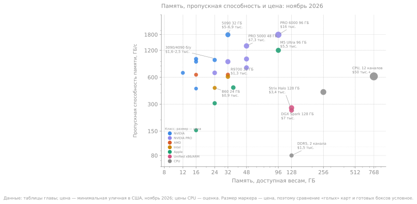
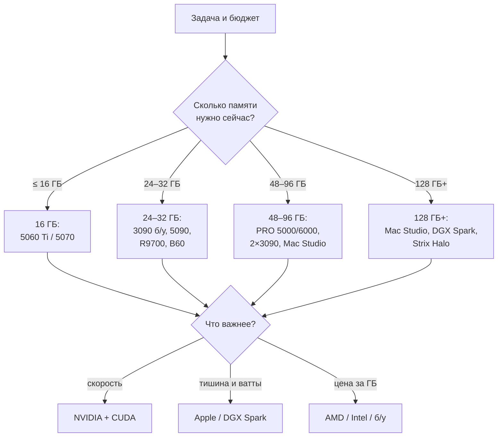

# Как выбрать железо для локального инференса

> **Зачем эта глава.** Глава 13 отвечает, какая модель влезет в вашу память. Эта глава — о том, на чём её запускать: какие карты, боксы и платформы продаются в ноябре 2026 года, сколько они стоят, что на них реально работает и где начинаются подводные камни. Железо не делает модель умнее. Оно решает три вещи: поместится ли она, с какой скоростью будет отвечать и сколько это будет стоить в рублях, ваттах и децибелах.

> **За 30 секунд**
> - **Память** решает, что запустится. **Пропускная способность** решает, как быстро пойдёт декод. **Софт** решает, заработает ли вообще.
> - Ноябрь 2026 — плохое время для покупки: кризис памяти поднял цены видеокарт и серверной ОЗУ в 1,5–3 раза выше MSRP. Покупайте под задачу, которая есть сейчас, а не «под будущее».
> - Одна карта с 24–32 ГБ часто полезнее двух по 16 ГБ: модель должна помещаться в один пул, а не делиться по PCIe.
> - 128 ГБ объединённой памяти — это про модели на 70–120 млрд параметров в Q4 (235B — уже 192–256 ГБ), но декод будет 3–60 ток/с, а не 200. Считайте по формуле из главы 2, а не по маркетингу.
> - Если нагрузка меньше ~500 часов в год, аренда GPU почти всегда дешевле покупки. Если больше 2 000 часов в год и данные нельзя выносить — покупка.

## 1. Три числа, которые решают всё

Любой вариант железа описывается тремя числами.

**1. Объём памяти.** Сколько весов, KV-кэша и буферов помещается одновременно. Считается по формулам глав 4 и 6:

```
вес + KV + буферы + запас ≤ доступная память
```

Для Q4_K_M удобно брать 0,6 ГБ на миллиард параметров. Тогда 8B — около 4,8 ГБ, 14B — 8,4 ГБ, 32B — 19,2 ГБ, 70B — 42 ГБ, 120B MoE — около 72 ГБ, 235B MoE — около 141 ГБ. KV-кэш на длинном контексте добавляет единицы или десятки гигабайт — глава 6.

**2. Пропускная способность памяти (ПСП).** Сколько гигабайт в секунду можно прочитать. Потолок декода:

```
ток/с ≈ ПСП ÷ байт активных весов на токен
```

Для dense это все параметры, для MoE — только активные. Реально получается 50–75 % потолка (глава 2). У 70B dense в Q4_K_M на токен читается ~42 ГБ: карта с 1 ТБ/с даёт потолок ~24 ток/с, реально 12–18.

**3. Софт.** CUDA, ROCm, SYCL, Metal, Vulkan, MLX. Одна и та же карта может быть отличной в llama.cpp и бесполезной в vLLM. Поэтому «характеристики» — только половина ответа.

> [!NOTE]
> Дальше в таблицах я даю **потолок** и **реалистичный диапазон** (50–75 % от потолка) для одного слота. Это оценки по формуле, а не замеры. Ваш рантайм, квант и длина контекста дадут другой результат — проверяйте по методике главы 12.

### 1.1 Почему ноябрь 2026 — особый случай

Рынок сейчас перекошен спросом на память для ИИ. По данным Fusion Worldwide со ссылкой на TrendForce, контрактные цены на DRAM выросли примерно на 93–98 % в первом квартале 2026 года и ещё на 58–63 % во втором. К июню 64-гиговая планка DDR5 RDIMM стоила в среднем около $2 841–2 972 — в несколько раз дороже, чем годом раньше. К ноябрю дешевле не стало: в конфигураторах серверов 16 ГБ DDR5-6400 RDIMM предлагаются за суммы порядка $3 175 ([PCSP](https://pcserverandparts.com/news/when-will-ram-prices-go-down-2026), 01.11.2026).

Следствия для видеокарт:

- RTX 5090 стартовала с MSRP $1 999, а в ноябре 2026 года уличная цена в США — **$4 999–6 919** ([BestValueGPU](https://bestvaluegpu.com/history/new-and-used-rtx-5090-price-history-and-specs), 12.10.2026; [Tech Insider/Tom’s Hardware](https://tech-insider.org/gpu-price-tracking-2026-rtx-5090-6919-tomshardware-lowest-prices), 05.11.2026).
- RTX PRO 6000 Blackwell 96 ГБ подорожала с $8 565 на старте до **$16 000** к августу 2026 года ([Tom’s Hardware](https://www.tomshardware.com/pc-components/gpus/nvidia-doubles-rtx-pro-6000-blackwells-msrp-to-a-staggering-usd16-000-96gb-card-started-pre-orders-below-usd8-000-last-year), 2026).
- DGX Spark 128 ГБ прошёл путь $3 999 → $4 699 → **$6 950**; 64-гиговая версия вышла по $4 999 ([The Register](https://www.theregister.com/systems/2026/10/02/nvidia-debuts-4999-dgx-spark-with-half-the-ram-and-storage-amid-memory-crunch/5300622), 02.10.2026; [ServeTheHome](https://www.servethehome.com/nvidia-dgx-spark-64gb-launched-and-big-128gb-gb10-price-increases), 2026).
- RTX 50 Super если и выйдет, то не раньше 2027 года; RTX 5080 24 ГБ рискует пропустить январский запуск ([WCCFtech](https://wccftech.com/nvidia-rtx-50-gpus-see-a-massive-price-increase-in-november), 03.11.2026). Ждать «следующего поколения» в этом сезоне бессмысленно.

> [!WARNING]
> **Все цены в главе — на 7 ноября 2026 года**, если рядом не указана другая дата. Курс ЦБ РФ на 06.11.2026 — **81,79 ₽ за доллар** ([ЦБ РФ](https://ru.myfin.by/currency/cb-rf/usd/06-11-2026)). Долларовые цены — уличные в США и Европе, без налогов; рублёвые — российские магазины и маркетплейсы, часто с серым импортом. Разброс в 1,5–2 раза внутри одной модели — норма. Наличие в РФ нестабильно: DNS и Citilink часто продают «под заказ», Avito — наличием; проверяйте перед покупкой. Там, где надёжного источника не было, написано **«не нашёл»**, а не придуманное число.

### 1.2 Электричество и шум — часть цены

Стоимость энергии считается так:

```
₽/год = мощность, Вт × часы в год × тариф / 1000
```

Московский одноставочный тариф для населения с 1 октября 2026 года — **8,90 ₽/кВт·ч** ([info-gkh.ru](https://info-gkh.ru/regiontariff/moskva-gorod/9), 2026). Возьмём типичные системные 150 Вт сверху к видеокарте:

| Конфигурация | Мощность | 8 ч/день, ₽/год | 24/7, ₽/год |
|---|---:|---:|---:|
| RTX 5060 Ti 16 + ПК | ~330 Вт | ~8 600 | ~25 700 |
| RTX 5090 + ПК | ~725 Вт | ~18 800 | ~56 500 |
| 2×RTX 3090 + ПК | ~850 Вт | ~22 100 | ~66 200 |
| Mac Studio M5 Max | ~150 Вт | ~3 900 | ~11 700 |
| DGX Spark | ~140 Вт | ~3 600 | ~10 900 |
| Strix Halo mini-PC | ~140 Вт | ~3 600 | ~10 900 |

Шум важнее, чем кажется. Карта на 575 Вт в маленькой комнате — это не «немного гудит», а постоянный источник тепла и звука. Боксы на 140 Вт (DGX Spark, Mac mini, Strix Halo) можно ставить на стол; 4×5090 — только в отдельную комнату с вентиляцией.



*Рисунок. Каждая точка — устройство из таблиц главы: по горизонтали доступная память, по вертикали пропускная способность, размер кружка — уличная цена в США. Логарифмические оси, поэтому расстояние между 8 и 16 ГБ такое же, как между 128 и 256. Точки в правом верхнем углу — серверные CPU с многоканальной DDR5; они дают объём, но не скорость. Данные и ссылки — в таблицах ниже; ПСП и объёмы сверены с датасетом AI Infra in Depth (Apache-2.0); цена — минимальная найденная уличная, ноябрь 2026.*

Prefill — отдельная история. У дискретных NVIDIA он быстрый: тысячи ток/с на 8B и сотни на 30–70B. У R9700 — в 2,6–3,4 раза медленнее 5090; у Apple и Strix Halo — ещё медленнее, особенно на длинном промпте; у CPU — десятки–сотни ток/с. Поэтому RAG с длинными документами и агент с большим системным промптом на unified-боксах ощущаются иначе, чем на 5090, даже когда декод у них сопоставим.

## 2. NVIDIA для потребителя: RTX 50 и остатки RTX 40

Это самый простой путь: CUDA, llama.cpp, vLLM, Ollama, TensorRT-LLM — всё работает. Вопрос только в том, сколько вы готовы заплатить за память и пропускную способность.

| Карта | VRAM | ПСП, ГБ/с | TDP | США, $ | Россия, ₽ | Кому |
|---|---:|---:|---:|---|---|---|
| RTX 5090 | 32 | 1792 | 575 | 4 999–6 919 [↗](https://bestvaluegpu.com/history/new-and-used-rtx-5090-price-history-and-specs) | 750–950 тыс. [↗](https://cybersport.metaratings.ru/articles/chto-proishodit-s-cenami-na-videokarty-operativnuyu-pamyat-i-zhestkie-diski-v-rossii) | 30B dense, 30B-A3B, длинный контекст |
| RTX 5080 | 16 | 960 | 360 | 1 290–1 866 [↗](https://www.pcgamer.com/the-best-graphics-cards) | 202–210 тыс. [↗](https://www.dns-shop.ru/catalog/recipe/9dacd3bfb81d51e2/rtx-5080) | 14B Q4; 30B MoE с выгрузкой |
| RTX 5070 Ti | 16 | 896 | 300 | 990–1 150 [↗](https://www.pcgamer.com/the-best-graphics-cards) | ~150 тыс. [↗](https://www.dns-shop.ru/catalog/recipe/da6891e61ee3cd67/rtx-5070-ti) | то же, дешевле и медленнее |
| RTX 5070 | 12 | 672 | 250 | 779–909 [↗](https://bestvaluegpu.com/history/new-and-used-rtx-5070-price-history-and-specs) | 105–113 тыс. [↗](https://www.dns-shop.ru/catalog/recipe/d6b9917aaa77a744/rtx-5070) | 8–9B Q4 с запасом, 14B на грани |
| RTX 5060 Ti 16 | 16 | 448 | 180 | 500–780 [↗](https://www.pcgamer.com/the-best-graphics-cards) | 80–92 тыс. [↗](https://www.dns-shop.ru/catalog/recipe/2387582a8bf1a48b/rtx-5060-ti-16-gb) | 8–14B Q4, бюджетный вход |
| RTX 5060 8 | 8 | 448 | 145 | 330–380 [↗](https://www.pcgamer.com/the-best-graphics-cards) | 54–55 тыс. [↗](https://gpuprices.ru/) | только 7–8B Q4, без запаса |

Цены в таблице — на 07.11.2026. MSRP на старте: 5090 — $1 999, 5080 — $999, 5070 Ti — $749, 5070 — $549, 5060 Ti — $429, 5060 — $299. То есть текущие улицы — это +10–250 % к рекомендованной цене; в Европе добавьте НДС, обычно +15–20 %. В России разброс больше: например, RTX 5090 в DNS и «Регарде» идёт за 750–950 тыс. ₽, а на Авито встречаются предложения «под заказ» около 500 тыс. ₽ ([3DNews](https://3dnews.ru/1119627/videokarti-geforce-rtx-5090-teper-prodayutsya-v-rossii-po-tsene-ot-350-tis-rubleys-garantiey), 02.11.2026). Гарантия и происхождение при такой разнице — не формальность.

### 2.1 RTX 5090: 32 ГБ и 1,8 ТБ/с, но за них просят как за автомобиль

Спецификация: 21 760 CUDA-ядер, 32 ГБ GDDR7, 512-битная шина, 1792 ГБ/с, 575 Вт, рекомендуемый БП 1000 Вт, длина 304 мм, 2 слота у Founders Edition, 3352 AI TOPS в FP4 с разреженностью ([NVIDIA](https://www.nvidia.com/en-us/geforce/graphics-cards/50-series/rtx-5090/), 2026). NVLink нет — только PCIe 5.0 x16. FP4 есть у 50-й серии, у 40-й — только FP8; для GGUF это почти не важно, для vLLM с FP8/FP4 — важно.

Что реально:

- **8B Q4** (4,8 ГБ) — потолок ~373 ток/с, реально **190–280**; prefill — тысячи ток/с.
- **14B Q4** (8,4 ГБ) — потолок ~213, реально **110–160**.
- **32B dense Q4** (19,2 ГБ) — потолок ~93, реально **47–70**; с контекстом 32k и KV в q8 остаётся ещё ~7–9 ГБ запаса.
- **30B-A3B MoE Q4** (1,8 ГБ на токен) — формальный потолок ~996 ток/с, реально **250–400**; упирается уже в attention, роутинг и накладные расходы.
- **70B dense Q4** (42 ГБ) — **не влезает** целиком. Можно выгрузить часть слоёв в ОЗУ, но скорость упадёт до 3–8 ток/с.

Плюсы: лучшая скорость декода среди потребительских карт, 32 ГБ хватает для 30B dense и длинного контекста, CUDA и все рантаймы. Минусы: цена в 2,5–3,5 раза выше MSRP, 575 Вт и 1000-ваттный БП, шум под нагрузкой, всего 2–3 слота в корпусе.

> [!WARNING]
> **RTX 5090D v2 — не «дешёвая 5090».** Китайская версия для обхода экспортных ограничений: те же 21 760 CUDA, но **24 ГБ** на 384-битной шине, **1344 ГБ/с** вместо 1792 и **2375 AI TOPS** вместо 3352, плюс встроенное ограничение ИИ-производительности ([NVIDIA China](https://www.nvidia.cn/geforce/graphics-cards/50-series/rtx-5090-d-v2), 2026; [Digital Razor](https://digital-razor.ru/media/news/hardware/rtx-5090d-v2-lauch), 13.08.2025). В России её продают за 400–440 тыс. ₽ ([Metaratings](https://cybersport.metaratings.ru/articles/chto-proishodit-s-cenami-na-videokarty-operativnuyu-pamyat-i-zhestkie-diski-v-rossii), 2026). Для 30B dense и 70B-с-выгрузкой она интересна, для честной 5090 — нет: меньше память, ниже ПСП и срезанный ИИ.

### 2.2 RTX 5080 и 5070 Ti: 16 ГБ — новый минимум

Обе карты дают 16 ГБ, но разную ПСП: 960 ГБ/с у 5080 и 896 ГБ/с у 5070 Ti. Для декода это почти одна лига; разница заметна в prefill и играх. TDP 360 и 300 Вт, длина около 304 мм, 2–3 слота — в компактный корпус такие карты не влезут.

Что реально:

- **8B Q4** — 100–150 и 93–140 ток/с.
- **14B Q4** — 57–86 и 53–80 ток/с; контекст 32k с KV в q8 помещается с запасом.
- **32B dense Q4** — **не влезает**: только веса 19,2 ГБ больше 16 ГБ. Даже 30B MoE Q4 (~18 ГБ) не помещается целиком; можно выгрузить часть экспертов в ОЗУ, но скорость упадёт. Для 32B нужен 24 ГБ (с контекстом 8–16k) или 32 ГБ (с 32k).
- **70B Q4** — не влезает.

16 ГБ в 2026 году — это «новые 12 ГБ»: хватает для 14B Q4 с длинным контекстом или 30B MoE с выгрузкой, но 32B dense в 16 ГБ не влезает. Если бюджет позволяет, берите 24–32 ГБ: разница в возможностях больше, чем разница в скорости.

### 2.3 RTX 5070 и 5060 Ti: где заканчивается комфорт

**RTX 5070** (12 ГБ, 672 ГБ/с, 250 Вт) — быстрая карта для 8–9B Q4 и 14B Q4 «в притык». 14B Q4 — 8,4 ГБ; 8k — помещается (около 11,6 ГБ), 16k — на грани (8,4 + 1,4 ГБ KV + 1 ГБ буферов + 1,5 ГБ запаса ≈ 12,3 ГБ), 32k — не влезает (KV ~2,8 ГБ). 8–9B Q4 с 32k — комфортно. 32B dense не влезает.

**RTX 5060 Ti 16** (16 ГБ, 448 ГБ/с, 180 Вт) — лучший бюджетный вход в 16 ГБ. Скорость ниже, чем у 5070, но память важнее: 14B Q4 с 32k помещается, 8B Q4 идёт 47–70 ток/с. Для чата и небольших агентов этого достаточно. Версию **8 ГБ** брать не стоит: 8B Q4 с длинным контекстом уже некомфортно, а 14B — нельзя.

**RTX 5060 8 ГБ** (448 ГБ/с, 145 Вт) — только 7–8B Q4 с контекстом 8k; 16k уже не оставляет запаса. Для локального инференса в 2026 году это компромисс, а не рекомендация.

### 2.4 RTX 40: дешёвое б/у и никакой гарантии

Серия снята с производства, но на вторичке ещё много карт. Главное отличие от 50-й серии — нет FP4 и нет DLSS 4, но для GGUF это почти не важно; FP8 у Ada есть, CUDA — та же.

| Карта | VRAM | ПСП, ГБ/с | TDP | США, б/у | Россия, б/у | Комментарий |
|---|---:|---:|---:|---|---|---|
| RTX 4090 | 24 | 1008 | 450 | $2 496–3 800 [↗](https://www.pcprice.watch/search/RTX4090/US/GPU) | 145–270 тыс. [↗](https://www.avito.ru/all/tovary_dlya_kompyutera/komplektuyuschie/videokarty/geforce_rtx_4090-ASgBAgICA0TGB~pm7gmmZ8KsFIji_RQ) | быстрее 3090, но 24 ГБ и 450 Вт |
| RTX 4080 / 4080 Super | 16 | 717–736 | 320 | $800–930 [↗](https://sellgpu.com/rtx-40-series-out-of-production-used-prices) | не нашёл | 16 ГБ, высокая цена за память |
| RTX 4070 Ti Super | 16 | 672 | 285 | $720–800 [↗](https://sellgpu.com/rtx-40-series-out-of-production-used-prices) | не нашёл | 16 ГБ, разумный компромисс |
| RTX 4060 Ti 16 | 16 | 288 | 165 | не нашёл | не нашёл | 16 ГБ, но очень низкая ПСП |

Б/у 4090 за 145–200 тыс. ₽ — интересный вариант, если проверить карту: 24 ГБ, 1008 ГБ/с, 70B Q4 не влезает, но 30B dense и 30B-A3B — отлично. Риски: 12VHPWR-разъём (оплавление), майнинг, отсутствие гарантии, дорогой ремонт. 4080/4070 Ti Super с 16 ГБ проигрывают новой 5060 Ti 16 по гарантии и цене за ГБ, если только не нужна скорость.

**Посчитай сам.** Есть 24 ГБ VRAM и 32B dense в Q4_K_M. Хватит ли контекста 32k, если KV-кэш в q8_0, а на буферы и запас оставить 2,5 ГБ? Конфиг: 48 слоёв, 8 KV-голов, `d_head = 128`.

<details>
<summary>Решение</summary>

```
вес:        32 × 0,6 = 19,2 ГБ
KV:         2 × 48 × 8 × 128 × 1,06 × 32 768 ≈ 3,41 ГБ
буферы:     1,0 ГБ
запас:      1,5 ГБ
итого:      19,2 + 3,41 + 1,0 + 1,5 = 25,11 ГБ
```

Не хватает около 1,1 ГБ. Варианты: контекст 24k (KV ~2,56 ГБ, итого ~24,3 ГБ — всё ещё на грани), KV в q4_0 (около 1,8 ГБ, итого ~23,5 ГБ), квант Q4_K_S или 32 ГБ карта. Вывод: **24 ГБ для 32B Q4 с 32k — мало**; 32 ГБ — комфортно. Это ровно тот случай, когда «влезает» и «работает» — разные вещи.
</details>

## 3. Б/у 3090 и профессиональные карты: память без скорости

Когда нужно много памяти, а бюджет не резиновый, есть два пути: вторичка и профессиональные карты.

### 3.1 RTX 3090 24 ГБ — народный выбор для 30B

3090 — это 24 ГБ GDDR6X, 936 ГБ/с, 350 Вт, 2×8-pin (у Founders Edition — 12-pin), длина около 313 мм, 3 слота. NVLink есть: две карты объединяются в 48 ГБ с пропускной способностью моста 112,5 ГБ/с. Для 2020 года это был флагман; в 2026-м — рабочий инструмент за 115–140 тыс. ₽ на Авито ([Авито](https://www.avito.ru/all/tovary_dlya_kompyutera/komplektuyuschie/videokarty-ASgBAgICAkTGB~pm7gmmZw?q=rtx+3090), 07.11.2026). В США медиана проданных — **$1 586** за 14 дней к 04.11.2026 ([GPU Sold](https://www.gpusold.com/gpu/rtx-3090-24), 04.11.2026). 3090 стартовала с $1 499, 4090 — с $1 599; сегодняшние б/у цены близки к этим MSRP, что для четырёх-пятилетних карт ненормально.

Что реально:

- **8B Q4** — 98–146 ток/с.
- **14B Q4** — 56–83 ток/с.
- **32B dense Q4** — 24–37 ток/с при контексте 16k; 32k в 24 ГБ уже не помещается.
- **30B-A3B MoE Q4** — формально ~520 ток/с, реально 150–250.
- **70B dense Q4** — не влезает; две 3090 по NVLink (48 ГБ) — влезает, 16–24 ток/с.

Плюсы: 24 ГБ за разумные деньги, NVLink, CUDA, ремонтопригодность, огромный выбор на вторичке. Минусы: нет FP8/FP4, старый техпроцесс, высокий нагрев памяти (junction 100–110 °C — проверяйте термопрокладки), майнинг в прошлом, нет гарантии. Проверяйте: артефакты под нагрузкой, температуру памяти, шум вентиляторов, состояние разъёмов, наличие NVLink-моста (он продаётся отдельно и стоит немало).

### 3.2 Профессиональные RTX PRO: ECC, blower и гарантия

| Карта | VRAM | ПСП, ГБ/с | TDP | США, $ | Что реально |
|---|---:|---:|---:|---|---|
| RTX PRO 4000 | 24 | 672 | 140 | 3 050 [↗](https://www.newegg.com/nvidia-blackwell-900-5g147-2270-000-rtx-pro-4000-24gb-graphics-card/p/N82E16814132109) | 32B Q4 только 16k; 14B комфортно; 1 слот |
| RTX PRO 4500 | 32 | 896 | 200 | 5 726 [↗](https://www.newegg.com/p/pl?d=rtx+pro+4500) | 32B Q4 с запасом, 70B нет |
| RTX PRO 5000 | 48 | 1344 | 300 | 7 300 [↗](https://www.newegg.com/nvidia-blackwell-900-5g153-2250-000-rtx-pro-5000-48gb-graphics-card/p/N82E16814132111) | 70B Q4 16–24 ток/с; 32B 35–53 |
| RTX PRO 6000 | 96 | 1792 | 600 | 16 000 [↗](https://www.tomshardware.com/pc-components/gpus/nvidia-doubles-rtx-pro-6000-blackwells-msrp-to-a-staggering-usd16-000-96gb-card-started-pre-orders-below-usd8-000-last-year) | 70B Q4 21–32; 70B Q8 12–18; 120B MoE 150–250 |
| RTX A6000 (б/у) | 48 | 768 | 300 | ~3 750 [↗](https://siliconcomps.com/gpu/rtx-4090) | 70B Q4 16–24; без FP8, но 48 ГБ |
| RTX 6000 Ada (б/у) | 48 | 960 | 300 | ~5 225 [↗](https://siliconcomps.com/gpu/rtx-4090) | 70B Q4 16–24; FP8, но NVLink нет |

На 48 ГБ 70B Q4 помещается с контекстом около 16k; для 32k нужно 64–96 ГБ. Это относится и к RTX PRO 5000, и к паре 3090. Профессиональные карты дают ECC-память, blower-охлаждение (можно ставить в плотный корпус), трёхлетнюю гарантию и профессиональные драйверы; за это платите в 1,5–3 раза больше за гигабайт, чем за потребительские. Российских розничных цен на RTX PRO 4000/4500/5000/6000 я не нашёл: они продаются через интеграторов по запросу, а не на витрине DNS. Отдельно стоит **RTX 6000 Ada 48 ГБ**: 960 ГБ/с, 300 Вт, FP8, но без NVLink; б/у около $5 225 ([Silicon Comps](https://siliconcomps.com/gpu/rtx-4090), 03.11.2026). Она быстрее A6000, но дороже; для 70B Q4 — те же 16–24 ток/с. Версия RTX PRO 5000 на 72 ГБ стоит $8 999–9 999 ([Newegg](https://www.newegg.com/nvidia-blackwell-900-5g153-2250-000-rtx-pro-5000-48gb-graphics-card/p/N82E16814132111), 11.2026) и позволяет держать 70B Q4 с контекстом 32k. У RTX PRO 6000 есть ещё Max-Q-версия: те же 96 ГБ и 1792 ГБ/с, но 300 Вт вместо 600 — меньше шума и тепла, ниже потолок мощности.

**Важно про NVLink.** В RTX PRO 6000 Blackwell **нет NVLink** — ни в Workstation, ни в Server Edition; в спецификации Lenovo прямо написано «NVLink support: No» ([Lenovo Press](https://lenovopress.lenovo.com/lp2364-thinksystem-nvidia-rtx-pro-6000-blackwell-max-q-workstation-edition-gpu), 2026). Две карты по 96 ГБ работают как два отдельных пула на 192 ГБ, общаются по PCIe 5.0 x16. Для layer split это нормально, для tensor parallel — медленнее. У старых A6000 (Ampere) NVLink был; у RTX 6000 Ada и RTX PRO 6000 Blackwell его уже нет. Именно поэтому A6000 до сих пор берут для 2×48 ГБ, а RTX 6000 Ada — уже нет.

> [!TIP]
> Если нужен именно **один** пул на 96 ГБ и CUDA — RTX PRO 6000 вне конкуренции. Если нужен 192 ГБ и вы готовы платить за две карты, сначала проверьте, умеет ли ваш рантайм нормально работать с двумя пулами по PCIe. vLLM умеет tensor parallel, llama.cpp — layer split; для второго NVLink не критичен.

## 4. AMD: 32 ГБ дешевле, но с оговорками

AMD в 2026 году — это прежде всего **Radeon AI PRO R9700**: 32 ГБ GDDR6, 640 ГБ/с, 300 Вт, 95,7 TFLOPS FP16, 1531 TOPS INT4 с разреженностью, ECC на Linux, PCIe 5.0 x16, два слота, blower. Под нагрузкой один вентилятор слышно отчётливо — это плата за плотную компоновку ([AMD](https://www.amd.com/en/products/graphics/workstations/radeon-ai-pro/ai-9000-series/amd-radeon-ai-pro-r9700.html), 2026; [AI Miracle](https://www.aimiracle.ai/ai-hardware-review/amd-radeon-ai-pro-r9700-review), 13.10.2026). MSRP — **$1 299**, улица — $1 320–1 699, в моменты дефицита до $1 999 ([AI Miracle](https://www.aimiracle.ai/ai-hardware-review/amd-radeon-ai-pro-r9700-review), 13.10.2026; [Newegg](https://www.newegg.com/p/pl?d=radeon+ai+pro+r9700+32gb), 11.2026).

Что реально (по независимым тестам и формуле):

- **8B Q4** — 67–100 ток/с.
- **14B Q4** — 38–57 ток/с.
- **32B dense Q4** — 17–25 ток/с; 32 ГБ хватает с 32k контекстом.
- **70B Q4** — не влезает.
- **30B-A3B MoE Q4** — 150–250 ток/с (потолок по весам высокий, но prefill и роутинг ограничивают).
- **Prefill** — в 2,6–3,4 раза медленнее RTX 5090; декод — примерно в 1,5 раза медленнее ([Local AI Master](https://localaimaster.com/blog/radeon-ai-pro-r9700-local-ai), 2026). Для длинных промптов и RAG это чувствуется.

Софт: ROCm 7 на Linux, официальная поддержка R9700 (gfx1201), llama.cpp HIP и Vulkan, vLLM ROCm, Ollama. На Windows — Vulkan/Adrenalin, ROCm ограничен. Проверяйте, собран ли бэкенд под вашу карту и версию драйвера.

**RX 9070 XT 16 ГБ** — тот же чип Navi 48, но 16 ГБ, 640 ГБ/с, 304 Вт, MSRP $599, улица $760–919 ([BestValueGPU](https://bestvaluegpu.com/history/new-and-used-rx-9070-xt-price-history-and-specs), 11.2026). В России — от 65 тыс. ₽ на Авито ([Авито](https://www.avito.ru/moskva/tovary_dlya_kompyutera/komplektuyuschie/videokarty-ASgBAgICAkTGB~pm7gmmZw?q=rx%209070%20xt), 07.11.2026; серый импорт) до ~110 тыс. ₽ в рознице ([GPUPrices](https://gpuprices.ru/), 30.10.2026). Для 14B Q4 и 8B — отличное соотношение цена/скорость; для 32B — мало памяти. Поддержка ROCm у потребительских RDNA4 менее стабильна, чем у R9700; Vulkan работает, но медленнее.

**RX 9060 XT 16 ГБ** — 322 ГБ/с, 160 Вт, MSRP $349, улица около $500; в России 73–89 тыс. ₽ ([Citilink](https://www.citilink.ru/catalog/videokarty--videokarty-amd), 2026). Для 8B Q4 — 40–60 ток/с, для 14B — 20–30. Бюджетный вариант, но ПСП низкая.

| Карта | VRAM | ПСП, ГБ/с | TDP | США, $ | Россия, ₽ | Комментарий |
|---|---:|---:|---:|---|---|---|
| Radeon AI PRO R9700 | 32 | 640 | 300 | 1 320–1 699 [↗](https://www.aimiracle.ai/ai-hardware-review/amd-radeon-ai-pro-r9700-review) | не нашёл | 32 ГБ, ECC, blower для плотных сборок |
| RX 9070 XT | 16 | 640 | 304 | 760–919 [↗](https://bestvaluegpu.com/history/new-and-used-rx-9070-xt-price-history-and-specs) | 65–110 тыс. [↗](https://gpuprices.ru/) | быстрая 16-гиговая, ROCm хуже |
| RX 9060 XT 16 | 16 | 322 | 160 | ~500 [↗](https://www.pcgamer.com/the-best-graphics-cards) | 73–89 тыс. [↗](https://www.citilink.ru/catalog/videokarty--videokarty-amd) | тихая, но медленная |

> [!WARNING]
> AMD — это Linux-first. Если вы работаете в Windows и рассчитываете на «просто поставлю драйвер», проверьте конкретную модель и версию ROCm до покупки. Для R9700 поддержка официальная; для RX 9070 XT — зависит от сборки и может требовать Vulkan. CUDA-специфичные инструменты (TensorRT-LLM, часть quantization-пайплайнов) не заработают.

## 5. Intel: 24–32 ГБ за небольшие деньги, если готовы к SYCL

Intel Arc Pro — самый недооценённый вариант 2026 года. Карты дают много памяти за деньги, но требуют Linux и терпения.

| Карта | VRAM | ПСП, ГБ/с | TDP | США, $ | Россия, ₽ | Что реально |
|---|---:|---:|---:|---|---|---|
| Arc Pro B50 | 16 | 224 | 70 | ~299 [↗](https://www.intel.com/content/www/us/en/products/details/discrete-gpus/arc/workstations/b-series.html) | не нашёл | 8B Q4, 14B Q4 медленно |
| Arc Pro B60 | 24 | 456 | 200 | 934–1 025 [↗](https://www.newegg.com/asrock-intel-arc-pro-b60-24gb-graphics/p/N82E16814930148) | 110 300 [↗](https://serverflow.ru/catalog/komplektuyushchie/videokarty/intel-arc-pro-b60-24gb-gddr6) | 14B Q4 27–41; 32B Q4 12–18 |
| Arc Pro B70 | 32 | 608 | 230 | 1 932–2 059 [↗](https://gpuprix.com/us/gpus/arc-pro-b70) | не нашёл | 32B Q4 16–24; 70B нет |

**B60** — 20 Xe-ядер, 24 ГБ GDDR6, 456 ГБ/с, 200 Вт, PCIe 5.0 x8, один 8-pin, blower, длина около 267 мм. MSRP $599, но улица $934–1 025. В России — 110 300 ₽ у ServerFlow (07.11.2026), то есть дороже, чем 3090 б/у, при меньшей скорости. Зато новая, с гарантией, ECC и низким энергопотреблением.

**B70** — 32 Xe-ядра, 32 ГБ, 608 ГБ/с, 230 Вт, 22,9 TFLOPS FP32, 367 TOPS INT8 ([Intel](https://www.intel.com/content/www/us/en/products/sku/245797/intel-arc-pro-b70-graphics/specifications.html), 2026). Цена выросла с $949 до $1 900–2 060. Для 32B Q4 — 16–24 ток/с, для 14B — 36–54.

Софт: llama.cpp SYCL, vLLM XPU, Ollama, OpenVINO, PyTorch XPU. На Linux нужен драйвер `xe`, GuC-прошивка и собранный с `-DGGML_SYCL=ON` llama.cpp. На Windows — проще, но меньше контроля. Intel продвигает 4×B60 как конфигурацию на 96 ГБ; в независимом тесте 4 карты дали **82,4 ток/с** на Qwen3-Coder-30B-A3B (один запрос), **119 ток/с** суммарно на 12 параллельных запросов по трём моделям на 130 млрд параметров, при **211 Вт пиковой мощности на четыре карты** в этом тесте (паспортные 4×200 Вт — верхняя граница) ([ninabot.ch](https://ninabot.ch/en/anchor/benchmarks), 10–11.09.2026). Это отличный результат для 96 ГБ за ~$3 700, если вам хватает PCIe x8 на карту и вы готовы к SYCL.

> [!NOTE]
> Intel — не «просто работает». Проверяйте версии драйвера, прошивки GuC, образ llama.cpp/vLLM и поддержку нужного кванта. Часть инструментов (например, IPEX-LLM) архивирована или меняет статус; сообщество вокруг B60 живое, но меньше, чем вокруг CUDA. Если нужен минимальный риск — это не первый выбор.

## 6. Apple: 128–512 ГБ, тихо, но медленно

Apple Silicon — это объединённая память: CPU и GPU видят один пул, веса не копируются по PCIe. Плата за это — пропускная способность ниже, чем у дискретных карт, и отсутствие CUDA.

| Машина | Память | ПСП, ГБ/с | Цена США, $ | Цена РФ, ₽ | Что реально |
|---|---:|---:|---|---|---|
| Mac mini M6 | 16–32 | 153 / 170 | 899 [↗](https://www.macworld.com/article/2964754/2026-mac-mini-m5-pro-design-specs-release-date.html) | не нашёл | 8B Q4 32–48; 14B 18–27 |
| Mac mini M5 Pro | 24–64 | 307 | 1 699 [↗](https://www.macworld.com/article/2964754/2026-mac-mini-m5-pro-design-specs-release-date.html) | 215–280 тыс. [↗](https://apple-store.net.ru/mac/apple-mac-mini) | 14B 18–27; 32B 8–12 |
| Mac Studio M5 Max | 36–128 | 460 / 614 | 2 499 [↗](https://www.apple.com/newsroom/2026/08/apple-introduces-new-mac-studio-with-m5-max-and-m5-ultra/) | 248–824 тыс. [↗](https://megabait.net/categories/katalog-epl/tag/mac-studio) | 70B/120B — только 64/128 ГБ; 70B Q4 7–11; 120B MoE 60–100 |
| Mac Studio M5 Ultra | 96–512 | 1 200 | 5 499 [↗](https://www.apple.com/newsroom/2026/08/apple-introduces-new-mac-studio-with-m5-max-and-m5-ultra/) | 853 тыс. (96/1 ТБ) [↗](https://apple-market.ru/mac/mac-studio) | 70B Q4 14–21; 120B MoE 150–250; 235B — только 256–512 ГБ |
| MacBook Pro 16 M5 Max | до 128 | 614 | 7 399 (128/2 ТБ) [↗](https://www.apple.com/shop/buy-mac/macbook-pro/16-inch-space-black-standard-display-apple-m5-max-chip-18-core-cpu-40-core-gpu-128gb-memory-2tb-storage) | не нашёл | то же, но в ноутбуке |

Спецификации памяти — с официальных страниц Apple: Mac Studio M5 Max 36 ГБ/460 ГБ/с (40-ядерный GPU — 614), M5 Ultra 96 ГБ/1,2 ТБ/с, до 512 ГБ; Mac mini M6 — 153 ГБ/с у 16 ГБ и 170 ГБ/с у 32 ГБ, M5 Pro — 307 ГБ/с ([Apple Support](https://support.apple.com/en-us/128107), [Apple Support](https://support.apple.com/en-us/128108), 2026).

Что реально:

- **Mac mini M5 Pro 64 ГБ** — 32B Q4 8–12 ток/с, 14B 18–27, 8B 32–48. Тихий, 12,7×12,7×5 см, ~100 Вт. Для чата и одного агента — отлично; для 70B — мало памяти или медленно.
- **Mac Studio M5 Max 128 ГБ** — 70B Q4 7–11 ток/с, 120B MoE Q4 60–100, 32B 16–24. Корпус 19,7×19,7×9,5 см, почти бесшумный. Для 70B это рабочий, но не быстрый вариант; для MoE с малым числом активных — вполне.
- **Mac Studio M5 Ultra 96–512 ГБ** — 1,2 ТБ/с меняет картину: 70B Q4 14–21, 70B Q8 8–12, 120B MoE 150–250; 235B MoE Q4 (~141 ГБ) влезает только в конфигурации на 256–512 ГБ и идёт там на 35–60 ток/с. Это самый доступный способ держать 235B MoE в одном пуле без сервера. 512 ГБ — для моделей на 400B+ и очень длинного контекста, цена «как автомобиль».
- **MacBook Pro 16 M5 Max 128 ГБ** — тот же чип и та же ПСП, но в ноутбуке; $7 399 за 128/2 ТБ. Для мобильной работы с 70B — да, для постоянного сервера — нет: нагрев, батарея, цена.

**MLX против llama.cpp Metal.** MLX — фреймворк Apple для Apple Silicon, умеет эффективно использовать объединённую память, хорошо работает с квантами MXFP4 и часто даёт более быстрый prefill, чем llama.cpp Metal. llama.cpp Metal — зрелый путь с GGUF, огромной библиотекой моделей и гибкими флагами; декод у него близок к потолку ПСП, но prefill на длинном промпте обычно ниже, чем у NVIDIA. Для одного пользователя разница между MLX и llama.cpp может быть 10–30 % в пользу MLX на prefill и почти незаметна на декоде; для сервера с несколькими слотами llama.cpp удобнее.

> [!WARNING]
> **Объединённая память — не бесконечная VRAM.** macOS резервирует часть пула под систему и GPU-драйвер; по умолчанию GPU может использовать не весь объём. Лимит поднимается через `sudo sysctl iogpu.wired_limit_mb=<МБ>`, но оставляйте 8–16 ГБ системе, иначе получите swap и падение скорости. И помните: 128 ГБ при 460–1200 ГБ/с — это не 128 ГБ при 1,8 ТБ/с. Для 70B Q4 разница в декоде будет в 1,5–4 раза.

## 7. NVIDIA DGX Spark: 128 ГБ CUDA на столе

DGX Spark — маленькая коробка на GB10 Grace Blackwell: 20-ядерный ARM (10×Cortex-X925 + 10×Cortex-A725), GPU Blackwell, **128 ГБ LPDDR5X**, **273 ГБ/с**, **1 PFLOPS FP4** (с разреженностью), TDP 140 Вт, БП 240 Вт, 150×150×50,5 мм, 1,2 кг, шум 29 дБА под нагрузкой и 13 дБА в простое ([NVIDIA](https://www.nvidia.com/en-us/products/workstations/dgx-spark/), 2026). Цена — **$6 950** за 128 ГБ, **$4 999** за 64 ГБ; у партнёров (Acer, ASUS, Dell, Gigabyte, HP, Lenovo, MSI) — $5 660–9 097 ([The Register](https://www.theregister.com/systems/2026/10/02/nvidia-debuts-4999-dgx-spark-with-half-the-ram-and-storage-amid-memory-crunch/5300622), 02.10.2026; [pi3g](https://pi3g.com/nvidia-dgx-spark-price), 24.09.2026). В России — **860 185 ₽** в NIX на 06.11.2026 ([NIX](https://www.nix.ru/autocatalog/other_computers/NVIDIA-DGX-Spark-4TB-940-54242-0006-000-ARM-v92-A-GB10-128-4TbSSD-NVIDIA-Grace-Blackwell-WiFi-BT-DGX-OS_960944.html), 06.11.2026).

Что реально:

- **8B Q4** — 28–43 ток/с.
- **14B Q4** — 16–24.
- **32B dense Q4** — 7–11.
- **70B Q4** — 3–5; 70B Q8 — 1,5–2,5.
- **120B MoE Q4** — 30–50; **235B MoE Q4** (~141 ГБ) в 128 ГБ не влезает; в Q3/IQ3 (~100–110 ГБ) — на грани, 5–10 ток/с.
- Prefill — на уровне CUDA-карты среднего класса, но не 5090: 273 ГБ/с ограничивают декод, а FP4 помогает prefill и батчингу.

Плюсы: 128 ГБ в одном когерентном пуле, CUDA и полный стек NVIDIA (vLLM, Ollama, llama.cpp, PyTorch), тихо и мало места, до 4 устройств объединяются по ConnectX-7 200 Гбит/с в кластер на 512 ГБ. Минусы: 273 ГБ/с — это уровень Strix Halo, а не 5090; ARM-архитектура (не все x86-бинарники и wheel-пакеты); память распаяна; цена выросла почти вдвое с анонса; 64-гиговая версия за $4 999 — плохой выбор, лучше 128 ГБ или Strix Halo.

> [!NOTE]
> «1 PFLOPS FP4» — это пик для разреженных тензорных операций. Для декода LLM важнее 273 ГБ/с; для prefill и батчинга FP4 действительно помогает. Не сравнивайте 1 PFLOPS с 3352 AI TOPS у 5090 напрямую: это разные режимы и разные ограничения.

## 8. AMD Strix Halo: 128 ГБ по цене видеокарты

Ryzen AI Max+ 395 («Strix Halo») — APU с 16 ядрами Zen 5, Radeon 8060S (40 CU) и **128 ГБ LPDDR5X-8000** на 256-битной шине, **256 ГБ/с**, до 126 TOPS (50 NPU), TDP 55–120 Вт, системное потребление мини-ПК 120–140 Вт. Это x86, Windows и Linux, без CUDA.

| Бокс | Память | Цена США, $ | Россия, ₽ | Комментарий |
|---|---:|---|---|---|
| Framework Desktop | 128 | 3 449 [↗](https://frame.work/products/framework-desktop-mainboard-amd-ryzen-ai-max-300-series) | не нашёл | mini-ITX, ремонтопригодный, Linux-first |
| GMKtec EVO-X2 | 128 | 3 649 [↗](https://datahardware.ai/products/framework-desktop) | 193–387 тыс. [↗](https://yandex.ru/search?text=Mini+PC+395+Ai+Max+Ryzen&lr=213&products_mode=1) | самый массовый |
| Beelink GTR9 Pro | 128 | 4 349 [↗](https://computingforgeeks.com/ryzen-ai-max-395-mini-pc-comparison) | не нашёл | дороже, больше портов |
| Minisforum MS-S1 Max | 128 | 3 799 [↗](https://computingforgeeks.com/ryzen-ai-max-395-mini-pc-comparison) | не нашёл | 2×10GbE, 2U-опция |

Цены в России — от 193 тыс. ₽ на Яндекс Маркете (серый импорт) до 387–414 тыс. ₽ на Wildberries/Ozon. Разброс объясняется происхождением, гарантией и комплектацией; проверяйте, что именно 128 ГБ, а не 64 или 32.

Что реально:

- **8B Q4** — 27–40 ток/с.
- **14B Q4** — 15–23.
- **32B dense Q4** — 7–10.
- **70B Q4** — 3–4,5.
- **120B MoE Q4** — 25–45; **235B MoE Q4** (~141 ГБ) в 128 ГБ не влезает; в Q3/IQ3 — на грани, 5–10 ток/с.
- Prefill слабее NVIDIA: iGPU не хватает вычислительной плотности, длинный промпт обрабатывается заметно дольше.

Плюсы: 128 ГБ за 200–400 тыс. ₽ — самая низкая цена за гигабайт среди готовых решений; x86 и Windows; можно играть и работать; 4,5-литровый корпус, ~140 Вт. Минусы: 256 ГБ/с — мало для 70B dense; ROCm на gfx1151 поддерживается хуже, чем R9700; память распаяна; нет CUDA; под нагрузкой вентилятор слышно; некоторые модели и кванты в llama.cpp/vLLM требуют танцев.

> [!TIP]
> Strix Halo — лучший выбор, если вам нужны **128 ГБ и тишина**, а скорость 70B в 3–4 ток/с устраивает. Если 70B нужен на 15–20 ток/с, смотрите Mac Studio M5 Ultra или RTX PRO 6000. Если нужен CUDA — DGX Spark, но он дороже и тоже не быстрый.

## 9. CPU-only и серверная память: когда это имеет смысл

CPU-only почти никогда не выигрывает по скорости. Он выигрывает по **объёму** и **цене за гигабайт**, если у вас уже есть сервер или нужна пакетная обработка.

| Платформа | Каналов DDR5 | ПСП, ГБ/с | 70B Q4, ток/с | 8B Q4, ток/с | Когда брать |
|---|---:|---:|---:|---:|---|
| Десктоп, 2 канала | 2 | 80–100 | 1–1,4 | 8–13 | только 7–14B, офлайн |
| Threadripper TRX50 | 4 | ~205 | 2,5–3,7 | 21–32 | 30B, 70B офлайн, 1–2 GPU |
| Threadripper PRO WRX90 | 8 | ~410 | 5–7 | 43–64 | 70B, 4 GPU, много RAM |
| EPYC 9005 | 12 | 614 | 7–11 | 64–96 | сервер, 768 ГБ+, батчи |
| 2×EPYC 9005 | 24 | 1 228 | 15–22 | 128–192 | большие батчи, NUMA-тюнинг |

Цифры ПСП — теоретические: 12 каналов DDR5-6400 дают 614,4 ГБ/с на сокет ([Supermicro](https://www.supermicro.com/en/support/resources/cpu-amd-epyc-9005-9004-7003), 2026); WRX90 — 8 каналов, около 410 ГБ/с; TRX50 — 4 канала, около 205 ГБ/с ([NEMIX](https://nemixram.com/blogs/news/how-to-populate-eight-channel-memory-on-wrx90), 2026). Реальная ПСП ниже на 10–20 %, а на 70B добавляется NUMA и неоптимальные ядра. Intel Xeon 6 в старших моделях тоже даёт 8–12 каналов DDR5; по ПСП он близок к EPYC, но конкретную платформу, цену и поддержку б/у проверяйте отдельно ([Intel](https://www.intel.com/content/www/us/en/products/details/processors/xeon.html), 2026).

Стоимость в 2026 году абсурдна: EPYC 9655P (96 ядер) стоит около £10 999 ([Overclockers UK](https://www.overclockers.co.uk/pc-components/processors/amd-processors/amd-epyc-processors/amd-epyc-9005-processors), 2026), а 64 ГБ RDIMM — порядка $3 000 ([Fusion Worldwide](https://www.fusionww.com/insights/rdimm-shortages-and-the-shift-in-server-shipments), 2026). Собрать 768 ГБ на 12 каналах — это $50–60 тыс. только за CPU, память и плату. За эти деньги можно купить 3–4 RTX PRO 6000 или целую стойку б/у 3090.

Когда CPU-only оправдан:

- **Пакетная обработка**: ночью прогнать 10 тысяч документов, скорость не важна.
- **Огромный контекст/база**: модель на 200B+ в Q4 не влезает ни в одну карту, а 768 ГБ ОЗУ — влезает.
- **Сервер уже есть**: вы докупаете память, а не всю платформу.
- **Юридические ограничения**: данные не могут покидать контур, а GPU нет.

Когда нет: интерактивный чат, агент с тулами, несколько пользователей. 70B на 1–2 ток/с — это не работа, а ожидание. И помните про шум: 1U-сервер с 12 каналами памяти и турбинными вентиляторами слышно из соседней комнаты; для дома нужен tower-корпус.

> [!WARNING]
> На двухсокетной системе каждый сокет — свой NUMA-узел. Если потоки читают память «чужого» сокета, ПСП падает почти вдвое. Для инференса на CPU закрепляйте потоки (`numactl --cpunodebind`), используйте `--threads` по числу физических ядер и проверяйте, что модель не размазана по двум узлам.

## 10. Несколько GPU: 48, 64, 96, 192 ГБ

Несколько карт нужны, когда одна не вмещает модель или когда нужен батчинг. Есть два режима:

- **Layer split** (llama.cpp `--split-mode layer`): слои делятся между картами, каждая считает свои; по PCIe ходят только активации. Требует меньше пропускной способности, но на каждом шаге карты ждут друг друга.
- **Tensor parallel** (vLLM): матрицы слоя делятся между картами, нужен all-reduce на каждом слое. Быстрее на prefill, но требует высокой пропускной способности между картами.

| Конфигурация | Память | ПСП суммарно | Мощность | Цена (оценка) | NVLink | Комментарий |
|---|---:|---:|---:|---|---|---|
| 2×RTX 3090 | 48 | 1 872 | ~700 Вт | 230–280 тыс. ₽ [↗](https://www.avito.ru/all/tovary_dlya_kompyutera/komplektuyuschie/videokarty-ASgBAgICAkTGB~pm7gmmZw?q=rtx+3090) | да, 112,5 ГБ/с | 70B Q4 16–24; лучший бюджет |
| 2×RTX 5090 | 64 | 3 584 | ~1 150 Вт | 1,5–1,9 млн ₽ [оценка] | нет | 70B Q4 24–40; БП 1600 Вт |
| 4×RTX 5090 | 128 | 7 168 | ~2 300 Вт | 3–3,8 млн ₽ [оценка] | нет | 120B MoE; только отдельная комната |
| 2×RTX PRO 6000 | 192 | 3 584 | ~1 200 Вт | 2,6–3 млн ₽ [оценка] | нет | 235B Q4 40–60; PCIe only |
| 4×Arc Pro B60 | 96 | 1 824 | ~800 Вт | ~440 тыс. ₽ [оценка] | нет | 30B-A3B 82 ток/с (тест) |

Ключевые ограничения:

- **PCIe-линии.** У Ryzen 9 обычно 24 usable линии: 16 на GPU, 4 на NVMe, 4 на чипсет. Две карты получат x8/x8, четыре — только через bifurcation или HEDT/сервер. У Threadripper 80–128 линий, у EPYC — 128. Для 4 GPU нужна платформа, а не «переходник».
- **Питание.** 5090 — 575 Вт; две — 1 150 Вт, четыре — 2 300 Вт. Обычная розетка 220 В на 16 А держит ~3,5 кВт, но БП и проводка должны быть рассчитаны. Для 2×5090 нужен БП 1 600 Вт; для 4× — два БП или 32-амперная линия.
- **Шум и тепло.** 4 карты по 575 Вт — это обогреватель на 2,3 кВт. В жилой комнате нельзя; нужна вентиляция и отдельный контур.
- **NVLink.** У 5090 его нет; у 3090 есть (2-way). У RTX PRO 6000 Blackwell нет. Для tensor parallel на 2×5090 all-reduce пойдёт по PCIe 5.0 x8 (32 ГБ/с в каждую сторону) — это может стать бутылочным горлышком на prefill. Для layer split — терпимо.

> [!WARNING]
> **2×16 ГБ ≠ 32 ГБ.** Модель, которой нужно 24 ГБ, не всегда делится на две карты по 12 ГБ: слой attention или один эксперт может не поместиться, а tensor parallel добавляет all-reduce. Если модель влезает в одну 32-гиговую карту, одна карта почти всегда быстрее и проще двух 16-гиговых. Исключение — 48 ГБ из двух 3090 по NVLink: там память действительно объединяется, и это дешевле одной 48-гиговой карты.

## 11. Облако или покупка: считаем точку безубыточности

Аренда GPU в 2026 году дешевле, чем кажется, а локальное железо — дороже. Формула простая:

```
часы до безубыточности = цена железа / (аренда в час − электричество в час)
```

Пример для RTX 5090:

- Покупка: 800 тыс. ₽ (карта + БП + корпус).
- Электричество: ~7 ₽/ч (725 Вт × 8,90 ₽/кВт·ч).
- Аренда 5090: $0,69/ч ≈ 56 ₽/ч ([RunPod](https://www.runpod.io/gpu-models/rtx-5090), 27.08.2026).
- Разница: 49 ₽/ч. Безубыточность: 800 000 / 49 ≈ **16 300 часов** непрерывной работы, то есть ~1,9 года 24/7 или ~5,6 лет по 8 часов в день.

| Вариант | Цена (только GPU/бокс) | Аренда | Часы до безубыточности | Вывод |
|---|---:|---:|---:|---|
| RTX 5090 | 800 тыс. ₽ | 56 ₽/ч (RunPod) | ~16 300 | 24/7 — локально; 8 ч/день — облако |
| 2×RTX 3090 | 260 тыс. ₽ | 60 ₽/ч (2×4090, Selectel) | ~5 200 | 24/7 — локально; 8 ч/день — ~1,8 года |
| RTX PRO 6000 96 ГБ | 1,3 млн ₽ | 290 ₽/ч (Selectel) | ~4 700 | 24/7 — локально; иначе аренда |
| Mac Studio M5 Ultra 96 ГБ | 853 тыс. ₽ | 342 ₽/ч (H100, Immers) | ~2 600 | сравнение условное: разные архитектуры |

Российские облака:

- **Selectel**: 2×RTX 4090 — от 210,04 ₽/ч; 1×RTX PRO 6000 96 ГБ — от 290,15 ₽/ч; 4×RTX 6000 PRO — от 1 168,26 ₽/ч; 2×H200 — от 1 397,98 ₽/ч ([Selectel](https://selectel.ru/services/gpu), 2026).
- **HOSTKEY**: H100 80 ГБ — 207 ₽/ч, A100 — 153 ₽/ч ([HOSTKEY](https://hostkey.ru/news/105-arendujte-moshchnyj-gpu-server-s-kartoj-nvidia-h100-za-207-rubchas), 31.08.2026).
- **Immers.cloud**: H100 — около 342 ₽/ч ([Immers](https://immers.cloud/gpu/h100), 2026).

Зарубежные: RunPod 5090 — $0,69/ч, H100 — $1,99–2,89/ч, RTX PRO 6000 — $1,69–2,35/ч, A100 — $1,19–1,59/ч ([RunPod](https://www.runpod.io/gpu-models/h100-pcie), 2026; [Spheron](https://www.spheron.network/blog/rtx-pro-5000-vs-rtx-pro-6000-blackwell-cheapest-to-rent-2026), 30.10.2026).

**Посчитай сам.** Вы работаете с 70B Q4 по 8 часов в день, 250 дней в году. Две карты 2×3090 стоят 260 тыс. ₽ (остальной ПК у вас уже есть), электричество — 10 ₽/ч, аренда 2×4090 — 60 ₽/ч. Что дешевле за 3 года?

<details>
<summary>Решение</summary>

```
часы:            8 × 250 × 3 = 6 000 ч
аренда:          6 000 × 60 = 360 000 ₽
локально:        260 000 + 6 000 × 10 = 320 000 ₽
```

Локально дешевле на ~40 тыс. ₽ за 3 года — но это без учёта амортизации, ремонта, шума и времени на настройку. Если часы упадут до 4 в день, аренда выиграет. Если 24/7 — локально выиграет в разы. Считайте свои часы, а не «кажется, что своё дешевле».
</details>

Плюсы облака: нет капитальных затрат, доступ к H100/B200, масштабирование, нет шума, не нужно обслуживать. Минусы: данные уходят наружу, egress и хранение стоят денег, цены и доступность меняются, воспроизводимость хуже. Гибрид — лучший компромисс: локальная 24–32-гиговая карта для разработки и мелких задач, аренда 96–192 ГБ для больших прогонов.

## 12. Бюджет → лучший вариант

Цены — российские, ноябрь 2026; они взяты из разделов выше, ссылки и дата проверки — там же (07.11.2026). «Лучший» — не самый быстрый, а лучший баланс памяти, скорости, гарантии и шума.

| Бюджет | Лучший вариант | Почему | Что запустите |
|---|---|---|---|
| **до 50 тыс. ₽** | б/у RTX 3060 12 ГБ [↗](https://www.avito.ru/all/tovary_dlya_kompyutera/komplektuyuschie/videokarty-ASgBAgICAkTGB~pm7gmmZw?q=rtx+3060); новых карт с 12+ ГБ в этом бюджете не нашёл | 12 ГБ лучше 8 для LLM; гарантии нет | 7–8B Q4, 8k; 15–30 ток/с |
| **50–100 тыс. ₽** | RTX 5060 Ti 16 ГБ (80–92 тыс.) | 16 ГБ, гарантия, 180 Вт, CUDA | 8–14B Q4, 32k; 27–70 ток/с |
| **100–200 тыс. ₽** | б/у RTX 3090 24 ГБ (115–140 тыс.) или RX 9070 XT 16 ГБ (65–110 тыс.) | 24 ГБ за деньги 16-гиговой новой; 9070 XT быстрее, но 16 ГБ | 3090 — 30B dense/A3B; 9070 XT — 14B Q4 |
| **200–400 тыс. ₽** | 2×RTX 3090 48 ГБ (230–280 тыс.) или Strix Halo 128 ГБ (193–387 тыс.) | 48 ГБ с NVLink против 128 ГБ без CUDA | 2×3090 — 70B Q4 16–24; Strix Halo — 120B MoE 25–45 |
| **400–800 тыс. ₽** | Mac Studio M5 Max 64 ГБ (464 тыс.) или RTX 5090 32 ГБ (750–950 тыс., верхняя граница) | тишина и 64 ГБ против скорости и 32 ГБ | 70B Q4 7–11; 30B 47–70 |
| **1 млн ₽+** | RTX PRO 6000 96 ГБ (1,3–1,7 млн [оценка]) или Mac Studio M5 Ultra 256 ГБ (точную цену не нашёл; 96 ГБ — 853 тыс.) | один пул 96 ГБ с CUDA против 256 ГБ с 1,2 ТБ/с | 70B Q8, 120B MoE; 235B MoE — 192 ГБ+ |

> [!TIP]
> Если бюджет 200–300 тыс. ₽ и вы не хотите возиться с б/у, Strix Halo 128 ГБ — самый универсальный вариант: 128 ГБ, x86, Windows, 140 Вт, 4,5 л. Но 70B на нём — 3–4,5 ток/с. Если 70B нужен быстрее, 2×3090 (48 ГБ) дадут 16–24 ток/с, но 120B MoE на них не влезет.

### 12.1 Цена за гигабайт — грубый, но полезный фильтр

| Устройство | Цена, ₽ | Память, ГБ | ₽/ГБ | Что не учтено |
|---|---:|---:|---:|---|
| Strix Halo 128 ГБ | 300 000 | 128 | ~2 340 | скорость, софт, гарантия |
| Radeon AI PRO R9700 | ~108 000 (по курсу) | 32 | ~3 380 | в РФ не нашёл; цена US |
| Arc Pro B60 | 110 300 | 24 | ~4 600 | скорость, драйверы |
| RTX 3090 б/у | 130 000 | 24 | ~5 420 | гарантия, ремонт, шум |
| Mac Studio M5 Max 128 ГБ | 823 900 | 128 | ~6 440 | CPU, SSD, софт Apple |
| DGX Spark 128 ГБ | 860 185 | 128 | ~6 720 | CPU, SSD, CUDA-стек |
| RTX PRO 6000 96 ГБ | 1 310 000 | 96 | ~13 650 | CUDA, ECC, гарантия |
| RTX 5090 32 ГБ | 800 000 | 32 | ~25 000 | скорость, CUDA, но цена |

Цена за гигабайт не говорит о скорости: 3090 и B60 стоят похоже за 24 ГБ, но 3090 читает память вдвое быстрее. И не говорит о софте: Strix Halo дешевле всех за гигабайт, но CUDA на нём нет. Это только первый фильтр, после которого всё равно надо считать декод и смотреть, что поддерживает ваш рантайм.

## 13. Задача → железо

| Задача | Минимум | Комфорт | Почему |
|---|---|---|---|
| **Чат 7–14B** | RTX 5060 Ti 16 | RTX 5070 / Mac mini M5 Pro 24 | 16 ГБ хватает на 14B Q4 + 32k; 12 ГБ — на 8–9B |
| **Агент 30B MoE** | RTX 3090 24 / B60 24 | RTX 5090 32 / R9700 32 | вся модель в VRAM; 24 ГБ — минимум, 32 ГБ — запас на KV |
| **70B dense** | 2×3090 48 / RTX PRO 5000 48 | Mac Studio 96 / RTX PRO 6000 96 | 42 ГБ весов + KV; 48 ГБ — только 16k, 96 ГБ — комфорт |
| **100B+ MoE** | Strix Halo 128 / DGX Spark 128 | RTX PRO 6000 96 / Mac Studio 128 | 72–110 ГБ весов (120B Q4); 235B Q4 — 192 ГБ+ |
| **Длинный контекст 64k+** | RTX 5090 32 | RTX PRO 6000 96 / Mac Studio 128 | KV растёт линейно; q8 KV и запас 2 ГБ |
| **Несколько пользователей** | RTX PRO 6000 96 + vLLM | 2×PRO 6000 / сервер | батчинг, PagedAttention, изоляция слотов |
| **Тишина и мало ватт** | Mac mini M5 Pro | Mac Studio / DGX Spark / Strix Halo | 140–150 Вт, 13–29 дБА |
| **Бюджет и офлайн** | б/у 3090 24 | 2×3090 48 | дешёвая память, CUDA, но шум и нет гарантии |

## 14. Дерево решений



Дерево читается сверху вниз: сначала память (она решает, что вообще запустится), потом приоритет (скорость, тишина, цена). Если вы не можете ответить на вопрос «сколько памяти нужно», вернитесь к главе 13 и посчитайте бюджет памяти для конкретной модели и контекста.

## 15. Красные флаги ноября 2026

- **8 ГБ в новой сборке.** Для 7–8B Q4 с контекстом 8k — можно, для всего остального — нет. 12 ГБ — минимум, 16 ГБ — комфорт.
- **«Две по 16 вместо одной 32».** Если модель не делится, вторая карта не поможет. Считайте память одного пула.
- **RTX 5090 за $6 900 / 950 тыс. ₽.** Это цена раннего доступа к дефициту, а не к производительности. Если нагрузка < 2 000 ч/год — аренда.
- **DGX Spark 64 ГБ за $4 999.** За +$1 951 вы получаете вдвое больше памяти; 64 ГБ — маркетинговый компромисс.
- **«1 PFLOPS» и «3352 TOPS» без контекста.** Это пики для разреженных FP4; декод упирается в ПСП.
- **Серверная DDR5 в 2026.** 64 ГБ RDIMM за ~$3 000 — это не время собирать CPU-only сервер с нуля.
- **Серый импорт без гарантии.** Разница в 30–40 % на 5090/4090 часто означает «без возврата». Проверяйте продавца, тесты и происхождение.
- **Б/у 3090 после майнинга.** Термопрокладки, память на 100–110 °C, следы перегрева. Просите тест памяти и проверку под нагрузкой.

## Ключевые идеи

- Память решает, что запустится; ПСП — как быстро; софт — заработает ли.
- 16 ГБ в 2026 году — минимум для 14B Q4 с длинным контекстом, 24–32 ГБ — комфорт для 30B, 48–96 ГБ — для 70B, 128 ГБ+ — для 100B+ MoE.
- RTX 5090 — самая быстрая потребительская карта, но цена в 2,5–3,5 раза выше MSRP; 5090D v2 — не замена.
- Б/у 3090 24 ГБ — лучший бюджетный вход в 30B; 2×3090 по NVLink — 48 ГБ за разумные деньги.
- AMD R9700 даёт 32 ГБ и ECC, но prefill в 2,6–3,4 раза медленнее 5090; Intel B60/B70 — 24–32 ГБ за небольшие деньги, если готовы к SYCL.
- Apple и Strix Halo — это 128 ГБ и тишина, но 3–21 ток/с на 70B; DGX Spark — 128 ГБ с CUDA и ценой как у подержанной машины.
- Ноябрь 2026 — рынок продавца: покупайте под задачу, не «под будущее»; считайте электричество и точку безубыточности аренды.

## Проверь себя

1. Почему RTX 5090 с 1,8 ТБ/с не всегда быстрее Mac Studio M5 Ultra с 1,2 ТБ/с?
2. Почему две карты по 16 ГБ не заменяют одну на 32 ГБ?
3. Что такое объединённая память и почему 128 ГБ в Mac — не то же самое, что 128 ГБ VRAM?
4. Когда CPU-only имеет смысл, а когда это потеря времени?
5. Почему ноябрь 2026 — плохое время для покупки GPU и что с этим делать?

## Ответы

1. Потому что декод упирается не только в ПСП, но и в то, помещается ли модель в один пул, как работает prefill и насколько зрел софт. У 5090 32 ГБ, у M5 Ultra — 96–512 ГБ; на 70B Q8 или 120B MoE Mac может выиграть за счёт объёма, хотя его ПСП ниже. На модели, которая влезает в 32 ГБ, 5090 будет быстрее.
2. Две карты — это два пула памяти. Модель должна делиться по слоям или тензорам; tensor parallel добавляет all-reduce по PCIe, а layer split — ожидание на каждом шаге. Если модель влезает в одну 32-гиговую карту, одна карта быстрее и проще. Исключение — 2×3090 по NVLink, где память объединяется аппаратно.
3. Объединённая память — общий пул для CPU и GPU, без копирования весов по PCIe. Но её ПСП ниже, часть пула резервирует ОС, а CUDA нет. 128 ГБ в Mac — это 128 ГБ, доступных и CPU, и GPU, но на 460–1200 ГБ/с, а не на 1,8 ТБ/с.
4. Когда важны объём и цена за гигабайт, а не задержка: пакетная обработка, огромный контекст, сервер уже есть, данные нельзя выносить. Для интерактивного чата и агента CPU-only на 1–2 ток/с — потеря времени.
5. Кризис памяти поднял цены DRAM и GPU в 1,5–3 раза выше MSRP; RTX 50 Super откладывается. Решение: покупать под текущую задачу, рассматривать б/у 3090/4090, арендовать GPU на время пиков и не ждать «следующего поколения» в этом сезоне.

## Источники главы

- **NVIDIA GeForce RTX 5090 — Specifications** — NVIDIA, 2026. [nvidia.com](https://www.nvidia.com/en-us/geforce/graphics-cards/50-series/rtx-5090/). 32 ГБ GDDR7, 575 Вт, 1000 Вт БП, NVLink нет.
- **NVIDIA RTX PRO 6000 Blackwell Workstation Edition** — NVIDIA, 2026. [nvidia.com](https://www.nvidia.com/en-us/products/workstations/professional-desktop-gpus/rtx-pro-6000/). 96 ГБ, 1792 ГБ/с, 600 Вт, 4000 AI TOPS.
- **Lenovo Press, RTX PRO 6000 Blackwell Max-Q** — Lenovo, 2026. [lenovopress.lenovo.com](https://lenovopress.lenovo.com/lp2364-thinksystem-nvidia-rtx-pro-6000-blackwell-max-q-workstation-edition-gpu). Прямо указывает «NVLink support: No».
- **NVIDIA RTX PRO 5000 Blackwell** — NVIDIA, 2026. [nvidia.com](https://www.nvidia.com/en-us/products/workstations/professional-desktop-gpus/rtx-pro-5000). 48/72 ГБ, 1344 ГБ/с, 300 Вт.
- **NVIDIA DGX Spark — Specifications** — NVIDIA, 2026. [nvidia.com](https://www.nvidia.com/en-us/products/workstations/dgx-spark/). 128 ГБ LPDDR5X, 273 ГБ/с, 140 Вт, 1 PFLOPS FP4, 29 дБА.
- **AMD Radeon AI PRO R9700** — AMD, 2026. [amd.com](https://www.amd.com/en/products/graphics/workstations/radeon-ai-pro/ai-9000-series/amd-radeon-ai-pro-r9700.html). 32 ГБ, 640 ГБ/с, 300 Вт, ECC, ROCm.
- **Intel Arc Pro B-Series** — Intel, 2026. [intel.com](https://www.intel.com/content/www/us/en/products/details/discrete-gpus/arc/workstations/b-series.html). B50/B60/B65/B70: 16–32 ГБ, 224–608 ГБ/с, 70–230 Вт.
- **Apple Mac Studio (M5 Max/M5 Ultra) — Tech Specs** — Apple, 2026. [support.apple.com](https://support.apple.com/en-us/128107). 36–512 ГБ, 460–1200 ГБ/с.
- **Apple Mac mini (M6/M5 Pro) — Tech Specs** — Apple, 2026. [support.apple.com](https://support.apple.com/en-us/128108). 16–64 ГБ, 153–307 ГБ/с.
- **AMD EPYC 9005 Series** — AMD, 2026. [amd.com](https://www.amd.com/en/products/processors/server/epyc/9005-series.html). 12 каналов DDR5-6400, 614 ГБ/с на сокет.
- **AMD Ryzen Threadripper 9000** — AMD, 2026. [amd.com](https://www.amd.com/en/products/processors/workstations/ryzen-threadripper.html). TRX50 — 4 канала, WRX90 — 8 каналов, 80–128 линий PCIe 5.0.
- **llama.cpp — Backend/build docs** — ggml-org, 2026. [GitHub](https://github.com/ggml-org/llama.cpp/blob/master/docs/build.md). CUDA, HIP, SYCL, Metal, Vulkan, CPU.
- **llama.cpp — SYCL backend** — ggml-org, 2026. [GitHub](https://github.com/ggml-org/llama.cpp/blob/master/docs/backend/SYCL.md). Сборка и запуск на Intel GPU.
- **MLX** — Apple Machine Learning Research, 2026. [GitHub](https://github.com/ml-explore/mlx). Фреймворк для Apple Silicon.
- **ROCm — System requirements** — AMD, 2026. [docs.amd.com](https://rocm.docs.amd.com/projects/install-on-linux/en/latest/reference/system-requirements.html). Поддержка Radeon AI PRO и RDNA.
- **vLLM — Installation** — vLLM, 2026. [docs.vllm.ai](https://docs.vllm.ai/en/latest/getting_started/installation/). CUDA, ROCm, XPU.
- **Fusion Worldwide, «RDIMM Shortage 2026»** — 2026. [fusionww.com](https://www.fusionww.com/insights/rdimm-shortages-and-the-shift-in-server-shipments). Рост цен DRAM и RDIMM.
- **Tom’s Hardware, «Nvidia doubles RTX PRO 6000 Blackwell’s MSRP to $16,000»** — 2026. [tomshardware.com](https://www.tomshardware.com/pc-components/gpus/nvidia-doubles-rtx-pro-6000-blackwells-msrp-to-a-staggering-usd16-000-96gb-card-started-pre-orders-below-usd8-000-last-year). Динамика цен professional-карт.
- **RunPod — RTX 5090 и H100** — 2026. [runpod.io](https://www.runpod.io/gpu-models/rtx-5090), [H100](https://www.runpod.io/gpu-models/h100-pcie). Цены аренды.
- **Selectel — GPU-серверы** — 2026. [selectel.ru](https://selectel.ru/services/gpu). Российские цены аренды.
- **HOSTKEY — аренда H100/A100** — 31.08.2026. [hostkey.ru](https://hostkey.ru/news/105-arendujte-moshchnyj-gpu-server-s-kartoj-nvidia-h100-za-207-rubchas). 207 и 153 ₽/ч.
- **AI Infra in Depth — hardware dataset** — Bojie Li, 2026. [GitHub](https://github.com/bojieli/ai-infra-book), [JSON](https://raw.githubusercontent.com/ilkruglov/designing-ai-infra-skill/main/plugins/designing-ai-infra/skills/designing-ai-infra/data/hardware.json). Apache-2.0. Сверка ПСП и объёмов 151 устройства; использован для Apple M5/M6, RTX PRO 6000, A6000 и RTX 6000 Ada.
